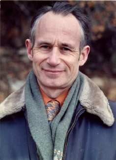
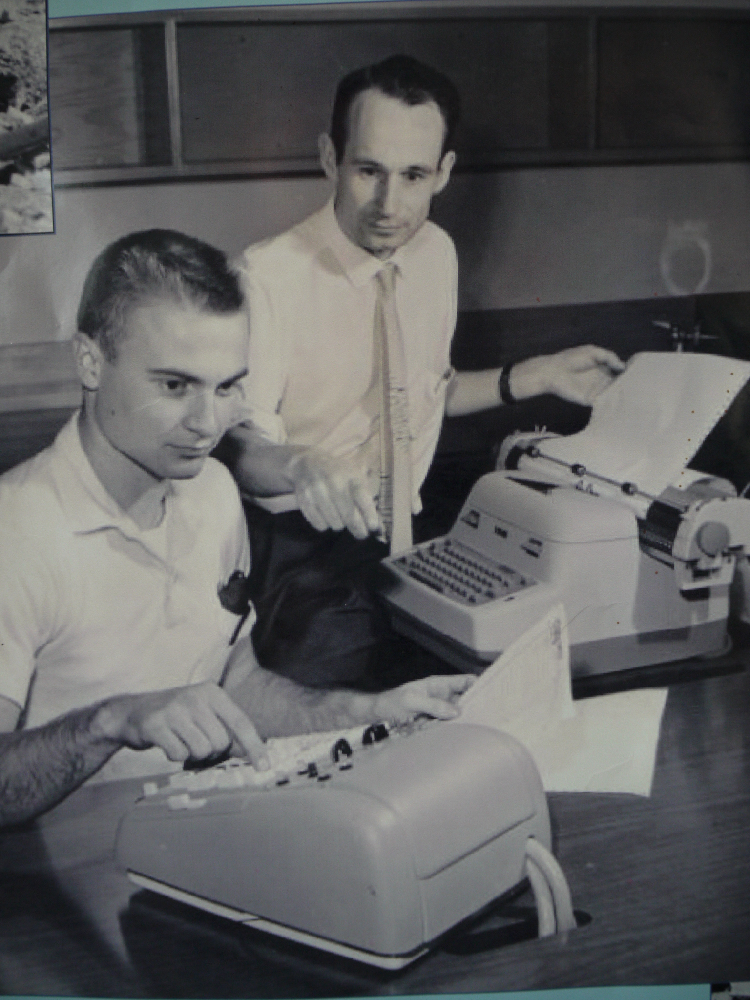

Keith Smillie (smillie@cs.ualberta.ca)
{ .byline }

<figure markdown="1">

<figcaption markdown="span">Donald McIntyre 1923-2009</figcaption>
</figure>

Donald McIntyre, geologist, teacher, lifelong APL user and contributor to *Vector*, died in 2009. He is remembered here by his friend Keith Smillie.

The I. P. Sharp Newsletter for November/December 1980 in a brief account of the APL Users Meeting held in Toronto that year has a picture of Donald McIntyre at the podium with the following caption:

> Donald B. McIntyre, Pomona College, Claremont, Ca, who has persuaded a liberal arts college, faculty and staff alike, to use APL before all other computer languages (commenting on the concept of the ‘empty vector’): “I think we have the Arabs to thank for inventing zero, but I know that we have Dr Iverson to thank for inventing nothing.”

Donald’s contribution to the conference, in addition to his presence which was always warmly welcomed wherever he went, was a 30-page paper, “APL in a liberal arts college”, describing his work in introducing computing in general and APL in particular to Pomona College, which still makes stimulating reading 30 years later.

As readers of *Vector* know, Donald died on 21 October 2009 at the age of 86 after a long illness. It is the purpose of this article to pay tribute to him as a person and to his contributions not only to the APL/J community but also to Scottish geology and to the larger world of scholarship. Some of the material here has been taken from an earlier appreciation of his life and work, “Donald McIntyre: Geologist, historian and array language advocate 1923-2009” which was published in the *Annals of the History of Computing*.

## Early life and education

Donald Bertram McIntyre was born on August 15, 1923 in Edinburgh, Scotland. His parents were the Reverend R. E. McIntyre, a Church of Scotland minister, and Mary Darling McIntyre. He was educated at George Watson’s Boys College, but during the war he was evacuated to Grantown Grammar School in the Scottish Highlands. While at Grantown he became an enthusiastic mountaineer. One of his earliest adventures was climbing the seven highest Cairngorms within twenty-four hours. Challenged by a published statement in the *Scottish Mountaineering Club Journal* that the six highest peaks – there were seven and the name of the highest had been omitted – had twice been climbed in one day, Donald and a fellow schoolboy climbed all seven in a twenty-hour expedition covering 35 miles and an ascent of 10,300 feet. According to Donald the climb was made difficult at one stage by an “adverse conspiracy of darkness, cloud, aneroid, and lack of previous acquaintance with this section of the traverse”.

In 1942 Donald entered the University of Edinburgh and soon “came under the spell”, to use the words of one writer, of Arthur Holmes who had just been appointed Regius Professor of Geology. He was one of three students in Holmes’s first class in Advanced Physical Geology, and his lecture notes from this class are now in the University’s Special Collections. Donald graduated with a B.Sc. in geology in 1945. In the same year he presented his first paper, "The crystal structure of Apatite and its relation to tooth and bone material", written jointly with Arnold Beevers, then Dewar Fellow in Crystallography at the University of Edinburgh. Donald was always very proud of this paper which was presented to the Mineralogical Society and which represented an early contribution to the understanding of the role of fluorine in the development of teeth.

In 1947 Donald received a Ph.D. in geology from the University of Edinburgh with a thesis supervised by Professor Holmes. He spent the following year at the University of Neuchâtel in Switzerland studying plate tectonics under C. E. Wegmann, Professor of Geology. While in Neuchâtel he developed an interest in the history of science which was apparent throughout his career in his lectures and published papers. On his return to Edinburgh in 1948 he took up a three-year appointment as Lecturer in Economic Geology which was followed by another three-year appointment as Lecturer in Petrology, a position he also held for three years. During this period his research interests were in tectonics and the study of the deformed rocks in the Scottish Highlands. In 1951 he received a D.Sc. in geology also from the University of Edinburgh.

## Geology

In addition to his field work Donald became a leading authority on the life and work of James Hutton (1726-1797), a leading figure in the Scottish Enlightenment, which Donald has described as “that constellation of friends and kin that gave the world modern philosophy, modern economics and much of modern science”. Hutton is known as the “father of modern geology” and was the first to give compelling evidence that the Earth was a million times older than the figure of 6000 years provided by Archbishop James Ussher, who in 1658 from an examination of biblical records said that the Earth was created on the night preceding 23 October 4004 BC. Hutton published his arguments in 1795 in his two-volume *Theory of the Earth* and was working on a third volume at the time of his death two years later. Illustrations intended for publication in this work were lost; Donald played a role in their discovery and publication almost 200 years later.

Donald was the opening speaker in The Royal Society of Edinburgh’s bicentennial celebration in 1997 of Hutton’s death. His paper “James Hutton’s Edinburgh: The historical, social and political background” with its 12 pages of bibliography was later published in the journal *Earth Sciences History*. Earlier that same year on a wet and windy 26 March in Greyfriars Kirkyard in Edinburgh he gave an eulogy to mark the exact bicentennial of Hutton’s death. Also in the same year Donald co-authored with Alan McKirdy of the Scottish National Heritage the monograph *James Hutton, The Founder of Modern Geology*, an attractive and beautifully illustrated and written life of James Hutton for the general reader, which was revised in 2001.

One of Donald’s fellow graduate students, who was also studying under Professor Holmes, was Ma Hsingyuan, one of the few Chinese students then studying in Britain. He and Donald went on geological and mountaineering trips in Scotland and Switzerland, and he soon became a family friend – and was the dancing partner of Donald’s mother on two occasions. He returned to China in 1948, where he disappeared from Donald’s view until he unexpectedly called Donald at Pomona College from New York in 1985. He was then Director of the State Seismological Bureau in Beijing and President of the Geological Society of China. He and Donald were able to renew their long-interrupted friendship both in the United States and in Beijing where Donald was invited to give lectures and workshops on computers and geology. Ma died in 2001 after a long illness.

## Pomona College

In 1954 Donald was invited to join the Department of Geology at Pomona College, a small liberal arts college in Claremont, California whose curriculum included astronomy, botany and geology. The geological attractions of California might be best described in his own words: “…whereas Scotland’s geological activity was in the distant past, California is geologically young. Imagine the thrill of a scientist seeing a live animal for the first time, having previously been familiar with the detailed anatomy of only dead animals. So it was for a young geologist leaving Scotland for California!” Donald joined the Department of Geology as an Associate Professor. The following year on the retirement of the long-time Chairman Professor A. O. Woodford he became Chairman, a position he held until 1984. In 1957 he was promoted to Professor, and in 1986 was appointed Seaver Professor of Science.

<figure class="left" markdown="1">
[{ style="width: 22em;" }](donaldtwo.jpg)
<figcaption markdown="span">First steps in computing</figcaption>
</figure>

Donald’s use of computers in geology began with what he termed a “state-of-the-art Marchant electronic calculator”. In April 1964 Pomona College ordered an IBM System/360 Model 40, which was installed in September 1965. Donald made use of this system in his own work and in informal classes in Assembler and Fortran. His first introduction to array languages was given by the formal description of the System/360 in what was then called Iverson Notation which appeared in the *IBM Systems Journal*, vol. 3, nos 2 and 3. He later said that he “pored over this remarkable document for years”. He made use of the notation in what was the first credit course in computer science at Pomona College in the 1968/69 academic year. This course and Donald’s subsequent very extensive work in APL and J will be described in the following section.

In 2001 Donald wrote an account entitled “My Involvement in the Use of Computers” which described his work with computers at Pomona College. Today it makes fascinating reading with its descriptions of the computing technologies available from the 1950s to the 1980s and the methods, most of them primitive by today’s standards, of their use. Near the end of the paper he remarked that in preparing this account he was “struck with the number of chance occurrences that have played so great a role in determining my professional life”, and that he kept thinking of the following lines from Robert Frost’s “The Road Not Taken”:

> Two roads diverged in a wood, and I –  
> I took the one less travelled by,  
> And that has made all the difference.

Perhaps all of us in the APL/J community by choosing these languages have taken “the one less travelled by”, and our lives are the richer for it.

During his time at Pomona College Donald gave a very large number of banquet addresses, invited papers and lectures, and workshops in the United States, Canada, Great Britain and other countries on a variety of topics in geology, computing and the history of science. He was twice appointed National Lecturer for the Association of Computing Machinery. In 1985 he was named California Professor of the Year. In the same year he received the medal of the Geological Society of China. In 1986 he was appointed a Distinguished Fellow of the University of Edinburgh. Most fittingly in 1994 he received the Kenneth E. Iverson Award for Outstanding Contributions to the Development and Application of APL.

He gave the Convocation address, “Footprints on the Sands of Time”, when Pomona celebrated its centennial in 1987. In this address, which fortunately has been preserved as an MP3 file, Donald used his extensive knowledge of the history of science and his skills as an expositor to place the Earth, its inhabitants and Pomona College in their rightful places in the cosmos. Hearing this address today is as moving as it obviously was to the Convocation audience when it was first given.

In spite of a busy and productive academic and professional life Donald did not neglect his personal life for in December 1957 he returned to Scotland and married Ann Alexander of Edinburgh in a ceremony conducted by Donald’s father. Among the guests were Professor Wegmann, with whom Donald had worked in his postdoctoral year in Neuchâtel, and Mrs Wegmann. The Wegmanns later visited Donald and Ann on their honeymoon in the Highlands. Donald and Ann’s marriage was welcomed by some of his students who felt that he “needed a wife to feed him well and bring out his shy sense of humor” and were “pleased to hear he’d brought one from Scotland, surely a rosy-cheeked and capable woman!”.

Donald and Ann had one son, Ewen, who was named after Professor Wegmann. As Ewen is disabled with cerebral palsy, he always has required special care. Donald always took an active part in this with some of his care reflecting his own many interests. When Ewen was a little child, Donald would often play him lullabies on the bagpipe chanter. Later Donald wrote a suite of personalized computer programs which enabled Ewen to have some employment in a local California hospital. Ewen even participated in some of his father’s mountaineering activities, and on one occasion Donald pushed him halfway up the Matterhorn in his wheelchair!

Donald’s contributions to Pomona College might best be summed up in the eulogy by David Alexander who was Pomona’s President from 1969 to 1991:

> In the history of Pomona College Donald McIntyre stands among the titans of its leadership. His uncountable contributions to the life and program of the College as a member of the faculty from 1954 to his retirement in 1989 admit him to the company of those heroic persons who have created and sustained the College’s excellence. … Being in the presence of Donald McIntyre was like, one imagines, being in the presence of an intellectual nuclear reactor. Learning radiated from him. …

## APL and J

Donald’s publications listed near the end of the paper show 12 papers related to APL and J with all but one either being given at APL Users Meetings or published in *Vector*. These represent only a small proportion of his work on these languages given the large number of invited talks and workshops with which he was involved. In this section we shall discuss two very early papers on APL both given at APL Users Meetings in Toronto, his seminal paper published in the issue of the *IBM Systems Journal* celebrating the 25th anniversary of APL, and briefly some of his J papers.

The first of the APL papers, “The architectural elegance of crystals made clear by APL”, describes the use of APL in a second-year crystallography course with a class of about 12 students. There were no prerequisites, with the necessary mathematics, including spherical trigonometry and matrix algebra, being introduced as needed. The approach to the use of APL is of interest and is best illustrated by the following quotation taken from the Introduction: “It is important always to remember that the subject is crystallography and mineralogy, not mathematics or computer programming. For this reason, I introduce notation only as needed for the work in hand, minimizing the computer and machine characteristics.” Even today, twenty-five years later, this course makes a refreshing contrast to so many introductory computer courses where the examples are chosen primarily to illustrate features of the programming language being used.

The second paper, “APL in a liberal arts college”, gives an account of the introduction of computers and computer courses at Pomona College. Two courses, both given by Donald, are of particular interest: one a large, far-ranging course entitled “Introduction to Computing” with about 140 students, and the other an intensive, two-week faculty seminar in computing with 12 participants. Again we see that the emphasis is on meaningful class problems which include the construction of frequency histograms, the economic problems of double declining balance and the Cobb-Douglas Production function, Brillouin’s Diversity Index, an extended syllogism from Lewis Carroll, and a literary database. At the end of the paper we are reminded, in case we might become discouraged with our own attempts to introduce the APL notation or indeed any mathematical notation into our courses, that the English mathematician William Oughtred (1574-1660) faced similar difficulties when he introduced our familiar multiplication sign.

The direct form of function definition is used throughout both of these papers. Some readers may encounter old friends, possibly long forgotten, amongst these functions, only two of which will be mentioned here. The first is the recursive definition of the factorial function

```
      FAC: ω×FAC ω-1:ω=0:1
```

and, for example, `FAC 4` is 24. The second is the function

```
      POLY: (α∘.*ιρω)+.×ω
```

for the evaluation of polynomials, where the left argument gives the values of the independent variable and the right argument gives the values of coefficients. As an example, consider evaluating the cubic which in conventional notation would be written as 1.5 + 2x – 3x<sup>2</sup> + 0.5x<sup>3</sup> for x = 2.5 and 3.5. Then if `C ← 1.5 2 ¯3 0.5` and `X ← 2.5 3.5`, the expression `X POLY C` would have the value `¯4.4375 ¯6.8125`. (In J this calculation could be done using the polynomial verb `p.` and if `c=. 1.5 2 _3 0.5` and `x=. 2.5 3.5`, then `c p. x` would be `_4.4375 _6.8125`.)

Donald’s paper “Language as an intellectual tool: From hieroglyphics to APL”, which appeared in the special issue of the *IBM Systems Journal* (vol. 30, no. 4) celebrating the 25th anniversary of APL, is a masterly survey of the development of mathematical notation interspersed with many examples given in APL, usually in both ordinary functional form and in direct definition form, and in J. They include a sequence of definitions for the familiar statistical computations of mean, deviations from the mean, sum of squares, etc., the calculation of pi using Archimedes’ method of inscribed polygons and the calculation of interest payments on a declining balance as examples of recursion, and some examples from the logical calculus of George Boole. This is followed by a detailed account of the evolution of the concept of an array in one or more dimensions with reference to the work of the nineteenth-century English mathematicians J. J. Sylvester, William Cayley, and William Rowan Hamilton. The last section, “Notation as a tool of thought” which is the title of Ken Iverson’s Turing Award lecture, presents the views on the importance of good mathematical notation of Charles Babbage, J. J. Sylvester, A. N. Whitehead, Bertrand Russell and Giuseppe Peano. There is a bibliography of 125 cited references and notes followed by 92 general references. We should mention that Donald’s paper is followed by Ken Iverson’s “A personal view of APL” which presents his views on the language and the development of J. Ken remarks that he turned his attention to developing a dialect of APL when he “retired from paid employment”, a delightful phrase that applies only too well to many academics and other professionals. Anyone interested in the development of APL and J would be advised to read these two landmark papers.

Donald’s papers on J can be divided into two groups, those concerned primarily with the language and its differences with APL and those concerned with applications. In the first group is an introduction to J for persons familiar with APL and papers on special topics such as function composition and the use of conjunctions. In the second group there are papers on the use of J in teaching elementary arithmetic, eigenvalue calculations, and importing data into a J system. All of these papers show a remarkable appreciation of the language, especially the first one, “Mastering J”, written in 1991 at time when most of us were just becoming aware of the language and were reluctantly abandoning the APL symbols with which we were so comfortable.

We shall mention, and only briefly, one of the J papers, “Perils of subtraction: a new language for an old algorithm” which begins with a discussion of the calculation of pi by Archimedes’ method of inscribed polygons. It might be considered a continuation of a discussion of the same topic in the paper “Language as an intellectual tool” which was published in the same year. In this latter paper it was shown that the value after 8 doublings of the number of sides the value of pi was 3.14159 and a remark is made at the end of the section that the “algorithm fails when the number of doublings is further increased”. However, in the “Perils of subtraction” paper it is shown that with 28 doublings, giving a polygon of with 1,610,612,736 sides, calculations in J give a value of 0 for pi, a result explained by a discussion of number representation in a PC and the process of subtraction.

## Perth

When he retired from Pomona College in 1989 after 35 years service, Donald, Ann and Ewen returned to Scotland and settled first at Kinfauns near Perth and then later in the centre of Perth. Interpreting retirement by Ken Iverson’s phrase quoted above he continued with his work with APL and the newly developing J, and with giving invited papers and workshops. His professional work was recognized during this time and he was made a Fellow of both the University of Edinburgh and the University of St. Andrews. He also found time to study Egyptian hieroglyphics and was able to translate a few symbols while visiting an active Coptic church in Scotland.

Donald’s last major work in computing was an account of the development of the APL and J languages which was intended when completed for submission to the *Annals of the History of Computing*. A rough draft of 29 pages, entitled “The Story of APL and J”, gives a fascinating account of Ken Iverson’s childhood in rural Alberta, his awakening interest in mathematics in school, and, after wartime service in the Royal Canadian Air Force, his undergraduate education at Queen’s University and his graduate work at Harvard leading to a Ph.D. under Howard Aiken. The evolution of the APL language is described up to the publication of *A Programming Language* and *Automatic Data Processing*. He worked closely with Ken on this paper up to a few days before Ken’s death. Fortunately Roger Hui has edited these notes and they have been published, with an introduction by Roger, in *Vector* in Ken’s name as “An autobiographical essay”.

Donald was also active in the Perth community. He was Chairman of the Perth Civic Trust and helped save Dunsinane Hill – of Shakespeare’s Macbeth fame – from being quarried to destruction, was an active member of the Burns Club, and was honorary archivist of the Scottish Mountaineering Club. He also took piping lessons and had the reel “Professor Donald McIntyre” written in his honour.

## Epilogue

In his last years Donald suffered from Parkinson’s disease and vascular dementia. He died in Perth on 21 October 2009. The memorial service, held in St John’s Kirk (founded in 1248), was introduced by the playing of the reels “Professor Donald McIntyre” and “Lord Lovat’s Lament” and celebrated his Scottish and Church of Scotland heritage, his professional life as a scholar, geologist and historian, and his family and community life in Perth. To the scripture readings from the Old and New Testaments read at the service we might append here the following from Ecclesiasticus, ch. 32, v. 8 which reflects the spirit, if not the letter, of the APL and J languages: “Let thy speech be short, comprehending much in few words.”

## Acknowledgements

Donald’s beautifully crafted and carefully written pages on the World Wide Web contain a wealth of information on his life and work. The Home Page at www.mcintyre.me.uk with its many links has a large colour picture of the beautiful Perth Bridge over the River Tay which, we are told, is a “Five minutes walk from home!”.

I would like to thank Ann McIntyre for her encouragement and help throughout the preparation of this paper, Roger Hui for his most helpful comments, and Willem Langenberg for providing a copy of Donald’s 1987 Convocation address in mp3 format.

I first met Donald at the APL Users Meeting, “The March on Armonk”, in Binghamton in 1969. Since then I have valued not only his friendship but also his guidance given by “precept and godly example”, if I may borrow a phrase from our common heritage. His help to me and to my work has been out of all proportion to the very little I have been able to do for him. Thank you so very much, Donald.

## Publications

1. Craig, G. Y., Donald B. McIntyre and Charles D. Waterston, 1978. *James Hutton’s Theory of the Earth. The Lost Drawings.* Scottish Academic Press, Edinburgh.
2. McIntyre, Donald B., 2008. “James Hutton, the Clerks of Penicuik and the igneous origin of granite.” *Transactions of the Royal Society of Edinburgh*, vol. 15, Supplement 1-Supplement 15.
3. McIntyre, Donald B., 1997. “James Hutton’s Edinburgh. The historical, social and political background.” *Earth Sciences History*, vol. 16, no. 2, pp. 100-157.
4. McIntyre, Donald B. and Alan McKirdy, 2001. *James Hutton. The Founder of Modern Geology.* National Museums of Scotland Publishing Limited, Edinburgh.
5. McIntyre, Donald B., 1986. “The architectural elegance of crystals made clear by APL.” *APL Users Meeting Proceedings*, Toronto, Ontario, pp. 233-250.
6. McIntyre, Donald B., 1980. “APL in a liberal arts college.” *APL Users Meeting Proceedings*, Toronto, Ontario, pp. 544-581.
7. McIntyre, D. B., 1991. Language as an intellectual tool: From hieroglyphics to APL.” *IBM Systems Journal*, vol. 30, no., 4, pp. 554-581.
8. McIntyre, Donald B., 1991. “Mastering J.” *APL Users Meeting Proceedings*, Stanford, California, pp. 264-273.
9. McIntyre, Donald B., 1992. “Hooks and forks and the teaching of elementary arithmetic.” *Vector*. The Journal of the British APL Association, vol. 8, no. 3, pp. pp. 101-110.
10. McIntyre, Donald B., 1992. “Using J with external data: Two examples.” *Vector*. The Journal of the British APL Association, vol. 8, no. 4, pp. 97-110.
11. McIntyre, Donald B., 1993. “Using J’s boxed arrays.” *Vector*. The Journal of the British APL Association, vol. 9, no. 1, pp. 92-124.
12. McIntyre, Donald B., 1993. Jacobi’s method for eigenvalues: An illustration of J.” *Vector*. The Journal of the British APL Association, vol. 9, no. 3, pp. 125-133.
13. McIntyre, Donald B., 1995.”Perils of subtraction: A new language for an old algorithm.” *Vector*. The Journal of the British APL Association, vol. 11, no. 44, pp. 93-103.
14. McIntyre, Donald B., 1995. “The role of composition in computer programming.” *APL Users Meeting Proceedings*, San Antonio, Texas, pp. 116-133.
15. McIntyre, Donald B., 2001. My Involvement in the Use of Computers. 14 pp. (unpublished)
16. McIntyre, Donald B., 2005. The Story of APL and J. 29 pp. (unpublished)
17. McIntyre, Donald B., 2006. “A tribute to Ken Iverson.” *Vector*. The Journal of the British APL Association, vol. 22, no. 3, pp. 109-114.

## Additional references

1. Alexander, David, 2010. “Professor Donald McIntyre.” *Pomona College Magazine*, vol. 46, Winter issue, p. 59.
2. Butcher, Norman E., 2009. “Donald McIntyre. Mountaineer, geologist, scholar and teacher.” *The Scotsman*, November 13.
3. Iverson, K. E., 1991. “A personal view of APL.” *IBM Systems Journal*, vol. 30, no. 4, pp. 582- 593.
4. Iverson, Kenneth E., 2008. “An autobiographical essay.” *Vector*. The Journal of the British APL Association, vol. 23, no. 4, pp. 70-84.
5. Merriam, Daniel E., 2010. Memorial to Donald B. McIntyre (1923-2009). *Geological Society of America Memorials*, vol. 39, pp. 23-25.
6. Phillips, Lucy Dickson, 2010. “Piping professor.” *Pomona College Magazine*, vol. 46, Winter issue, p. 59.
7. Smillie, Keith, 2011. “Donald McIntyre: Geologist, historian and array language advocate 1923-2009.” *Annals of the History of Computing*, vol. 33, no. 1, pp. 73-77.
