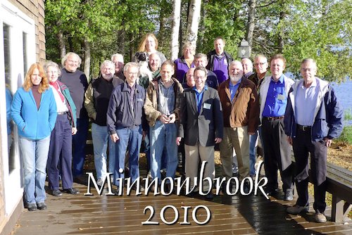
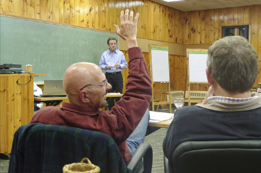
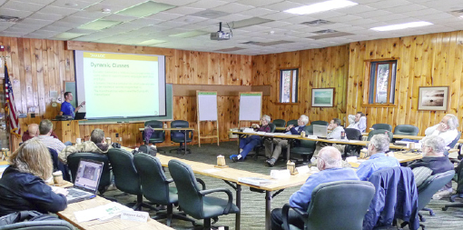
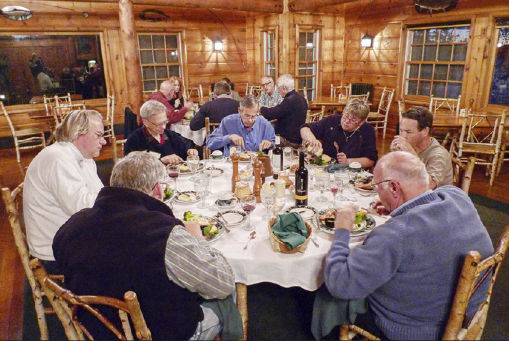
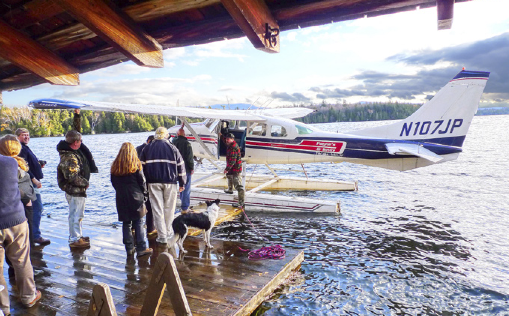

Roy Sykes (roy@roysykes.com)
{ .byline }

<figure markdown="1">

</figure>

The Minnowbrook series of APL Implementors Conferences was revived in 2007. Although its proceedings are always confidential, Roy Sykes gives us a glimpse of what it was like to be there.

The 2010 APL Implementers Workshop was held 16-20 October at the eponymous Minnowbrook Conference Center, Syracuse University’s retreat in the Adirondack Mountains of upstate New York. Situated on the shore of Blue Mountain Lake, complete with boathouse, docks, and canoes, Minnowbrook is an immersive experience, as Border Collie Tess (brought to herd the participants) found out the hard way.

<figure markdown="1">

<figcaption markdown="span">There is always plenty of spirited discussion at Minnowbrook</figcaption>
</figure>

For four days and four nights, the conferees explained and discussed, speculated and debated the present and future of APL, parallel programming, web services, .Net, GUIs (graphical user interfaces), and the Internet. With (mostly) all attendees attending (mostly) all sessions, which lasted from 9am to 9.30pm, followed by evening seminar, one completes the experience of Minnowbrook both exhausted and exhilarated, primed to embark on the challenges of design, implementation, education, and marketing of the growing family of languages rooted in APL.

What’s said at Minnowbrook stays at Minnowbrook, so this review is somewhat oblique. Our community is strangely and wonderfully both competitive and cooperative. At Minnowbrook, marketing and recruiting plans are discussed. New features, both planned and speculative, are explained and debated.

<figure markdown="1">

<figcaption markdown="span">A session in progress in the classroom</figcaption>
</figure>

Gitte Christensen presented the positioning and marketing plans for Dyalog APL, leading to an intense debate led by Morten Kromberg. Morten presented the development and technical plans for Dyalog APL, leading to an intense debate led by Gitte. Joe Blaze discussed APL2000’s plans for APL+Win and VisualAPL, leading to an intense debate led by Gitte and Morten. Alan Graham and Cory Skutt each presented their somewhat black-box plans, intensely debated by everyone.

Several implementers, led by David Liebtag of IBM, discussed their various implementations and problems with PEACH (parallel each) and related operators, leading to cacaphonous parallel discussions quashed only by the immoderate moderator, Roy Sykes. These tend to benefit SIMD (single-instruction, multiple-data) types of applications. In contrast, MIMD (multiple-instruction, multiple-data) applications benefit from the types of work Ron Murray did at Microsoft, called cohort scheduling, to address server scheduling issues, and Jacob Brickman is doing in development of function (as opposed to data) arrays. Bob Smith addressed meaty issues relating to singletons and prototypes, leading both to dinner and to subsequent discussions of multisets and related functions (union, intersection, index of, etc.), new system functions, and powerful new operators.

<figure markdown="1">

<figcaption markdown="span">Dinners at Minnowbrook are superb</figcaption>
</figure>

Shannon Bailey, a founder of Native Cloud Systems, fascinated the group with her compiled APL, which forms the heart of a secure and scalable native cloud stack, which is also inherently parallel. Both she and Alan Graham emphasized the complexity and insecurity inherent in today’s computing and communication environments, and addressed solutions thereto. Paul Grosvenor also addressed solutions to the GUI issues and questioned APL’s role, which led to a wider discussion of object orientation and its utility in APL for anything but GUIs.

Other topics covered in more or less detail were Unicode and symbology, APL on 64-bit processors, IDEs (integrated development environments), and broadening the APL market and educating new APL programmers, the latter particularly addressed by Ray Polivka, Gitte Christensen, Joe Blaze, and Paul Grosvenor. Jon McGrew wrapped up the final session with a video presentation of the work of Catherine Lathwell (daughter of Dick), who is creating a movie documenting the history of APL, and urged the group to keep in contact with “http://AProgrammingLanguage.com” for ongoing information about the project.

We decided to hold Minnowbrook every odd year starting in 2011, which is already scheduled for 20-24 September, when the autumn colours will be on full display and the weather a bit less brisk.

<figure markdown="1">

<figcaption markdown="span">Two pontoon planes were brought in for us</figcaption>
</figure>

What little recreational and eating time remained was pleasingly filled with aeroplane rides around the Adirondacks (graciously donated by Paul Grosvenor), canoeing, hiking, excellent food from the Minnowbrook staff, tasty wines courtesy of Joe Blaze, zesty ales supplied by Jon McGrew, multiple libations supplied by Garth Foster, and scrumptious malt Scotch whiskies sacrificed to the crew by Paul Grosvenor and Roy Sykes. Jon McGrew did his usual excellent work providing the materials for the workshop. Finally, we thank Garth Foster, who started the Minnowbrook conferences in the early 1970s, and without whom they would not exist today.

<figure markdown="1">

<figcaption markdown="span">A serene time: Minnowbrook at midnight (60-second time-exposure)</figcaption>
</figure>
