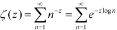

Sylvia Camacho in conversation with Graham Parkhouse
{ .byline }

A conversation about some paradoxes of infinity, helped by J notation.
{ .abstract }

Anthony and I contrive to live among a chaos of possessions acquired during our own seventy-odd years and a goodly proportion added by inheritance. We have walls of shelves but any other horizontal surface attracts books, which are never discarded. Indeed there are occasional duplicates bought anew to replace a valued volume gone missing without trace. We are often taken by surprise by new arrivals which, as the bailiff never comes knocking, we presumably ordered and paid for. However I was slighly taken aback to find three books about prime numbers all published since 2000 and all telling the same story. Readers should appreciate that neither Anthony nor I have more than School Certificate mathematics. So what was so compelling about these three that I began to explore one of them in detail, using J to try to connect to its mathematical arguments?

All three of our books about primes were published inside two years, as a response to the centenary of David Hilbert’s 1900 Address to the International Congress of Mathematicians, challenging them with 10 mathematical problems still looking for resolution at the start of the 20th century. For our three authors it was noteworthy that number 8 among these, the Riemann Hypothesis, was still unproven after yet another century, at the start of the 21st. All three books recount the history of attempts to prove the hypothesis, delivered by Bernard Riemann to the Berlin Academy in 1859 and entitled *On the Number of Prime Numbers Less Than a Given Quantity*.

This would have been a matter of only passing interest for me but for the pivotal story, common to all three, of the chance encounter between numerical analyst Hugh Montgomery and mathematician and physicist Freeman Dyson, at Princeton in 1972. This revealed a possible connection between Riemann’s attempts to characterise the distribution of prime numbers using the tools of calculus and the much later use of matrices in quantum theory; although, of course, each investigation was in pursuit of wholly different ends.

I have read and tried to summarise histories of calculus that describe how it progressed from a tool justified by little more than Isaac Newton’s intuition, to a fully axiomatic system for defining the concept of a continuum. The assumption of a spacial and temporal continuum was a natural consequence of the astronomical speculations of the 17th century, but it was the depth of penetration of calculus into almost all pre-1925 physics that made its failure to mathematise quantum effects so traumatic that it led to a schism within the physics community. One would have supposed that there is nothing more quantal than the succession of natural numbers and yet Riemann’s proposition was that the techniques of calculus could be used to predict the distribution of primes across the infinity of whole numbers. So could that 1972 encounter at Princeton presage a healing of the schism?

To date I have only come to terms with about half of the book I chose to study. It is by John Derbyshire and entitled *Prime Obsession*. When I am wholly lost I turn to my friend Graham Parkhouse, who has put my feet back on the right path several times as I struggle to express Derbyshire’s exposition in J. He encouraged me to come to terms with Equation Editor so I am now able to show here what all the fuss was about. Riemann’s Hypothesis is:

> All non-trivial zeros of the zeta function have real part one-half.

For a non-mathematician this is obscure, but at least I know what a Greek zeta looks like (ζ) and I do have a mathematical dictionary which says:

> The zeta function of complex numbers z = x + iy is defined for x > 1 by the series…

<figure markdown="1">

</figure>

Even I can see that this is an infinite sum and it becomes apparent in the course of the book that, given mathematical ingenuity, it can be evaluated for any real number over the entire complex plane, with the sole exception of integer 1. So it is natural that the characteristics of infinite series are a key part of Derbyshire’s account. He begins gently with a very simple series, based on a deck of cards. Suppose the top card is moved over the edge of the pack to its maximum overhang without overbalancing, obviously half its length, what about the next one down? How far can it be moved without toppling both cards? The series expressing this stable progressive shift of the top 51 of the 52 cards is:

1/2 + 1/4 + 1/6 + 1/8 + 1/10 + 1/12 + 1/14 + 1/16 + … + 1/102

Now, in J notation, for the first eight terms this is:

```
   % 2 * 1 + i. 8   NB. Reciprocals of twice the first  8 integers, excluding zero
0.5 0.25 0.166667 0.125 0.1 0.0833333 0.0714286 0.0625
```

and for a pack of 52 cards:

```
   +/ % 2 * 1 + i. 51     NB. Sum of reciprocals of numbers 2 through 102
2.25941  NB. (or 2.2594065907333398 to the maximum precision available)
```

The original expression can be rewritten as:

1/2 × (1/2 + 1/3 + 1/4 + 1/5 + 1/6 + 1/7 + 1/8 + … + 1/51 )

Or, as J has it, the sum:

```
   +/ 0.5 * % 1 + i. 51
2.25941
```

This, in other contexts is called the *harmonic series* and it grows without limit: it is divergent. It becomes apparent that this series was carefully chosen, as later analyses of the zeta function centre around infinite series similar to the harmonic series but convergent. Riemann’s Hypothesis reads <q>All
		non-trivial zeros of the zeta function have real part one-half</q>, so means had to be found to extend the domain of the zeta function over the whole complex plane and in the course of indicating how this is possible, while avoiding heavy calculus, Derbyshire derives series which do yield values less than 1. He shows that:

log(1 − x) = − x − (x<sup>2</sup>/2) − (x<sup>3</sup>/3) − <sup>4</sup>/4) − (x<sup>5</sup>/5) − (x<sup>6</sup>/6) − (x<sup>7</sup>/7) − …

is true when x = −1. In fact, it is equivalent to:

log 2 = 1 − 1/2 + 1/3 − 1/4 + 1/5 − 1/6 + 1/7 − …

which resembles the harmonic series but is convergent.

```
   NB. if we give it enough terms it is log 2.
   +/_1* (_1^1+i.1000000)%1+i.1000000
0.693147
```

Now the log 2 expression can be given in J by

```
    +/1,_1r2,1r3,_1r4,1r5,_1r6,1r7
319r420
   +/_1*(_1^1+i.7)%1+i.7 NB. not that 7 terms gets us very far!
0.759524
```

But Derbyshire, having introduced the log 2 series, makes an apparently casual observation:

> It is, in fact, a textbook example of the trickiness of infinite series. It converges to log 2, which is 0.693147180559453 …
>
> *but only if you add up the terms in this order.* If you add them up in a different order, the series might converge to something different; or it might not converge at all!
>
> … Convergent series fall into two categories: those that have this property and those that don’t. Series like this one whose limit depends on the order in which they are summed, are called ‘conditionally convergent’.

Unfortunately at this stage in his narrative he does not offer any clues as to why and how the order of a series is liable to change. It seems that I must first come to terms with the second part of the book where a real ‘for instance’ is promised. However, he does supply an example of what is meant, by first amending the order of the terms of the log 2 expression, then enclosing some terms in parentheses and resolving the parentheses thus:

> 1 − 1/2 − 1/4 +1/3 − 1/6 − 1/8 + 1/5 − 1/10 – …
>
> Just putting in some parentheses, it is equal to
>
> (1 − 1/2) − 1/4 +(1/3 − 1/6) − 1/8 + (1/5 − 1/10) – …
>
> If you now resolve the parentheses, this is
>
> 1/2 − 1/4 + 1/6 − 1/8 + 1/10 − … ,
>
> which is to say
>
> 1/2 (1 − 1/2 +1/3 − 1/4 + 1/5 − … ).
>
> The series thus rearranged adds up to one-half of the un-rearranged series!
>
> This, as the saying goes, “gives one furiously to think”!

These expressions can be put into J and will be easier to follow if we use J notation for negative numbers, which touches on a topic about which Cornelius Lanczos had quite a lot to say and will be sympathetically received by *Vector* readers, as this quotation from his *Numbers Without End* will show: (p88)

> If we think of the picture in which we count steps, 12 − 15 means that we should go forward 12 steps and backward 15 steps. This will bring us three steps *to the left* from zero, thus generating new points which did not exist before… Our usual emotional associations with the words *positive* and *negative* are here positively out of place. The complete symmetry of the two halves of a straight line demonstrates that negative numbers are in no way inferior to positive numbers and can be employed with the same justification.

Lanczos suggests that this parity could be emphasised by indicating a positive number with a superscribed → and a negative number with superscribed ← . He goes on:

> Our usual notation is less fortunate. We write + 3 and − 3 which gives the impression that the same number 3 is once added, once subtracted. But *minus 3* does *not* mean that we should subtract 3. The minus sign belongs to the digit 3 and designates a *new number*, created by the operation of subtracting 3 from 0.

He notes that the Hindus were aware of this distinction and marked negative numbers with a superscript dot. He has proposed instead to use an overline thus:

> 0 − 3 = <span style="text-decoration: overline">3</span> and generally: 0 − a = <span style="text-decoration: overline">a</span>

Thus to add a positive number is the same as to subtract the corresponding negative number and to subtract a positive number is the same as to add the corresponding negative number. J emphasises this by a distinction between the primitive *verb* `-` (subtract) and the underbar `_` which is an intrinsic part of any negative number: so `5 − _3 = 5 + 3` and `5 − 3 = 5 + _3`. This allows parentheses and sequence changes to be resolved without the ambiguity of ‘the rule of signs’. This clarifies Derbyshire’s example of series re-arrangement and led me to appeal to Graham in these terms:

> Dear Graham, (26 March)
>
> Please can you help me clear my head.
>
> Derbyshire quotes the series: log 2 = 1 - 1/2 + 1/3 - 1/4 + 1/5 - 1/6 + 1/7 - … of which he says:
>
> > It is, in fact, a textbook example of the trickiness of infinite series. It converges to log 2, which is 0.693147180559453 … but only if you add up the terms in this order. If you add them up in a different order, the series might converge to something different; or it might not converge at all !
>
> He demonstrates using this extract from the series, saying:
>
> > 1 - 1/2 - 1/4 + 1/3 - 1/6 - 1/8 + 1/5 - 1/10 - … Just putting in some parentheses, it is equal to (1 - 1/2) - 1/4 +(1/3 - 1/6) - 1/8 + (1/5 - 1/10) - … If you now resolve the parentheses, this is 1/2 - 1/4 + 1/6 - 1/8 + 1/10 - … , which is to say 1/2 (1 - 1/2 + 1/3 - 1/4 + 1/5 - … ). The series thus rearranged adds up to one-half of the un-rearranged series !
>
> Now Cornelius Lanczos points out that the Hindus distinguished a negative from a positive number by putting a dot over it, …

and after quoting Lanczos I continue …

> So Derbyshire's example above can be written in J
>
> ```
>    (1+_1r2)+_1r4+(1r3+_1r6)+_1r8+(1r5+_1r10) NB. with parentheses as above
> 47r120
>    1+_1r2+_1r4+1r3+_1r6+_1r8+1r5+_1r10 NB. without parentheses
> 47r120
>    +/1,_1r2,_1r4,1r3,_1r6,_1r8,1r5,_1r10 NB. as sum of a list of numbers
> 47r120
>    +/1,_1r2,1r3,_1r4,1r5,_1r6,_1r8,_1r10 NB. same numbers in descending order
> 47r120
>    1r2*(1+_1r2+1r3+_1r4+1r5) NB. D. says this is half the amount!
> 47r120
> ```
>
> The `+/` expressions emphasise that we are talking throughout about summation; it just happens that some of the values are negative. With respect to convergence Anthony suggested that I consult his old 1944 paperback by Eugene Northrop, *Riddles in Mathematics* and there I found an almost identical account of the effect of inserting parentheses into the log 2 series in his chapter called *Paradoxes of the Infinite*. This leaves me even more confused, because his explanation reads:
>
> > The difficulty arises from our attempt to apply to infinite series the processes of finite arithmetic. In finite arithmetic we go on the assumption that we can insert and remove brackets at will, grouping terms in any way we please. In other words, we assume that
> >
> > A + B + C = (A + B) + C = A + (B + C).
>
> But surely the point that Lanczos made so cogently is that the associative and commutative laws do not apply to subtraction … What am I misunderstanding?

To which Graham responded: (27 March)

> I think you’re misunderstanding the infinity bit a little! There is no way, of course, that Derbyshire is saying “this is half the amount” at the following stage:
>
> ```
>     1r2*(1+_1r2+1r3+_1r4+1r5) NB. D. says this is half the amount!
> 47r120
> ```
>
> To illustrate in J what Derbyshire is saying we need to make two calculations: take n terms of the original series, once in the order they originally come in (the first n terms) and once in Derbyshire's order.
>
> I love the series and its zany characteristic! I don't remember seeing it before.
>
> Lets look at `2*n` terms of the original series
>
> ```
>    series =: 3 :',1 _1*&.:|:%(y,2)$>:i.+:y'
>    [s =: series 8r1
> 1 _1r2 1r3 _1r4 1r5 _1r6 1r7 _1r8 1r9 _1r10 1r11 _1r12 1r13 _1r14 1r15 _1r16
> ```
>
> Indices of the first n terms of this series are `i.n`
>
> Indices of n terms of Derbyshire's series are `ind n` where
>
> ```
>    ind =: 3 :'/:~(+:i.>.y%3),>:+:i.0>.<.2r3*y'
>    ind 20
> 0 1 2 3 4 5 6 7 8 9 10 11 12 13 15 17 19 21 23 25
> ```
>
> For n = 13, the indices for s in each case are:
>
> ```
>     (i.,:ind)13
> 0 1 2 3 4 5 6 7 8 9 10 11 12
> 0 1 2 3 4 5 6 7 8 9 11 13 15
> ```
>
> giving these two series:
>
> ```
>     s{~(i.,:ind)13
> 1 _1r2 1r3 _1r4 1r5 _1r6 1r7 _1r8 1r9 _1r10  1r11 _1r12  1r13
> 1 _1r2 1r3 _1r4 1r5 _1r6 1r7 _1r8 1r9 _1r10 _1r12 _1r14 _1r16
> ```
>
> Summing them we get:
>
> ```
>     8j4":+/"1 s{~(i.,:ind)13
> 0.7301  0.4284
> ```
>
> We can observe the factor of 2 beginning to appear for n = 13. As n increases so the two answers would be expected to converge to `^.2` and `-:^.2`.

To which I responded: (28 March 15:14)

> Of course I agree with everything you say, but that is not my problem. Derbyshire is not saying that the value of an accumulation of an extract from an infinite series will most probably not match the accumulation of a different extract, that is so obvious as not to need saying, I hope. The example he quotes does not use two different sets taken from the series. What he is talking about is the sequence in which they are accumulated and he effects this change by enclosing some pairs of terms in parentheses, evaluating the parentheses and then accumulating his partial result. I think his 1/2 (1 - 1/2 + 1/3 - 1/4 + 1/5 - … ) suggestion is just an abuse of algebra. Let us use the first 10 terms of the original alternating series without confusing the issue with parentheses and then merely change the sequence. This is what he is actually suggesting is critical after all. Then we have:
>
> ```
>    1-1r2+1r3-1r4+1r5-1r6+1r7-1r8+1r9-1r10 NB. first 10 terms but remember this is J
> 1117r2520
>   1+1r7-1r8+1r9-1r10-1r2+1r3-1r4+1r5-1r6 NB. rearranged & sure enough a different result
> 1151r2520
>   1+_1r2+1r3+_1r4+1r5+_1r6+1r7+_1r8+1r9+_1r10 NB. now taking Lanczos to heart
> 1627r2520
>   1+1r7+_1r8+1r9+_1r10+_1r2+1r3+_1r4+1r5+_1r6 NB. re-arrangement has no effect
> 1627r2520
> ```
>
> What we must remember is that J does not evaluate the same way as conventional maths, which does it this way:
>
> ```
>    (((((((((1-1r2)+1r3)-1r4)+1r5)-1r6)+1r7)-1r8)+1r9)-1r10)
> 1627r2520
> ```
>
> and this way there is no problem with the *sequence*
>
> ```
>    (((((((((1+1r7)-1r8)+1r9)-1r10)-1r2)+1r3)-1r4)+1r5)-1r6)
> 1627r2520
> ```
>
> but, of course, using different sets is unlikely to give the same answer. It is not the sequence of terms that is the problem, it is the sequence of evaluation if `−` is confused with `_` … I think

To which Graham replied: (28 March 20:28)

> Aren't there two quite separate issues here? One is notational and the other is the infinite series paradox. The notational one will get anyone into trouble who doesn't follow the rules on whatever issue they tackle, but I see no reason to believe Derbyshire hasn't followed the rules. But, from your last sentence, it seems you think he has.
>
> Where does he make a *notational* error when deriving his 1/2(1 - 1/2 + 1/3 - 1/4 + ...)?
>
> The reason for the paradox is exactly <q>that the value of an
>     		accumulation of an extract from an infinite series will most
>     		probably not match the accumulation of a different extract.</q> We are interested in the series
>
> 1 + -1/2 + 1/3 + -1/4 + 1/5 + -1/6 + -1/7 + -1/8 + …
>
> If you begin taking these terms in the order Derbyshire does, before bracketing them up, 2/3 of the terms he extracts are negative numbers and only 1/3 are positive. No wonder it converges to a different sum!

Which provoked me to: (30 March 14.59)

> Thank you for keeping me thinking – what I want to say to your last is … yes, but … what are these mathematicians agonising over? What is it that they find so remarkable? If we are allowed to pick and choose among the terms of an infinite series to be summed, we have an infinity of results to choose from. If we use only the positive terms our sum diverges:
>
> ```
>    +/\1r3,1r5,1r7,1r9,1r11
> 0j6":1r3 8r15 71r105 248r315 3043r3465
> 0.333333 0.533333 0.676190 0.787302 0.878211
> ```
>
> If we choose the negative terms, our sum diverges negatively:
>
> ```
>    0j6":+/\_1r2,_1r4,_1r6,_1r8,_1r10
> _0.500000 _0.750000 _0.916667 _1.041667 _1.141667
> ```
>
> If we modify an initial positive, we go from positive to negative:
>
> ```
>    0j6":+/\1,_1r2,_1r4,_1r6,_1r8,_1r10
> 1.000000 0.500000 0.250000 0.083333 _0.041667 _0.141667
> ```
>
> A judicial mixture of positive and negative will get us somewhere near the number we first thought of – but what is the point? What conclusion are we being asked to draw? I thought that there must be some argument to suggest that the log 2 irrational is efficiently approximated by the summation of the alternative. There may be other values as good or better to be obtained by permutations of the terms, but these ‘Gee-Whiz’ rearrangements seem frivolous.
>
> Here it seems justifiable to select only the first 60 terms:
>
> ```
>    - /% 2 ^ i.7   NB. alternating sum of reciprocal of 2 to powers 0 to 6
> 0.671875
>   - /% 2 ^ i.53   NB. and here it is for 53 terms at maximum precision
> 0.66666666666666674
>   - /% 2 ^ i.60   NB. while 60 terms reduces it a bit …
> 0.66666666666666663
>    - /% 2 ^ i.90   NB. 90 shows no change, so two-thirds looks like the limit
> 0.66666666666666663
> ```
>
> Is there something here other than a statement of the blindingly obvious?

To which Graham came back: (30 March 18:03)

> OK! So what is all the fuss about?
>
> We love infinite series, especially ones that converge, because they sum to a number that is unique and a number that cannot always be found exactly. For example I don't remember (if I ever did know) how to demonstrate our series converges to log 2. So there is mathematical excitement associated with infinite series. An infinite series is defined by its first few terms, assuming the continuing sequence is unambiguous, so the shocking thing about our sequence is that you can clearly write it down two different ways and so obviously get two very different answers! The fact that you are reordering the series is not immediately apparent.
>
> Another point that makes this a special series is that it converges very very slowly. I think I am right in saying that there are very many infinite series whose sum would not be affected by the alteration in order that was made to our series. Obviously in the extreme case when only positive terms are taken from an alternating series you will get a different answer, but there are many series that converge to the same sum irrespective of how you order its tail end.

Sylvia to Graham (1 April 16:41) — now we both have our teeth in it!

> The log 2 series is a method of approximating the irrational by accumulating values which decrease according to a clear pattern, either positively or negatively — a sort of Lambeth Walk. Thus the adjustments continually decrease in significance until we call a halt, for the very practical reason that we cannot work with infinite expansions. My version of J calls log2, 0.693147 and half log2, 0.346574, when in standard display mode.
>
> You chose two sets of terms from the log 2 series. They have the first ten in common so we can keep the display small by displaying the sum of those as the first cumulative value:
>
> ```
>    8j4":+/1 _1r2 1r3 _1r4 1r5 _1r6 1r7 _1r8 1r9 _1r10
> 0.6456
> ```
>
> You then arrive at two different cumulative results from your two chosen sets of 13 terms:
>
> ```
>    8j4":+/\0.6456 1r11 _1r12 1r13
> 0.6456 0.7365 0.6532 0.7301
>    8j4":+/\0.6456 _1r12 _1r14 _1r16
> 0.6456 0.5623 0.4908 0.4283
> ```
>
> You then posit the case that as the number of terms increases 0.7301 will tend to 0.693147 while 0.4283 will tend to 0.346574. What is not clear is how the additional terms are to be chosen. You have used two selections from the first 16 so we could decide to ignore those and take say a further 8 from 16 onwards:
>
> ```
>    8j4":+/\0.7301 1r17 _1r18 1r19 _1r20 1r21 _1r22 1r23 _1r24
> 0.7301 0.7889 0.7334 0.7860 0.7360 0.7836 0.7382 0.7816 0.7400
>    8j4":+/\0.4284 1r17 _1r18 1r19 _1r20 1r21 _1r22 1r23 _1r24
> 0.4284 0.4872 0.4317 0.4843 0.4343 0.4819 0.4365 0.4799 0.4383
> ```
>
> So far both values have increased and this is getting tedious, given that we are left with infinity minus 24 to add.
>
> So what should we do about the terms we have so far left out of each set. What happens if we put them back in?
>
> ```
>    8j4":+/\0.7400 _1r14 1r15 _1r16
> 0.7400 0.6686 0.7352 0.6727
>    8j4":+/\0.4383 1r11 1r13 1r15
> 0.4383 0.5292 0.6061 0.6728
> ```
>
> The difference, unsurprisingly, is accounted for by the terms we left out. We have thus been justified in our belief that A+B+C = (A+B)+C = A+(B+C) or even C+B+A and all other permutations, but A+B does not equal A+C unless A=B=C or A=0. What we have illustrated is that the sequence of the series is immaterial providing that all terms up to a selected one are represented. I think you are right to say of this so-called “paradox of the infinite” that “this only has the appearance of significance”.
>
> Moreover, I think Derbyshire goes a step too far when he says:
>
> > 1 - 1/2 - 1/4 +1/3 - 1/6 - 1/8 + 1/5 - 1/10 - …
> >
> > Just putting in some parentheses, it is equal to
> >
> > (1 - 1/2) - 1/4 +(1/3 - 1/6) - 1/8 + (1/5 - 1/10) - …
> >
> > If you now resolve the parentheses, this is
> >
> > 1/2 - 1/4 + 1/6 - 1/8 + 1/10 - … ,
> >
> > which is to say
> >
> > 1/2 (1 - 1/2 + 1/3 - 1/4 + 1/5 - … ).
> >
> > The series thus rearranged adds up to one-half of the un-rearranged series!
>
> Oh yeah!
>
> ```
>    NB. rearranged and two terms missing, ... but so what.
>    +/1 _1r2 _1r4 1r3 _1r6 _1r8 1r5 _1r10
> 47r120
>    NB. resolve some parentheses
>    (1+ _1r2), _1r4, (1r3+ _1r6), _1r8, (1r5+ _1r10)
> 1r2 _1r4 1r6 _1r8 1r10
>    NB. add up the result. No change so far.
>    +/1r2 _1r4 1r6 _1r8 1r10
> 47r120
>    NB. extracting one-half ...
>    (1r2 _1r4 1r6 _1r8 1r10)%1r2
> 1 _1r2 1r3 _1r4 1r5
>    NB. doubles the result …
>    +/1 _1r2 1r3 _1r4 1r5
> 47r60
>    NB. so we must times half to get back where we started
>    1r2*1 _1r2 1r3 _1r4 1r5
> 1r2 _1r4 1r6 _1r8 1r10
>    +/1r2 _1r4 1r6 _1r8 1r10
> 47r120
>     NB. sure is equal!
>    (+/1 _1r2 _1r4 1r3 _1r6 _1r8 1r5 _1r10) = (+/1r2*1 _1r2 1r3 _1r4 1r5)
> 1
> ```
>
> But what could possibly justify us writing it this way?
>
> ```
> (+/1 _1r2 _1r4 1r3 _1r6 _1r8 1r5 _1r10 … ) = (+/1r2*1 _1r2 1r3 _1r4 1r5 …)
> ```
>
> What could this mean? How are these apparent series to be continued? Is the next term positive or negative? I still think it’s an abuse of algebra and uninformative into the bargain.
>
> Stroppy Sylv

Graham's response: (1 April 21:35)

> You: <q>The log 2 series is a method of approximating the irrational
>     		by accumulating values which decrease according to a clear pattern,
>     		either positively or negatively – a sort of Lambeth Walk. Thus the
>     		adjustments continually decrease in significance until we call a
>     		halt, for the very practical reason that we cannot work with
>     		infinite expansions.</q>
>
> Why call a halt? Only if we are computing a result term by term. But the equality
>
> Log 2 = 1 + -1/2 + 1/3 + -1/4 + …
>
> must not be halted. Halting it makes it no longer correct.
>
> You: <q>What is not clear is how the additional terms are to be
> 			chosen.</q>
>
> I think you may have missed a key point here. There is a simple rule for determining additional terms, which I gave in my first reply, i.e.
>
> ```
>    ind =: 3 :'/:~(+:i.>.y%3),>:+:i.0>.<.2r3*y'
>    ind 20
> 0 1 2 3 4 5 6 7 8 9 10 11 12 13 15 17 19 21 23 25
> ```
>
> Using the verb `ind` you can find the additional terms. From the pattern above it is clear that the 21st term is either going to be 14 or 27, and it turns out to be 27. So the “rearranged” series is precisely defined for any number of terms. But note that the trailing terms are all odd and these are all negative ones, demonstrating what I said in my last email that there are twice as many negative terms as positive ones. The rearrangement is a completely different infinite series from the original. The sleight of hand is in the bracketing process which initially fooled me into thinking the original and the rearrangement were one and the same.
>
> Are you laying your stroppiness at Derbyshire’s door? I cannot spot anything you have told me about his argument that I can fault. I think you're having a genuine struggle to see the wood for the trees here, and worthwhile struggles can be painful.
>
> I hope this helps. Taking an equal number of terms of each is necessary to keep up the paradox because if you took an arbitrary number of each then comparing the two sums would have no significance! Keeping them equal as you approach infinity is intriguing, but actually it only has the appearance of significance. I think the paradox simply demonstrates that the order in which you choose to sum an infinite series can sometimes affect the answer.

Sylvia to Graham (8 April 18:12) — so I turned my attention to the example in Northrop’s book.

> Oooh! I am having fun. This is how Northrop illustrates his ‘paradox of the infinite’.
>
> > L=1-1/2+1/3-1/4+1/5-1/6+1/7-1/8+… +1/13-1/14+1/15-1/16+…
> >
> > Grouping terms first by twos and then by fours.
> >
> > \[1\] L=(1-1/2)+(1/3-1/4)+(1/5-1/6)+(1/7-1/8)+… +(1/13-1/14)+(1/15-1/16)+…
> >
> > \[2\] L=(1-1/2+1/3-1/4)+(1/5-1/6+1/7-1/8)+… +(1/13-1/14+1/15-1/16)+…
> >
> > Dividing both sides of equation \[1\] by 2 we get
> >
> > \[3\] 1/2L=(1/2-1/4)+(1/6-1/8)+(1/10-1/12)+(1/14-1/16)+…
> >
> > Adding, bracket by bracket, equations \[2\] and \[3\],
> >
> > \[4\] 3/2L=(1+1/3-1/2)+(1/5+1/7-1/4)+(1/9+1/11-1/6)+(1/13+1/15-1/8)+ …
> >
> > which is obviously, he says, equal to
> >
> > 1-1/2+1/3-1/4+1/5-1/6+1/7-1/8+1/9-1/10+1/11 …
>
> The trick is not at all obvious when step \[4\] is glossed over so confidently: The expression \[4\] was arrived at by adding the two-term brackets from \[3\] to the four-term brackets from \[2\] and then simplifying; e.g. the first bracket is the result of working out 1-1/2+1/3-1/4+1/2-1/4. You see how the -1/2 and +1/2 terms cancel out and -1/4+-1/4 becomes -1/2 to take the place of the lost term. So, in the same way, the terms metamorphose into each other until all that we are left with is the original alternative L which has miraculously been proved by simple arithmetic to be equal to 3/2L!
>
> But notice that when we added the first set of brackets we used a positive term +1/2 to get rid of the -1/2 and, very conveniently, the duplicated -1/4 terms converted themselves into the, now cancelled out, -1/2 term. Talk about smoke and mirrors! This is why I went to my mathematical dictionary to see just what is meant by *monotonically decreasing*, which expression \[4\] is manifestly not doing, and then to check on the meaning of *alternative* and *conditionally convergent*. It has been a fascinating journey and without you to goad me I might never have taken it. Thank you.
>
> > Monotone Monotonic adj… .
> > :   A monotonic decreasing quantity is a quantity which never increases.
>
> The use of “never” here suggests that the order of the absolute value of the terms is significant, but for summations I think it is always irrelevant except perhaps for practical questions about the inevitable limitation of calculation to a finite number of terms, which might make it invalid to use terms taken almost exclusively from way out along an infinite series.
>
> > Alternating adj.
> > :   … alternating series. A series whose terms are alternately positive and negative, as
> >
> >     1 - 1/2 + 1/3 - 1/4 + (-1)n-1/n + … .
> >
> >     An alternating series converges if the absolute values of its terms decreases monotonically with limit zero (the Leibnitz test for convergence). This is a sufficient but not a necessary condition for convergence of an alternating series. If one convergent series has only positive terms and another only negative terms, then the series obtained by alternating terms from these series is convergent, but the absolute values of its terms may not be monotonically decreasing. The series
> >
> >     1 - 1/2 + 1/3 - 1/4 + <b>1/9 - 1/8</b>+ 1/27 - 1/36 + … is such a series.
>
> This it seems would guarantee log2 convergence, but see below:
>
> > Convergence n… .
> > :   *Conditional convergence* An infinite series is conditionally convergent if it is convergent and there is another series which is divergent and which is such that each term of each series is also a term of the other series (the second series is said to be derived from the first by a rearrangement of terms); i.e.; an infinite series is conditionally convergent if its convergence depends on the order in which the terms are written. A convergent series is conditionally convergent if and only if it is not absolutely convergent. E.g.; the series 1 - 1/2 + 1/3 - 1/4 + … is conditionally convergent because it converges and the series 1 + 1/2 + 1/3 +… diverges.
>
> For a summation to depend upon the order in which the terms are written, when combining it with terms from another series having just the same set of terms, can only be by changing some + and − signs; but this would mean that the series is not a summation but a series of arguments to addition and subtraction functions. If, taking Lanczos to heart, we use a notation which distinguishes a negative number from the positive argument to a subtraction function, the alternating series for log2, for instance, contains only negative 1/2 and positive 1/3. But negative 1/2 is not a member of the divergent series 1+1/2+1/3 … referred to above as the “second series said to be derived from the first by a rearrangement of terms”.
>
> Now, by the definition above, the *alternating series* for log2, contains an infinity of reciprocals of positive odd integers and an infinity of reciprocals of negative even integers. It does not contain positive even or negative odd denominators although there is, of course, an infinite series having wholly negative terms which is monotonically divergent and complements the other infinite divergent series 1+1/2+1/3+ … as mentioned in definition 3 above. Now, which one of these 2 divergent series bears the relationship to the log2 *alternating series* defined above, “such that each term of each series is also a term of the other series (the second series is said to be derived from the first by a rearrangement of terms”?
>
> It is easy to prove that the log2 alternate is insensitive to parentheses if it is written using J notation:
>
> ```
>    +/1 _1r2 1r3 _1r4 1r5 _1r6 1r7 _1r8 1r9 _1r10 1r11 _1r12
> 18107r27720
>    +/(1 _1r2),(1r3 _1r4),(1r5 _1r6),(1r7 _1r8),(1r9 _1r10),(1r11 _1r12)
> 18107r27720
>    +/(+/1 _1r2 1r3 _1r4),(+/1r5 _1r6 1r7 _1r8),(+/1r9 _1r10 1r11 _1r12)
> 18107r27720
> ```
>
> Order of summation changes nothing, the total depends on the number of monotonically decreasing terms taken. Division, however, creates new terms of which some are in the log2 series and some from a different and divergent series and this applies irrespective of parentheses:
>
> ```
>    1r2*1 _1r2 1r3 _1r4 1r5 _1r6 1r7 _1r8 1r9 _1r10 1r11 _1r12
> 1r2 _1r4 1r6 _1r8 1r10 _1r12 1r14 _1r16 1r18 _1r20 1r22 _1r24
> ```
>
> The following terms are in the positive divergent series but excluded from the log2 series:
>
> ```
>    8j4":+/1r2 1r6 1r10 1r14 1r18 1r22 NB. are not in log2 alternating series
>    0.9391
> ```
>
> These terms are already in the log2 alternating series and do not occur twice:
>
> ```
>    NB. are in the log2 alternating series
>    8j4":+/_1r4 _1r8 _1r12 _1r16 _1r20 _1r24 _0.6125
>    NB. which adds to half log2
>    NB. if we add the terms found only in the divergent series
>    _0.6125+0.9391
> 0.3266
>    NB. so their combined sum is indeed
>    NB. half the total of the original alternating series:
>    0.3266*2
> 0.6532
> ```
>
> This is the basis on which Northrop claims that *rearrangement* of its infinite series can demonstrate that the log2 series is equal to 1.5 times the log2 series, which should sum to:
>
> ```
>    8j4":18107r27720 NB. total of first 12 terms
> 0.6532
> ```
>
> So by doing some simple arithmetic, terms from two series (one alternating and another divergent) have been intercalated with the apparent effect of adding half as much again to the total. This is described as a mere *rearrangement* of the alternating series so, as usual with paradoxes, it all boils down to a question of terminology: “when is a member of a series not a member of a series?” Answer, “only when you can’t think of an algorithm which would convert a non-member to a *bona fide* member”. In other words, the term *rearrangement* covers the whole panoply of algebraic manipulation. It is not merely a question of the *order* in which the terms are taken — in fact the order is immaterial providing sequence A contains the same selection of *either* positive or negative terms as sequence B… .
>
> Only a bit breathless,
>
> Sylv

In response to which Graham sent: (14 April 21:01)

<blockquote>
    	<p>
    		Dear Sylv,
    	</p>
    	<p>
    		You’re still not happy with it, are you? The bracketing is fine, and
    		I like your alternative method. But I prefer the original bracketing
    		method which is nicely visualised by the table I have enclosed in
    		the attached Word document. And I think this table helps to
    		illustrate why the two infinite series are not equal. But see what
    		you think!
    	</p>
		<table class="code tight">
		  <tr>
			<th> </th>
			<th>1</th>
			<th>1r2</th>
			<th>1r3</th>
			<th>1r4</th>
			<th>1r5</th>
			<th>1r6</th>
			<th>1r7</th>
			<th>1r8</th>
			<th>1r9</th>
			<th>1r10</th>
			<th>1r11</th>
			<th>1r12</th>
			<th>1r13</th>
		  </tr>
		  <tr>
			<td>1r2</td>
			<td>1</td>
			<td>_1r2</td>
			<td></td>
			<td></td>
			<td></td>
			<td></td>
			<td></td>
			<td></td>
			<td></td>
			<td></td>
			<td></td>
			<td></td>
			<td></td>
		  </tr>
		  <tr>
			<td>_1r4</td>
			<td></td>
			<td></td>
			<td></td>
			<td>_1r4</td>
			<td></td>
			<td></td>
			<td></td>
			<td></td>
			<td></td>
			<td></td>
			<td></td>
			<td></td>
			<td></td>
		  </tr>
		  <tr>
			<td>1r6</td>
			<td></td>
			<td></td>
			<td>1r3</td>
			<td></td>
			<td></td>
			<td>1r6</td>
			<td></td>
			<td></td>
			<td></td>
			<td></td>
			<td></td>
			<td></td>
			<td></td>
		  </tr>
		  <tr>
			<td>_1r8</td>
			<td></td>
			<td></td>
			<td></td>
			<td></td>
			<td></td>
			<td></td>
			<td></td>
			<td>_1r8</td>
			<td></td>
			<td></td>
			<td></td>
			<td></td>
			<td></td>
		  </tr>
		  <tr>
			<td>1r10</td>
			<td></td>
			<td></td>
			<td></td>
			<td></td>
			<td>1r5</td>
			<td></td>
			<td></td>
			<td></td>
			<td></td>
			<td>_1r10</td>
			<td></td>
			<td></td>
			<td></td>
		  </tr>
		  <tr>
			<td>_1r12</td>
			<td></td>
			<td></td>
			<td></td>
			<td></td>
			<td></td>
			<td></td>
			<td></td>
			<td></td>
			<td></td>
			<td></td>
			<td></td>
			<td>_1r12</td>
			<td></td>
		  </tr>
		</table>
		<p>
			This table represents the top left hand corner of an
			<em>infinite</em> table. Along the top line we have our first
			infinite series ‘properly’ ordered. Down the left column we have our
			second infinite series ‘properly’ ordered. Next, all the terms of
			our first <em>infinite</em> series are distributed to the body of
			the table, each being dropped to a row according to the linear
			pattern clearly visible: the filled places form two straight sloping
			lines. Adding along the rows we get the result shown in the left
			column, i.e. the second <em>infinite</em> series.
    	</p>
		<p>
			This is a pictorial equivalent of the bracketing and what I used to
			derive that early J expression I gave you defining the reordering of
			the terms. It gives the impression that the two <em>infinite</em>
			series are equal, but they are not: the reordering causes the
			negative terms to be used up twice as quickly as the positive ones,
			so no wonder the sum is less.
    	</p>
    	<p>
    		Notice I have italicised <em>infinite</em>! There are issues
    		associated with the infinite and the infinitesimal that cannot
    		readily be replicated in finite examples. For example, take a finite
    		table of the kind shown above and you get an incomplete first series
    		equal to an incomplete second series – no great deal, as you have
    		noted in earlier emails.
		</p>
	</blockquote>

This is the point to which Graham and I have arrived to date. I am hoping some others of the APL/J community might join the fray. Do we have any takers?
