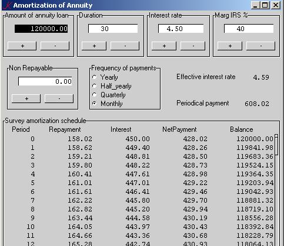

by Jan Karman (jkarman@planet.nl)
{ .byline }

The annuity differs from the other applications in that it doesn’t need external files. It is simply (and simple) mathematics. The program produces a survey of the amortisation of an annuity loan, with the necessary controls. For convenience we shall define some auxiliary functions so that the development of the annuity function will be very easy, almost trivial. So, the purpose is just to show what is possible with a few lines of K. The annuity loan is in wide use for mortgages and a large scale of many other types of private loans.
{ .abstract }

## Mathematics

In actuarial practice every value is being brought back to the point of time 0 – that’s where we are – usually called “the present value”. The present value of an annuity, a financial form in which a unit of capital is being paid at the end of every consecutive year, is denoted by a<sub>n</sub>. If an individual wants to settle for a loan and repaying it by way of a yearly level amount t, then t.a<sub>n</sub> should be 1, according to the equivalence principle as the axiom of all financial theory, and t = 1/a<sub>n</sub>. If i is the interest rate and v denotes the present value of the unit 1 at the end of the year v = 1/1 + i.

The present value of each payment in the annuity can be written as

v<sup>1</sup>, v<sup>2</sup> … v<sup>(n-1)</sup>, v<sup>n</sup>

and the total value of the annuity

a<sub>n</sub> = v<sup>1</sup> + v<sup>2</sup> + … + v<sup>(n-1)</sup> + v<sup>n</sup>     **(1)**

Multiplied by the ratio (1+i) we get

(1+i).a<sub>n</sub> = v<sup>0</sup> + v<sup>1</sup> + … + v<sup>(n-2)</sup> + v<sup>(n-1)</sup>      **(2)**

and like an ordinary geometric series we subtract (1) from (2)

i.a<sub>n</sub> = 1 – v<sup>n</sup>

getting

a<sub>n</sub> = (1-v<sup>n</sup>)/i

The level annual payment of t contains two components: an interest component and a redemption component. Two successive outstanding balances amount to t.a<sub>n-m</sub> and t.a<sub>n-m+1</sub> and therefore the debt appears to be decreased with t.v<sup>n-m+1</sup> immediately after the m<sup>th</sup>payment.

## A little detour

It may seem all trivial, but the geometric series has its dark and obscure caverns. We have seen that the yearly payments have two components, an interest and a redemption part. Now, the first redemption, a<sub>1</sub>, equals to the level payment, t, minus the indebted interest i, being t-i. In the second year this component increases to (t-i).(1+i), and all the remaining redemption parts form again a geometrical series with ratio (1+i), adding up, of course, to the initial amount of the debt 1, and the series will be cumulated to s<sub>n</sub>, the accumulated value of an annuity – also known as a saving contract.

Thus (t – i).s<sub>n</sub> = 1, so t – i = 1/s<sub>n</sub>.

Therefore, since by definition

t = 1/a<sub>n</sub>

it follows that

1/a<sub>n</sub> – i = 1/s<sub>n</sub>

and

1/a<sub>n</sub> – 1/s<sub>n</sub> = i.

Here we see the remarkable relationship between the present value and the accumulated value of an annuity on the one hand and the interest rate on the other. Indeed, the difference between the reciprocal of the present value of an annuity and the reciprocal of the accumulated value of the same annuity results in the basic ingredient: the interest rate. Of course we could come to this result by reducing right from the definitions – that would give a longer detour.

Back to business.

## Effective interest rate

An interest rate is most typically quoted as an annual percentage. In practice, however, interest rates are being paid in fractions, say half-yearly, quarterly or monthly or even in days. In theory it can be paid in infinitely small fractions, in which case we have to do with continuous interest rates. Here, we will confine to the discrete method.

It would be logical when calculating a monthly interest that the accumulated monthly fractions would equal the contractual interest. Thus that j in

j = ((1 + i'/12)<sup>12</sup>) – 1

would equal i, with of course i' somewhat lower than i.

Banks know better, they are the money experts and they calculate

j = ((1 + i/12)<sup>12</sup>) – 1

(Once, when I showed this to my brother in law, he checked his mortgage contract, which stated an “annual interest rate of 6%, payable monthly” – he lodged a complaint with his bank, with success).

## The K-implementation

```
/Global functions
f:{100*((1+0.01*x%y)^y)-1}    / real interest
vn:{(1+0.01*z%y)^-x*y}        / present value
an:{(1-vn[x;y;z])%0.01*z%y}   / annuity
sumrnd:{x*(*t)-':t:_.5++\y%x} / rounding function
```

### Calculations

The calculations are all being done in one dependency:

```
t..d:".$term"
eff..d:"f[I.i;t]"
eff..f:5.2$
ann..d:"B.bd*%an[D.d;t;I.i]"
ann..f:8.2$
tm..d:"!D.d*t"
at..d:"sumrnd[0.01;(ann-B.bd*0.01*I.i%t)*(1+0.01*I.i%t)^!D.d*t]"
it..d:"(nR.nbd*0.01*I.i%t)+ann-at"
ml..d:"at+(1-0.01*IB.ib)*it"
rs..d:"nR.nbd+B.bd-+\\0,-1 _ at"
```

### Picture

… and the `show` gives this:



The complete application is available online and can be downloaded freely from  [www.ganuenta.com/annuity\_k.exe](http://www.ganuenta.com/annuity_k.exe).

There is also an APL version at  [www.ganuenta.com/annuity.exe](http://www.ganuenta.com/annuity.exe) built in Dyalog APL by means of Causeway. From this version neat reports can printed by use of Newleaf, Adrian Smith’s DTP application – so, 100% APL.

## Appendix

(May be downloaded from [here](annuity.k).)

```
/ Amortization scheme for annuity
/ Variables: amount(bd), duration(d), interest rate(i), marg IRS(IB)
 \m f courier new-9
/ \m l arial-8
  \m c 0 -1 808080
  \p 16
  \c 0
```

```
/Global functions
f:{100*((1+0.01*x%y)^y)-1}/ real interest
vn:{(1+0.01*z%y)^-x*y}/ present value
an:{(1-vn[x;y;z])%0.01*z%y}/ annuity
```

```
/ Dictionaries

\d .k.B
bd: 1.0*120000; bd..l:""; bd..f:12.2$
incbd:"bd+:1000"; decbd:"bd-:1000"
incbd..c:decbd..c:`button
incbd..l:"+"; decbd..l:"-"
incbd..f:16.2$
.k.B..l:"Amount of annuity loan"
.k.B..a:(`bd;`incbd`decbd)
```

```
\d .k.nR
nbd: 1.0*0; nbd..l:""; nbd..f:12.2$
incnbd:"nbd+:1000"; decnbd:"nbd-:1000"
incnbd..c:decnbd..c:`button
incnbd..l:"+"; decnbd..l:"-"
.k.nR..l:"Non Repayable"
.k.nR.[`x]:12
.k.nR..a:(`nbd;`incnbd`decnbd)
```

```
\d .k.D
d: 30; d..f:4$; d..l:""
incd:"d+:1"; decd:"d-:1"
incd..c:decd..c:`button
incd..l:"+"; decd..l:"-"
.k.D..l:"Duration"
.k.D..a:(`d;`incd`decd)
```

```
\d .k.I
i:4.50; i..f:5.2$; i..l:""
inci:"i+:0.01"; deci:"i-:0.01"
inci..c:deci..c:`button
inci..l:"+"; deci..l:"-"
.k.I..l:"Interest rate"
.k.I..a:(`i;`inci`deci)
```

```
/In some countries interest paid on a (mortgage) loan is deductable
/from income for IRS;

\d .k.IB
ib:40; ib..f:4$; ib..l:""
incib:"ib+:1"; decib:"ib-:1"
incib..c:decib..c:`button
incib..l:"+"; decib..l:"-"
.k.IB..l:"Marg IRS %"
.k.IB..a:(`ib;`incib`decib)

\d ^
```

```
eff..e:ann..e:0
eff..l:"    Effective interest rate    "
ann..l:"    Periodical payment"
```

```
Yearly:1; Half_yearly:2; Quarterly:4; Monthly:12
term:`Monthly
term..l:"Frequency of payments"
term..c:`radio
term..o:(`Yearly `Half_yearly `Quarterly `Monthly)
term..x:18
```

```
t..d:".$term"
eff..d:"f[I.i;t]"
eff..f:5.2$
ann..d:"B.bd*%an[D.d;t;I.i]"
ann..f:8.2$
tm..d:"!D.d*t"
at..d:"sumrnd[0.01;(ann-B.bd*0.01*I.i%t)*(1+0.01*I.i%t)^!D.d*t]"
it..d:"(nR.nbd*0.01*I.i%t)+ann-at"
ml..d:"at+(1-0.01*IB.ib)*it"
rs..d:"nR.nbd+B.bd-+\\0,-1 _ at"
```

```
/ Survey
hdr:`Period`Repayment`Interest`NetPayment`Balance
fs:("6$.k.tm";"13.2$.k.at";"13.2$.k.it";"13.2$.k.ml";"15.2$.k.rs")
comp:{[x;y;z]
        a:.,(`e;0)
        t:.+(x;y;a)
        .[t;(~x;`d);:;z]}
Survey:comp[hdr;&#hdr;fs]
Survey..l:"Survey amortization schedule"
```

```
.k..l:"Amortization of Annuity"
.k..a:((`B`D`I`IB);(`nR;`term;`eff`ann);`Survey) / rearrange display

`show$`.k
```

```
/=====================================================================
\
Description:
This program produces a survey of the amortization of an annuity loan.
In the top section of the screen are four controls for the data.
In the middle section are two controls and display of real interest and
yearly annuity.
The bottom section shows the amortization scheme with one line for
every payment, giving redemption part, interest part, net cost and
balance.
The + and - buttons are supposed to behave like spinboxes.


\
 Comments & questions welcome
 Middelburg (Neth), January 2006
 info@ganuenta.com
```
