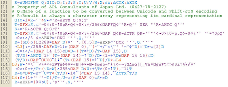
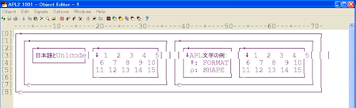
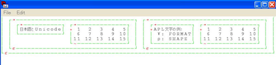
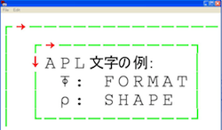
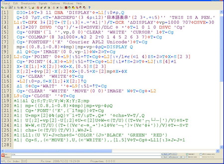
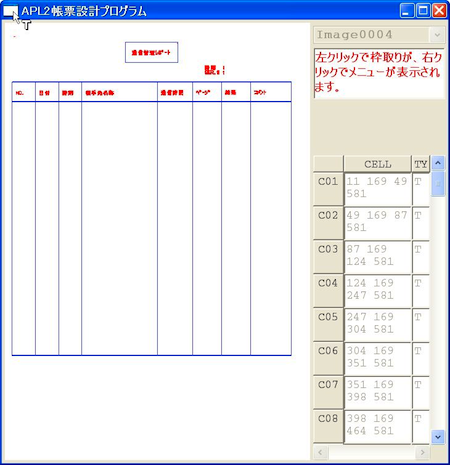
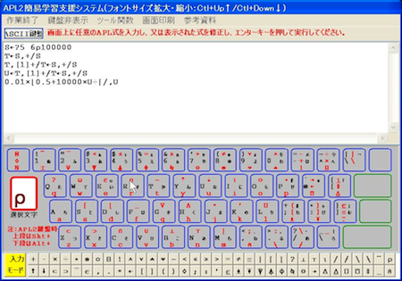
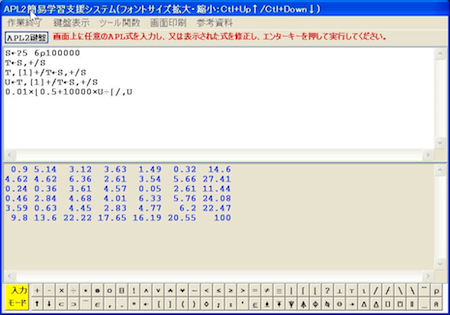
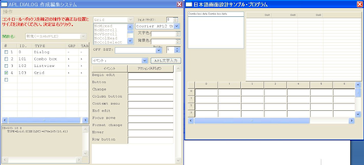
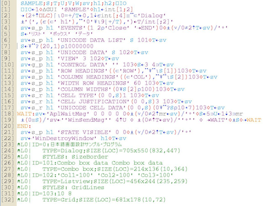

by Kyosuke Saigusa (JCE01163@nifty.com)
{ .byline }

Recent service levels of IBM Workstation APL2 V2 for Windows introduced support for Japanese characters in Unicode. APL tools are described for exploiting this capacity and for introducing Japanese programmers to APL.
{ .abstract }

## The APL we use

Unicode seems to have been included in the design of this product from the beginning, but before its service level 7, released in 2005, we could neither key in nor display Japanese characters in APL functions. Therefore we developed our own system based on SHIFT-JIS (ASCII) with a customised Japanese font called *APL2KJ* and a special function editor. This font was created by sacrificing some infrequently used characters.

During 2005-2007, I closely watched IBM’s efforts to implement Japanese language support with Unicode, initially with suspicion, but later with admiration, as they released Service Levels 7, 8, 9, 10 and 11, with vital issues, such as distinction between legal and illegal blanks, getting solved step by step.

As a result, two items remained unsolved because of complexity of fixing the interpreter code. One was the entry and display of Japanese characters on the APL session manager screen. The other was Japanese texts in the format masks for primitive function “format (`⍕`)”.

The first item above may be something that classical APL users, using APL in desk calculator mode mainly, may want, but today’s APL systems offer highly sophisticated editors to write APL programs and the dependency on the session manager is relatively smaller than before. For the data input and display in APL applications, dialogue windows will provide much better human interface.

The second item is something that programmers can get around easily, by defining a function to achieve it. Therefore we judged that we can do without them.

Microsoft Windows offers a Unicode font called *Arial Unicode MS*. This font we found is not suitable to write APL functions with, because of the unfamiliar shapes and unbalanced sizes of its APL characters and pitches. New system font *Courier APL2 Unicode* on the other hand behaved as if it contained Japanese characters as well under Windows XP and Vista, and we found it a perfect font for our use.

## Conversion of APL functions from ASCII encoding to Unicode

When I confirmed that the Unicode approach is the right direction, at least for Japanese programmers, I decided to convert all of my functions to Unicode encoding without exception, though IBM Workstation APL2 allows coexistence of both encodings in the same workspace, mainly for simplicity. Workstation APL2 V2 seems to handle this conversion automatically, but we had to process Japanese texts preceded and followed by SO/SI codes in APL functions in our Japanese text support system.

The function shown below was used to convert individual functions one by one with care. It produces only Unicode character arrays as cardinal representations, because if conversion fails, we can analyze to see which parts to mend. Fortunately it worked well. In actuality, it was used in the way that all the functions be converted to vector of cardinal representation arrays and they were in turn `⎕FX¨`ed to produce the vector of fixed names or numeric values indicating the fix failed for the corresponding functions.

<figure markdown="1">

<figcaption markdown="span">Fig.1: ∆UNIFNS source</figcaption>
</figure>

Once they are converted to Unicode encoding, APL2 system’s object editor handled the entry and display of Japanese characters in a very natural way. One of the things I found it superior to my old system was that now I didn’t have to pay attention to break Japanese characters (formerly two bytes each) into illegible segments in APL statements.

## How we handle block letters for display and print

<figure markdown="1">

<figcaption markdown="span">Fig.2: Example of `DISPLAY` output as shown on the object editor of the Workstation APL2 v2</figcaption>
</figure>

<figure markdown="1">

<figcaption markdown="span">Fig.3: Example of `∆DISPLAY` output</figcaption>
</figure>

Advantage of `∆DISPLAY` over `DISPLAY` is that the output is not affected by the size difference of the characters used. Besides it will choose the most appropriate font sizes automatically, so that it will accommodate almost any size output and any part of it can be cut to be shown in enlarged scale. This is a convenient and powerful alternative to analyze the structures of APL2 objects.

`∆DISPLAY` is a utility tool function programmed in APL as shown below and is stored in a name space and used from there. It can be modified easily to fit users’ requirements if necessary. Internally it uses the function `DISPLAY` and converts its output into a graphic representation as shown in the illustration. The same logic can be applied to any similar cases to convert texts to graphics, which is more flexible.

<figure markdown="1">

<figcaption markdown="span">Fig.4: `∆DISPLAY` output</figcaption>
</figure>

<figure markdown="1">

<figcaption markdown="span">Fig.5: `∆DISPLAY` source code</figcaption>
</figure>

## How we handle business forms printout

Classical approaches to create business forms output in APL includes a method to draw lines with box characters as `│┌┐└┘├┤┬┴┼`. The same method as used in the case of `∆DISPLAY` can be used, but for higher quality printout, positions of these block characters in the intermediate output can be used to draw lines graphically. In this case texts must also be converted into graphic images.

Before Unicode, when we used double byte-code, it presented no problems because there were only two sizes with Japanese characters identified with `X'8x'`, `X'9x'`, `X'Ex'` and `X'Fx'` codes in the first byte having twice the width of other ASCII characters.

<figure markdown="1">

<figcaption markdown="span">Fig.6: Designing business forms</figcaption>
</figure>

## How to bring new programmers to APL

Unicode has brought about an ideal environment for casual as well as professional programmers to try and learn APL2 in native languages. However, in reality, the initial cost of getting a product license is something beyond the budget of most of the prospective users. To invite these people into the world of APL effectively, neither academic initiative nor free trial use is adequate, because real persuasion comes from proper tools to prove the usefulness of APL and access to consistent and high-level consultancy and information.

<figure markdown="1">

<figcaption markdown="span">Fig.7: Japanese APL Learning System (1)</figcaption>
</figure>

Therefore we created an APL2 package called the Japanese APL2 Learning System as shown above, which offers an inexpensive APL programming environment with full interpreter capabilities of the free IBM Workstation APL2 V2 runtime modules. It uses currently most advanced features of the Workstation APL2 V2 such as calling APL2 interpreter under application APL2 to isolate interpreter environment to avoid crashes between user entered names and the names uses in the application system program.

This package, revised totally in November 2008, supports only the Japanese users with online APL references all in Japanese at this time, and is downloadable free upon registration of e-mail address from our website [aplcons.com](http://aplcons.com) without obligation to pay any fee for the entire system, although it is priced to cover development and support cost. It interprets every line user enters in the upper section of the window by way of `⎕EC` and the result or error message will be displayed in the lower section.

It is safe from system program crashes resulting from invalid entries, because all the errors are trapped and shown in the lower section of the window. Japanese texts are directly handled in these windows as well. In addition to supporting hardware keyboard, APL-Japanese software keyboard is also provided.

<figure markdown="1">

<figcaption markdown="span">Fig.8: Japanese APL Learning System (2)</figcaption>
</figure>

This package allows defining, editing, executing APL functions including the ones transferred from APL product environments as well. In another word, it is designed to fulfill the requirements of most of the prospective APL users to assess APL2’s total capability.

## Dialogue editor with APL function-generation capability

In order to encourage novice programmers to use designed dialogue windows instead of bare-input and output on the APL session manager, we developed a system to help write APL applications with embedded dialogue windows.

		
		 
		
		 
		Fig.9: GUI code generation
	

The generated APL function prototypes as shown above can be edited to develop real APL applications in a short time. A Japanese online text book explains the rules and syntax of this method (which is somewhat different from what the IBM product offers) accompanies this program.

## In conclusion

Adoption of Unicode in APL which supports native languages in any part of the world can provide a good opportunity to spread the use of APL as a major programming language.

I firmly believe that this language is no longer a replacement of desk calculators. Therefore I wish the vendors of APL would emphasise the runtime with a high degree of error handling and maintenance capabilities in the language system.

## References

1. “Use of APL in Japan”, Kyosuke Saigusa, *Proceedings of APL94*, Antwerp, ACM-SIGAPL
2. “Japanese Language Handling in APL environments”, Kyosuke Saigusa, *Proceedings of APL 98*, Rome, ACM-SIGAPL
3. “Simulated APL Session Manager”, Kyosuke Saigusa, *Proceedings of APL2003*, San Diego, ACM-SIGAPL
4. “A Simple APL-Excel Interface”, Kyosuke Saigusa, *APL Quote Quad* Vol.34, No.3, Summer 2004

## Related articles

- [“Unicode support for APL”](../art10500090/), Morten Kromberg, [24:1](../24/#n1-december-2008), p.52
- [“Review: The Solid Form of Language (Robert Bringhurst)”](../art10009840/), Stephen Taylor, [21:2](../21/#n2-february-2005), p.44
