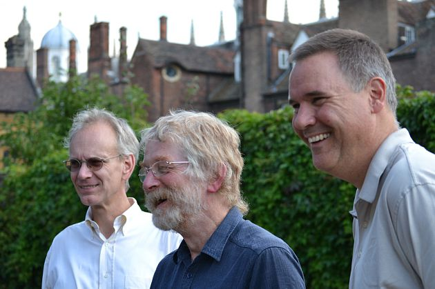
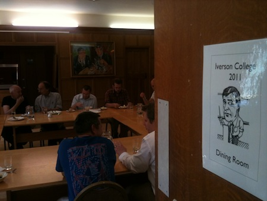
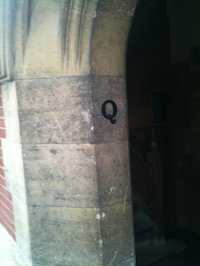
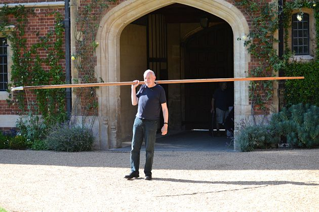
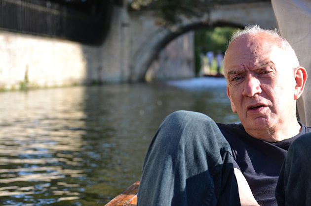
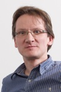
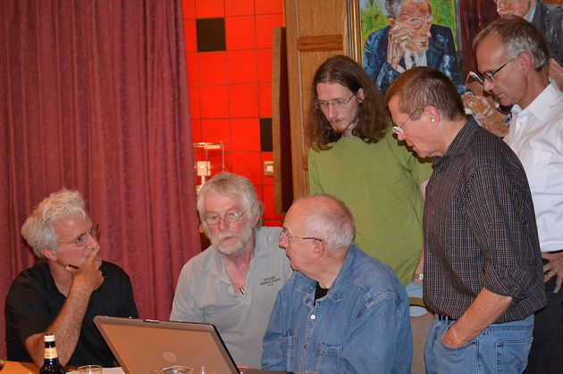
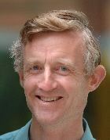
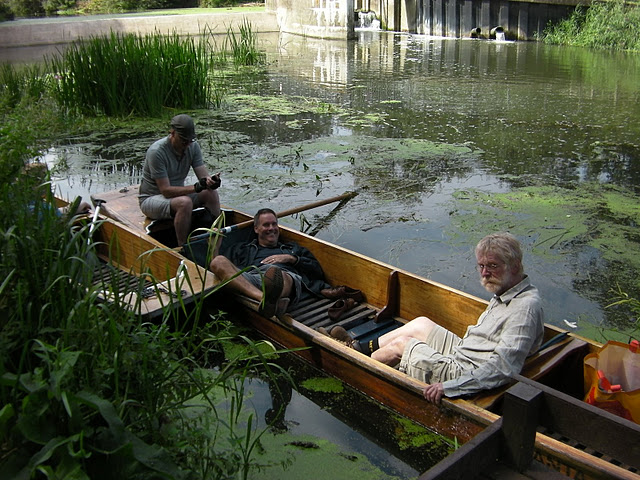
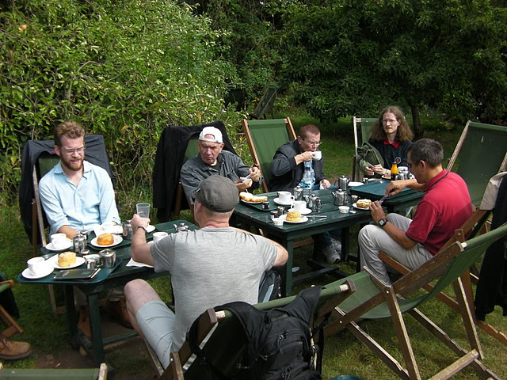

by Stephen Taylor (sjt@5jt.com)
{ .byline }

A score of APL programmers gathered in Cambridge this summer to spend a week living and working together. It proved popular and drew attention from luminaries at Microsoft Research.
{ .abstract }

<figure markdown="1">
{ style="width: 450px" }
<figcaption markdown="span">The FlipDB Team: Kai Jaeger, Phil Last & Paul Mansour</figcaption>
</figure>

We were, almost, eighteen. Two of us had been unable at the last minute to escape our offices. The other sixteen made it to Trinity Hall in Cambridge for a ‘working week’ – some kind of hybrid of a computer conference and a monastic retreat. We dubbed it [*Iverson College*](http://sites.google.com/site/iversoncollege/ "event website")[\[1\]](#ref1).

Actually, we were just working away from home. Not a big deal with a laptop and the Net.

Some of us remembered working in offices decades ago, for companies such as the legendary [I.P. Sharp Associates](http://en.wikipedia.org/wiki/I._P._Sharp_Associates "Wikipedia article"). Even when not on the same project, there was so much then to learn from each other, over lunch, over coffee, over drinks, or even just in a heart-felt cry from the keyboard: “How on earth do I…?”

<figure markdown="1">

<figcaption markdown="span">Taking meals together</figcaption>
</figure>

So we had reserved study bedrooms in ancient [Trinity Hall](http://www.trinhall.cam.ac.uk) for the last week of August. The college gave us the Leslie Stephen Room as a workroom, some fast Net pipes, and a private dining room for our lunches and dinners. Breakfasts we took in the cavernous dining hall, beneath the disapproving expressions of generations of former college masters.

<figure class="left" markdown="1">
{ style="width: 150px" }
<figcaption markdown="span">A q portal</figcaption>
</figure>

Who were we? Kx Systems assembled a crew from around the world: Arthur Whitney from California, Simon Garland and Charlie Skelton from Switzerland, Chris Burke from China and Arthur’s young collaborators from St Petersburg, Oleg Finkelshteyn and Pierre Kovalev. Kx customer Merrill Lynch in London took another four places, but at the last minute only James Garrett and Phil Beasley-Harling were able to leave London.

Morten Kromberg brought two implementors from Dyalog: John Scholes and Jay Foad. (John introduced himself as a C programmer who had only ever written one program, which he thought might be nearly finished.) Dyalog customer Joakim Hårsman joined us from Stockholm.

Paul Mansour of The Carlisle Group, host of invited conferences in Tuscany and Cephalonia, came from Pennsylvania and met his England-based collaborators Phil Last and Kai Jaeger. Dyalog customers to a man, all three of them.

And there was me. I booked the rooms.

Apart from meals, we had no programme. Sometimes one worked in one’s room to avoid disturbance; sometimes in the common workroom for the chance of one. The workroom was usually silent but for key taps and a murmur of conversation. At other times a lively conversation would start and draw everyone in.

      
       
      Scholes with pole
        
      
       
      Scholes without pole
    

When we gathered on the Sunday afternoon, we possessed ourselves of the two college punts and took to the Cam to explore the Backs of the Colleges. Jay Foad has a degree from Cambridge. This apparently includes handling a loaded punt. Others, like Morten Kromberg, learned fast. A wet August was ending in a warm and largely dry week. Late afternoon sun angled down between the colleges, through the trees and spread buttery-gold light over the river and lawns.

Dinners were delicious, gusting to sumptuous, with generous portions. We had earmarked some bottles from the college cellars and made steady progress through them on our first few evenings, sitting and talking until late. Phil Last provided a range of good English ales in support.

We had no programme. Or rather: we were the programme. At our first meal I welcomed everyone and announced my job was now done. People looked a bit bewildered. What was the plan? I insisted: we had no schedule of talks or activities. Only meal times were fixed. If we wanted talks, we could arrange some as we went along, perhaps at tea time.

<figure class="right" markdown="1">

<figcaption markdown="span">Andrew Kennedy</figcaption>
</figure>

[Andrew Kennedy](http://research.microsoft.com/en-us/um/people/akenn/), of the F# team from Microsoft Research in Cambridge, dropped by to see what we were doing. ([Don Syme](http://research.microsoft.com/en-us/people/dsyme/) was out of the country at the time, but sent his regrets and his delight that a flock of functional programmers was nesting in his old college.) Andrew gave us a talk on his work implementing units-of-measure in F#, then sat next to me while Arthur Whitney presented his work in progress on k – a research version of the kdb+ interpreter.

Arthur spent some time constructing and analysing versions of his famous expression that generates all solutions to a Sudoku puzzle, kicking off explorations that lasted the rest of the week, writing equivalent expressions in J and Dyalog.

<figure class="right" markdown="1">

<figcaption markdown="span">Interesting expressions</figcaption>
</figure>

The k interpreter occasionally gave wrong answers. It would have been easy to suppose we were looking at a graduate project, did we not remember how Kx makes millions of dollars selling its programming language to a world in which programming languages are largely free.

John Scholes ventured a question: “How do you do garbage collection?” — “No need to do garbage collection. I know where everything is.”

The k binary weighs in at about 50Kb. Someone asked about the interpreter source code. A frown flickered across the face of our visitor from Microsoft: what could be interesting about that? “The source is currently 264 lines of C,” said Arthur. I thought I heard a *sotto voce* “that’s not possible.” Arthur showed us how he had arranged his source code in five files so that he could edit any one of them without scrolling. “Hate scrolling,” he mumbled.

<figure class="right" markdown="1">

<figcaption markdown="span">Simon Peyton-Jones</figcaption>
</figure>

The following day brought us Haskell pioneer [Simon Peyton-Jones](http://research.microsoft.com/en-us/people/simonpj/), who graciously autographed a well-thumbed textbook proffered by the blushing John Scholes. “We had,” he said, “no idea what you guys have been doing. You are completely off our radar. You have to come to some of our conferences.”

In the event it all seemed to work astonishingly well. Our first two evenings were spent socialising and drinking. Then the focus sharpened. People were using the late afternoon to exercise, so we reserved the time after dinner for talks in the Lesley Stephen Room. Simon Garland bowed to popular pressure and gave the current version of his always hilarious Kx technical presentation, showing kdb+ woofing down gargantuan tic volumes from the financial markets, as always, illustrated from his vast collection of cartoons.

Days at the keyboard demand exercise. There was the Cam to run beside, a swimming pool at a nearby sports centre, and Cambridgeshire roads for biking. (I managed to stay with Morten for 20km before retiring hurt to celebrate my achievement.)

      
       
      At Byron’s Pool
      
       
      At the Orchard Tea Gardens
    

We took one day as a play day, hiring punts and poling them upriver to Grantchester. Most punters were new to the business, but competitive. (Testosterone-fuelled punting: did you ever see anything so silly?) Two of the boats made it past Grantchester, turning back only on reaching the weir at Byron’s Pool. Returning to Grantchester, we partied over tea and scones with the wasps at the Orchard Tea Gardens, attended by the shades of Russell and Wittgenstein.

The programmers were the programme. It was agreed the week was fruitful and inspiring, the format a success, and the venue a delight. (Nothing came of a scheme to scale a tower of neighbouring Caius & Gonville College and label its sun-dialled faces “London”, “Tokyo” and “New York”.) I have promised to mount another ‘working week’ next year.

Many thanks to Arthur Whitney of Kx Systems, Mark Sykes of Merrill Lynch and Morten Kromberg of Dyalog for encouragement and advice. Many thanks to the generous donors of the Wine Committee. Most of all, thanks to everyone who came: I had one of the most rewarding working weeks of my life.

## References

1.  ‘Iverson College’ website:  
    [sites.google.com/site/iversoncollege](http://sites.google.com/site/iversoncollege/)
