by Kai Jaeger (kai@aplteam.com)
{ .byline }

One of the important advantages of the object-oriented (OO) paradigm is that implementation details are hidden from the user of a class. All one can see is the public interface. There is a problem as well: without having created an instance you cannot see anything of the public interface that is not shared. For creating the instance you might have to look at the documentation. With ADOC this can be achieved effortlessly.
{ .abstract }

Dyalog’s APL Tools Group recommends the use of ADOC for documenting classes and intends to do so itself as appropriate. Therefore you are likely to find ADOCable information in classes delivered by Dyalog in the future.
{ .abstract }

## Introduction to ADOC

ADOC offers two services:

- Gather all the built-in information available in any class by definition: fields, properties and methods of both types, shared and instance.
- Collect information added by the programmer.

It then compiles an HTML file which not only displays all these pieces of information, it also allows you to print it.

Let’s take a look at an example:

```
:Class Sample_01
:Field Public Instance CRLF←⎕UCS 13 10
∇ r←Version
  :Access Public Shared
  r←'1.0.0' '2011-09-25'
∇
∇ make2(arg1 arg2)
  :Implements Constructor
  :Access Public Instance
∇
∇ r←Hello
  :Access Public Instance
  r←'World'
∇
Prim←{{⍵/⍨2=+⌿0=⍵∘.|⍵}⍳⍵
:EndClass
```

The script `Sample_01` has one shared and two instance methods. It also has a field of type Instance and one private method. If ADOC is installed as a User Command (discussed in a second) then this statement:

```
]ADOC.Browse Sample_01
```

shows this in your default browser:

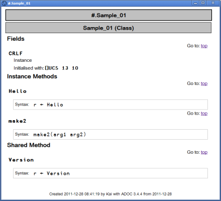

As you can see ADOC has gathered all the information provided by the public interface of the class Sample\_01. That is certainly useful but ADOC can do much more than that. Let us introduce a namespace script `NS_01`:

```
:Namespace NS_01
∇ r←Hi
  :Access Public Instance
  r←'There'
∇
∇ r←Sum vector
  :Access Public Shared
  r←+/vector
∇
∇ r←a Times b
  r←a×b
∇
:EndNamespace
```

Note that the namespace script comes with one private method, one shared method and one instance method. Now let’s introduce a class Sample\_02 which is a copy of Sample\_01 plus one more statement right after the `:Class` line: it includes the namespace script `NS_01`:

```
:Class Sample_02
:Include NS_01
:Field Public Instance CRLF←⎕UCS 13 10
…
```

Now let’s execute:

```
      ]ADOC.Browse Sample_02
```

Note that ADOC has included the two public methods that come from the included namespace:

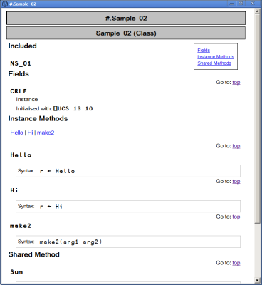

ADOC has also added a table-of-contents (toc) with links to fields, instance methods and shared methods. ADOC not only deals with included namespaces, it can also handle inheritance. In order to prove that let’s introduce a class `Sample_03` which inherits from Sample\_02:

```
:Class Sample_03 : Sample_02
:Include NS_01
:Field Public Instance CRLF←⎕UCS 13 10
∇ r←TheAnswerIs
  :Access Public Instance
  r←42
∇
∇ TidyUp
:Implements Destructor
∇
:EndClass
```

After executing `]ADOC.Browse Sample_03`, this is what the browser shows:

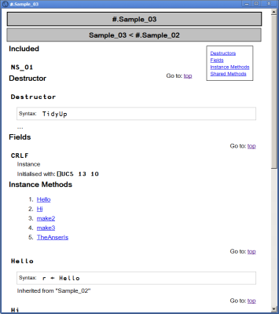

ADOC has added a kind of sub-toc underneath the *Instance methods* heading, providing links to the three methods. Now this may look a little bit over the top right now, but with more methods these links will prove to be useful.

Note that the header declares that Sample\_03 is inheriting from Sample\_02. Note also that the method `Hello` is listed as an instance method, together with the information that it was inherited from Sample\_02.

This is all well and good, but to become really useful it needs more information than just the method signatures.

## Adding content (documentation)

Information regarding the type and structure of the arguments a method is expected, and what is returned as a result is naturally something that needs to be added by a human being. By following a set of simple rules you can make ADOC insert such pieces of information into the HTML page generated by ADOC.

### Adding public comments

Let’s introduce a class Sample\_04 which has just one shared method but a couple of paragraphs:

```
:Class Sample_04
⍝ This is a single-line paragraph.
⍝ This is a paragraphs that spans _
⍝ over two lines in the script.

⍝ This is a third paragraph.
  ∇ r←Hello
  :Access Public Shared
  r←'World'
∇
:EndClass
```

This is what ADOC makes of this:

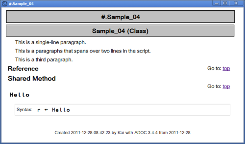

As you can see, a blank followed by an underscore at the end of a line is treated by ADOC as *glue this line together with the next one.* But how does ADOC determine what it should take into the HTML page and what it shouldn’t? To find out we process `Sample_05`:

```
:Class Sample_05
∇ r←TheUltimateAnswer
⍝ This method is a homage to Douglas Adams.
  :Access Public Shared
⍝ We don't need millions of years in order to calculate _
⍝ the - somewhat surprising - result.

⍝ As you can see, empty lines don't change a thing.
  r←42
⍝ We simply assign it.
∇
:EndClass
```

And this is what ADOC is making of that:

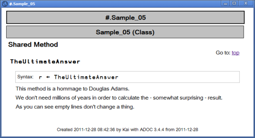

Note that the `:Access Public` line is ignored, and so are any blank lines. All comment lines until the very first APL statement are processed by ADOC. In ADOC terms they are *public comments*.

### Adding Lists

`#` can be used for marking up numbered lists, and `*` for marking up bulleted lists:

```
:Class Sample_06
⍝ We have numbered lists:
⍝ # This is the first topic
⍝ # The second one which in the code spans _
⍝    over two lines
⍝ # And number three.

⍝ And we also have bulleted lists:
⍝ * One topic
⍝ * Just another topic

∇ r←TheUltimateAnswer
⍝ This method is a homage to Douglas Adams.
  :Access Public Shared
  r←42
∇
:EndClass
```

And this is the result:

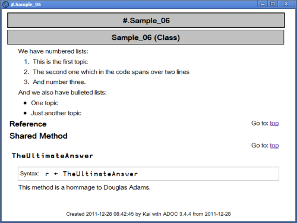

Note that the underscore at the end of a list element is treated the same way as it is within paragraphs.

### Adding headers

There are headers available as well:

```
:Class Sample_07
⍝ === Header of level 3
⍝ ==== Header of level 4
⍝ ===== Header of level 5: {{⍵/⍨2=+⌿0=⍵∘.|⍵}⍳⍵}
⍝ ====== Header of level 6 ======
:EndClass
```

Note that the headers only need to be marked up to their left – see level. Level 1 header shouldn’t be used: they are reserved for the main header of the document as such. All the entries make it into the table of contents:

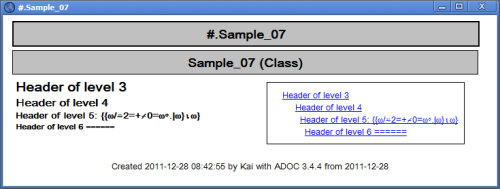

Last but not least, investigate the level-5 header. Although it is not set in a monospaced font, it is actually a special version of APL385 Unicode that allows us to display APL characters in a header.

### Showing APL characters

There are two different ways to show APL characters: you either embed APL code in an ordinary paragraph or you create stand-alone APL code, also called a code block.

### Embedded APL characters

In order to embed APL characters within an ordinary paragraph, the APL code needs to be enclosed by two double-quotes:

```
:Class Sample_08
⍝ == Embedding APL chars
⍝ This is an ordinary paragraph with ""{{⍵/⍨2=+⌿0=⍵∘.|⍵}⍳⍵}"" _
⍝ some APL code embedded in between.
:EndClass
```

And this is how the result looks like:

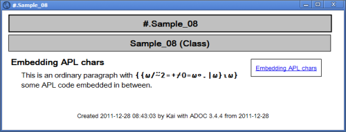

### A block of APL code

Not surprisingly, the HTML `pre` tag is used in order to insert a block of APL code:

```
:Class Sample_09
⍝ The following is a kind of "APL paragraph":
⍝ <pre>
⍝ ⍝ This is an example how not to calculate prime numbers in APL:
⍝ {{⍵/⍨2=+⌿0=⍵∘.|⍵}⍳⍵}
⍝ ⍝ There are better (faster) ways of doing this in APL.
⍝ </pre>
⍝ Note that code marked as <pre> is not wrapped: it is up to _
⍝ you to provide code in reasonably sized chunks.
:EndClass
```

The result:

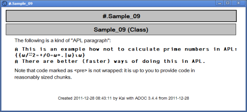

Note that code blocks are not wrapped: it is up to the author to take care of reasonably long lines.

### Embedding HTML

Within paragraphs you can embed HTML tags into your documentation:

<pre>
:Class Sample_10
⍝ Note that you <b>can</b> include _
⍝ &lt;i&gt;&lt;b&gt;ordinary&lt;/b&gt; HTML code&lt;/i&gt; _
⍝ into your documentation easily.
:Property Hello
:Access Public Shared
        ∇ r←get
          r←'World'
        ∇
:EndProperty
∇ r←Version
  :Access Public Shared
  r←'1.0.0' '2011-09-25'
∇
:EndClass
</pre>

This has actually the desired effect:

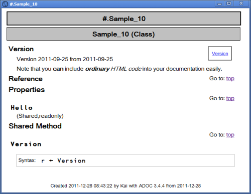

However, this has a drawback if you actually *want* any of the special HTML chars: `<`,`>` or `&`. In other words if you would like them to appear in your documentation you must include them as HTML entities[\[1\]](#ref1) rather than as the characters themselves. Note that this is not true within a block of APL code.

The number of tags you can make use of is naturally limited because most HTML tags are created by ADOC automatically anyway. That leaves `<b>` and `<i>` and `<em>`.

One speciality needs to be mentioned in this context. Look at this class:

```
:Class Sample_11
⍝ More information regarding ADOC is available at _
⍝ http://aplwiki.com/ADOC
:Property Hello
:Access Public Shared
        ∇ r←get
          r←'World'
        ∇
:EndProperty
:EndClass
```

It contains an external link. You don’t need to worry about this because this is handled for you:

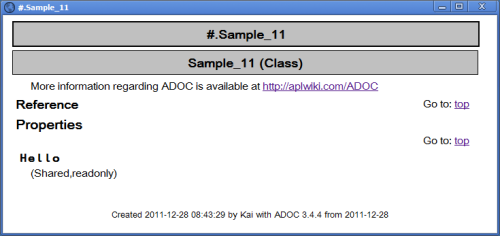

Note that this is not done by ADOC – it’s actually the browser which is adding the link. Sometimes however you don’t want a particular string to appear as a hyperlink at all. Look at the following example: the text tries to explain what the `file://` entry means. In this case you don’t want this string to be a hyperlink because the link would get you nowhere anyway. The only reasonable way to get around this is to specify the two slashes trailing the word `file:` as `&amp;#47;`.

```
:Class Sample_12
⍝ The format can be either file:///localhost/foo.html or, as a _
⍝ shortcut, file:&amp#47;&amp#47;/foo.html
:Property Hello
:Access Public Shared
        ∇ r←get
          r←'World'
        ∇
:EndProperty
:EndClass:EndClass
```

This is the result:

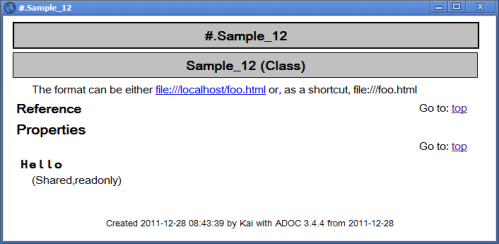

### A bunch of classes

If it happens that the complexity of a given project forces you into writing a bunch of classes rather than a single one then most likely we want to generate a document that contains all these classes. You can achieve this by specifying more than one class to the `Browse` method:

```
ref←Sample_03 Sample_02 Sample_01 Sample_11
cs←#.ADOC.CreateBrowseDefaults
cs.Caption←'Complex example'
cs #.ADOC.Browse ref
```

This is the result:

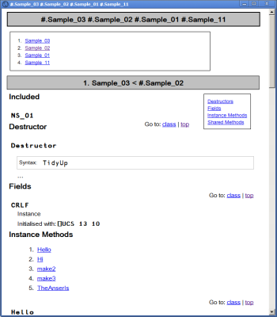

As you can see ADOC has compiled a kind of main table-of-contents listing all the classes involved. There is still a problem: when dealing with a bunch of classes having a reference of some sort for every class involved is not enough: in order to get something done you need to know the workflow. For example, quite often you start with an instance of a certain class, and then you add instances of other classes to properties of this main instance.

To create all-singing, all-dancing documentation you need to add information explaining the workflow, which I like to call ‘the big picture’. This can be achieved by adding ordinary functions to the list provided to ADOC via the right argument which contain nothing but comments. If it is just one function at the start of the list that’s fine, but you can add such functions pretty much everywhere.

ADOC considers all of them but the first one as containers: all references after such a function name pointing to classes are going to become children of the function in the hierarchy built up by ADOC. That is reflected in the table-of-contents inserted at the top.

See this example:

```
l←''
l,←⊂'#.BigPicture'
l,←⊂'#.Workflow'
l,←⊂Sample_09
l,←⊂Sample_04
l,←⊂Sample_02
l,←⊂'#.Container'
l,←⊂Sample_07
l,←⊂Sample_08
l,←⊂Sample_11
```

```
cs←#.ADOC.CreateBrowseDefaults
cs.Caption←'The big picture'
cs.withColor←0
cs #.ADOC.Browse l
```

These are the three functions `BigPicture`, `Workflow` and `Container`:

```
∇ BigPicture
⍝ Get the idea
⍝ This bunch of classes allow you to ...
∇
```

```
∇ Workflow
⍝ The work flow - how to start
⍝ To start create an instance of the class "Presentation".
⍝ You can than add instances of the class "Slide" and _
⍝ add such an instance to the "Slides" property of your _
⍝ instance of the "Presentation" class by calling the _
⍝ "AddSlide" method and passing a ref to an instance of _
⍝ the "Slide" class.
∇
```

```
∇ Container
⍝ In-between container
⍝ This is a kind of 'container'; Sample_07, Sample_08 & _
⍝ Sample_11 are all ...
∇
```

This is the result:

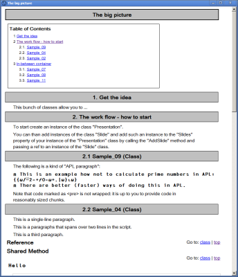

Note that the first line of the three functions is converted into a header. Note also that ADOC restricts you to just one level of nesting: a container ‘contains’ all the refs until the next container arrives.

The first function (`BigPicture`) stands on its own: by definition it never has children. The second one (`Workflow`) has three children. The remaining scripts then by definition all become children of `Container`.

## ADOC as a User Command

ADOC can be made available as a User Command. There are two options available when calling `ADOC.Browse` as a User Command:

```
]ADOC.Browse {refToScript} –caption='My caption'
]ADOC.Browse {refToScript} –browser='C:\Programs\Opera\opera.exe'
```

Of course they also can be specified together.

In order to define a list of scripts note that they must be comma-separated with no blanks in between:

```
]ADOC.Browse ADOC,WinFile
```

This is because a blank is treated as an argument separator.

### Conclusion

ADOC is a powerful tool that allows you to create proper documentation on scripts. By following a set of simple rules one can add comments to a script which are extracted and prepared by ADOC appropriately.

The further away documentation is from the actual code the less likely it is to be up-to-date when you look at it, so I strongly recommend keeping it as close to the code as possible. ADOC allows you to do just that.

ADOC is available on the APL Wiki [\[2\]](#ref2).

## References

1. <a id="ref1"></a> [www.w3schools.com/html/html\_entities.asp](http://www.w3schools.com/html/html_entities.asp)
2. <a id="ref2"></a> [aplwiki.com/ADOC](http://aplwiki.com/ADOC)
