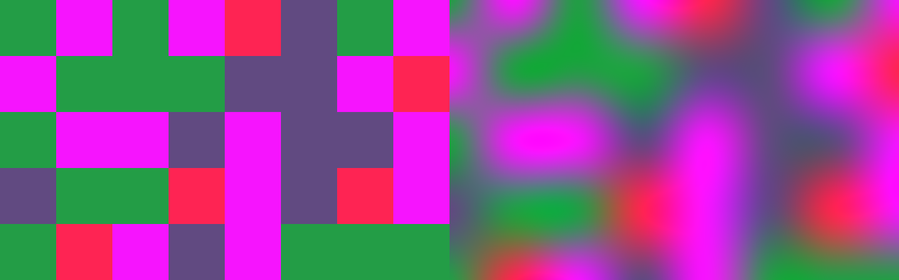

by Cliff Reiter (reiterc@lafayette.edu)
{ .byline }

## Prolog

In 2008 there was a query on the J Programming forum about whether bicubic interpolation had been implemented in J \[[4](#ref_porter)\]. This is a standard technique for resizing images. I was doubtful that there were many situations for bicubic interpolation to be noticeably better than resizing by sampling pixels. However, when I created the hiking guide \[[6](#ref_wfw)\] as a PDF, I found the palette based topographic maps were very washed out after conversion until I selected the bicubic interpolation option. Perhaps more is going on in creating the PDF, but I put taking a closer look at bicubic image interpolation onto my "to do" list. Recently I implemented Keys \[[3](#ref_keys)\] convolution bicubic algorithm. In this note I share the implementation and some experiments. A script with the functions defined here may be found at \[[7](#ref_script)\]. Other versions of bicubic interpolation exist \[[1](#ref_wiki), [5](#ref_art)\].

## Bicubic Interpolation

Bicubic interpolation uses four-by-four patches of equally spaced discrete data points to obtain cubic polynomials in two variables that can be used to approximate data that falls within the interior two-by-two patch. This is done independently in the two image directions and for color planes in the case of RGB images. Thus, we begin by considering the one dimensional version.

Keys type interpolation can be described in terms of matrix multiplication on the four data (pixel) values by the matrix `acon` shown below. The entries in the matrix are derived by Keys \[[3](#ref_keys)\]. The entries do not arise from interpolating all the points. The coefficients arise from interpolating the central pair and using some high order derivative approximations and boundary conditions. We refer the reader interested in the details to Keys \[[3](#ref_keys)\]. It is convenient to think of the independent points where the data is known as `_1 0 1 2`. Multiplying the values at those four points by `acon` results in the coefficients of Keys cubic polynomial. It is designed to approximate the data on the interval from `0` to `1`. At the end points it gives the appropriate data values.

For example, if we want to use a Keys type interpolation of the data that has values `2 3 5 7`  at the points `_1 0 1 2` respectively, we can do that as shown below. We see that it exactly returns correct values at `0` and `1` and a cubic interpolation of `3.9375` at `0.5`.

```
   acon
   0    1    0    0
_0.5    0  0.5    0
   1 _2.5    2 _0.5
_0.5  1.5 _1.5  0.5

   mp=: +/ . *

   acon mp 2 3 5 7
3 1.5 1 _0.5

   (0 0.5 1^/i.4) mp acon mp 2 3 5 7
3 3.9375 5
```

A two dimensional version of this interpolation is given by the verb `bicuev` below. Consider the four-by-four patch, `p`, of primes given below and interpolation in two variables. Note that the input values are between zero and one and matrix oriented coordinates are used with the origin being at the upper left of the two-by-two central patch. Thus evaluating at `0 0` gives `13` and `0.1 0.9`, which is near `0 1`, gives a value near `17`.

```
   bicuev=: 4 : 0
'X Y'=.y^"0 1 i.4
Y mp"2 acon mp X mp"3 acon mp"3 x
)

   ]p=:p: i.4 4
 2  3  5  7
11 13 17 19
23 29 31 37
41 43 47 53

   p bicuev 0 0
13
   p bicuev 1 0
29
   p bicuev 1 1
31
   p bicuev 0.1 0.9
17.9766
```

## Resizing Images

Before discussing bicubic interpolation on a larger array, we consider the resizing verb from the image3 addon shown below. That verb uses subsampling or resampling as necessary to obtain the resized image. The local variable `szi` gives the size (height-width) of the input image while `szo` gives the size of the output image which is the largest image that fits inside a window specified by the left argument while respecting the aspect ratio of the input image. We cheat a bit displaying `ind` since it is actually a local variable, but we see the indices are repeated (or not) in a smooth way obtaining an array of the desired size by over (or under) sampling the rows and columns of the array as necessary.

```
   resize_image=: 4 : 0
szi=.2{.$y
szo=.<.szi*<./(|.x)%szi
ind=.(<"0 szi%szo) <.@*&.> <@i."0 szo
(< ind){y
)

   6 6 resize_image p
 2  2  3  5  5  7
 2  2  3  5  5  7
11 11 13 17 17 19
23 23 29 31 31 37
23 23 29 31 31 37
41 41 43 47 47 53

   ind
+-----------+-----------+
|0 0 1 2 2 3|0 0 1 2 2 3|
+-----------+-----------+
```

The verb `bicubic_resize_image`, shown below is similar in many regards. However, the floating point arithmetic used in the interpolation uses substantial space, so that is mitigated by updating one row at a time in the array `z`. Also, a local function `get_patch` is defined to facilitate obtaining the four-by-four patches needed for the interpolation. Due to the patch sizes of four-by-four we need to enlarge the input array by increasing the number of rows and columns by `3`. We do that by constant extensions: by two copies on the leading edges and one on the trailing edges. We again cheat and display some local variables. Below is the result of applying the boundary conditions. The last value computed depends on the indices `3.5 3.5`. Thus, the last patch used is determined by `3 3` and that patch is used to obtain the bicubic interpolation at `0.5 0.5`. The result of that interpolation is given. One might not prefer these boundary conditions, but they are fairly simple and appear reasonable in practice for image data. Also, for image data using a scale of `0` to `255`, we will want to clamp (or round) the data into the desired range.

```
   conext0=:{.,{.,],{:

   conext3=:conext0"_1@:conext0

   clamp=:0>.255<.<.

   bicubic_resize_image=:4 : 0
szi=.2{.$y
szo=.<.szi*<./(|.x)%szi
get_patch=.(( [:<((i.4)+{.);(i.4)+{:)) { (conext3 y)"_
'indj indk'=:(>:(<:{.szi)*(i.%[){.szo);>:(<:{:szi)*(i.%[){:szo
z=.(szo,2}.$y)$0
for_j. i.#indj do.
  inds=.(j{indj),.indk
  as=.get_patch"1 <.inds
  t=.clamp as bicuev"_1 1 ]1&| inds
  z=.t j}z
  end.
z
)

   6 6 bicubic_resize_image p
 2  2  3  3  5  6
 5  6  7  8 10 11
11 11 13 15 17 18
16 18 20 22 23 25
23 25 29 30 31 34
32 34 37 38 39 43

   conext3 p
 2  2  2  3  5  7  7
 2  2  2  3  5  7  7
 2  2  2  3  5  7  7
11 11 11 13 17 19 19
23 23 23 29 31 37 37
41 41 41 43 47 53 53
41 41 41 43 47 53 53

   indj
1 1.5 2 2.5 3 3.5

   indk
1 1.5 2 2.5 3 3.5

   get_patch <.3.5 3.5
13 17 19 19
29 31 37 37
43 47 53 53
43 47 53 53

   (get_patch <.3.5 3.5) bicuev 1|3.5 3.5
43.1797
```

## Image Experiments

First we apply bicubic interpolation to a tiny randomly chosen four colour image.

```
   $b=:(?.5 8$4){?.4 3$255
5 8 3

   view_image 720 720 resize_image b
720 450

   view_image 720 720 bicubic_resize_image b
720 450
```

{ width="100%" }

Figure 1. Sampling and Bicubic Interpolation of a Random Image
{ .caption }

In the bicubic image we see that the "super" pixels blend into one another in a fairly natural way and that the blending near the boundaries is visually unbiased with respect to which edge is chosen.

As a second example we consider a thumbnail sized zoom into an image of Ken Iverson at Kiln farm from the image3 addon that is expanded to create a web sized image.

```
   B=:read_image jpath,'~addons/media/image3/atkiln.jpg'

   view_image B
468 700

   ken=:100 100{.120 210}.B

   view_image 720 720 resize_image ken
720 720

   view_image 720 720 bicubic_resize_image ken
720 720
```

The original image quality is poor, but the contrast between the pixilation of sampling and the smoother bicubic interpolation can be observed in Figure 2.

{ width="100%" }

Figure 2. Sampling and Bicubic Interpolation of an Image Piece
{ .caption }

## References

1. Bicubic Interpolation, Wikipedia,  <a id="ref_wiki"></a><a class="www" href="http://en.wikipedia.org/wiki/Bicubic_interpolation">
    		http://en.wkipedia.org/wiki/Bicubic\_Interpolation</a>, 2011.
2. Jsoftware, J6.01c, with Image3 addon,  <a id="ref_j"></a>[http://www.jsoftware.com](http://www.jsoftware.com), 2007.
3. Robert G. Keys, Cubic Convolution Interpolation for Digital Image Processing, *IEEE Transactions on Acoustics, Speech and Signal Processing*, <a id="ref_keys"></a>, 29 6 (1981) 1153-1160.
4. David Porter, Jprogramming forum, Bicubic Image Smoothing, <a id="ref_porter"></a> January 24, 2008. <a id="ref_jprog"></a>
5. William H. Press et al, *Numerical recipes: the Art of Scientific Computing*, 3rd edition, Section 3.3.6, 2007. <a id="ref_art"></a>
6. Cliff Reiter, *Witness the Forever Wild, A Guide to Favorite Hikes around the Adirondack High Peaks*,  <a id="ref_wfw"></a>[http://webbox.lafayette.edu/~reiterc/wfw/index.html](http://webbox.lafayette.edu/~reiterc/wfw/index.html), Lulu.com, 2008.
7. Cliff Reiter, bicubic\_keys script,  <a id="ref_script"></a>[http://webbox.lafayette.edu/~reiterc/j/vector/index.html](http://webbox.lafayette.edu/~reiterc/j/vector/index.html), 2011.
