David Porter (dporter@cissoid.net) &  
Cliff Reiter (reiterc@lafayette.edu)
{ .byline }

Savitzky-Golay filters use best least squares fit polynomials to approximate data and derivatives. They can be computed very rapidly. We implement Savitzky-Golay filters in J and explore their behaviour on noisy time series data. Applications to remove noise from images and to detect edges in images are also considered.
{ .abstract }

## 1. Introduction

In a previous note on image processing filters \[[4](#ref1)\] Cliff observed that the Savitzky-Golay filter could be used to smooth data, thereby removing some noise, but also sharpening the edges somewhat. That is a classic image processing application, \[[3](#ref3), [8](#ref8), [10](#ref10)\]. David has noted that filters based on the Savitzky-Golay kernels are really much more general than the case considered in that reference. Besides smoothing values, it can provide smoothed derivatives of many orders. In fact, a classic application is using Savitzky-Golay estimates for the first derivative to pin-point spectral peaks \[[2](#ref2), [9](#ref9)\]. The usefulness of the higher order derivatives is enhanced by the overlapping local-polynomial smoothing inherent in these filters.

The central idea of Savitzky-Golay filters is to use best least squares polynomial fits to approximate data; then use those polynomials to estimate data or derivatives. The beauty is that weights may be computed ahead of time so that the approximations can be computed very rapidly. In this note we explain how that works, implement it in J \[[1](#ref1)\], and show applications using both value and derivative approximations to image processing.

## 2. Computing Weights

We begin by assuming that we want to estimate a value or derivative at the point *u<sub>0</sub>=0* and that we know the data values at *lr* (left radius) uniformly spaced points to the left of *u<sub>0</sub>* and *rr* (right radius) uniformly spaced points to the right of *u<sub>0</sub>*. Thus, for purposes of our derivation and applications we assume the points at which the data is known are <span style="position:relative;top:3.0pt">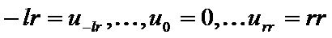</span>. Suppose we want to use a polynomial of degree *N* to approximate the data. We need <span style="position:relative;top:1.5pt">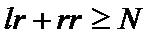</span> for the least squares polynomial to be well defined. Suppose the polynomial has the form <span style="position:relative;top:3.0pt">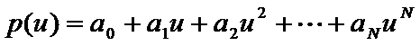</span> and the corresponding values are given by *v<sub>i</sub>*. That is, we desire the least squares solution to the system of equations <span style="position:relative;top:3.0pt">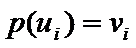</span>. In matrix-vector form this can be written as *U A = V* where *A* is the list of the polynomial coefficients and *V* is the list of the data values. The matrix *U* has entries <span style="position:relative;top:3.5pt">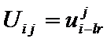</span>. Thus, the solution is given by <span style="position:relative;top:1.5pt">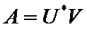</span> where <span style="position:relative;top:2.5pt">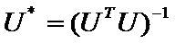 </span> is the least-square pseudo-inverse. The pseudo-inverse is a primitive in J and APL.

In order to determine <span style="position:relative;top:3.0pt">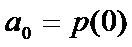</span> we matrix multiply (a dot product here) the first row of *U<sup>\*</sup>* times the data values *V*. Thus, the weights we use as a filter to estimate the values are given by the first row of *U<sup>\*</sup>*. Likewise, the row with index *k* estimates *a<sub>k</sub>*. A standard fact about the coefficients for McLaurin polynomials is that <span style="position:relative;top:6.0pt">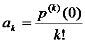</span>. Thus, to estimate the *k<sup>th</sup>* derivative, the weights we want are given by the row of *U<sup>\*</sup>* with index *k* times *k!*. We implement this in J as `sgw` shown below. Its left arguments are the order of the derivative and degree of the polynomial. The right argument is the left and right radii to use. The expression to the right of `%.` computes the matrix `U`. The pseudo-inverse is computed. The expression `(!@[*{)` selects the row and multiplies by the factorial. We see some examples of weights below. The last one of those gives the weights that will approximate the first derivative using a degree three polynomial by utilizing two points to the left and right of the data point of interest.

```
   sgw=: 4 : 0
({.x)(!@[*{)%. (({.y)-~i.1+({.+{:)y) ^/ i. 1+{:x
)

   0 1 sgw 2 2
0.2 0.2 0.2 0.2 0.2

   0 3 sgw 2 2
_0.0857143 0.342857 0.485714 0.342857 _0.0857143

   1 1 sgw 1 1
_0.5 0 0.5

   1 3 sgw 2 2
0.0833333 _0.666667 4.48235e_17 0.666667 _0.0833333
```

Next we define the matrix product and check that when we multiply actual polynomial data times these weights we get the appropriate derivatives. We use the fourth degree polynomial with coefficients `5 4 3 2 1` for these examples.

```
   mp=:+/ . *

   p=:5 4 3 2 1&p.

   ((0 4 sgw 3 3)mp p i:3); p 0
+-+-+
|5|5|
+-+-+

   ((1 4 sgw 3 3)mp p i:3); p d.(1) 0
+-+-+
|4|4|
+-+-+

   ((2 4 sgw 3 3)mp p i:3); p d.(2) 0
+-+-+
|6|6|
+-+-+

   ((3 4 sgw 3 3)mp p i:3); p d.(3) 0
+--+--+
|12|12|
+--+--+

   ((3 4 sgw 2 4)mp p i:3); p d. (3) _1
+---+---+
|_12|_12|
+---+---+
```

The last of those illustrates what happens when the left and right radii are different. With two points on the left, a point of interest, and four points on the right and independent variable based on `i:3`, we see `_1` is the point of interest in the polynomial's coordinates (which is not the same as the analysis coordinates).

## 3. Applying Filters to Oscillations

Before discussing the Savitzky-Golay filter on image data, we will take a look at its behaviour on illustrations that have been modified with some standard normal noise. In this section we consider oscillations of varying frequency. We generate the standard normal values using `randsn` from *povkit2.ijs* from the *fvj3* add-on. Figure 1 shows the oscillations and a noisy variant.

```
   require '~addons/graphics/fvj3/povkit2.ijs'

   require 'plot'

   y=: sin *: 0.01 *i.1000

   plot y,:~z=:(0.1* randsn 1000)+y
```

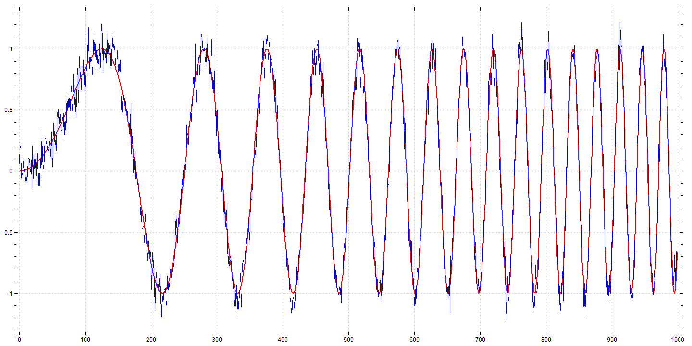{ width="100%" }

Figure 1. Oscillations and added noise.
{ .caption }

Our goal is to, as best possible, recover the original (red) curve from the noisy data (blue).

In order to compare the data to the result of a Savitzky-Golay filter on the data it is convenient to extend the data and we will extend the data in a constant manner using `conext`, repeating the first and last values an appropriate number of times. The conjunction `SG` takes the derivative order and polynomial degree as its left argument and the right argument is the radius. The conjunction extends the data in a constant manner and applies the filter `(m sgw n)&mp` to all the windows of appropriate size. Below we compute Savitzky-Golay weights with left and right radii `15` so that we will be using windows of width `31`. Fifth degree polynomials are being used. The result is shown in Figure 2; this Savitzky-Golay filter (red) smooths the data substantially, but still has some noise and edge artefacts.

```
   conext=:1&$: : ((#,:@:{.),],(#,:@:{:))

   3 conext i.5
0 0 0 0 1 2 3 4 4 4 4

   SG=:2 : '(1+2*n)&((m sgw n)&mp\)@:(n&conext)'

   f1=: 0 5 SG 15

   plot z,:~f1 z
```

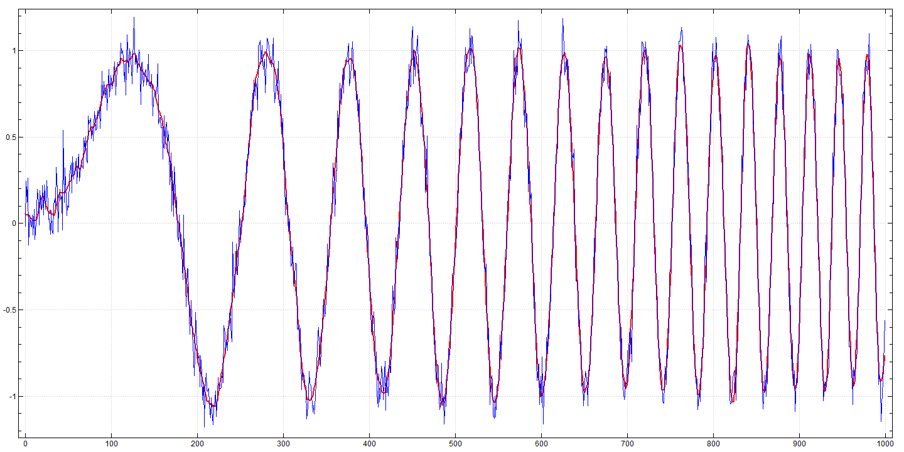{ width="100%" }

Figure 2. Savitzky-Golay filter preserves amplitude.
{ .caption }

Note that that Savitzky-Golay filter does a fine job of recovering the proper amplitudes. That is in contrast to what happens when a simple moving average is used instead, as seen below and in Figure 3. Namely, amplitude information is lost. Other filters may damage frequency or phase information. Note that the Savitzky-Golay weights are uniform when linear functions approximate values, so we can obtain a radius 15 moving average with `f2` below.

```
   0 1 sgw 2 2
0.2 0.2 0.2 0.2 0.2

   f2=: 0 1 SG 15

   plot z,:~f2 z
```

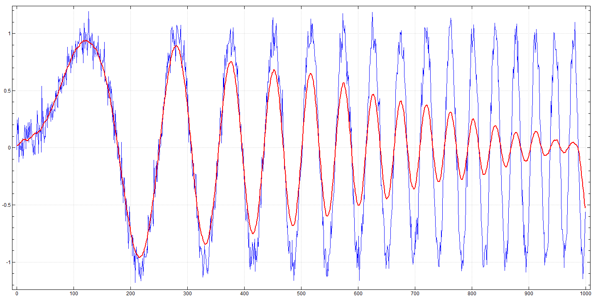{ width="100%" }

Figure 3. Ordinary moving averages lose amplitude information on narrow peaks.
{ .caption }

## 4. Applying Filters to Edges

There are three parameters to the Savitzky-Golay algorithm that must be chosen. The following examples of computer generated edges (step functions) help illustrate the behaviours these parameters control. Figure 4 shows two steps, one pure and the other has noise added to it.

```
   st=: 100<:i.200

   plot rst=: st,st+0.1*randsn 200
```

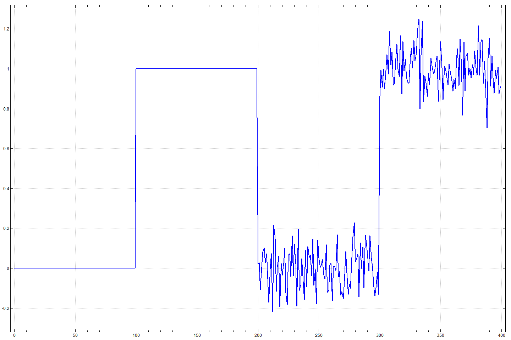{ width="60%" }

Figure 4. Step functions: pure and noisy.
{ .caption }

Figure 5 show the effects of changing the smoothing window radius when using a Savitzky-Golay filter using the zeroth derivative, a zero degree polynomial, and a smoothing window radii of 5, 10, and 15 pixels. This is equivalent to a running average with 11, 21, and 31 sample points. As can be seen, the noise is reduced with larger radii and the edges become broadened and less steep.

```
   plot 0 0 SG 5 rst

   plot 0 0 SG 10 rst

   plot 0 0 SG 15 rst
```

{ width="60%" } 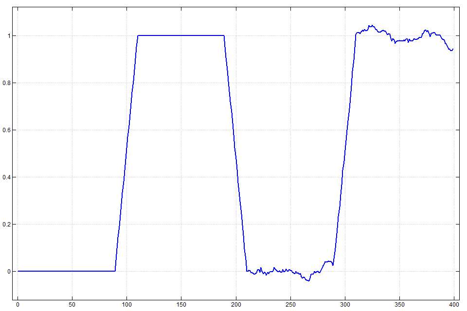{ width="60%" } 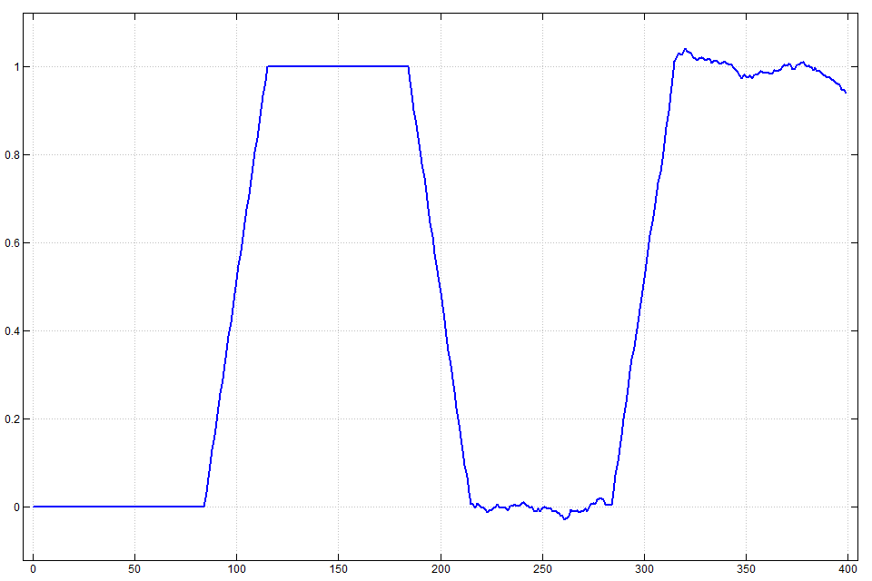{ width="60%" }

Figure 5. Smoothed with radius 5, 10, and 15 filters.
{ .caption }

In Figure 6 the Savitzky-Golay parameters are set for zeroth derivative, a 5 point smoothing window radius, and the polynomial order 0, 2 and 4. The noise at higher polynomial orders contains more high frequency components and overshoot is apparent at the pure step.

```
   plot 0 0 SG 5 rst

   plot 0 2 SG 5 rst

   plot 0 4 SG 5 rst
```

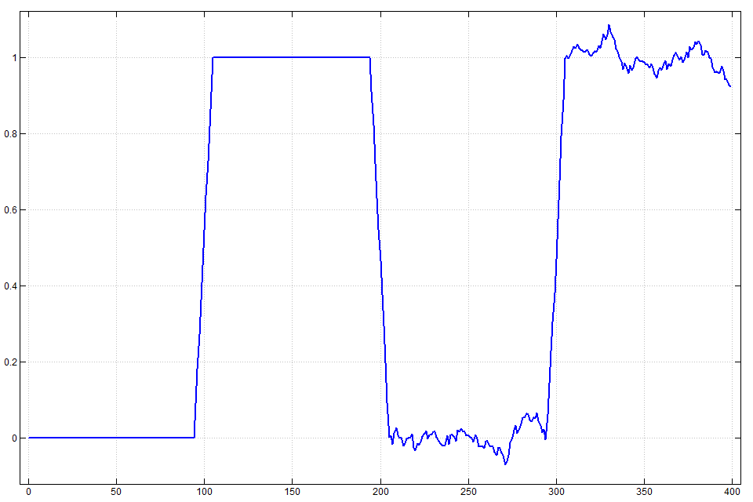{ width="60%" } 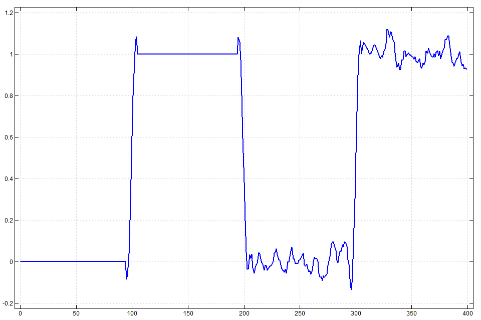{ width="60%" } 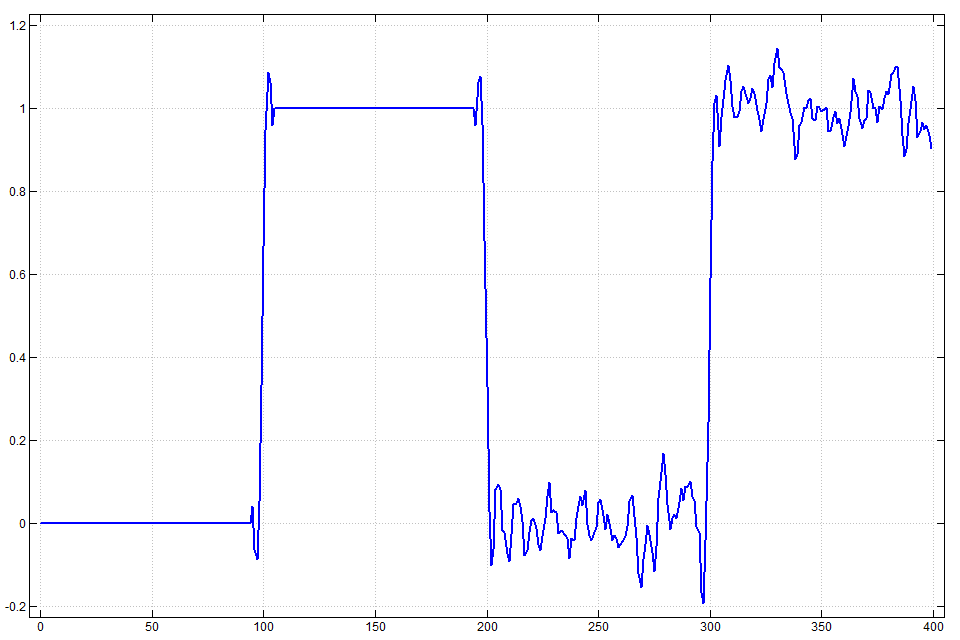{ width="60%" }

Figure 6. Smoothed with radius 5 and polynomials of degree 0, 2 and 4.
{ .caption }

In Figure 7 the first four derivatives are calculated. Each one is calculated with a polynomial one order larger than the derivative and the smoothing window radius is set at 5 pixels. The filter computed first derivative of a step function is a Gaussian. The peak marks the location of the edge very accurately. The zero-crossings of even order derivatives mark the location of the edge. The peaks of odd order derivatives mark the location of the edge. The overshooting skirts of the odd order peaks are a part of the high-order derivative and can be used to help identify them in high noise. The location is preserved to a high degree of accuracy.

```
   plot 1 2 SG 5 rst

   plot 2 3 SG 5 rst

   plot 3 4 SG 5 rst

   plot 4 5 SG 5 rst
```

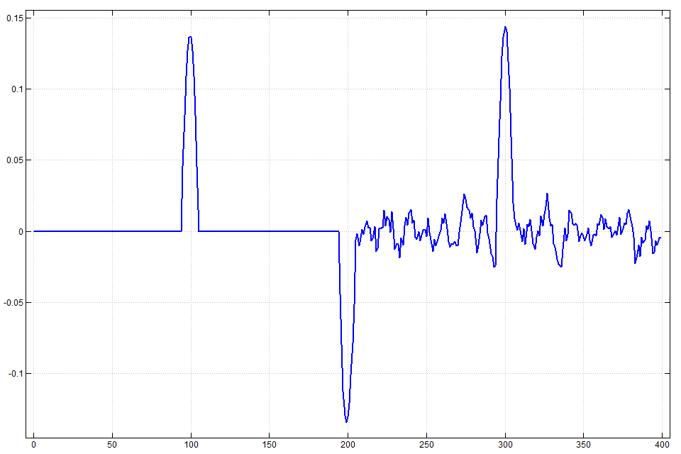{ width="60%" } 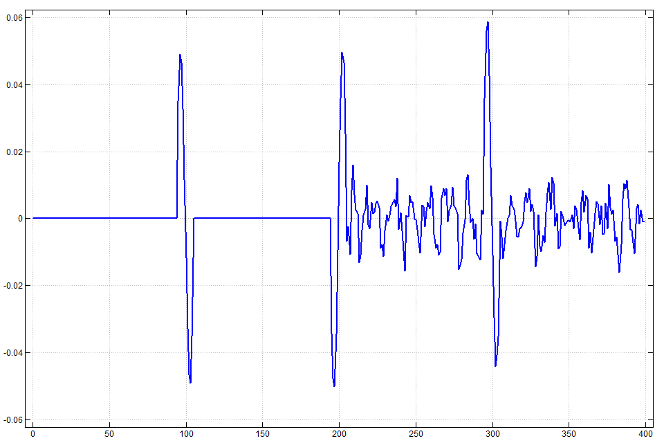{ width="60%" } 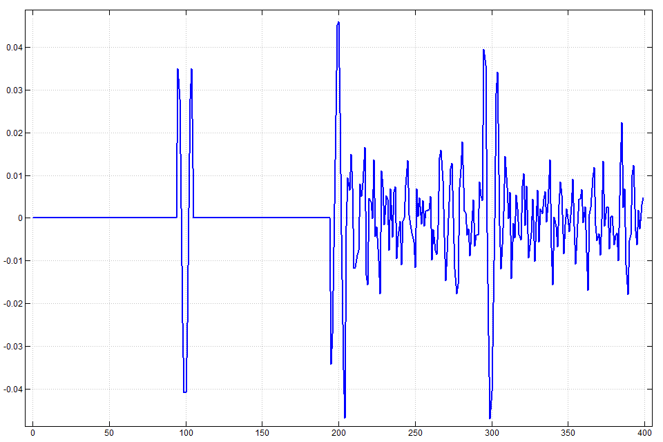{ width="60%" } 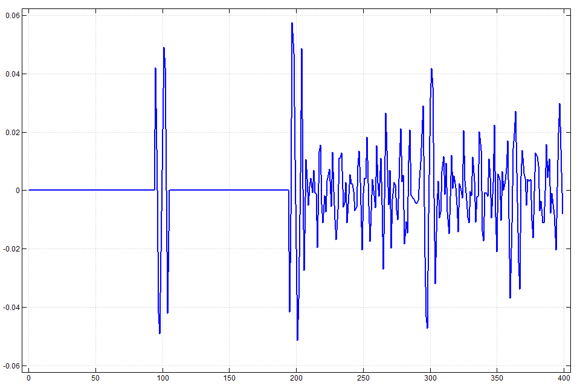{ width="60%" }

Figure 7. Derivatives of order 1, 2, 3 and 4 and polynomials one degree higher.
{ .caption }

The higher derivatives shown in Figure 7 are almost lost in the noise. Readers are encouraged to retry these experiments using radii 10 and 15 to observe the higher derivatives more clearly while the precise location of the lower derivatives becomes less apparent.

We have seen that often using a polynomial of degree one higher than the order of the derivative is advantageous because ringing is minimized. However, we also see that in some circumstances, such as the previous section, one may need to use higher degree polynomials in order to retain high frequency information.

## 5. Filtering a Beaver Photo

We will consider the application of Savitzky-Golay filters involving values and first and second derivatives. We begin with values. The idea is very similar to the above data filtering except that we apply the filter in two dimensions of a raster image. For simplicity we will use a grayscale image. The *image3* add-on contains *filter1.ijs* which has facilities for converting between colour models. In particular, the "Y" component of "YUV" space gives a good grayscale\[[5](#ref5)\]. The image used below may be found at \[[6](#ref6)\] although readers may want to experiment with their own images.

```
    require '~addons/media/image3/color_space.ijs'

   require '~addons/media/image3/view_m.ijs'

   $b=:read_image 'C:/temp/dscf3950.jpg'  NB. modify path/image names
2736 3648 3

   BW256 view_data g=:0{"1 RGB_to_YUV b
3648 2736
```

Figure 8 shows the resulting greyscale image. We use `view_data` with a greyscale palette since it automatically rescales data not in the `0` to `255` range. The photo was taken in moderately adverse conditions: the evening light was dim, the beaver was moving, and there were high contrast reflections of sky and clouds.

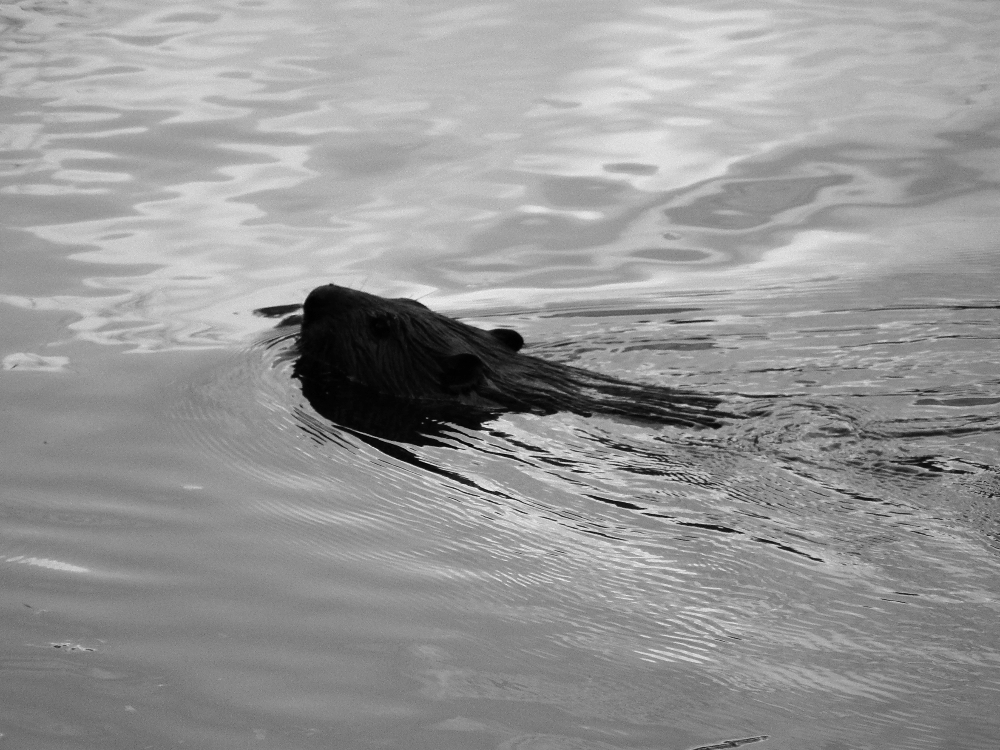{ width="60%" }

Figure 8. A swimming beaver.
{ .caption }

The first of the following filters produces a Savitzky-Golay filter using radius 7 (which gives 15 by 15 blocks of pixels) and degree 7 polynomials. The result is the array `sgg` which can be viewed. The other examples arise from cubic polynomials with radii 7 and 11 respectively. It is possible to see the improvement in the full scale image, but the differences are somewhat subtle. Instead, we pixel peek at two small portions of the image.

```
   sgv=: 1 : 0
f=.(0,{.m) SG ({:m)
f f"_1 y
)

   BW256 view_data sgg=:7 7 sgv g
3648 2736

   zm1=:3 : '200 200{.600 500}.y'

   spix=:[##"_1

   BW256 view_data 5 spix  g ,.&zm1 sgg
2000 1000

   BW256 view_data 5 spix  (3 7 sgv g) ,.&zm1 3 11 sgv g
2000 1000
```

First we peek at a reflection of the sky and clouds using `zm1` defined above to zoom into a small portion of the image. The function `spix` replicates pixels in blocks so they become apparent. Figure 9 compares the degree 7 polynomial with radii 7 filtered version with the original. The noise is noticably reduced but the boundary between regions remains distinct, unmoved and slightly clarified. Figure 10 shows the same zoom but with radii 7 and 11 and degree 3 polynomials. Notice these give much more smoothing.

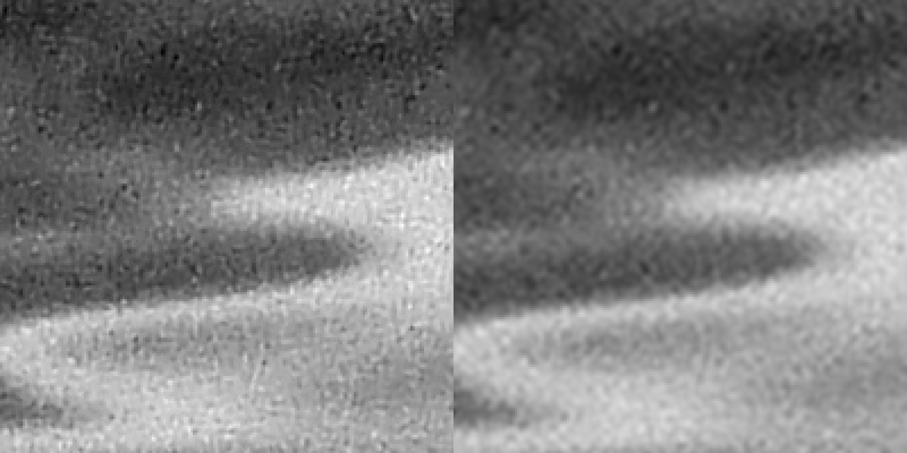{ width="100%" }

Figure 9. Cloud boundary before and after filtering.
{ .caption }

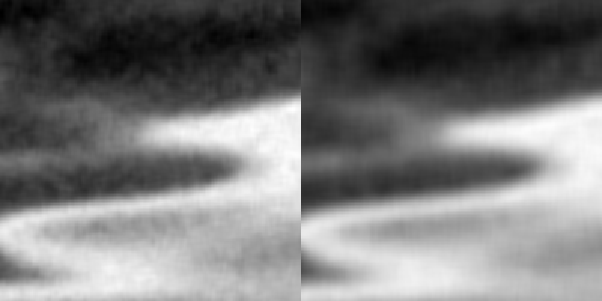{ width="100%" }

Figure 10. Cloud boundary after heavier filtering.
{ .caption }

Similar zooms are used zoom into the edge of the beaver with water where whiskers are visible. In Figure 11 we observe that despite significant smoothing, the whiskers not only remain, but are slightly enhanced. There the degree 7 polynomial with radius 7 filtered version is compared with the original. Figure 12 shows the filters with radii 7 and 11 with degree 3 where damage to the whiskers is observed.

```
   zm2=:3 : '200 200{.1050 1400}.y'

   BW256 view_data 5 spix  g ,.&zm2 sgg
2000 1000

   BW256 view_data 5 spix  (3 7 sgv g) ,.&zm2 3 11 sgv g
2000 1000
```

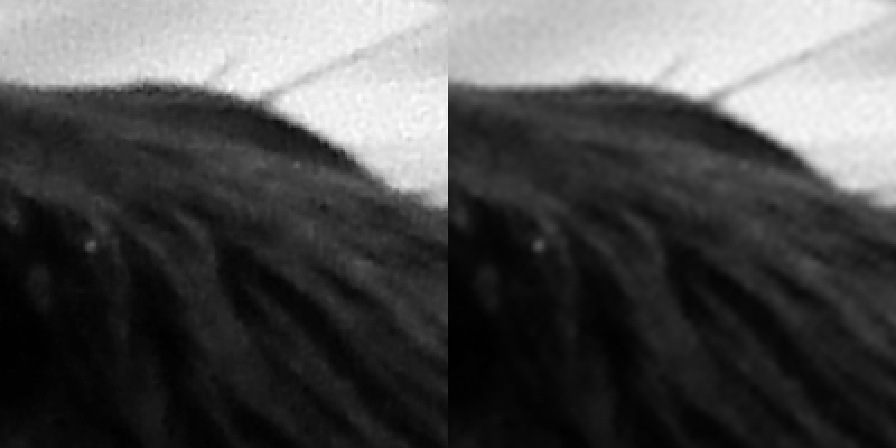{ width="100%" }

Figure 11. Beaver and water. Whiskers remain.
{ .caption }

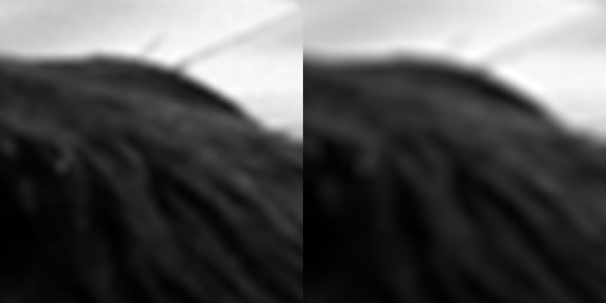{ width="100%" }

Figure 12. Beaver and water. Whiskers damaged by heavy filtering.
{ .caption }

Thus we see that the desire to enhance different features may affect our choice of filter and no one filter is ideal for all purposes.

## 6. Sobel and Laplacian Filters based upon Savitzky-Golay

A classic method for edge detection is to use length of the gradient vector; namely, the square root of the sum of squares of the first partial derivatives as follows.

<span style="position:relative;top:8.0pt">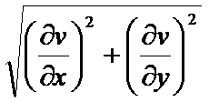</span>

Usually those partial derivatives are computed using divided differences of nearby pixels. The method is effective, but sensitive to noise in those pixels. We compute the derivatives using 7 by 7 Savitzky-Golay approximations and contrast that with the divided differences from \[[6](#ref6)\]. In Figure 13 we see that the edges are distinctly highlighted. The divided difference version shows many noise artefacts.

```
   lxy=:+&.*:

   3 lxy 4
5

   sob=:1 : 0
d=.(1,{.m) SG ({:m)
(d y)lxy d"_1 y
)

   BW256 view_data 5 spix zm2 3 7 sob g
1000 1000

   BW256 view_data 5 spix zm2 3 7 sob g
1000 1000

   dx=: 1 2 1 */ 1 0 _1

   ]dy=: |:dx
 1  2  1
 0  0  0
_1 _2 _1

   filt2=: *&dx +&.:*:&(+/@,) *&dy

   sobel=: 3 3&(filt2;._3)

   BW256 view_data 5 spix zm2 sobel g
1000 1000
```

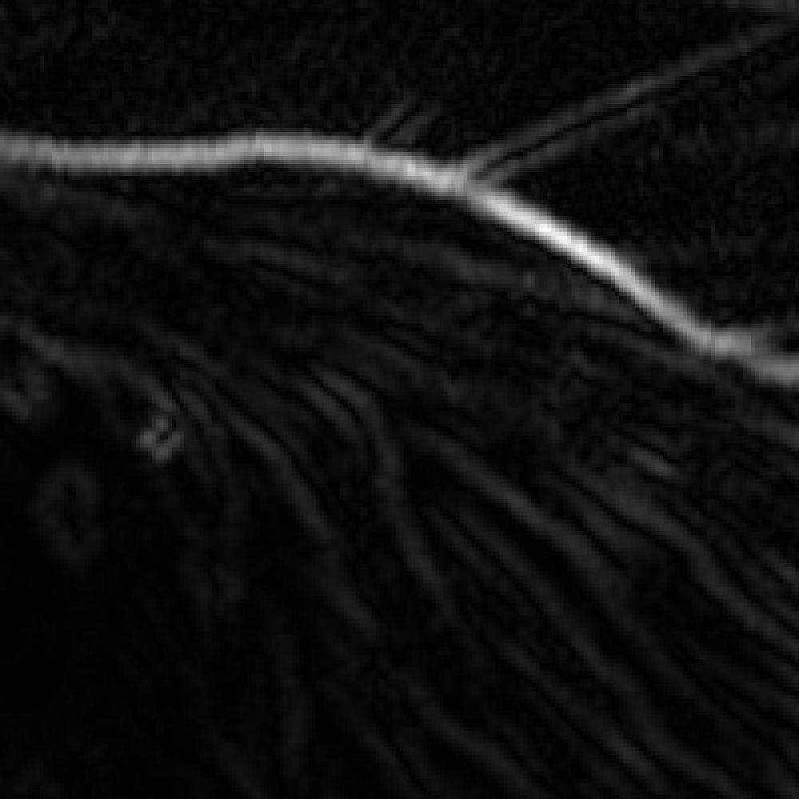{ width="49%" } { width="49%" }

Figure 13. Sobel edges using Savitzky-Golay derivatives (left) and using classic divided differences (right).
{ .caption }

The Laplacian is the sum of the second order derivatives with respect to the independent variables: <span style="position:relative;top:7.5pt">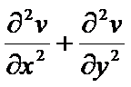</span>. Again, these are traditionally estimated using nearby pixels and are susceptible to the noise in those pixels. We use Savitzky-Golay estimates to reduce the noise in the second order derivatives. In Figure 14 we see that it detects edges with an up-down band.

```
   lap=:1 : 0
d=.(2,{.m) SG ({:m)
(d y)+d"_1 y
)

   BW256 view_data 5 spix  zm2 3 5 lap g
1000 1000

   BW256 view_data 5 spix  g ,.&zm2 g+2 2 lap g
2000 1000
```

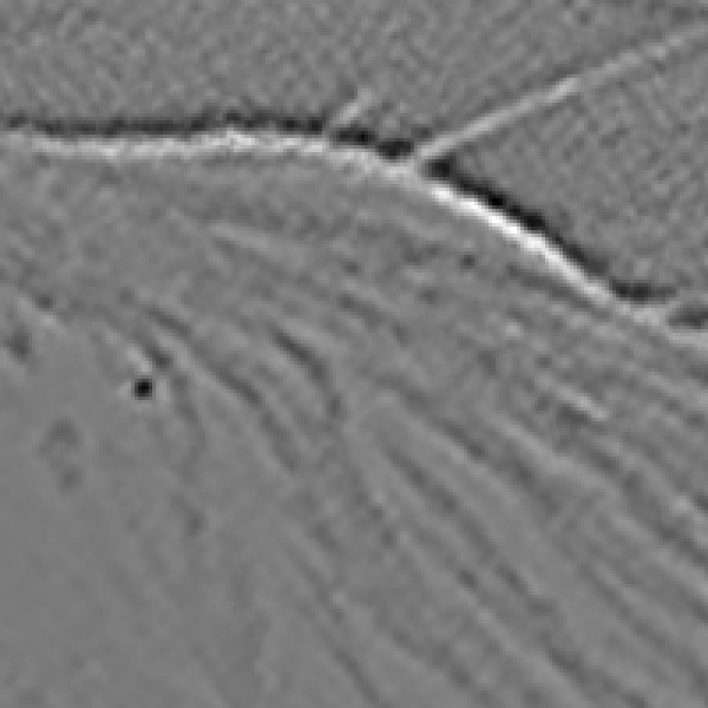{ width="50%" }

Figure 14. Laplacian shows edges with an up-down band.
{ .caption }

One application of the Laplacian is that when it is added to the original image in some cases the edges can be clarified and noise reduced. Figure 15 shows the original data and the data added to a Laplacian filter with radius and degree 2. Notice that a remarkable amount of noise has been removed.

```
      BW256 view_data 5 spix  g ,.&zm2 g+2 2 lap g
2000 1000
```

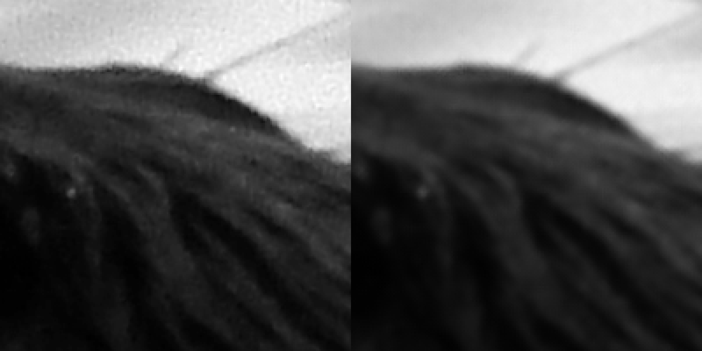{ width="100%" }

Figure 15. Image and image added to its Laplacian.
{ .caption }

## 7. Image Processing a Disk

We finish by offering a few lines that interested readers could use to investigate these Savitzky-Golay image processing tools on an abstract image of a disk. Readers might enjoy trying to predict the result based upon the discussion earlier in this note.

```
   BW256 view_data dot=:1>2*lxy/~(i:%])500
1001 1001
   BW256 view_data 1 10 sgv dot
1001 1001
   BW256 view_data 1 30 sgv dot
1001 1001
   BW256 view_data 3 30 sgv dot
1001 1001

   BW256 view_data 2 15 sob dot
1001 1001
   BW256 view_data 5 15 sob dot
1001 1001
   BW256 view_data 2 2 sob dot
1001 1001

   zm3=:3 : '200 200{.500 600}.y'
   BW256 view_data 3 5 lap dot
1001 1001
   BW256 view_data 5 spix dot ,.&zm3 dot+3 2 lap dot
2000 1000
```

## References

1. <a id="ref1"></a> Jsoftware, J6.01c, with Image3 and FVJ3 addons, [http://www.jsoftware.com](http://www.jsoftware.com), 2007.
2. <a id="ref2"></a> Anthony J. Owen, Uses of Derivate Spectroscopy, [http://www.chem.agilent.com/Library/applications/59633940.pdf](http://www.chem.agilent.com/Library/applications/59633940.pdf).
3. <a id="ref3"></a> William H. Press et al, Numerical recipes: the art of scientific computing, 3rd ed., Cambridge University Press, 2007.
4. <a id="ref4"></a> Cliff Reiter, With J: Image Processing 1: Smoothing Filters, *APL Quote Quad*, 34 2 (2004) 9-15.
5. <a id="ref5"></a> Cliff Reiter, With J: Image Processing 2: Color Spaces, *APL Quote Quad*, 34 3 (2004) 3-12
6. <a id="ref6"></a> Cliff Reiter, Fractals, Visualization and J, 3rd ed., Lulu.com, 2007.
7. <a id="ref7"></a> Cliff Reiter, Beaver image,  [http://webbox.lafayette.edu/~reiterc/j/vector/index.html](http://webbox.lafayette.edu/~reiterc/j/vector/index.html).
8. <a id="ref8"></a> John C. Russ, The image Processing Handbook, 5th edition, CRC Press, 2006.
9. <a id="ref9"></a> A. Savitzky and M.J.E. Golay, M.J.E., Smoothing and Differentiation of Data by Simplified Least Squares Procedures, Analytical Chemistry 36 8 (1964) 1627–1639.
10. <a id="ref10"></a> Wikipedia, Savitzky-Golay smoothing filter  [http://en.wikipedia.org/wiki/Savitzky-Golay\_smoothing\_filter](http://en.wikipedia.org/wiki/Savitzky-Golay_smoothing_filter)
