Trig Time
{ .subtitle }

by Norman Thomson
{ .byline }

A general objective of J-ottings over the years has been to draw attention to the considerable number of mathematical or mathematical type routines which are built into J primitives thereby leading to significant reductions of programming effort. One such feature is the versatility of j which although primarily a complex number constructor is adaptable to other circumstances in which objects are defined by pairs of numbers, for example betting odds (see J-ottings 54).

A further example concerns transformations of a 2-dimensional plane by means of matrices of the form

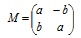

where a and are b real numbers. A transformation such as

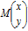

is called a **similitude**, that is a transformation which results in the combination of an **anti-clockwise rotation about the origin**  and an **enlargement** of the objects described by the coordinates. (For a clockwise rotation exchange b and –b ). Given `det=.-/ .*` standing for determinant, det M is a² + b² and its square root is the enlargement E. The rotation component is represented by *M* divided by E, resulting in a matrix of the form

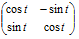

where t is the anti-clockwise angle of rotation.

Now although a similtude could be applied to a triangle whose points are, say, (0,0), (2,1) and (0,1) by

```
   ]M=.2 2$2 _3 3 2             NB. similitude matrix
2 _3
3  2
    ]tri=.2 3$0 2 0 0 1 1
0 2 0
0 1 1
   M +/ .*tri
0 1 _3
0 8  2
```

to give the transformed triangle (0,0), (1,8), (-3,2), clearly M is defined by the number pair (a,b) and so can be represented compactly as a `j` pair, in which case enlargement E and rotation t are given by :

```
   10 o. 2j3
3.60555                     NB. enlargement=sqrt of 2^2 + 3^2
   (%10&o.)2j3
0.5547j0.83205              NB. (cos x)j(sin x) where tan x=3%2
```

Instead of using a matrix inner product to transform points, simple multiplication is all that is required, so that the previous triangle transformation is given by

```
   each=.&>
   2j3*each 0j0 2j1 0j1     NB. triangle transformation
0 1j8 _3j2
```

Also since multiplication is commutative, a product such as `2j3*2j1` has two geometric interpretations, viz. the similtude `2j3` transforms the point (2,1) to the point (1,8) and the similtude `2j1` transforms the point (2,3) to (1,8).

For rotation without enlargement the transformed coordinates of the point (x, y) in the new frame of reference are

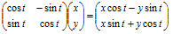

which can be confirmed by elementary trigonometry:

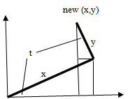

The components of displacement from \{x, y\} are thus

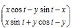 or 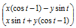

which can be written

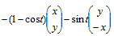.

The object of this rearrangement will become apparent shortly.

## Rotations in three dimensions

Here the geometry is more complicated and j no longer helps. Take those rotations in which any line through the origin may be chosen as axis. Define such a rotation by any point on it other than the origin, and normalise this so that the defining point lies on the unit sphere. The results of this normalisation are the direction cosines of the axis of rotation, that is the cosines of the angles which this axis makes separately with each of the coordinate axes :

```
   dircos=.% %:@(+/@:*:)       NB. direction cosines
   dircos 3 4 5
0.424264 0.565685 0.707107
```

A necessary preliminary is to obtain the cross-product of the rotation vector and a point to be rotated. To my knowledge there is no primitive which delivers cross-products directly, however it is a reasonably straightforward to write a verb xp. First stitch 3 4 5 (defining the axis) to 1 2 3, a point to rotated, and use the ‘all but one’ technique described in J-ottings 52 to obtain the submatrices obtained by progressively eliminating one row at a time. The determinant of each of these 2x2 matrices is required with a suitable adjustment for alternating signs leading to :

```
xp=.4 : '1 _1 1*det each<"(2) 1+\.(dircos x),.y'
```

One other requirement is an identity matrix of appropriate length :

```
   id=.=@i.@#               NB. identity matrix
```

Now suppose the anti-clockwise angle of rotation looking outwards from the origin is t. By a pleasing analogy with the two dimensional case the displacement components are

```
- (1 - cos t) times <a vector>  -  sin t times <a cross-product>
```

Where ‘a vector’ is the result of the matrix multiplication

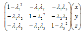

in which the λs are the direction cosines of the axis of rotation. The parameters defining a rotation are thus an axis (three coordinates) joined to the angle t, and it seems natural to take this 4-element vector as the left argument of a rotation verb. Also many people are more comfortable with degrees rather than radians, so define :

```
dtor=.180%~o.               NB. degrees to radians
```

rm defines the rotation matrix above and rmdata multiplies it with the coordinates of the data point being rotated :

```
rm =.(id - */~)@dircos      NB. rotation matrix
   rm 3 4 5
 0.82 _0.24 _0.3
_0.24  0.68 _0.4
 _0.3  _0.4  0.5
   rmdata=.rm@dircos@(}:@[) +/ .* ]
   (3 4 5,dtor 60) rmdata 1 2 3
_0.56 _0.08 0.4
```

(As an aside, taking the z axis as axis of rotation (0 0 1) so that λ<sub>3</sub> = 1 and λ <sub>1</sub> = λ<sub>2</sub> = 0 gives

```
    rm 0 0 1
1 0 0
0 1 0
0 0 0
```

which multiplies 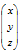 to give 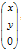 , while the cross-product of 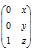 is 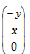 so that this reduces to the formula given earlier for the two-dimensional case. )

Next define m1 and m2, bearing in mind that t has to be extracted as the 4th element of the rotation vector:

```
    m1=.-.@(2&o.@({:@[))        NB. (1-cos t)
    m2=.1&o.@({:@[)             NB. sin t
```

Finally reflect the formula for the displacement components in

```
    rotate=.] - (m1 * rmdata) + m2 * }:@[ xp ]
    (1 0 0,dtor 90)rotate 1 2 3
1 3 _2
```

A couple of further checks helps confirm understanding :

(a) Rotate the point (1,2,3) through a *clockwise* angle of 90<sup>o</sup> about the x-axis:

```
   (1 0 0,dtor _90)rotate 1 2 3
1 _3 2
```

(b) Undo a clockwise rotation of (1,2,3) with an anti-clockwise one :

```
    axis=.?3$10 NB. choose an axis at random
    (axis,dtor 60)rotate (axis,dtor _60)rotate 1 2 3
1 2 3
```

Multiple data points are dealt with by, for example

```
   (<3 4 5,dtor 60)rotate each 1 2 3;2 3 1;3 1 2
1.03505  2.5299 2.55505
3.03722 1.56268 1.52753
1.82258 0.31773 3.25227
```

For practical uses consider that every minute of every day we all perform rotations on a merry-go-round called Earth which itself rotates continuously within an even larger solar system which itself gyrates around another even larger system and so on. Alternatively, from an earth-bound view, units of this larger system are in a perpetual state of 3-D rotation about what appears to us as a fixed axis. Perhaps there’s an idea here for next time …
