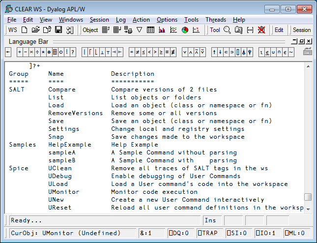
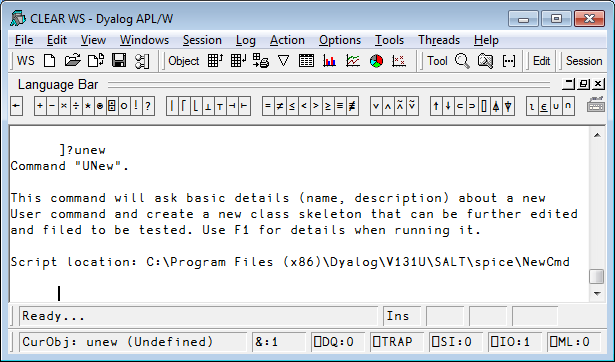
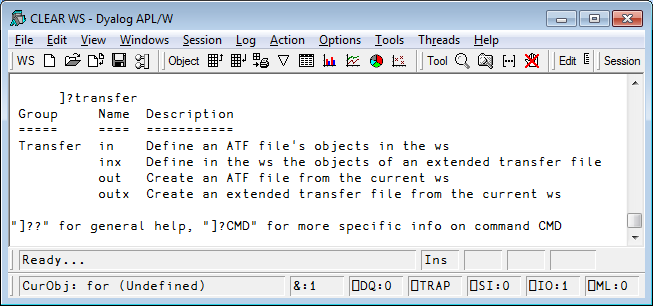
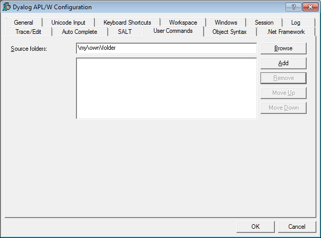

by Dan Baronet (danb@dyalog.com)
{ .byline }

## Prologue

With Version 12.1 Dyalog introduced “User Commands”. Like system commands, user commands are tools which are available to developers at any time, in any workspace. Unlike system commands, user commands are written in APL. Dyalog APL is shipped with a set of user commands, with APL source code that you can inspect and modify – or use as the basis for writing completely new user commands of your own. User commands are intended to make it easy to write and share development tools. User commands began life as Spice commands in version 11. This article assumes you know how to create a user command in Dyalog APL. To see how to create one see Vector article “Spice for beginners” in Vector 24/1.The rest of this article will concentrate on technicalities and tricks instead. If an input line begins with a closing square bracket “<strong>\]</strong>”, the system will interpret the line as a user command, temporarily loading the required code into the session namespace where it cannot conflict with any code in the active workspace, and executing it. For example:

```
    )load util
util saved whenever
    ]fns S*
SET  SETMON SETWX  SM_TS  SNAP
```

Help is easily accessible for user commands:

```
    ]?fns
Command "fnsLike"
Syntax:  accepts switches -regex -date=

Arg: pattern; returns names of fns matching the pattern given
-regex    uses full regular expression
-date     takes a YYMMDD value preceded by > or <

Script location: C:\ProgramFiles\D121U\SALT\spice\wsutils
```

As we can see above, the full name of the command is `fnslike`, but unambiguous abbreviations are allowed. The source code is in a file called `wsutils.dyalog` in the folder which is identified in the above output. New user commands can be installed simply by dropping new source code files into the command folder, making them instantly accessible without restarting any part of the system. A full list of installed user commands is available at any time:

```
        ]?
73 commands:

aplmon  calendar cd      commentalign    cfcompare      compare
(more lines here) …
varslike         wscompare       wsloc   wspeek  xref

Type "]?+" for a summary or "]??" for general help or "]?CMD"
for info on command CMD
```

## Implementation

When an input line begins with a closing square bracket, the system will look for a function named `⎕SE.UCMD` and call this function passing the rest of the input line as the right argument. The default session files (.DSE) contain a function which passes the command to the Spice command processor, which is based on <em>SALT</em>[\[1\]](#ref1). As a result any Spice commands that you may have developed before are now available as user commands in version 12.1.

Dyalog’s user commands are similar in concept to those implemented in other APL systems in the past[\[2\]](#ref2) – but the text based implementation is intended to allow much easier sharing of development tools.

## Using user commands

All *user commands* are entered in the session starting with a right bracket, in the same way that *system commands* start with a right parenthesis.

To execute command **xyz** type

```
    ]xyz
```

To find all available commands type

```
    ]?
```

To get a summarized list of all commands type

```
    ]?+
```

To get more general help type

```
    ]??  or  ]help
```

To find all the available commands in a specific folder type

```
    ]? \folder\name
```

To get info on command XYZ type

```
    ]?xyz  or  ]help xyz
```

To get detailed help/info on command XYZ type

```
    ]??xyz
```

To assign the result of a command to a variable type

```
    ]nl←cmdx …
```

Example:



To view help on a particular command type `]?cmdname`. For example, to find help on command `UNew`:



The names of commands are case insensitive, so `UNew` and `unew` are the same command.

Upon hitting Enter, the line is sent to the user command processor which determines which command has been selected, brings in the code, runs it, and then cleans up.

## Groups

Commands with common features can be regrouped under a single name. To find all the commands related to a particular group type `]?grpname`

For example, to list all the commands in the `transfer` group:



## Locations of commands

By default, the files defining user commands are located in the folder SALT\\spice below the main Dyalog program folder. You can change that by specifying a new location.

You can change the location using *Options/Configure User Commands Tab*, just remember the change won’t become effective until the next APL restart:



You can also change the location of user commands immediately (no need to restart APL) using the command `]settings`.

`]settings` takes 0, 1 or 2 arguments. With no argument, it displays the current value of ALL settings. With one argument it shows the value of that particular setting. With two arguments it resets the value of the setting specified.

The setting to use for the user command folder is ‘cmddir’. Thus

```
    ]settings cmddir
```

will report the folder(s) currently in use. The installed default is \[SALT\]\\spice, where `[SALT]` is shorthand for the SALT program folder. If you wish to use another folder, e.g. `\my\user\cmds` you should type

```
    ]settings    cmddir    \my\user\cmds
```

Note that this will change the setting *for the duration of the session only*. If you wish to make this permanent you should use the `–permanent` switch:

```
    ]settings   cmddir   \my\user\cmds  -permanent
```

More than one folder can be specified by separating the folders with semi colons (;), e.g.

```
    ]settings  cmddir  \my\user\cmds;\my\other\goodies
```

The folders will be used in the order specified. If a command with the same name appears in more than one folder, only the first occurrence will be used.

Because spaces are important in folder names you must take care **not** to introduce **any** spaces inappropriately.

If you replace the command folder with your own, you effectively disable most installed commands. Only the commands which are part of the *SALT* and *Spice* framework will remain active. See below for details on those.

If you wish to **add** to the existing settings you can either retype the list of folders including the previous ones or precede your new folder with a comma to mean “add” (in front), e.g.

```
    ]settings  cmddir ,\my\spice\cmds;\my\other\goodies
```

will add the two folders specified to any existing setting.

If your folder includes spaces or a dash you should use quotes:

```
    ]settings cmd '\tmp\a –b c;\apl\with spaces'
```

When you change the command folder it takes effect immediately. The next time you ask for `]?` or a command it scans the new folder(s) specified to cache the info related to all commands: name, description, parsing rules.

## Advanced topics

By default, all errors in user commands are trapped, possibly making it difficult to debug commands as you are working on them. To prevent this, you can set the `DEBUG` mode `ON`, as follows:

```
    ]udebug ON
```

### Tracing user commands

You can trace into a user commands just like any other APL expression. Because there is a setup involved in executing a user command it can take quite a few keystrokes to get to the actual code: first the `UCMD` function is called then the Spice processor, and finally your `Run` function. To speed up the process you can ask Spice to stop just prior to calling `Run` by adding a dash at the end of your command expressions, e.g.

```
    ]command  arguments  –
```

The dash will be stripped off and APL will stop on the line calling your `Run` function, allowing you to trace into your code.

This will only work when the `DEBUG` mode, as shown above, is `ON`.

### Parsing the input

If desired, your input line can be broken down into arguments and switches for you. To do so simply specify in function &lt;List> in your script what are the parsing rules for your command (see article ‘Spice for beginners’ in Vector 24/1 for details). The framework will build a namespace containing variable ‘Arguments’ and a variable for each switch mentioned. ‘Arguments’ will be a VTV (a vector of string vectors) containing all your arguments. This namespace will also contain some other utility functions and will be passed as 2nd argument to your &lt;Run> function. If you do not wish to have your input line parsed simply leave the parsing rules empty ('') and the framework will set your 2nd argument to whatever you entered on the command line, minus the command name itself.

In the text that follows A2 will represent that namespace passed as 2nd argument to your &lt;Run> function.

### Default values for switches

A switch always has a value, either 0 if not present on the command line, 1 if present without a value or a *string* matching the value of the switch. For example, if you use `–X=123` then `A2.X` will be a 3-element character vector, not an integer.

If you wish to default a switch to a specific value, you can either test its value for 0 and set it to your desired default, e.g.

```
:if  X≡0  ⋄  X←123  ⋄  :endif
```

or you can use the function `Switch` which is also found in your namespace (in the 2nd argument).

Monadic `Switch` returns the value of the switch as if it had been requested directly except that it returns 0 for invalid switches (an error normally).

Dyadic `Switch` returns the value of the left argument if the switch is undefined (0) or the value of the switch if defined but with a twist: if the value of the default is numeric it assumes the value of the switch should also be numeric and will transform it into a number, so if `–X=123` was entered, then (remember `A2` in the following text is your function &lt;Run>’s 2nd argument, a namespace containing all the switches)

```
99  A2.Switch  'X' ⍝ default to 99 if undefined
```

will return *(,123)* , not <em>'123'</em>[\[3\]](#ref3)

### Restricted names

If possible, avoid using switches named `Arguments`, `SwD`, `Switch`, `Propagate` or `Delim`, as these names are used by the parser itself (remember that switch names are case sensitive) and included in the 2nd argument. You **can** use these names, but they will not be defined as variables in the argument namespace. They will only be available through function `Switch`, for ex: `A2.Switch 'SwD'` will return the value of switch named `SwD`.

### Long arguments

There are times when arguments contain spaces. The user can put quotes around related elements. For example, if the user command `newid` accepts two arguments, say *full name* and *address* you would set `Parse` to `2` and the user would use, e.g.

```
    ]newid  'joe blough'  '42 Main str mycity'
```

If the command needed arguments *name, surname* and *address* (three arguments), the user would not need the quotes around ‘joe’ and ‘blough’, but would need them for the 3rd argument to keep the four parts of the address together.

If you want the **last** argument to contain “whatever is left”, then you can declare the command as ‘*long*’. If there are too many arguments, the “extra” ones will be merged into the last one (with a single space inserted between them). To do this, append an `L` after the number of arguments, for example, here, `3L` (plus switches if any).

An example of a logging command requiring one compulsory *long* argument would be coded `1L`:

```
    ]log    all this text is the argument.
```

Note that if there are multiple blanks anywhere in the text, they will be converted into single spaces.

### Short arguments

There are times when you only know the MAXIMUM number of arguments. For example there may be 0, 1 or 2 but no more. In that case you would code the parse string as `2S` for 2 Shorted arguments.

Another example is when you have a single argument which can be defaulted if not supplied. You would then use `1S` (plus switches if any) as parse string. If the user enters no argument (`0=⍴A2.Arguments`) then your program takes the proper action (e.g. default to a specific value).

### Forcing a reload of all commands

When you use a command which the framework does not recognize, it can scan the command folder(s) to see whether new commands have been added. This is the default behaviour when the `setting newcmd` is set to ‘auto’. However, if you change this setting to ‘manual’ or make a change to the short help or the parsing rules you will need to use the command `]ureset` to force a complete reload of all user commands.

### SALT commands

Because SALT is part of the user command framework, the commands which implement SALT itself are always available, even if you remove the default command folder from the *cmddir* setting. The commands in question are `load`, `save`, `compare`, `list`, `settings`, `removeversions` and `snap`. If you "shadow" these with your own command with the same names, you will effectively make them invisible, but you will always be able to call them directly by using the functions in `⎕SE.SALT`, for example `⎕SE.SALT.Load`.

### Detailed help

It is possible to provide several levels of help for your commands. When the user enters `]?xyz` the framework calls your &lt;<strong>Help</strong>> function with the name of the command (here `xyz`) as right argument. If your command accepts a left argument it will be given the number 0 for “basic help”.

It is possible to use more than one ‘<strong>?</strong>’ to specify the level of help required. Entering `]??xyz` is requesting more help than `]?xyz`. `]???xyz` even more so. In effect the left argument to your &lt;<em>Help</em>> function is the number of **extra** ‘?’ See command `]HelpExample` for details.

## More Implementation Details

User commands are implemented through a call to `⎕SE.UCMD` which is given the string to the right of the `]` as the right argument and a reference to calling space as the left argument. For example, if you happen to be in namespace `#.ABC` and enter the command

```
    ]XYZ   –mySwitch=blah
```

APL will make the following call to `⎕SE.UCMD`:

```
    #.ABC ⎕SE.UCMD 'XYZ  –mySwitch=blah'
```

preserving the command line exactly. The result returned by `UCMD` is displayed in the session.

This means that application code can invoke user commands by calling `⎕SE.UCMD` directly and that if you erase the function, you will disable user commands completely.

By default, `⎕SE.UCMD` calls *Spice*, which implements user commands as described in this document. Its right argument is simply passed on to Spice using (here) the call:

```
    ⎕SE.SALTUtils.Spice 'XYZ  –mySwitch=blah'
```

&lt;Spice> will make `UCMD`’s left argument available to your command via global `##.THIS` so you can reference the calling environment if you need to.

### Assigning the result of a command

It is possible to assign the result of a command by simply inserting an assignment between `]` and the command name. For example to assign the result of **list** to ‘a’:

```
    ]a←list -raw
    ⍴⎕←a
 <DIR>  lib        2010 7 8 17 38 10 879
 <DIR>  SALT       2010 7 8 17 38 10 889
 <DIR>  spice      2010 7 8 21 0 52 715
 <DIR>  study      2010 7 8 17 38 10 930
 <DIR>  tools      2010 7 8 17 38 10 948
5 5
```

To discard the result, do not specify a variable:

```
    ]←list -raw
```

To display line by line (as opposed to block by block) use quad:

```
    ⎕pw←30
    ]disp 2 32⍴';'
;;;;;;;;;;;;;;;;;;;;;;;;;;;;;;
;;;;;;;;;;;;;;;;;;;;;;;;;;;;;;

    ;;
    ;;
    ]⎕←disp 2 32⍴';'
;;;;;;;;;;;;;;;;;;;;;;;;;;;;;;
    ;;
;;;;;;;;;;;;;;;;;;;;;;;;;;;;;;
    ;;
```

### Detecting if the result will be captured

It may be interesting to know if the result of a command will be used. For example, command `]fnsLike` returns a matrix result but can be formatted to be seen like `)FNS`.

Since most calls issued in the session would require one to use `–format` to format the result a la `)FNS`, it is easier to assume this is always the case and make the command show a formatted result whenever called from the session.

For this the framework supplies a Boolean variable, `##.RIU` (Result Is Used), which tells whether the result is captured either because `⎕SE.UCMD` was used specifically or `]Z←cmd` was entered.

In the case above where we would **not** want `]fnsLike` to format the result we can always use `]⎕←fns` (quad assign the result).

### Source file of the command

Should you need to know which file your command came from, global `##.SourceFile` will provide that information.

## Epilogue

The user command implementation of Dyalog is changing but pretty stabilized. Dyalog will continue working on the framework but the community can add to the existing user command stock. There is a project underway to put general interest commands on the web. More on this in a subsequent article.

## References

1. <a id="ref1"></a> For details on SALT see articles [SALT: A Simple APL Library Toolkit](../art10011850/) in Vector 23/3 and [SALT II](../art10012050/) in 23/4
2. <a id="ref2"></a> APL/PC was the first to offer user commands. This was carried on to the rest of the APL+ family. It was using component files instead of text files to hold the code and data.
3. <a id="ref3"></a> The result is always a vector with Switch, this makes it easy to subsequently tell between 0 (switch not there) and ,0 (value supplied by the user)
