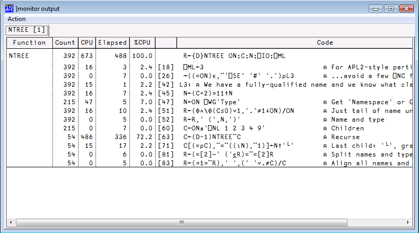

Dan Baronet (danb@dyalog.com)
{ .byline }

In proof reading this article Dan has informed me that many of the commands listed have already been modified a bit.
{ .ednote }

Version 13.1 is the third release which includes user commands. The user command mechanism is stable but should still be considered experimental to some extent: while the intention is that user commands built with version 13.1 will continue to work in future releases, the mechanism may be extended and many of the user commands shipped with the product are likely to be renamed, moved or significantly modified in the next couple of releases. V13 and 13.1 already have some changes which are mainly additions to the 12.1 set.

## Public user commands in Dyalog APL

Use `]?` To list the commands currently installed.

Commands are divided into groups. Each group is presented here along with its commands.

To get examples or more information use`]??`command . For example, to get detailed info on command wslocate do

```
    ]??wslocate
```

The commands are divided into groups. Commands are usually regrouped under a same script with the same group name but it does not have to be this way. A script may regroup several commands with different groups and a group may comprise several commands distributed over several scripts.

## Group SALT

This group contains commands that correspond to the SALT functions of the same name found in `⎕SE.SALT:` `Save`, `Load`, `List`, `Compare`, `Settings`, `Snap` and `RemoveVersions`.

**Example:**

```
    ]save  myClass  \tmp\classX  -ver
```

This will do the same as

```
    ⎕SE.SALT.Save 'myClass  \tmp\classX  -ver'
```

## Group Sample

There are commands in this group used to demonstrate the use of help and parsing user command lines. You should have a look at the classes and read the comments in them to better understand the examples.

## Group Spice

This group contains nine commands: UClean, UDebug, Uload, Umonitor,UNew, USetup, UReset, Uupdate and UVersion. They are used to manage the user command system itself.

### Command UClean

This command removes any trace of SALT in the workspace by removing all tags associated with SALT with each object in the workspace. Once you run it the editor will no longer put changes back in the source file(s).

### Command UDebug

This command turns debugging ON and OFF in order to stop on errors when they happen. Otherwise the error will be reported in the calling environment. It also enables the ‘stop before calling the run function’ feature which consists in adding a dash at the end of the command as in

```
    ]mycmd myarg -
```

UDebug can also turn system debugging on and off[\[1\]](#ref1). For example, to turn the *w* debug flag on use

```
    ]udebug +w
```

to turn it off use

```
    ]udebug -w
```

### Command ULoad

This command is used to bring in the workspace the namespace associated with a user command. It is typically used when debugging a user command and you need the code in order to work with it.

**Example:** load the code for the CPUTime command:

```
    ]uload  cpu
Command “CPUTime” is now found in <#.Monitor>
```

The namespace Monitor containing the code the for the CPUTime user command was brought in from file. We can now edit the namespace and modify the command. When we exit from the editor, the namespace will automatically be saved back to the script file from whence it came. There is no need for a `usave` command since *SALT's* `save` command already saves code and subsequent changes are handled by the editor’s callback function. However, there is a command for creating a new command, `UNew`, described below.

### Command UMonitor

This command turns monitoring ON or OFF. When ON, all active functions see their `⎕CR` and their `⎕MONITOR` information paired in global variable `#.UCMDMonitor`

Results are set in `#.UCMDMonitor` after each invocation of a command.

`-var=` sets the name of the variable to store the result instead of `#.UCMDMonitor`

### Command UNew

This command is used to create a namespace containing one or more user commands.

It saves you from having to create a new script from scratch.

It creates a form which is used to input all the basic information about the commands contained in a *Spice* namespace: the command names, their groups, their short and long description and details of switches.

Each command’s information is entered one after another.

When finished it creates a namespace which you can edit and finally save as a file.

### Command UReset

Forces a reload of all user commands – this may be required e.g. after modifying a command’s description or parsing rules which are kept in memory.

### Command UUpdate

This command will update your current version of SALT and user commands to the latest version. This command must be run manually as prompts are issued to do the work although the -noprompt switch allows to bypass them.

### Command UVersion

This command reports various version numbers: for APL, SALT, .NET and UCMD itself. If given the name of a file containing a workspace it will display the minimum version of Dyalog necessary to `)LOAD` the workspace.

## Group svn

This group contains a series of commands used as cover to SubVersion functions of the same name. For example, `svnci` is equivalent to *svn ci* and commits changes made to the current working copy. This is only useful if you have SubVersion installed and in use.

## Group SysMon

This group contains three commands for measuring CPU consumption in various ways: `CPUTime` simply measures the total time spent executing a statement, `Monitor` uses `MONITOR` to break CPU consumption down by line of application code, and `APLMON` breaks consumption down by APL Primitive.

### Command APLMON

From version 12.0, Dyalog APL provides a root method which allows profiling of application code execution, breaking CPU usage down by APL primitive rather than by code line. The `APLMON` command gives access to this functionality.

As with `Monitor`, you can either run the command with the switch `–on` to enable monitoring, run your application, and then run the command again with the switch `–report` to produce a report, or you can pass an expression as an argument, in which case the command will switch monitoring on, run the expression, and produce a report immediately. The only other switch is `–filename=`, which allows specification of the APLMON output file to be used. If it is omitted, a filename will be generated in the folder which holds your APL session log file.

**Examples:**

```
    ]aplmon ⍴{+/1=⍵∨⍳⍵}¨⍳1000 –file=\tmp\data
1000
Written: C:\tmp\data.csv
```

The above command generated a log file name, enabled APLMON logging, ran the expression and switched APLMON off again. You can report on the contents of this file using the “aplmon” workspace, or send it to Dyalog for analysis.

```
    )load aplmon
    InitMon '\tmp\data.csv'
Total CPU Time   =  0.15 seconds
Total primitives =           5,003
                        count  sum hitcount  sum time    pct  time
---------------------------------------------------------------
 1.      or          │      7         1,000  0.136557  94.03  ▏
 2.      equal       │      6         1,000  0.00454    3.13  ▏
 3.      iota        │      1         1,001  0.003087   2.13  ▏
 4. plus slash       │      6         1,000  0.001038   0.71  ▏
```

### Command CPUTime

This command is used to measure the CPU and Elapsed time required to execute an APL expression. There are two switches, `-repeat=` which allows you to have the expression repeated a number of times and/or some period of time and `–details=` which specifies how much details should be included. By default, the expression is executed once. The report always shows the average time for a single execution.

It can also accept a combination of both iterations and period, for example the maximum between 10 iterations and 1000 milliseconds. If 1 second is not enough to run the expression 10 times it repeats until the expression has been executed 10 times. On the other hand if the expression ran 10 times in less than 1 second it continues to run until 1 second has gone by. It would be specified this way: `-repeat=10 ⌈ 1s`

With `–details=none` only the numbers are returned as a 2 column matrix (CPU and elapsed), 1 row per expression.

With `–details=ai` only the same numbers plus the 2 `⎕AI` numbers are returned (Nx4 matrix).

With `–details` or `–details=all` nothing is returned; instead, a report that includes the number of times repeated and the `⌷AI` and `⌷MONITOR` numbers is shown.

**Examples:**

```
    ]cputime {+/1=⍵∨⍳⍵}¨⍳1000
* Benchmarking "{+/1=⍵∨⍳⍵}¨⍳1000"
             Exp
 CPU (avg):   63
 Elapsed:     67

    ]cputime {+/1=⍵∨⍳⍵}¨⍳1000 -repeat=1s
* Benchmarking "{+/1=⍵∨⍳⍵}¨⍳1000", repeat=1s
             Exp
 CPU (avg):   54.6
 Elapsed:     55.2

    ]cpu  {+/1=⍵∨⍳⍵}¨⍳100  ⍳⍨⍳1e6  -details=ai -rep=50
 0.64  0.46  0.64  0.46
30.58 30.52 30.58 30.52
```

The last example shows the 2x4 result for the 2 expressions tested.

### Command Monitor

This command is used to find out which lines of code in your application are consuming most CPU. You can either run the command with the switch –on to enable monitoring, run your application, and then run the command again with the switch –report to produce a report, or you can pass an expression as an argument, in which case the command will switch monitoring on, run the expression, and produce a report immediately. Other switches are:

| Switch | Effect |
| --- | --- |
| `-top=n` | Limits report to the n functions consuming the most CPU |
| `-min=n` | Only reports lines which consume at least n% of the total, either CPU or Elapsed time |
| `-fns=fn1,fn2,…` | Only monitors named functions |
| `-caption=text` | Caption for the tab created for this report |

**Examples:**

```
    ]monitor –on
Monitoring switched on for 44 functions

    5↑[1]NTREE '⎕SE'
⎕SE                     (Session)
├─Chart                 (Namespace)
│ ├─CheckData           (Function)
│ ├─Do                  (Function)
│ ├─DoChart             (Function)

    ]mon -rep -cap=NTREE
```

(Pops up the following dialog)



### Command Profile

This command is used to fine tune your application. This is a more complex command that will be the subject of a separate article.

## Group System

This group contains operating system related commands.

### Command assemblies

This command lists all the assemblies loaded in memory.

### Command cd

This command will change directory **in Windows only**. It reports the previous directory or the current directory if the argument is empty.

**Example:** switch to directory *\\tmp* for the remaining of the session:

```
    ]cd  \tmp
C:\Users\Danb\Desktop
```

### Command EFA

This command will associate Windows® file extensions .dyapp and .dyalog with a specific Dyalog APL version. This is useful only if you have several versions installed and wish to change the current association made with the latest install.

## Group Tools

This group contains a series of commands used to perform tasks related to everyday activities.

### Command calendar

This command is similar to Unix’ cal program and displays a calendar for the year or the month requested.

**Example:**

```
    ]cal  2010 3
     March 2010
Su Mo Tu We Th Fr Sa
    1  2  3  4  5  6
 7  8  9 10 11 12 13
14 15 16 17 18 19 20
21 22 23 24 25 26 27
28 29 30 31
```

### Command Demo

Demo provides a *playback* mechanism for live demonstrations of code written in Dyalog APL

Demo takes a script (a text file) name as argument and executes each APL line in it after displaying it on the screen.

It also sets F12 to display the next line and F11 to display the previous line. This allows you to rehearse a demo comprising a series of lines you call, in sequence, by using F12.

For example, if you wish to demo how to do something special, statement by statement you could put them in file *\\tmp\\mydemo.txt* and demo it by doing

```
    ]demo \tmp\mydemo
```

The extension TXT will be assumed if no extension is present.

The first line will be shown and executed when you press Enter. F12 will show the next which will be executed when you press Enter, etc.

### Command dinput

This command is used to test multi line D-expressions.

**Example:**

```
    ]Dinput      ⍝ multi-line expression
....{            ⍝ dup:
........⍵ ⍵
....}{           ⍝ twice:
........⍺⍺ ⍺⍺ ⍵
....}7
 7 7  7 7
```

### Command disp

This command will display APL expressions using boxes around enclosed elements as per the familiar disp function.

#### Example:

```
disp ⍳¨⍳2 3
┌→────┬─────────┬─────────────┐
↓┌→──┐│┌→──┬───┐│┌→──┬───┬───┐│
│↓1 1││↓1 1│1 2││↓1 1│1 2│1 3││
│└~─→┘↓└~─→┴~─→┘↓└~─→┴~─→┴~─→┘↓
├────→┼────────→┼────────────→┤
│┌→──┐│┌→──┬───┐│┌→──┬───┬───┐│
│↓1 1││↓1 1│1 2││↓1 1│1 2│1 3││
│├~─→┤│├~─→┼~─→┤│├~─→┼~─→┼~─→┤│
││2 1│││2 1│2 2│││2 1│2 2│2 3││
│└~─→┘↓└~─→┴~─→┘↓└~─→┴~─→┴~─→┘↓
└────→┴────────→┴────────────→┘
```

### Command display

This command will display APL expressions using boxes around enclosed elements as per the familiar `DISPLAY` function.

Note that this command is different from the disp command just like the 2 functions disp and DISPLAY are different and you must enter at least ‘displ’ to use it.

**Example:**

```
    ]display ⍳¨⍳2 3
┌→────────────────────────────────────────────────┐
↓ ┌→──────┐ ┌→────────────┐ ┌→──────────────────┐ │
│ ↓ ┌→──┐ │ ↓ ┌→──┐ ┌→──┐ │ ↓ ┌→──┐ ┌→──┐ ┌→──┐ │ │
│ │ │1 1│ │ │ │1 1│ │1 2│ │ │ │1 1│ │1 2│ │1 3│ │ │
│ │ └~──┘ │ │ └~──┘ └~──┘ │ │ └~──┘ └~──┘ └~──┘ │ │
│ └∊──────┘ └∊────────────┘ └∊──────────────────┘ │
│ ┌→──────┐ ┌→────────────┐ ┌→──────────────────┐ │
│ ↓ ┌→──┐ │ ↓ ┌→──┐ ┌→──┐ │ ↓ ┌→──┐ ┌→──┐ ┌→──┐ │ │
│ │ │1 1│ │ │ │1 1│ │1 2│ │ │ │1 1│ │1 2│ │1 3│ │ │
│ │ └~──┘ │ │ └~──┘ └~──┘ │ │ └~──┘ └~──┘ └~──┘ │ │
│ │ ┌→──┐ │ │ ┌→──┐ ┌→──┐ │ │ ┌→──┐ ┌→──┐ ┌→──┐ │ │
│ │ │2 1│ │ │ │2 1│ │2 2│ │ │ │2 1│ │2 2│ │2 3│ │ │
│ │ └~──┘ │ │ └~──┘ └~──┘ │ │ └~──┘ └~──┘ └~──┘ │ │
│ └∊──────┘ └∊────────────┘ └∊──────────────────┘ │
└∊────────────────────────────────────────────────┘
```

### Command dmx

This command will provide more detailed information about the last APL error. It uses `⎕DMX`, the new Display Message eXtended system variable to do its work.

### Command factorsof

This command will return the factors that constitute a number.

**Example:**

```
    ]fac 123456789
3 3 3607 3803
```

### Command FFind

This command searches the *.dyalog* files in, by default, the current SALT working directory for the string given as argument in *SALT* script files. It needs one long argument which may be a *.Net* regular expression[\[2\]](#ref2).

It reports all the hits in each script file where found.

To search different directories use the switch –folder to specify the new location.

`-options` will accept a value of I (insensitive), S (Singleline mode) or M (Multiline mode – the default) to change search behavior.

`-types` will accept the extensions to use when searching (default *.dyalog*)

`-regex` will consider the argument to be a regular expression

**Example:**

```
    ]ffind \b(abc|\w{7})\b –folder=\tmp -typ=txt log -r
```

will find *abc* or all 7 letter words in all *.txt* or *.log* files in *\\tmp*, and below. `–r` is short for `–regex`; without it the exact text above would be looked for.

### Command FnCalls

This command is used to find the calls made by a program in a script file or in the workspace.

It takes one or two arguments: the function name and the namespace or filename where it resides (default current namespace). With switch `–details` it can provide extra details on all the names involved such as locals, globals, unused, recursively called, etc.

With switch `–treeview` it will show the result in a treeview window instead of the session log.

If the switch `–file` is provided the namespace is assumed to be the name of a file.

**Example:**

```
    ]fncalls Spice '\Dya -APL\12.1\SALT\SALTUtils'  -fil
Level 1:  →Spice
⍝ Handle KeyPress in command window
⍝ The function can also be used directly with a string
F:isChar            F:isHelp            F:isRelPath
F:BootSpice         F:GetSpiceList      F:SpiceHELP

Level 2: Spice→isChar
…
Level 2: Spice→BootSpice
⍝ Set up Spice
F:GetList      R:Spice

Level 3: BootSpice→GetList
⍝ Retrieve the list of all Spice commands
F:getEnvir     F:lCase        F:splitOn     F:ClassFolder

Level 4: GetList→ClassFolder
⍝ Produce full path by merging root and folder name
…
```

NB: the argument `'\Dya -APL\12.1\SALT\SALTUtils'` is surrounded by quotes because it contains a dash

At each level the calling function is followed by the called function which is detailed. It lists each function called preceded by either an `F` (for function) or an `R` (for recursive call). We can see at the 1st level that function `Spice` calls 6 other functions and at the 2nd level function `isChar` calls nothing and `BootSpice` calls 2 functions: `GetList` and `Spice`, recursively. At the 3rd level `GetList` calls 4 functions and so on.

With the switch `–full` the output repeats for already shown functions. This may produce output where the same function calls may be different if objects are shadowed up the stack.

With the switch `–details` each object is preceded by either `F` or `R` as above or a character meaning:

```
○: local
G: global
!: undefined local
↑: glocal (global localized higher on the stack)
L: label
l: unreferenced label
*: previously described in the output
```

NB The abbreviation `*: previously described in the output` won’t happen when switch `–full` is used.

With the switch `–isolate` all the object names required to run the function given as argument are returned in matrix form. Moreover, if `–isolate` takes an unused APL name as value (e.g. `–isolate=newNs`) then all the objects are copied into the new namespace. This allows you to modularize code by isolating individual sections.

### Command FReplace

This command searches the *.dyalog* files in, by default, the SALT current working directory for the string given as first argument in SALT script files and replaces occurrences by the second (long) argument. It needs two arguments which may be *.Net* regular expressions[\[3\]](#ref3) if the switch `–regex` is used.

To work on a different directory use the switch `–folder` to specify the new location.

`-options` will accept a value of `I` (insensitive), `S` (Singleline mode) or `M` (Multiline mode – the default) to change search behavior.

`-types` will accept the extensions to use when searching (default .dyalog)

`-regex` will consider the arguments to be regular expressions

**Example:**

```
    ]frepl Name:\s+(\w+)\s+(\w+) Name: $2, $1 -f=\tmp -r
```

will reverse every occurrence of two words (`-r` means this is a regular expression) when they follow `Name:` , i.e

```
Name:  Joe   Blough
```

will become

```
Name: Blough, Joe
```

in every file it finds in the directory `\tmp`

### Command fromhex

This command will display an hexadecimal value in decimal

**Example:**

```
    ]fromhex   FFF  A0
4095  160
```

### Command ftttots

This command will display a number representing a file component time information into a `⎕TS` form (7 numbers).

```
    ]ftttots 3⌷⎕frdci 4 1
2011 3 10 23 16 28 0
```

### Command GUIProps

This command will report the properties (and their values), *childlist*, *eventlist* and *proplist* of the event given as argument or, if none provided, the object on which the session has focus (the object whose name appears in the bottom left corner of the session log).

### Command latest

This command will list the names of the youngest functions changed (most likely today, otherwise of the last changed day), the most recently changed first.

### Command open

This command opens a specific file with the proper program, e.g. an *Excel* spreadsheet, or it open *Explorer* (under Windows®) to view the files in the main SALT folder. It replaces `]explore` with has been decommissioned.

### Command Summary

This command produces a summary of the functions in a class in a script file. It takes a full pathname as single (long) argument. If the switch `–file` is provided the name is assumed to be a file.

```
    ]summary ⎕SE.Parser
name       scope  size  syntax
 fixCase             24   n0f
 if                  24   n0f
 init       PC     4500   n1f
 xCut               532   r2m
 Parse      P      5748   r1f
 Propagate  S      1220   r2f
 Switch            1152   r2f
```

*Scope* shows S if shared, P if public, C if constructor and D if destructor

*Size* is in bytes

*Syntax* is a 3 letter code:

```
[1] n=no result, r=result
[2] # of arguments (valence)
[3] f=function, m=monadic operator, d=dyadic operator
```

### Command tohex

This command will display a number in hexadecimal value

**Example:**

```
    ]tohex   100 256
64  100
```

### Command tohtml

This command will produce HTML text that displays a namespace or a class in a browser. It accepts five switches

`-title=` will take a string to be displayed at the top of the page, e.g.

```
–title=<center>My best Class</center>
```

`-full` will include the full HTML code, including the &lt;head> section before the &lt;body>

`-filename=` write the result to the file specified

`-clipboard` will put the result on the clipboard, ready to be pasted elsewhere

`-xref` will produce a Cross-reference of the names used in the class in relation to all the methods

### Command WSpeek

Executes an expression in a temp copy a workspace. As its name suggests, WSpeek is used to view, rather than to change, a saved workspace; any changes made in the copy are discarded on termination of the command. A `wsid='.'` means the saved copy of the current workspace.

```
    ]WSpeek wsid [expr ...] ⍝ expr defaults to ⍎⎕LX
```

**Example:** execute the &lt;queens> program from the ‘dfns’ workspace

```
    ]wsp  dfns  0 disp queens 5
```

### Command Xref

This command returns a Cross-reference of the object given. If the switch `–file` is provided the name is assumed to be a file.

It produces a very crude display of all references on top against all functions to the left. At the intersection of a function and a reference is shown a symbol denoting the nature of the reference in relation to the function: *o* means local, *G* mean global, *F* means function, *L* means label.

**Example:**

```
    ]xref  \Program Files\Dyalog\SALT\lib\rundemo -file
        ccfkllnpssszzzFFILNPPS
        llieaiaa_cn...iinieaoc
         .lybnms ri.NRllinxtsr
         Tes eet ip.eaeetethni
         e . . e p .sw . . . p
         x . . . t .t. N . . t
         t . . . . . . . . . .
         - - - - : - - - - : -
 Edit    . . . . ○ . . G . : G
 Init    . . . .○: . . . .F:GG
 Load    .○. .○. : ○GGG.F. G G
```

As can be seen in this report, name `script` is a local in function `edit`. The characters *dot*, *dash* and *semi colon* only serve as alignment decorators and have no special meaning.

## Group Transfer

This group contains four commands: *in*, *out*, *inx* and *outx*. *In* and *Out* read or write APL Transfer Files in the standard ATF format, and should be compatible with similarly named user or system commands in other APL implementations. **Inx** and **Outx**  use a format which has been extended to represent elements of a workspace which have been introduced in Dyalog APL since the ATF format was defined.

See the Dyalog APL Windows Workspace Transfer v12.1 for more details.

## Group wsutils

This group contains several commands used for workspace management and debugging. Some of the commands take a filter as an argument, to identify a selection of objects. By default, the filters are in the format used for filtering file names under Windows or Unix, using <em>?</em> as a wildcard for a single character and <em>\*</em> for 0 or more characters. For example, to denote all objects starting with the letter A you would use the pattern A\*.

Regular expressions can be used to select objects. You indicate that your filter is a regular expression by providing the switch `–regex`.

The commands which accept filters are *fnslike*, *varslike*, *nameslike*, *reordlocals*, *sizeof* and *commentalign*. They all apply to *the current namespace*, i.e. you cannot supply a dotted name as argument.

Also, very often the same command will accept a –date switch which specifies the date to which the argument applies. This will typically be used when functions are involved, for example when looking for functions older than a date, say 2009-01-01, you would use `–date=<90101` . The century, year and month are assumed to be the current one so if using this expression in 2009 using `–date=<101` would be sufficient. You can use other comparison symbols and –date=≠80506 would look for dates different than 2008-05-06. Ranges are possible too and `–date=81011-90203` would look for dates from 2008-10-11 to 2009-02-03 included.

The value of *date* is &lt;90101, the &lt; is included which is why the syntax includes both = and &lt;.

### Command cfcompare

This command compares 2 APL component files. It accepts the same switches as `varcompare` plus switch `–cpts` which list the components to compare. It accepts two arguments: either the path of files or their tie number if already tied. They can be optionally followed by *:passnumber* if the file(s) require one for reading

**Example:**

```
    ]cfcompare  \tmp\abc:123   27  -cpts=5 7, 9-99
```

This will compare file *\\tmp\\abc* with the file using 27 as tie number. The passnumber 123 will be used for file *\\tmp\\abc* to read the components. Only components 5, 7 and 9 to 99 will be compared.

Only those components with the same number will be compared; if the 1st file’s components range from 1 to 10 and the 2nd’s range from 6 to 22 then only components 6 to 10 will be compared. In this case because a set has been specified only components 7, 9 and 10 would be compared.

If either the path of the name of the 2nd file is the same as the 1st’s then `=` can be used to abbreviate the name. For example to compare files ABC and XYZ in folder *\\tmp\\long\\path* you can enter

```
    ]cfcomp  \tmp\long\path\ABC  =\XYZ
```

See command `varcompare` for the list of other accepted switches.

### Command CommentAlign

This command will align all the end of line comments of a series of functions to column 40 or to the column specified with the `–offset` switch.

The arguments are DOS type patterns for names which can be viewed as a regular expression pattern if switch `–regex` is supplied. The `–date` switch can also be applied.

The result is the list of functions that were modified in column format or in `)FNS` format if switch `–format` is supplied.

**Example:**

```
    ]commentalign  HTML*  -format  -offset=30
```

This will align all comments at column 30 for all functions starting with *HTML* and display the names of all the functions it modified in `)FNS` format

### Command fncompare

This command will show the difference between 2 functions, including timestamps. It can handle large functions and has switches to trim the functions first, exclude the timestamps, etc.

**Example:**

```
given:    ∇fna                  ∇fnb
       [1] same line         [1] same line
       [2] fna line 2        [2] fnb line 2
       [3] same line 3       [3] same line 3
       [4] ⍝ comment deleted [4] new common line
       [5] new common line   [5] ⍝ new comment
          ∇                     ∇

    ]fncomp fna fnb
←[0]   fna
→      fnb
 [1]   same line
←[2]   fna line 2
→      fnb line 2
 [3]   same line 3
←[4]  ⍝ comment deleted
 [5]   new common line
→     ⍝ new comment
```

**Switches**

```
-normalize  removes excess space at the ends of each line
-delins  change the delete/insert characters
-exts   exclude timestamps in comparison
-zone   specify how many lines to show before and after each difference
-nolastline  exclude the last line of each function (ex ignore SALT tag
lines)
```

### Command fndiff

This command will show the different lines between two functions by showing the differences side by side. It is more suited for small functions. With the same example functions as in fncompare:

**Example:**

```
    ]fndiff fna fnb
.fna.   .   .   .   .   │.fnb.   .   .   .   .   .   .
.fna.line 2 .   .   .   │.fnb.line 2 .   .   .   .   .
⍝ comment deleted   .   │⍝ new comment   .   .   .   .
```

### Command fnslike

This command will show all functions names following a pattern in their names. It accepts the `–regex`, `-date` and `–format` switches.

### Command nameslike

This command will show all objects following a same pattern in their names. Each name will be followed by the class of the name.

It accepts the `–regex`, `-date` and `–format` switches.

<strong>Example:</strong>find all names containing the letter *a*:

```
    ]nameslike  *a*
aplUtils.9        disableSALT.3     enableSALT.3
commandLineArgs.2 disableSPICE.3    enableSPICE.3
```

### Command reordlocals

This command will reorder the local names in the header of the functions given in the argument. The argument is a series of patterns representing the names to be affected. It accepts the `–regex`, `-date` and `–format` switches.

### Command sizeof

This command will show you the size of the variables and namespaces given in the argument. The argument is a series of patterns (including none=ALL) representing the names affected. It accepts the `–class` switch to specify the classes involved and the `-top` switch to limit the number of items shown.

**Example:**

```
    )obs
NStoScript      aplUtils        test
    )vars
CR      DELINS  Describe        FS
    ]size -top=4 –class=2 9
NStoScript 132352
aplUtils    40964
test        31996
Describe    10128
```

### Command supdate

This command will update a namespace script with newly added variables and functions.

This can come in handy when you’ve added code and data inside a scripted namespace.

**Example:**

```
    ]load myns
    )cs myns
    V ←⍳9
    ⎕fx  'myfn'  '2+2'
⍝ Now update the script to include these new objects
    ]supdate
Added 1 variables and 1 functions
```

### Command varcompare

This command will compare two variables including namespaces which contain functions and other variables and namespaces. For this reason it includes the same switches as command `fncompare` plus the following:

```
-exnames=   exclude names from the comparison
-nlines=    show only the 1st n lines of each variable not in the other
 object
-show=      show only specific sections of the comparison report
-nssrc      force the use of source for namespaces if they exist instead of
            comparing object by object
```

See `]??varcompare` for details

### Command varslike

This command will show all variables following a same pattern in their names. It accepts the `–regex` and `–format` switches.

### Command wscompare

This command will show the difference between two workspaces. It is a combination of the commands `fncompare` and `varcompare` being run on entire workspaces. The workspaces are first copied into temporary namespaces and the comparison then performed. It includes the switches of `fncompare` and `varcompare` plus the following:

```
-exstring=      exclude object containing this string
-gatheroutput   gather all the output and return it as a result
                (can be quite large)
```

### Command wslocate

This command will search strings in the current namespace. It accepts a number of switches that allow it to screen out hits in comments, text, etc. It accepts normal and regular expressions and will perform replacement on most objects. It is a very comprehensive command. For example it allows you to find where 3 names are assigned 3 numbers. See its documentation (`]??wslocate`) for details.

**Example:** look for the words ending in *AV* (syntactically to the right), regardless of case, in text only (exclude Body and Comments):

```
    ]wslocate AV –syntactic=r –insensitive –exclude=bc
Search String (Find and Replace) for Dyalog V6.01

    ∇ #.xfrfrom (3 found)
[57]  ⍎(∆⍙trans=2)/oNS,'∆AV←bUf'
                         ∧
[72]  ∆⍙CodT←∆⍙CodT,(∆⍙trans=2)/'%⎕av[%∆AV['
                                   ∧    ∧
```

### Footnotes

1. <a id="ref1"></a>system debug flags are used to debug the interpreter itself. See the User Guide for details on this topic.
2. <a id="ref2"></a>to look for or replace strings in the workspace use command WSLOCATE
3. <a id="ref3"></a>For *.Net* regular expressions see   [http://msdn.microsoft.com/en-us/library/az24scfc(VS.71).aspx](http://msdn.microsoft.com/en-us/library/az24scfc(VS.71).aspx)
