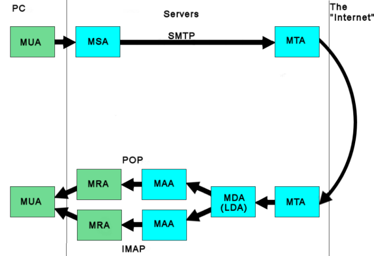

Chris Hogan (chris.hogan@4xtra.com)
{ .byline }

The details of how standard email is generated, propagated across the Internet and received by a remote reader are usually hidden behind elaborate GUIs. This short article sets out to explain the basics of email processing and to show how an APL system can benefit from being able to utilise direct access to email handling. Some samples of code and brief case studies are included to illustrate the procedures involved and the uses to which they may be put.
{ .abstract }

Most people think of email as a bi-directional process, but it isn’t that simple...  
  


## Definitions

<dl>
		<dd>
		<em>MUA (Mail User Agent):</em> an email client such as Thunderbird or Outlook. This writes your emails to a MSA and reads them from a MAA
		</dd>
		<dd>
		<em>MSA (Mail submission Agent):</em> usually part of a MTA, this communicates with the MUA and transfers the incoming email to the MTA
		</dd>
		<dd>
		<em>MTA (Mail Transfer Agent):</em> L handles the mail traffic between two servers, so this is what actually “sends” the email – and receives it at the far end.
		</dd>
		<dd>
		<em>MDA (Mail Delivery Agent):</em>  takes incoming mail from the MTA and places it in the addressee’s in-box. Can also be called a LDA (Local Delivery agent) 
			if the email folder and the MTA are on the same server
		</dd>
		<dd>
		<em>MAA (Mail Access Agent):</em> manages the folders of an email account and makes the messages available to a MRA.
		</dd>
		<dd>
		<em>MRA (Mail Retrieval Agent):</em> accesses the email folders via the MAA and makes the messages available to the MUA
		</dd>
	</dl>

## So where does APL fit into this?

The APL code is in effect the MUA :

- it will log into the MSA and send mail.
- it will log into the MAA and act as the MRA

## How does all this communication happen?

Through the wonder of TCP/IP, so we use sockets.

My code is all Dyalog APL, but APL2000 also has TCP/IP sockets and I imagine APL2 and APLX can do this too. J can, but that is well beyond the scope of this short article.

What does the traffic consist of? Remember that email really started on Unix machines, so the commands are plain text.

So what’s in a message? This is the real (well, if you know what you are looking for) source of an email. This is the header and unrendered body of a real email from Amazon. I’ve taken a few liberties with the long Amazon addresses in order to get them to fit on this page, but that does not alter the substance of the header.

```
Return-Path: <20113470203e1e8f5b2ae4797a3d6f7453d450d78@bounces.amazon.com>
X-Original-To: sales@4xtra.com
Delivered-To: sales@4xtra.com
Received: from retail-smtp-out-22001.amazon.com
(retail-smtp-out-22001.amazon.com [212.123.28.40])
        by chris.vm.xeriom.net (Postfix) with ESMTP id E74253C5E2
        for <sales@4xtra.com>; Wed, 23 Mar 2011 13:52:12 +0000 (GMT)
DKIM-Signature: v=1; a=rsa-sha256; c=simple/simple;
  d=amazon.co.uk; i=auto-confirm@amazon.co.uk; q=dns/txt;
  s=rte02; t=1300888158; x=1332424158;
  h=date:from:to:message-id:subject:mime-version:
   content-type:bounces-to:x-amazon-mail-relay-type:
   x-amazon-rte-version;
  z=Date:=20Wed,=2023=20Mar=202011=2013:47:02=20+0000=20(UTC
   )|From:=20"auto-confirm@amazon.co.uk"=20<auto-confirm@ama
   zon.co.uk>|To:=20"sales@4xtra.com"=20<sales@4xtra.com>
   |Message-ID:=20<1003847.1291711300888022380.JavaMail.corr
   eios@rte-svc-eu-12011.dub2.amazon.com>|Subject:=20Your=20
   Order=20with=20Amazon.co.uk|MIME-Version:=201.0
   |Content-Type:=20multipart/mixed=3B=20=0D=0A=09boundary
   =3D"----=3D_Part_93377_21274456.1300888022379"
   |Bounces-to:=202011032313470203e1e8f5b2ae4797a3d6f7453d45
   0d78@bounces.amazon.com|X-AMAZON-MAIL-RELAY-TYPE:=20notif
   ication|X-AMAZON-RTE-VERSION:=202.0;
  bh=ctkIU05imPGMClPT674rciV+ciF5MQ3E0lsqcdH+8Us=;
  b=NP1SvGK3lKhSCu+FTTL+Lol9+ucTuYPdNjrf2dAh+1Fi14nKsVtuWGGx
   bcEjxUT7ksgrou7u16oP9dQ1gbatTQ==;
Date: Wed, 23 Mar 2011 13:47:02 +0000 (UTC)
From: "auto-confirm@amazon.co.uk" <auto-confirm@amazon.co.uk>
To: "sales@4xtra.com" <sales@4xtra.com>
Message-ID: <10847.129180.JavaMail.correios@rte-svc-eu-12011.dub2.amazon.com>
Subject: Your Order with Amazon.co.uk
MIME-Version: 1.0
Content-Type: multipart/mixed;
        boundary="----=_Part_93377_21274456.1300888022379"
Bounces-to: 2011032313470203e1e8f5b2ae4797a3d6f7453d450d78@bounces.amazon.com
X-AMAZON-MAIL-RELAY-TYPE: notification
X-AMAZON-RTE-VERSION: 2.0

------=_Part_93377_21274456.1300888022379
Content-Type: multipart/alternative;
        boundary="----=_Part_93378_3767371.1300888022379"

------=_Part_93378_3767371.1300888022379
Content-Type: text/plain; charset=UTF-8
Content-Transfer-Encoding: quoted-printable
Thanks for ordering from Amazon.co.uk. Your purchase information appears be=
low.
```

The entire header routing information is in plain, human readable text.

The message body consists of one or more sections to hold plain text, HTML and attachments. In fact, because we cannot predict the hardware or software which will handle our message on its journey even the attachment must be plain text.

This is handled by Base64 encoding - the 256 values of a byte are reduced to an encoding of A-Z, a-z, 0-9 , “+”, “/” and “=” - Note how “=” was used as a continuation character and it is also used as padding. Obviously any attachment is going to be bigger than the original file.

## So what does APL have to provide?

The most basic requirement is code to implement the TCP/IP communication. I’ve used the `APLmail` namespace provided by Konrad Hoesle-Kienzlen, with a few minor changes and improved handling for badly formed messages.

The next major issue is guaranteeing the integrity of any messages. This is to ensure against accidental corruption in transit. Together with encryption (discussed below) a hash can also guard against deliberate tampering with the message.

The simplest way of doing this is to provide a message digest. This is a hash: a fixed length string usually represented in hexadecimal format. It’s created using an algorithm which takes the message as input and returns a hash. Two different messages result in different hashes, no matter how small the difference is. One of the most popular algorithms is known as Message Digest 5 or MD5 for short and this is the one which I’ve used.

We also need an encryption process. MD5 is non-reversible and what is to stop someone with malicious intent from altering not only the message content but the included MD5 hash? Therefore we also need to encrypt the hash and anything else we don’t wish to be easily readable. Again there are many algorithms for encryption, but I chose the Tiny Encryption Algorithm (TEA) as it is secure and reasonably simple to implement.

For many of the uses we might want to employ an APL email process for, we will need file attachments. The `aplmail` workspace contains suitable functions which work very well on files up to medium size, read into the workspace using the native file system functions. As stated above, the attachments must also be converted into plain text using Base64 encoding. Naturally we cannot assume that the intended recipient’s process is another APL workspace; therefore we must use ASCII translation when reading and writing the files.

If we are sending files of any size we should compress them. While there are several implementations of zipping in APL (for example in Dyalog’s dfns workspace), for larger files I’ve found that they are too slow, so I use the freely available 7zip program.

## A Message Digest 5 implementation

I wrote my own, but there is one on the APL wiki.

```
r←MD5 n;t;v;F;G;H;I;T
 F←{x y z←de ⍵
     2⊥(x∧y)∨(~x)∧z
 }
 G←{x y z←de ⍵
     2⊥(x∧z)∨y∧~z
 }
 H←{x y z←de ⍵
     2⊥(x≠y)≠z
 }
 I←{x y z←de ⍵
     2⊥y≠x∨~z
 }
 T←{⌊4294967296×|1○⍵}
 r←⊃Loop/SetState PaddingBits ASCII n ⍝v
 r←hx indx⊃,/{2⊥⍉(8 4⍴⍵⊤⍨32⍴2)[7 8 5 6 3 4 1 2;]}¨r

PaddingBits←{                     ⍝ ⍵ is a message, treat it as binary
     m←11 ⎕DR ⍵                   ⍝ assume ASCII translation has been done
     p←{⍵+512×⍵≤0}448-512|⍴m      ⍝ pad to multiple of 512, less reserve
     p←m,11 ⎕DR 1=p↑1             ⍝ add "1" & as many "0" to pad
     p←p⍴⍨⌽8,8÷⍨⍴p                ⍝ reshape to byte lengths
     p←,p[{,⌽{(4,⍨⍵÷4)⍴⍳⍵}⊃⍴⍵}p;] ⍝ reorder to low bits first, double words
     p←p,,⊖2 32⍴(64⍴2)⊤⍴m         ⍝ add original message length low order 1st
     p←⍉p⍴⍨32,⍨32÷⍨⍴p             ⍝ reshape to make 32-bit words
     2⊥p                          ⍝ returns as floating point
 }

{r}←SetState n
 r←⊂hex¨'67452301' 'efcdab89' '98badcfe' '10325476'
 r,←↓n⍴⍨16,⍨16÷⍨⍴n
 r←⌽r

{r}←n Loop state;x;a;b;c;d;t;y;i
⍝ called in this fashion {md5}←Loop/PaddingBits 'message'
⍝ PaddingBits returns 1 row per word, prcessing 16 words at a time
 a b c d←state
 x←n indx Order ⍬               ⍝ put message block in encoding sequence
 i←↓⊖4 16⍴{⍵-⎕IO}⍳64
 y←↓⊖(64⍴0 3 2 1),x,md5Constants ⍬ ⍝ md5Constants set up S11, S12 etc.
 a b c d←⊃F md5Round/(y indx 1⊃i),⊂a b c d       ⍝ Round 1
 a b c d←⊃G md5Round/(y indx 2⊃i),⊂a b c d       ⍝ Round 2
 a b c d←⊃H md5Round/(y indx 3⊃i),⊂a b c d       ⍝ Round 3
 a b c d←⊃I md5Round/(y indx 4⊃i),⊂a b c d       ⍝ Round 4
 r←a b c d+state

 md5Round←{a b c d←⍺[1]⌽⍵
     x s ac←1↓⍺
     a←b+2⊥s⌽(32⍴2)⊤a+x+ac+⍺⍺ b c d ⍝ this is an operator ⍺⍺ is F G H I
     (-⊃⍺)⌽a b c d
 }
```

## Tiny Encryption Algorithm (TEA)

```
 r←k Encrypt v;v0;v1;k0;k1;k2;k3;sum;delta;i;b
⍝ 128-bit key working on 2×4 bytes of data      ⍝ Decrypt
⍝ The Tiny Encryption Algorithm (TEA) by David Wheeler and Roger Needham
⍝ TEA is a Feistel cipher with XOR and AND addition
⍝ as the non-linear mixing functions.
⍝ TEA takes 64 bits of data in v0 and v1, ( 2 x 4 bytes -> 8 ascii chars )
⍝ and 128 bits of key in k0 k1 k2 and k3.(4 x 4 bytes->16 bytes)
 v0 v1←v                              ⍝ set up - k is the key
 sum←0
⍝ delta is chosen to be the Golden ratio
⍝ ((5/4)1/2 - 1/2 ~ 0.618034) multiplied by 2*32
 delta←hex'9e3779b9'                  ⍝ a key schedule constant
 :For i :In ⍳32                       ⍝ basic cycle start
     ⍝ floor to force back to 32 bit arithmatic
     b←bits sum+k[⎕IO+2⊥¯2↑bits sum]
     v0←v0+⌊signbit 2⊥(bits v1+2⊥(v1 shiftleft 4)≠v1 shiftright 5)≠b
         ⍝ we keep on adding - this algorithm treats it as a sign bit...
     sum+←delta
          b←bits sum+k[⎕IO+2⊥¯2↑sum shiftright 11]
     v1←⌊v1+signbit 2⊥(bits v0+2⊥(v0 shiftleft 4)≠v0 shiftright 5)≠b
 :EndFor                              ⍝ end cycle
 r←v0 v1
```

I leave `Decrypt` as an exercise for the reader.

## So what can one use it for?

A mention must be made of *Alissa:* the old Dfns mailing list was built by Konrad Hoesle-Kienzlen on the `aplmail` workspace, conforming to the mailing list conventions.

### Mail filtering:

A mass email reader. Analyses the headers to separate email into groups according to sender. Fairly crude textual analysis breaks emails into interesting and less interesting lists. Using Dyalog’s OCX class thus, where `ax` is an existing OCX class:

```
 {r}←Fetch ax
 :While ax.ReadyState≠4
     ⎕DL 0.1
 :EndWhile
       ⍝ innerText isn´t enough, not all text is preserved if frames are used
       ⍝ so innerHTML & parse it out - again
 r←⊂ax.Document.body.innerText  ⍝ text of this page, ignoring all HTML tags
       ⍝ remember this is just the body, not the complete html
 r,←⊂ax.Document.body.innerHTML ⍝ HTML of page

 ax←Make n;Form;OCX;f;w;o
 (f←'Form')⎕WC'form'('visible' 0)
 (o←f,'.OCX')⎕WC'ocxclass' 'Microsoft Web Browser'
 (w←f,'.ActiveX')⎕WC o
 ax←⍎w

 {ax}←http Set ax;count;true;r
 r←'http://'
 ax.Navigate2 http,⍨r/⍨r≢http↑⍨⍴r
```

and then analysing these for keywords too.

### Remote data entry

One of HMW’s clients employees a number of travelling salesmen who must report figures back to head office. They can use a form on a web page, but very often they cannot access the Internet when they wish to enter the data. A simple application on their laptops creates emails which can be sent later and gathered up by an APL process which handles a queue of update requests.

Each email consists of a plain text message with a set of key=value pairs in the mail body: the data isn’t particularly sensitive, but it is "signed" with a TEA encrypted MD5 hash to ensure that the information is not corrupt and has not been tampered with.

### Delivering updates

In a simpler fashion, another client has the need to distribute code and data updates to clients but cannot use a direct "real time" interface. A GUI is provided to the support team which emails them to select a file from within the system and generate an email to a specified client. This email has a subject line which contains the name of the file and date of the release, a simple message body (typed by the team member), plus an encrypted signature which is used to verify the message and attachment and to which the compressed file is attached.

At the remote client end a "Receive update" process reads the email, decrypts the signature and uses it to check the header and file attachment. The old version of the file is archived and the new copy is unzipped and renamed into its new location, based on the information in the subject line. The email is then deleted.

### “Split WS”

Harking back to the days of I.P. Sharp; PC No. 1 is running a workspace with these functions in it:

1. It `⎕SAVE`s itself.
2. It reads the saved workspace as a native file.
3. Base 64 encodes this, attaches it to an email which is sent to an email account.
4. Finally it “dies”, terminating local processing.

Sometime later on a PC far, far away another workspace running these functions receives an email:

1. It detaches the attachment, Base 64 decodes it and writes it out as a native file.
2. It `⎕LOAD`s the resultant workspace and...
3. The task carries on from where it left off on the other PC.

## Conclusion

This article and a sample Dyalog workspace are published on HMW Computing’s website.

## References

1. <a id="ref1"></a>7-zip: Main Project page [http://www.7-zip.org/](http://www.7-zip.org/)
2. <a id="ref2"></a>APL Wiki MD5: Message Digest on the APL wiki [http://aplwiki.com/MessageDigestHash](http://aplwiki.com/MessageDigestHash)
3. <a id="ref3"></a>APLmail: The `aplmail` workspace was included as part of a standard Dyalog distribution. It is probably still available upon request.
4. <a id="ref4"></a>Hash Functions: a Wikipedia article on hash algorithms [http://en.wikipedia.org/wiki/Cryptographic\_hash\_function](http://en.wikipedia.org/wiki/Cryptographic_hash_function)
