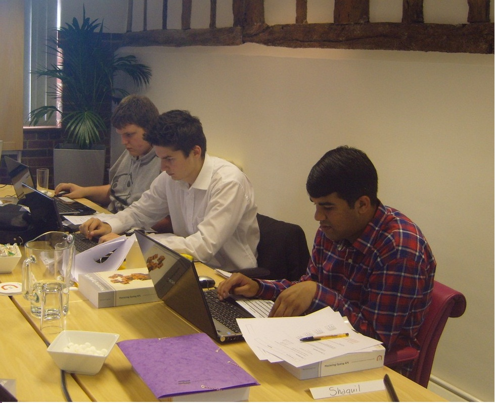
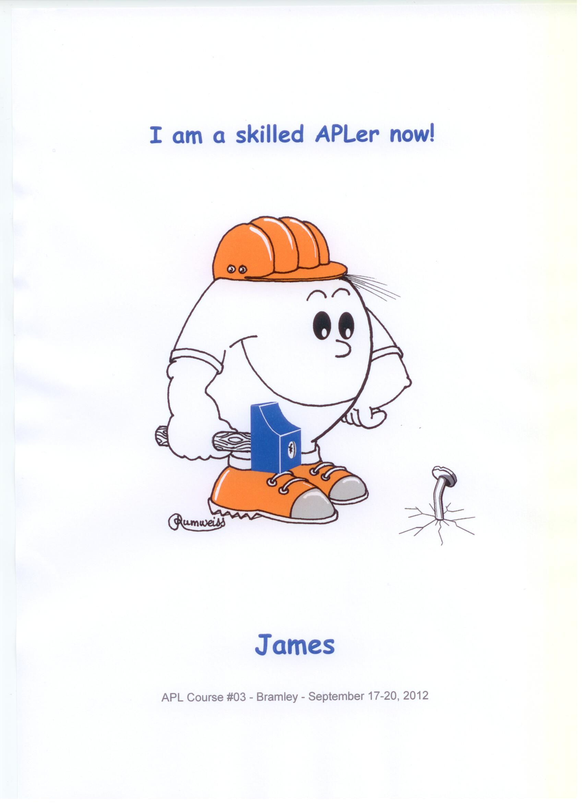

Sam Gutsell (samuel@optima-systems.co.uk)  
Shaquil Sidiki (shaquil@optima-ystems.co.uk)  
James Greeley (james@optima-systems.co.uk)
{ .byline }

This is a companion article to "Three Blind Mice" by Paul Grosvenor in this issue. Here three apprentice APL programmers introduce themselves and give their first impressions of APL and the community that uses it.
{ .ednote }

<figure markdown="1">

<figcaption markdown="span">Hard at work learning Dyalog APL on the course taught by Bernard Legrand at Dyalog's Bramley offices From left to right: Sam Gutsell, James Greeley, Shaquil Sidiki</figcaption>
</figure>

## About me: Sam Gutsell

I am an apprentice APL programmer at Optima Systems, I come from an academic and conceptual background of programming and have achieved an A-Level in Computing; in completing my A-Level I gained experience with Visual Basic, HTML, MySQL, PHP and Java.

## My impressions of APL: Sam Gutsell

At first glance APL was quite daunting because of the amount of symbols, but with time I started to develop an understanding of how the language is constructed and how the language works. I have adapted to the concepts of APL quite well due to the style of my experience. I completed a four day course taught by Bernard Legrand which helped give me a better understanding of APL. I have learnt with the little experience I have that the language is a very powerful and unique one and can be uniquely used by everyone using it. I am sure that with the help of the very experienced people around me at Optima Systems I will develop a great understanding of the language and hopefully one day be a skilled APL programmer.

## My reflections about the Dyalog'12 Conference: Sam Gutsell

Thank you to everyone who made our first conference so enjoyable, to those of you who lead the workshops and presentations thank you very much we all found them both useful and interesting and hope that you will find our blog both useful and interesting too. The whole experience of meeting everyone was very interesting and we would like to thank everyone for being very welcoming and kind to us absolute beginners.

## About me: Shaquil Sidiki

I’m seventeen years old. I am originally from Lisbon, Portugal and I moved to England when I was fifteen. I am currently working at Optima Systems as an Apprentice APL Programmer. My hobbies are to play and watch football, go to the gym, meet up with my friends and to watch videos on YouTube. I have GCSE’s in Mathematics, English Language, English Literature, Chemistry, Physics, Spanish, French, Portuguese and an OCR Double Award in Information Technology.

## My impressions of APL: Shaquil Sidiki

My impressions of APL so far are great. I think it’s a very powerful and interesting language as it uses symbols instead of ordinary words. Also everyone has a different style and therefore some problems have more than one solution. Furthermore, in my point of view APL is just like a spoken language. I say this because for me the symbols are like “the words” and it’s not enough to memorise what each symbol means we need to know how to put the symbols together to make the code to work, as in any spoken language it’s not enough to know what each word means, we need to know how to put a sentence together.

## My reflections about the Dyalog'12 Conference: Shaquil Sidiki

It was my first conference and I loved it. In my opinion the conference itself was very well planned. I liked all the presentations however it was very hard to follow some of them. I must say, the presentations I enjoyed the most were: “Introducing Dyalog Version 13.2” (John Daintree), because I’m really looking forward to this new version as I like updates; “Potential Version 14” (John Scholes and Roger Hui), because once again I like updates and I like to look forward to improvements and new features; “Optimisation across networks” (Paul Grosvenor) because it’s related to the company that I’m working for (Optima Systems); “Building an Android Application” (Illse Nell and Danie Mare), because as a young adult I think that phones are very important and I like new technology; and “APL and Raspberry Pi” (Liam Flanagan) because again I love new technology and also its good to the growth of APL and I also think that the iPad app was very good and interesting, and of course “Three Blind Mice by” by us! I would like to make a special reference to John Scholes for his fantastic presentation “State-Free Programming”.

Well done to everyone who made a presentation though. I also would like to thank everyone at the Dyalog conference who made us feel very welcome into the APL community. Overall my experience of the Dyalog’12 Conference was fabulous and hopefully next year I can go again. A special thank you to Optima Systems (Paul Grosvenor) for taking us to the Conference.

## About me: James Greeley

I am 20 years old and work for Optima Systems as an Apprentice APL Programmer A Levels: Biology, Chemistry, Economics, Business. Interests: Web Design, Good UI, Computers, Gym, Video Games

## My impressions of APL: James Greeley

Having only previously dealt with HTML APL was somewhat a jump into the deep end of the pool. At first its syntax and incomprehensible symbols baffled me, what the hell am I looking at? Why have I got this error? However, having spent more time with APL I find myself understanding the symbols without even thinking, as if it were just another word in my vocabulary.

My main interests about APL would be using its power and quick development capabilities to deploy as back ends to web applications. The perfect example of this was demonstrated to me by Gilgamesh Athoraya who showed me the Cosmos system being developed by Optima Systems. This system used MiServer with a flash front end.

I being one of three apprentices taken on by Optima recently went on a four day course at Dyalog taught by Bernard Legrand it was fascinating to meet the author of the book we’d spent so much time reading and a really fantastic week that I would recommend to all.

I’d like to take this opportunity to thank everyone at Optima Systems for an amazing opportunity and being such a nice company to work for!

<figure markdown="1">

<figcaption markdown="span">The Skilled APLer certificate we recieved on completion of our course with Bernard Legrand</figcaption>
</figure>
