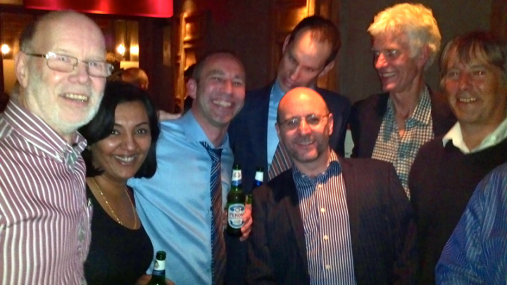
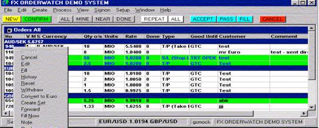

Sam Sexton
{ .byline }

*Authors Note* \[This article will appear in various places, so apologies to those of you who don’t know many of the names, but I wanted to put on record the history of what is regarded by many as two ground-breaking applications. I’ve included the Newsflash crew, but there were too many (all around the world) involved in FX Order Management to list you all, but you know who you are! If I’ve omitted any of the early developers, the fault is mine, so please accept my apologies.\]
{ .ednote }

A long time ago in a galaxy far, far away… well, perhaps it’s not quite that distant in time and space, but the life of the products I’m about to tell you about may be among the longest in the commercial world.

To start at the end, on October 15th 2012, Israel Discount Bank (IDB) informed us that they had gone live on RET-LOM. Coincidentally on that day an article appeared on The Hub commemorating the end of System 77, an editorial system which dated from the mid 1980s and had shut down in September. Whilst this is impressive longevity, it didn’t go back as far as the technology used in FX Orderwatch (FXOW - the first of various names of the product over the years), which is what IDB had migrated from to RET-LOM.

This represented the end of several years of migrating FXOW customers to the Sybase and Oracle-based successors and the end of an era that possibly started in the 70s. I say possibly, as it’s been difficult finding anyone who can remember that far back!

However, with that caveat, back to the beginning… it all started with a Canadian software company called I P Sharp Associates (IPSA). Back in the 1970s they provided a timesharing service with email and several databases with software to manipulate them on their Toronto mainframe, which ran a modified version of IBM’s DOS, known as Sharp DOS. This was accessed from around the world using their proprietary packetswitched network, IPSANET, with nodes in around 60 locations.

Around the end of the decade, BP’s Oil Trading International division (OTI) wanted to be able to communicate between their traders more efficiently than using phones and later PCs and spreadsheets. They came to IPSA and the product Newsflash was created for them, by Paul Odho, who sadly died of a brain tumour in 1987. BP used the system to ensure that they had the correct stocks of fuel at airports and docks and it provided them with a significant commercial advantage. This system was written in the wonderful (some may say ‘esoteric’) APL, with the database implemented in IPSA’s component file system.



Left to right: Sam Sexton, Kuldeep Karnan, Hayden Bird, Shaun Doyle (at the back, spoiling the photo!), Gary Smock, Ed Nelson and Andy Bunce.
{ .caption }

Newsflash was effectively smart email with bulletin boards, but it was extremely useful to BP for communicating between six of their traders in New York and a similar number in London and it became known as the Sharps system. The number of users grew and eventually exceeded the capacity of Newsflash to cope with the load, so Paul, along with Peter Airs, addressed this with Newsflash 2 in 1986. This used the magical capabilities of Shared Variables, which allowed a user to be notified immediately when they had an incoming message. This capability is part and parcel of everyday life now, but back then it really was cutting edge technology!

News of the effectiveness of this system spread within BP and another system was created for the Marine division. Karl Mabert and Bob Davison moved from developing the OTI system and worked with Greg Prowse, Mike Elbourne and Hazel O’Hare on this new system.



In time, the Sharp DOS host in Toronto migrated to IBM’s MVS and BP decided to move the service inhouse and onto their own network. Iain Hunneybell and Paul Odho worked on the application code issues and I had the pleasure of transferring the service to BP’s offices in Finsbury Square. It later moved to Hemel Hempstead and a few years later I worked with Steve Moles of BP to migrate it to Solaris, using SAX (Sharp APL for uniX) rather than SAM (…MVS). This worked very well and only the code that interfaced with the operating system needed adjustment.

Shell also came looking for this technology and Peter Airs, along with Mike Elbourne and Peter Biddlecombe came up with another Newsflash system called BEANO, for marine bunkering – communicating between different companies within the Shell group to supply marine fuel. Such was the effectiveness of this that in due course, two more systems - LEANO (for lubricants) and ACE (for Aviation fuel) followed.

Eventually, Shell dropped their use of the system, but BP continued, although the Marine division migrated away later on, leaving OTI as the last Newsflash user – but a big one. In March 2008, they had moved from the original handful of users to 3000 around the world.

In 1987, Reuters had bought IPSA and in 1993, after having absorbed the database part of the company, sold the APL development and support groups back to the employees, causing the formation of Soliton Associates. At this point, many of the Newsflash team soon left Reuters, but others who had just joined IPSA at the time of the takeover took their place.

Over the years, attempts were made to make the Newsflash interface more sexy by giving it a GUI, but despite the best efforts of Andy Bunce, Bob Davison, Mike Elbourne and Peter Biddlecombe, most traders were happy with the original line mode interface, as it was quick and efficient. Meanwhile Dave Ziemann joined us as a contractor and reworked the database access functions (a function is an APL program or building block) to provide greater efficiency.

As Reuters was down to one customer for the Newsflash technology, we started to look around for other areas where it could be applied. We were lucky in that the remaining ex- IPSA staff were assigned to City West (later International) division, headed up by Claude Green, with his deputy Ed Nelson, who unlike many of their peers and seniors, had the nerve to take on what Ed recently referred to as "an eccentric but very talented team" (there’s no argument about the first part of that description!). Claude soon came to realise that he’d made the right choice and said that he "liked dealing with the ex-IPSA staff as you could ask them to do something, then go away and forget about it and they’d come back on time with the goods". Claude and Ed were invaluable in keeping the team together - despite encouragement to do otherwise - and spurred us on to find alternative uses for the Newsflash technology, given that we only had BP as our customer.

Some weird and wonderful suggestions arose such as management of racing bloodstock, radio advertising and agency nursing and I seem to recall suggesting a bed management system for the NHS. Radio advertising was considered, but when Reuters bought LBC, we were no longer considered a neutral player. Consideration was given to using Newsflash to enhance the Shipping service, but there was an opinion that Reuters Mail was better – but that was shut down shortly afterwards! It wasn’t until Paul Jackson, who’d managed the BP Newsflash account, overheard a conversation in a pub (a rare visit to such an establishment for him!) that the idea of managing FX orders came up. This was pursued with Sumitomo and a prototype system produced, but in the end, Sumitomo decided not to proceed. Luckily, as Alan Clarke (known as ‘Shoulders’), then at HSBC, recalls:

> ‘I remember we had persuaded IT and management to buy a competitor’s product as we didn’t know you had one at the time, and then our account manager sent in Super Jacko who suddenly turned up with one. We didn’t like that and the following week Super J had found another that was something to do with an oil platform that Reuters had acquired. We liked him and his entrepreneurial approach a lot and decided to eat humble pie with the management and IT and do a U-turn and switch to the Reuters product. Jon \[Healey\] and I then spent a long long time working with Jacko to turn it into an FX product.”

> ‘The other interesting thing was that at the launch party where Reuters were showing it off to the community, rumours circulated that management at Reuters were going to kill off the product, virtually at its birth. Fortunately we made it clear that HSBC would not be amused and the decision never came to kill it… the rest as they say, is history.”

Indeed, there was much debate at senior management level as to whether it was appropriate for such a complex product developed by such a small group, to be launched on a global basis. As Shoulders states, it was the pressure from HSBC and other clients that resulted in a positive decision being made.

The competitor’s product referred to was Telerate Passbook. FXOW proved to be the better product and gained a significantly higher market share. When Telerate was acquired by Reuters, all the Passbook clients migrated to FXOW.

At HSBC, FXOW replaced whiteboards, spreadsheets and faxes with the new system and it used a variant of the Visual Basic GUI which Andy Bunce had provided to BP.

Shoulders’ colleague at HSBC, Jon Healey, also commented recently, “To this day, I have not yet found another orders system that fulfilled the single main criteria of an orders system as well; it stayed up”.

On a personal note, we all enjoyed working with HSBC and both sides considered it as good a relationship as you could expect between supplier and customer – there were many happy memories, not all of which were associated with licensed premises!

Other banks soon followed suit and with the help of our agent TMT in Helsinki (Timo, Tuija, Tapsa and others whose names didn’t start with T!), we had about 30 customers around the world. I was the lucky one who flew around the globe, installed many of those systems and trained internal and customer technical staff to look after it – an onerous task, but someone had to do it! Once it was installed, it didn’t really need that much looking after. As an example of this, I’d installed a demonstration system at a bank in London on my way to Heathrow in January 2002. A couple of months later, we attempted to retrieve our hardware, but the customer was loath to let it go, as the dealers loved the system and we suspected were using it for more than just evaluation purposes. In the end, the bank got their own hardware and we got the box back eighteen months after it had been installed, during which time no backups had been taken and no (required) regular housekeeping performed, but the system just kept purring along.

> ```
> no. 439949 from stew    23:01 26 may 2011 to all
> subj Last message from Paul Reed
>
> This may be the last message sent on the
> 'Sharps' system - and it marks something of a
> milestone. I have had the 'pjr' sharp code
> since I first traded Rotterdam barges in our
> Dutch office in 1985. Originally it was a
> groundbreaking Instant Messaging system used by
> BP traders to connect 6 traders in New York
> with 6 in London. By the time I joined the
> Crude bench two years later it had evolved into
> also keeping records of all crude bids and
> offers known from the market and was accessible
> to all our refinery buyers, it was used as our
> deal entry system and even did real time
> exposure for our OTC Brent and Dubai at one
> stage. Within a few years it had grown to over
> 600 users in 40 countries and for many years
> was a great competitive advantage when most
> other firms were still using Telex to
> communicate and were just implementing Fax
> technologies and then subsequently mobile
> phones and later personal computers.
>
> Clearly today everyone has instant messaging
> and we are not only the
> first users on the planet to use the system
> widely but also now the last.
>
> Today's milestone passes whilst recognising
> that for over two
> and a half decades this system was at the heart
> of our collaborative and
> joined up culture.
>
> PJR (aka Paul J Reed, Chief Executive,
> Integrated Supply and Trading)
> Regards,
> ```

Despite this success, time was catching up with the product and it wasn’t a viable proposition to commission a Solaris 10 version of SAX for Solaris 10 from Soliton and so FXOW customers were encouraged to migrate to an Automated Dealing system, based on TIBCO technology with Sybase. This attracted some customers, but wasn’t a roaring success. However, in December 2002, Reuters acquired AVT Microsystems in Nottingham as they were looking for a company to help them spread the use of their trading software called GenIdeal. This was much better and the FXOW customers were encouraged to migrate to RET-OM, based on GenIdeal with the database in Oracle and (eventually) a Java GUI. Kevin Clarke had the honour of being the last APL and VB programmer to work on the code, after having left Reuters for Soliton when the Global Limits Control System (that’s another story!) that he worked on was closed down, but he returned to look after FXOW.

The system didn’t need too much support, but a couple of occasions when it was needed stand out. One year Kevin and I were called on Christmas Day and then again on New Year’s Day – but our marriages managed to survive the experience! At Easter 2003 I was attending my niece’s 21st birthday party and when I returned to the car, I found I’d left my mobile there and had missed about 18 calls. Our favourite customer had had a hardware crash and needed some help, so as soon as I arrived home, I was off again on the train to London. It was a long and stressful night and the three of us (myself, Teech and a Sun engineer) eventually got the system up and running, but after ten years of therapy, we can look back fondly on the experience!

The BP story ended at close of business in New York on 27 May 2011, as recorded by Paul Reed in his message (see left), which is reproduced with permission.

Between them, these two products, which were seen as too risky in various quarters (without justification, as time was to prove) and only kept going by tenacious and committed managers together with responsive support and development staff, have provided a service to BP and many banks for around 30 years and they outlasted many of those who were not convinced of the potential of both the technology and the team that developed it. They also provided a significant revenue stream.

I am sure that I speak on behalf of all involved in saying that we are proud and honoured to have played our roles in this small episode of history and that we recognise the debt we owe to the late Paul Odho and also Paul Jackson, who sadly also died - in June 2003 - without whom our working lives would have been very different and much less fun!
