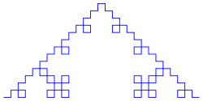

R.E. Boss (r.e.boss@planet.nl)
{ .byline }

## Introduction

There are not many examples of repeated squaring [\[1\]](#ref1), but I stumbled upon a new one in 2006, solving a problem posed by Bron [\[2\]](#ref2). To explain it I use some examples and some theory, but then a new method is introduced in J. The term L-system in the title is short for Lindenmayer system [\[3\]](#ref3) [\[4\]](#ref4).

## Rabbit sequence

This is an infinite sequence [\[5\]](#ref5) of booleans which has the property that if one changes each 0 to a 1 and every 1 to the pair 1 0 , the sequence does not change.

```
1 0 1 1 0 1 0 1 1 0 1 1 0 1 0 1 1 0 1 0 1 1 0 1 1 0 1 0 1 1 0 1 1 0 1 0 1
1 0 1 0 1 1 0 1 1 0 1 ….
```

Notice that this is the Algae example [\[6\]](#ref6) in [\[3\]](#ref3).

## Lindenmayer systems

An L-system is a parallel rewriting system, i.e. consisting of an *alphabet* **V** of symbols which can be replaced, a set of (production) *rules* **P** such that each rule replaces a particular symbol of **V** in a string of symbols (from **V**), and an *initial symbol* **S** to which the rules subsequently are applied.

All rules are applied at the same time, therefore the system is *parallel*.

In fact **P** is a mapping from <strong>V → V\*</strong>, the set of all strings with symbols from **V**, including the empty string. If for some *a* ∈ **V** one has <strong>P</strong>(*a*)=s, with s some string, this is also denoted by *a* → s.

If for a symbol *c* in **V** one has <strong>P</strong>(*c*) = *c*, then *c* is called a *constant*.

If a symbol in **V** is not a constant, then it is called a *variable*.

In the example of the rabbit sequence, **V** is the set of booleans \{0,1\}.

The rules are <strong>P</strong>(0) = 1 and <strong>P</strong>(1)= 1 0 and the initial symbol S is 0.

## L-systems in J

To apply J [\[7\]](#ref7) in producing an L-system, I prefer the alphabet **V** to be a set of integers, say \{0,1,…,n-1\}, such that(mostly) **S** is represented by 0.

Then the mapping P can be represented by an array of boxes, all of which contain an array of integers form **V**. The production rules are then <strong>P</strong>(k) = `;k{P`.

So for the rabbit sequence we get `V =: 0 1`, `S =: 0` and `P =: 1; 1 0` .

Now the verb to produce the next generations of S is easy to construct:

```
    P {~ S
+-+
|1|
+-+

   P {~^:2 S
+---+
|1 0|
+---+
```

But after that we get a problem:

```
   P {~^:3 S
|length error
|   P    {~^:3 S
```

This can easily be repaired by the following verb:

```
   P ([:; {~)^:3 S
1 0 1
```

And now we can get a rabbit sequence of any length:

```
   P ([:; {~)^:20 S
1 0 1 1 0 1 0 1 1 0 1 1 0 1 0 1 1 0 1 0 1 1 0 1 1 0 1 0 1 1 0 1 1 0 1 0 1
1 0 1 0 1 1 0 1 1 0 1 0 1 1 0 1 0 1 1 0 1 1 0 1 0 1 1 0 1 1 0 1 0 1 1 0 1
0 1 1 0 1 1 0 1 0 1 1 0 1 1 0 1 0 1 1 0 1 0 1 1 0 1 1 0 1 0 1 1 0 1 0 1 1
0 1 1 0 1 0 1 1 0 1 1 0 1 0 1 1 0 …
```

Which can be given a bit more sophisticated by ``P ([:; {~)^:(]`(S"_)) 20``

Notice that if the production rules all have the same length, no boxing is needed, in which case the `;` in the expression is replaced by a `,` .

## More examples

Some examples from [\[3\]](#ref3) are Cantor dust [\[7\]](#ref7) and Koch curve [\[8\]](#ref8).

The first is given in J by `V =: 0 1`, `S =: 0` and `P=: 0 1 0; 1 1 1` so

```
   P ([:; {~)^:(]`(S"_)) 3
0 1 0 1 1 1 0 1 0 1 1 1 1 1 1 1 1 1 0 1 0 1 1 1 0 1 0
```

Where 0 represents black and 1 represents white.

The Koch curve [\[8\]](#ref8) is given by

```
   V=:0 1 2,  S =: 0
```

and

```
   P=: 0 1 0 2 0 2 0 1 0; 1; 2
```

```
   P ([:; {~)^:(]`(S"_)) 3
0 1 0 2 0 2 0 1 0 1 0 1 0 2 0 2 0 1 0 2 0 1 0 2 0 2 0 1 0 2 0 1 0 2 0 2 0
1 0 1 0 1 0 2 0 2 0 1 0 1 0 1 0 2 0 2 0 1 0 1 0 1 0 2 0 2 0 1 0 2 0 1 0 2
0 2 0 1 0 2 0 1 0 2 0 2 0 1 0 1 0 1 0 2 0 2 0 1 0 2 0 1 0 2 0 2 0 1 0 1 0
1 0 2 0 2 0 1 0 2 0 1 0 2 0 2 0 1 …
```

With the graph below.



Given these examples, anybody can make her own.

## Repeated squaring

Now the question (with which I perhaps whetted your appetite) in the introduction is still open, what about repeated squaring?

If you look at the verb ``P ([:; {~)^:(]`(S"_))`` it is obvious the behaviour is rather linear. In each iteration a string is used to apply **P** on the individual symbols of the string and the results are concatenated.

Now consider **P<sup>k</sup>** which is the mapping applied *k* times (on S which is 0). It is easy to construct in J by `(;@:{&.> <)^:(k-1)~ P` .

If we apply this to the rabbit sequence `(V =: 0 1, S =: 0,P =: 1; 1 0 )` we get

```
   (;@:{&.> <)^:(<4)~ P
+---------+---------------+
|1        |1 0            |
+---------+---------------+
|1 0      |1 0 1          |
+---------+---------------+
|1 0 1    |1 0 1 1 0      |
+---------+---------------+
|1 0 1 1 0|1 0 1 1 0 1 0 1|
+---------+---------------+
```

As soon as (some of) these <strong>P</strong><sup>k</sup> are known, repeated squaring can start:

`binind=: I.@|.@#:` NB. The binary indices are determined

`appl=: (;@:{&.> <)` NB. Applying the main verb

`rs=: 4 : '> {. appl/ appl^:(binind y) x'` NB. `x` equals P and `y` is the generation giving the complete solution

The figures show that the performance is what you would expect, much better, while the output is the same:

```
   ts'P ([:; {~)^:(]`(S"_))35'
0.50670696 1.6777933e8

   ts'P rs 35'
0.022058907 79695232

   (rs-:P ([:; {~)^:(]`(S"_))]) 35
1
```

In this example we can do even better, since for the rabbit sequence we have **P<sup>k+1</sup> = P<sup>k</sup>** , **P<sup>k-1</sup>** , indeed Fibonacci!

```
   ts'3 : '';|. appl/ appl^:(]`(P"_)) binind y-2''35'
0.012114756 46154880
```

So this gives a solution which is about 40 times as fast and 3.5 times as lean as the original one.

## Final example, Gray codes

The last I owe the reader was the solution I found for the problem of Bron [\[2\]](#ref2). He asked for the most efficient verb to generate the Gray code, see [\[9\]](#ref9) and [\[10\]](#ref10). Fortunately he also allowed to generate the decimal values of that code, which for the first 64 numbers look like:

```
G=: 0 1 3 2 6 7 5 4 12 13 15 14 10 11 9 8 24 25 27 26 30 31 29 28 20 21 23
22 18 19 17 16 48 49 51 50 54 55 53 52 60 61 63 62 58 59 57 56 40 41 43 42
46 47 45 44 36 37 39 38 34 35 33 32 .
```

The fractal structure of the code becomes apparent if you do

```
   2-~/\ G
1 2 _1 4 1 _2 _1 8 1 2 _1 _4 1 _2 _1 16 1 2 _1 4 1 _2 _1 _8 1 2 _1 _4 1 _2
_1 32 1 2 _1 4 1 _2 _1 8 1 2 _1 _4 1 _2 _1 _16 1 2 _1 4 1 _2 _1 _8 1 2 _1
_4 1 _2 _1 .
```

To not let grow the numbers too quickly, I transformed it in

```
   G1=: (** 2^. 2* |) 2-~/\ 64{.G
1 2 _1 3 1 _2 _1 4 1 2 _1 _3 1 _2 _1 5 1 2 _1 3 1 _2 _1 _4 1 2 _1 _3 1 _2
_1 6 1 2 _1 3 1 _2 _1 4 1 2 _1 _3 1 _2 _1 _5 1 2 _1 3 1 _2 _1 _4 1 2 _1
_3 1 _2 _1 .
```

By the way, this representation of the (binary reflected) Gray code has a very useful interpretation: each number gives by its absolute value the coordinate where two consecutive code words differ, and by its sign how they differ: + if 0→1 and – if 1→0.

So I defined **V** to be the set of integers and `S=:1` . But most important was **P**. To produce G1, I defined

```
   P=: 1; 1 2 _1; 3; 4; 5; 6;(…); _6; _5; _4; _3;1 _2 _1
```

Notice that in fact **P** is infinite, which is indicated by the (…).

Notice also that (`P{~ –n) -: |.- n{ P` for n > 0, so in general we have `P=:3 :'1; (, [:|. -@|.&.>) 1 2 _1; ;/3+ i.y'n` for some *n*, like

```
   [P=:3 :'1; (, [:|. -@|.&.>) 1 2 _1; ;/3+ i.y'6
+-+------+-+-+-+-+-+-+--+--+--+--+--+--+-------+
|1|1 2 _1|3|4|5|6|7|8|_8|_7|_6|_5|_4|_3|1 _2 _1|
+-+------+-+-+-+-+-+-+--+--+--+--+--+--+-------+
```

The only thing one has to do is to transform this resulting fractal in the Gray code again, ie to invert `(** 2^. 2* |)` and precede it by 0 :

```
   +/\0,(** 2%~ 2^|) P rs 6
0 1 3 2 6 7 5 4 12 13 15 14 10 11 9 8 24 25 27 26 30 31 29 28 20 21 23 22
18 19 17 16 48 49 51 50 54 55 53 52 60 61 63 62 58 59 57 56 40 41 43 42
46 47 45 44 36 37 39 38 34 35 33 32
```

which is equal to the original G. This, in principle, gives the impressive performance results in [\[2\]](#ref2).

## Conclusions

Using L-systems in J is a powerful technique for generating all kinds of fractal like structures. In a next paper I will describe how to transform these arrays in nice graphs using the plot facility of J.

## Bibliography

1. <a id="ref1"></a> RepeatedSquaring.  
    \[Online\].  [http://www.jsoftware.com/jwiki/Essays/Repeated%20Squaring.](http://www.jsoftware.com/jwiki/Essays/Repeated%20Squaring)
2. <a id="ref2"></a> Bron. \[Online\].  [http://www.jsoftware.com/jwiki/Puzzles/Gray%20Code.](http://www.jsoftware.com/jwiki/Puzzles/Gray%20Code)
3. <a id="ref3"></a> Lindenmayer1. \[Online\].  [http://en.wikipedia.org/wiki/L-system.](http://en.wikipedia.org/wiki/L-system)
4. <a id="ref4"></a> Lindenmayer2. \[Online\].  [http://mathworld.wolfram.com/LindenmayerSystem.html.](http://mathworld.wolfram.com/LindenmayerSystem.html)
5. <a id="ref5"></a> RabbitSequence.  
    \[Online\].  [http://www.maths.surrey.ac.uk/hosted-sites/R.Knott/Fibonacci/fibrab.html.](http://www.maths.surrey.ac.uk/hosted-sites/R.Knott/Fibonacci/fibrab.html)
6. <a id="ref6"></a> Algae. \[Online\].  [http://en.wikipedia.org/wiki/L-system#Example\_1:\_Algae.](http://en.wikipedia.org/wiki/L-system#Example_1:_Algae)
7. <a id="ref7"></a> CantorDust. \[Online\].  [http://en.wikipedia.org/wiki/L-system#Example\_3:\_Cantor\_dust.](http://en.wikipedia.org/wiki/L-system#Example_3:_Cantor_dust)
8. <a id="ref8"></a> KochCurve. \[Online\].  [http://en.wikipedia.org/wiki/L-system#Example\_4:\_Koch\_curve.](http://en.wikipedia.org/wiki/L-system#Example_4:_Koch_curve)
9. <a id="ref9"></a> GrayCode1. \[Online\].  [http://en.wikipedia.org/wiki/Gray\_code.](http://en.wikipedia.org/wiki/Gray_code)
10. <a id="ref10"></a> GrayCode2. \[Online\].  [http://www.jsoftware.com/jwiki/Essays/Gray%20Code.](http://www.jsoftware.com/jwiki/Essays/Gray%20Code)
