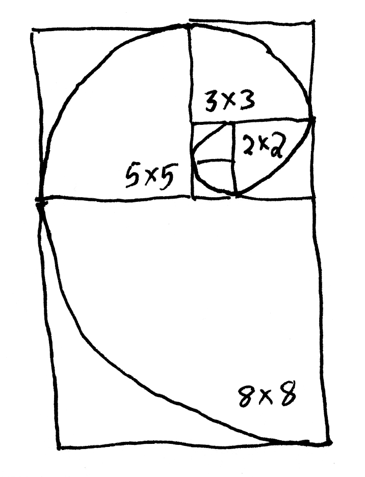
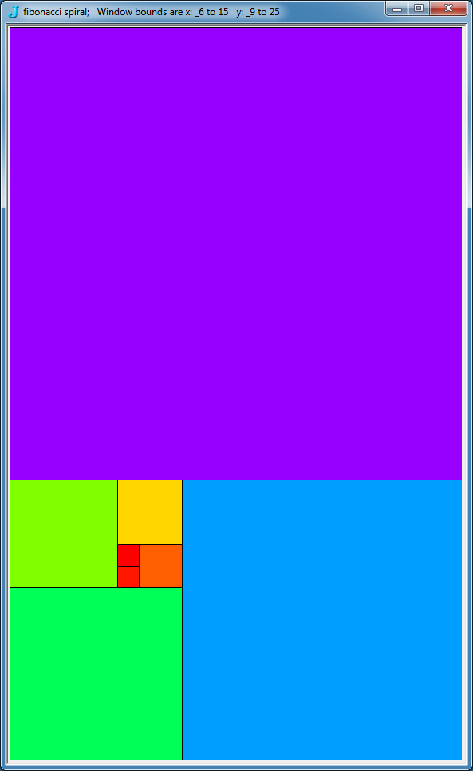
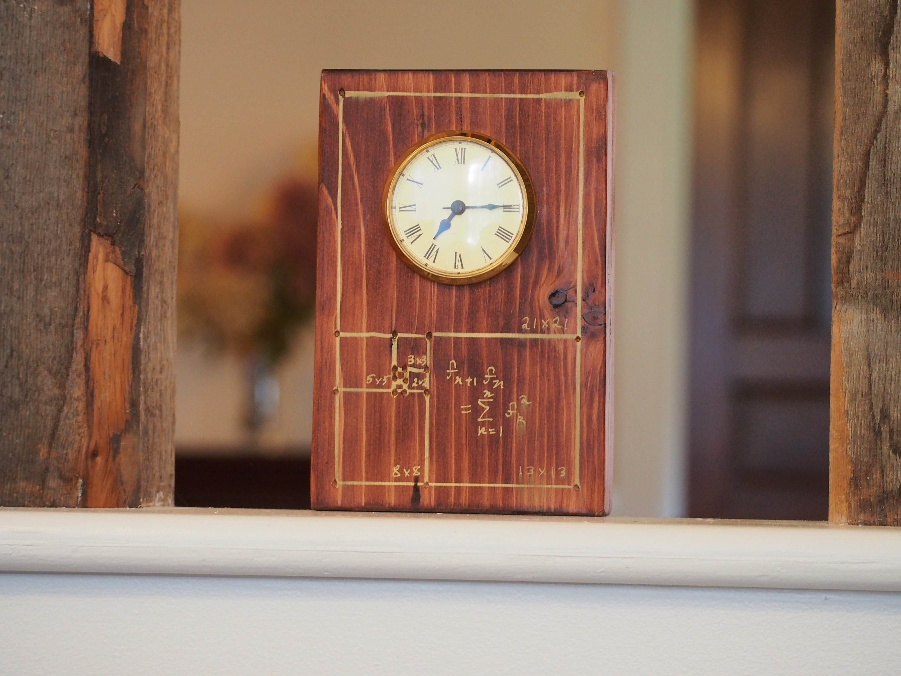
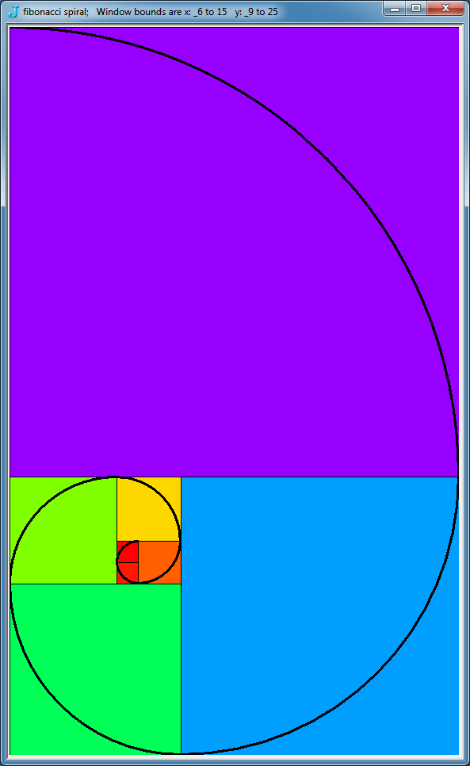
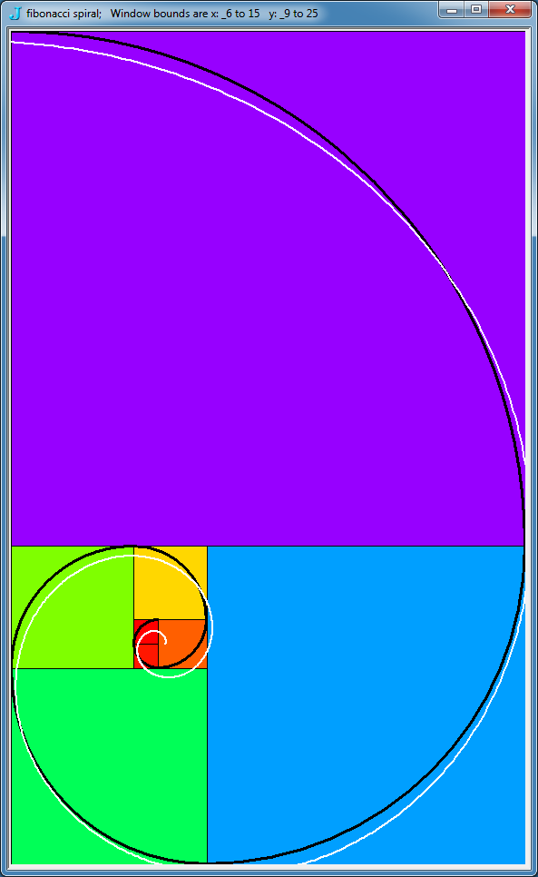
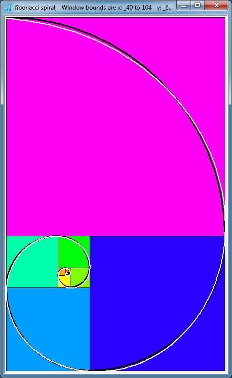

Cliff Reiter (reiterc@lafayette.edu)
{ .byline }

A spiral of squares with Fibonacci edge lengths is created in J. Spiral Fibonacci and Golden curves are also explored.
{ .abstract }

## 1. Introduction

During renovations of an abandoned farmhouse much demolition debris was created. Almost all of it went to the dump, but occasionally a piece of old wood was saved. Such a pine board seemed well suited to make a two faced clock for a partition exposing post and beam construction. I considered several natural and mathy designs for the clock. I decided a golden ratio rectangle would have a nice overall form and soon focused on a Fibonacci spiral of squares that would approximate the golden ratio and illustrate the proof of a Fibonacci identity.

The Fibonacci sequence may be defined by <em>F</em><sub>1</sub>=1, <em>F</em><sub>2</sub>=1, and <em>F</em><sub><em>j</em></sub>=<em>F</em><sub><em>j</em>-1</sub>+<em>F</em><sub><em>j</em>-2</sub> for integer indices *j* greater than 2. The Fibonacci sequence has many remarkable properties, surprising applications and lovely connections to nature. [\[1\],](#ref1)[\[2\],](#ref2)[\[4\],](#ref4)[\[6\],](#ref6)[\[7\]](#ref7)

We can implement a verb to generate the positive Fibonacci sequence of specified length (greater than or equal to 2) as follows. The verb iterates the process of appending the sum of the last two items an appropriate number of times.

```
   pos_fib_seq=:3 : '(,[:+/ _2&{.)^:(y-2) 1 1'

   pos_fib_seq 8
1 1 2 3 5 8 13 21
```

If we place two 1 by 1 squares adjacent along an edge then the assembly forms a 1 by 2 rectangle. If we put a 2 by 2 square adjacent to the length 2 edge of that, the new assembly forms a 2 by 3 rectangle. If we put a 3 by 3 square adjacent to the length 3 edge, then the new assembly forms a 3 by 5 rectangle. We can continue this process resulting in a *F<sub>j</sub>* by <em>F</em><sub><em>j</em>+1</sub> assembly at the <em>j</em><sup>th</sup> stage.

We organize the placement of the edges so that we adjoin edges sequentially on the south edge, east edge, north edge and then west edge and then continue repeatedly. A spiral pattern of squares with edge lengths given by the Fibonacci numbers develops. See Figure 1 for a hand sketch of the idea we have in mind for the spiral of squares and a Fibonacci spiral. Notice the spiral curve is tangent to the intersection points as shown. We will describe one way to define such a spiral curve in Section 3.

<figure markdown="1">
{ width="30%" }
</figure>

Figure 1. Rough sketch of a spiral of Fibonacci squares and a spiral curve.
{ .caption }

In the next section we will discuss J verbs to create these spiral assemblies of squares. Then we will look at spiral curves that "fit" the pattern of squares.

## 2. Assembling the Fibonacci spiral of squares

We begin by defining matrix `fs_sq1` (Fibonacci spiral square of size 1) with rows giving the vertices of the unit square with diagonal corners at (0,0) and (1,1).

```
   ]fs_sq1=:#:0 2 3 1
0 0
1 0
1 1
0 1
```

The main function `draw_fib_sqs`, defined below, organizes the overall assembly. Its argument is the number of squares to create. It initializes three global variables and then updates them at each stage. At each stage, the next square will be a translated version of the unit square `fs_sq1` multiplied by the current Fibonacci number. Since the details depend upon the side we adjoin the next square, we organize by cases, according to the stage modulo 4. The three global variables are updated using the conjunction `nx_fs_sq`.

The three global variables are the bounds of the assembly, `fs_wsen`, (Fibonacci spiral: west-south-east-north), and the list of squares, `fs_sqs`, that form the spiral pattern and the list of arcs, `fs_arcs`, giving a spiral curve. We will not fully discuss the arcs until the next section. Looking at the core conjunction, `nx_fs_sq` (next Fibonacci spiral square), it updates the bounds of the assembly at each stage using the global variable `fs_wsen` by adding or subtracting a Fibonacci number corresponding to the just joined square. The conjunction also adds a new square, nsq to the global list `fs_sqs` that gives a list of the coordinates of each of the squares. And the list of arcs, `fs_arcs` is updated. Notice that the new square `nsq` is translated so that the lower left has the appropriate coordinates. As we noted, the details of how to do that depend upon the side we adjoin the next square.

For example, when we adjoin a new square to the west, the first two entries of `fs_wsen` give the position of the lower left corner. However, when adjoining to the east, the upper right coordinates are available from `fs_wsen` but we need to subtract the current Fibonacci number from those coordinates to obtain the lower left. The conjunction `nx_fs_sq` accomplishes these tasks. It also presumes a global variable `F_j` giving the current Fibonacci number exists. Note that we use `fibs` as a local list of positive Fibonacci numbers and index to it to obtain `F_j`. The for-loop runs through all those Fibonacci numbers; however, its indices are one off from the standard indices of the Fibonacci numbers.

The arguments to `nx_fs_sq` are as follows: `x` which gives a unit vector specifying the direction in which wsen should be modified, `m` which gives the indices of wsen that give a corner of the square, `n` which is used to translate the first entry in the new square to be the lower left corner of `nsq`, and `y` which gives the indices of the points of `nsq` on the arc that should be drawn to get the Fibonacci spiral. The main function `draw_fs_sqs` also plots the spiral of squares.

The functions require that we load two scripts from the add-ons to give some utilities for interactively plotting polygons and defining a nice colour sequence. If you want to duplicate these experiments you should have downloaded the add-ons required for the scripts below (currently these are available for J6.02, 32 bit [\[3\]](#ref3)). A script containing the J expressions in this note may be found at [\[5\]](#ref5).

```
   load '~addons/graphics/fvj3/dwin2.ijs'

   load '~addons/media/image3/image3.ijs'

   draw_fs_sqs=:3 : 0
fibs=.pos_fib_seq y
fs_wsen=: 0 0 0 1
fs_sqs=: i. 0 4 2
fs_arcs=: i.0 8
for_J. i. y do.
  F_j=:J{fibs
  select. 4|J
    case. 0 do. NB. add onto west
    _1 0 0 0 (0 1 nx_fs_sq 0 1) 2 0
    case. 1 do. NB. add onto  south
    0 _1 0 0 (0 1 nx_fs_sq 0 0) 3 1
    case. 2 do. NB. add onto  east
    0 0 1 0 (2 3 nx_fs_sq 1 0) 0 2
    case. 3 do. NB. add onto  north
    0 0 0 1 (2 3 nx_fs_sq 1 1) 1 3
  end.
end.
range=.(2 3{fs_wsen)-0 1{fs_wsen
WIN_WH=:range*<.<./0.8*(_2{.".wd'qm')%range
fs_wsen dwin 'Fibonacci Spiral'
(Hue *:(i.%])#fs_sqs) dpoly fs_sqs
)

   nx_fs_sq=:2 : 0
:
fs_wsen=:fs_wsen+x*F_j
nsq=.((m{fs_wsen)-F_j*m-:2 3)+"1 fs_sq1*F_j
fs_sqs=:fs_sqs,nsq
fs_arcs=: fs_arcs,((0{nsq)-n*F_j),(2#2*F_j),,y{nsq
)
```

Now we can run an 8 square spiral. The result is shown in Figure 2 and the list of squares and bounds from the global variables are given below.

```
   draw_fs_sqs 8

   fs_wsen
_6 _9 15 25

   <"2 fs_sqs
+----+-----+----+----+-----+-----+-----+-----+
|_1 0|_1 _1|0 _1|_1 1|_6 _1|_6 _9| 2 _9|_6  4|
| 0 0| 0 _1|2 _1| 2 1|_1 _1| 2 _9|15 _9|15  4|
| 0 1| 0  0|2  1| 2 4|_1  4| 2 _1|15  4|15 25|
|_1 1|_1  0|0  1|_1 4|_6  4|_6 _1| 2  4|_6 25|
+----+-----+----+----+-----+-----+-----+-----+
```

<figure markdown="1">
{ width="50%" }
</figure>

Figure 2. A spiral of eight Fibonacci square.
{ .caption }

Now suppose we consider the area of the assembled rectangle in two ways. Suppose the last square added had an edge length of *F<sub>n</sub>*, then the other edge of the assembled rectangle has length <em>F</em><sub><em>n</em></sub>+<em>F</em><sub><em>n</em>-1</sub>= <em>F</em><sub><em>n</em>+1</sub>; thus, the total area of the assembled rectangle is <em>F<sub>n</sub></em><em>F</em><sub><em>n</em>+1</sub>. On the other hand, the area of the assembled rectangle is the sum of the area of all the squares which is <em>F</em><sub>1</sub><sup>2</sup>+ <em>F</em><sub>2</sub><sup>2</sup>+ <em>F</em><sub>3</sub><sup>2</sup>+ ...+ <em>F</em><sub><em>n</em></sub><sup>2</sup>. Thus, we have given a geometric proof that F<sub>n</sub>F<sub>n+1</sub>= F<sub>1</sub><sup>2</sup>+ F<sub>2</sub><sup>2</sup>+ F<sub>3</sub><sup>2</sup>+… + F<sub>n</sub><sup>2</sup>. This identity is well known and commonly appears in lists of Fibonacci identities \[1, 2, 4, 6, 7\]. Figure 3 shows one face of the pine board clock illustrating that fact.

<figure markdown="1">

</figure>

Figure 3. A clock showing the Fibonacci spiral of squares.
{ .caption }

### 3. The Fibonacci spiral

A simple Fibonacci spiral can be drawn that places a quarter circle in each square \[1, 2, 4, 5, 6, 7\]. The add-on *graphics/fvj3/dwin2.ijs* does not have a utility for drawing arcs, so we will define one similar to the style of the add-on. For the right argument we use the same parameters as the `glellipse` function. Namely, we give a corner of the drawing window, the extent of a box that bounds the ellipse, and start and end points for the arc (given as points on a ray from the center, not necessarily points on the ellipse). The left argument is a boxed array giving the RGB colour and the pen style for the arc. Notice that `darc` converts its data to window coordinates using the global function `SC` so it requires some adjustments since the extent needs to be scaled, but it is not a coordinate.

```
   darc=:3 : 0"1
(0 0 0;1 0) darc y
:
wd 'psel ',WIN_nam
glrgb >{.x
glpen >{:x
'a b c d'=.4 2$y
'A B C D'=.SC a,(a+b),c,:d
glarc x:^:_1 A,(B-A),C,D
glpaint''
)
```

The result of the following expressions is shown in Figure 4.

```
   draw_fs_sqs 8

   (0 0 0;3 0) darc fs_arcs
```

<figure markdown="1">
{ width="50%" }
</figure>

Figure 4. A Fibonacci spiral of square and a  
spiral curve consisting of quarter circles.
{ .caption }

Since we are drawing arcs of circles the curvature is constant on the interior of each square. However, the curvature discontinuously changes at each intersection point. One might hope for a smooth spiral with continuous derivatives of all orders. Such a curve seems plausible although we have not seen one in the literature. However, in the next section we will describe a smooth golden spiral that approximates the Fibonacci spiral.

A variant of the above Fibonacci spiral is the Great Fibonacci spiral. It is created by drawing the complements of the arcs (in their circles) that we used in the Fibonacci spiral. This can easily be done by interchanging the start and end points of the arcs as below.

```
   draw_fs_sqs 8

   (0 0 0;3 0) darc 0 1 2 3 6 7 4 5{"1 fs_arcs
```

The result is not shown but is worth exploring.

## 4. The golden spiral

The golden spiral is a spiral given in polar coordinates by *r* = <em>a e</em><sup><em>bθ</em></sup> where  
*b* = 2 ln(τ)/π and *τ* = (1 + √5)/2 is the golden ratio.[\[4\],](#ref4) [\[6\],](#ref6) [\[8\]](#ref8) We take *a* = 1/(2 τ) to fit our orientation of the spiral of squares. The argument to `draw_golden_spiral` gives the ending angle (in radians).

```
   draw_golden_spiral=:3 : 0
(0 0 0;1 0)draw_golden_spiral y
:
wd 'psel ',WIN_nam
glrgb >{.x
glpen >{:x
gr=.-:>:%:5
]b=.(^. gr)%1r2p1
]r=. ^@:(b&*)
X=.r * cos
Y=.r * sin
]a=. %2*gr
z=. a *(X,.Y) y *(i.%])1000
gllines ,x:^:_1 SC 2{."1 z
glpaint''
)
```

In Figure 5 we see the result of the following expressions.

```
   draw_fs_sqs 8

   (0 0 0;3 0) darc fs_arcs

   (255 255 255;2 0) draw_golden_spiral 5p1
```

<figure markdown="1">
{ width="50%" }
</figure>

Figure 5. Fibonacci and golden spirals on eight squares.
{ .caption }

Notice in Figure 5 that the golden spiral does not seem to be a close approximation to the Fibonacci spiral, especially near the center.

In Figure 6 we see the result of the following expressions where we plot four additional squares.

```
   draw_fs_sqs 12

   (0 0 0;3 0) darc fs_arcs

   (255 255 255;2 0) draw_golden_spiral 7p1
```

<figure markdown="1">
{ width="50%" }
</figure>

Figure 6. Fibonacci and golden spirals on 12 squares.
{ .caption }

In Figure 6 the golden spiral is a good approximation for the large squares. Notice that as we move outward along the golden spiral the curve bends more slowly than the circle at the beginning of the square and it bends faster than the circle toward the end of the square. Many other geometric designs based upon the Fibonacci numbers and the golden ratio may be found.[\[4\],](#ref4) [\[6\]](#ref6)

## References

1. <a id="ref1"></a> Richard A. Dunlap, The Golden Ratio and Fibonacci Numbers, World Scientific, 1997
2. <a id="ref2"></a> Vener E. Hoggatt, Jr., Fibonacci Numbers, The Fibonacci Association, 1969.
3. <a id="ref3"></a> Jsoftware, J6.01c, with Image3 and FVJ3 addons, [http://www.jsoftware.com](http://www.jsoftware.com). 2007
4. <a id="ref4"></a> Alfred S. Posamentier and Ingmar Lehmann, The Glorious Golden Ratio, Prometheus Books, 2012.
5. <a id="ref5"></a> Cliff Reiter, Fibonacci and Golden Spirals Script, [http://webbox.lafayette.edu/~reiterc/j/vector/fib\_spiral.html](http://webbox.lafayette.edu/~reiterc/j/vector/fib_spiral.html), 2013.
6. <a id="ref6"></a> Hans Walser, The Golden Section, translated by Peter Hilton et al, The Mathematical Association of America, 2nd ed., 1996, translation, 2001.
7. <a id="ref7"></a> Wikipedia: Fibonacci Numbers, [http://en.wikipedia.org/wiki/Fibonacci\_number](http://en.wikipedia.org/wiki/Fibonacci_number)
8. <a id="ref8"></a> Wikipedia: Golden Ratio, [http://en.wikipedia.org/wiki/Golden\_ratio](http://en.wikipedia.org/wiki/Golden_ratio)
