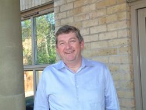

Paul Grosvenor (paul@optima-systems.co.uk)
{ .byline }

 Hello to you all and welcome back to Vector. Our production team has been working hard to produce this edition which now comes with a few pages in colour ! We would very much like your input and views as to whether or not this adds or subtracts from our journal. There is a small increase in costs as a result but significantly less than if we printed the whole thing in colour. I think it adds but what about you?

Our AGM was held in May, as last year, during the BAA Moot at the Lee Valley youth hostel \[http://moot.aplwiki.com/\]. Thank you to Phil Last for arranging and generally running around after us. The AGM & Moot saw about 20 keen APLers do what APLers seem to do best – cut code, talk code and drink beer but not necessarily in that order. If anyone is interested, the BAA meets in London monthly to continue these activities so contact Phil to find out more \[phil.last@ntlworld.com\].

Coming up over the next few months we have the Minnowbrook seminar and Dyalog 2013 conference in Miami and we look forward to including a write up of these in our next edition. If there are any other meetings / gatherings / seminars / that we have not mentioned please let us know so we can include them. Of course if you would like to send us a few words or even photographs of your event we would love to include it into future editions.

I hope you enjoy our journal and look forward to seeing some of you at the forthcoming conferences and just to finish off, a quote from Eugene;

> Some of my children and nephews started APL on a 5100. Some started on the two-huge-suitcases version of “portable” APL. Some started on the 2741 time-sharing terminal. Luckily, none of them had to start on a 1050.
>
> I started on the blackboard version.  
> — Eugene McDonnell

Well we all have to start somewhere …
