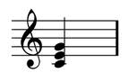
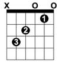
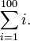

Brian Becker
{ .byline }

I've used APL for over 35 years and one of the recurring criticisms of APL is its non-standard character set – its use of “funny” symbols. This got me to thinking about symbols in general. We use symbols every day. They're used to convey meaning, to share information, to establish a common format for communication. The letters that form the words on this page are nothing more than symbols.

Symbologies are tailored to optimize communication within a domain.

A musician will see the symbols below and see a “C-major” chord. 

Whereas a guitarist may understand C-major as this...

A mathematician sees the expression below and understands it as the sum of the first 100 integers.

And an APLer sees it this way `+/⍳100`

Symbols, until you learn their meaning, are incomprehensible. The argument “I can't read APL” can be applied to any domain that uses a specific symbology – language, music, mathematics, electrical engineering, even cooking – if you don't know that tsp means teaspoon and tbsp means tablespoon, you're in for some potentially unpleasant culinary surprises.

We learn new symbols all the time. Before the EU, the € symbol was unknown. Emoticons :-) are a new breed of symbols that we've created to compactly express emotion through typed media.

If we can accept that symbols are a good thing and that we are continually learn new symbols, perhaps we can get past the bias against APL because it uses those “funny characters”.

Downloadable APL fonts and keyboard drivers, on-screen keyboards and language bars have made APL easier to learn than ever. Yes, it does take some effort to learn the symbols and how to enter them – but that's no different than learning a new language, how to read music, or any domain where the symbology is unfamiliar to us. With APL, the payback in productivity far exceeds the investment to learn the symbols.
