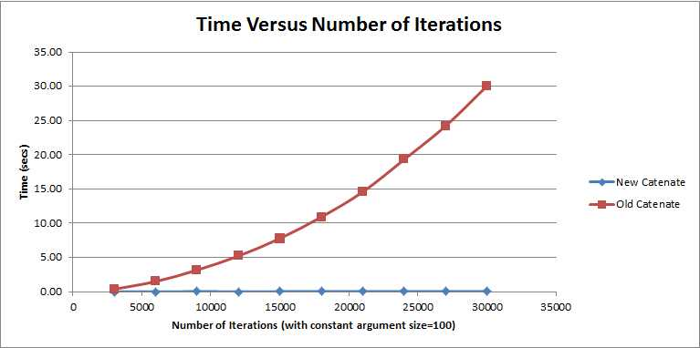

## APL2000

APL2000’s leads the way with significant new enhancements while maintaining complete compatibility with existing APL+Win-based application systems:

- Significant performance gains in core APL functions
- Access the Microsoft.Net Framework directly
- Enable Multi-thread Processing
- Expose APL+Win applications to web-based users

### APL+Win Versions 10 - 12

Significant overall performance improvements in the APL+Win interpreter were made available to APL2000 customers. Many customers experienced doubling of overall interpreter performance while maintaining complete compatibility with existing application system source code.

### APL+Win Version 13.1

APL+Win v13.1 includes optimized catenation for significant performance gains, a new primitive function, and a new operator along with other improvements. Enhancements in this release include:

- Significant Performance Gains with Optimized Catenation
- A New Mismatch Primitive Function
- New Commute Operator
- New Euro Glyph Shortcut Key
- New Log File Options

### Optimized Catenation Yields Breakthrough Speed

APL+Win expert Brent Hildebrand says it best:

> “I want to say just one word about the new catenation - WOW. three orders of magnitude faster. 1825 times faster +/- in one test.”

Optimized Catenation in APL+Win 13.1 provides significant performance gains, particularly in cases that involve repetitive catenations with large arrays such as inside an iterative control structure.

Traditional catenation runs exponentially slower as the number of iterations increases, making it impractical to use in some real-world applications. The Optimized Catenation function has nearly linear performance characteristics as a function of the number of iterations and volume of data making it an elegant solution that is blindingly fast.

<figure markdown="1">

<figcaption markdown="span">This graph represents APL2000 testing results.</figcaption>
</figure>

Note the brevity of the new optimized syntax:

```
    A←A,B (Traditional syntax)
    A,←B (Optimized syntax)
```

Extraordinary speed increases are possible if your application uses catenation for:

- Building Long Lists
- Building Documents such as Web Pages
- Accumulating Results from Stochastic Models

### APL+Win Version 13.2

APL+Win v13.2 includes the APL+Win C# Script Engine (CSE). With the CSE enhancement an APL+Win programmer can merge the benefits of .Net technology with the power of APL+Win. Direct access to the .Net Framework from APL+Win is now available while maintaining complete compatibility with existing APL+Win-based application systems.

### The C# Script Engine for APL+Win

A few examples of the power the C# Script Engine in APL+Win:

- Create utilities using .Net features for use in APL+Win application systems.
- Create and present Windows Forms or Windows Presentation Foundation GUI’s.
- Use the .Net web tools to access and capture web-based information.
- Access Microsoft Office using .Net tools.
- Use third Party .Net tools in native C# format from APL+Win.
- Use ADO.Net to access databases such as Microsoft (SQL Server, Office), Oracle, IBM (DB2, Informix, U2), SAP (Sybase), MySQL and SQLite.

APL2000 developed the □cse system function as an interface to the APLNext C# Script Engine for APL+Win. APL+Win application system programmers can now access the features of the Microsoft.Net Framework directly from APL+Win.

The CSE enables an APL programmer to create multiple instances of the CSE object in memory space separate from that of the initiating APL+Win instance. With the CSE, APL+Win data can be passed to a C# object, where it can be manipulated using the extensive Microsoft .Net Framework and the result can be returned as APL+Win data.

### The APLNext Supervisor for Multi-threaded Processing in APL+Win Applications

If an APL+Win application performs repeated in-memory processing of similar data elements, multi-core processing can provide significant performance improvements. Typical applications which benefit include:

- Time series analysis
- Population models
- Stochastic process models
- Simulations

The APLNext Supervisor exploits available multiple processors on a workstation by automatically scheduling and controlling multiple instances of the APL+Win ActiveX calculation engine to significantly improve APL+Win application system performance.

The APLNext Supervisor causes application programmer designated APL+Win functions to be executed in a concurrent, multi-threaded manner. The object model of the APLNext Supervisor provides for extensive control and monitoring of multiple threads directly from APL+Win.

The APLNext Supervisor is available to all current APL+Win Subscription licensees at no additional cost. APL2000 consultants can assist APL2000 customers to determine if the APLNext Supervisor technology will produce significant benefits in an APL+Winbased application system.

### Expose Your APL+Win Applications to Web Clients with the APLNext Application Server

APL+Win algorithms, business rules, data stores and application output can be accessed by web-based clients using public or private Internet communications for real time or scheduled batch processing. With the APLNext Application Server an APL+Win application can satisfy requests from:

- Browser-based clients
- Server clients under program control
- Local workstation, tablet or smart phone clients under program control

Using the APLNext Application Server an APL+Win application can provide web-based clients with processing capabilities that are:

- Responsive - The APLNext Application Server establishes a programmer-controlled pool of APL+Win instances with workspaces already loaded containing APL+Win functions ready to calculate
- Easily Scalable - The APLNext Application Server can be scaled to multiple servers so that client requests are always satisfied promptly.
- Capable of handling client request which are independent and stateless or dependent and stateful.
- Easily tracked and, if desired, monetized on a transaction request level.
- Deploy the APLNext Application Server using Microsoft Internet Information Server (IIS) or as an independent web server.

### APL2000 Conference March 23-25, 2014 in Ft. Lauderdale Florida


Please save the dates and mark your calendar now!

The conference will be held at the GALLERYone Doubletree Suites by Hilton, conveniently located on the Intracoastal Waterway, 8 miles from the Fort Lauderdale/Hollywood International Airport (FLL) and 3 short blocks from the Atlantic Ocean beaches.

We look forward to seeing you.

For more information on APL2000 products and services contact sales@apl2000.com.
