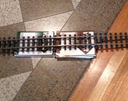

<figure class="right" markdown="1">

<figcaption markdown="span">*Vector*: As a sustaining member for a sustaining member.</figcaption>
</figure>

Well its taken a while longer than I would have liked but the latest issue of *Vector* has arrived. A glance to the right shows the journal providing much needed support in someone's daily toil.

This issue brings a few changes. Colour for one. We have negotiated a new printing agreement, a little extra cost, that will allow us to include a limited number of colour images and we will use this resource for photographs, graphs, screen images and diagrams in that priority order should we use up our allotment.

Also we have automated the process of producing the PDF document for the print shop directly from the on line material which removes the need for a tedious manual task hitherto performed with great fortitude by Kai Jaeger. A consequence of this is that there is no need for a second proof reading of the collated PDF document.

We have experimented with using MathML in the sub-editing submitted papers to produce mathematical equations. This has always been a problem in the past where we have had to rely on using graphic image files. These in turn need more intervention as we moved from an on line to a printed medium.

The next improvement in the production process will be to try and make articles being prepared available for to authors and reviewers in an on line edit facility to help them collaborate in the exercise.

Going forward we are looking to make some changes to our *Vector* web site. One such change will be to post the latest edition of *Vector* as a PDF for members. This be available for download once it is ready for use in a variety of eReaders or similar devices. Six to twelve months on we would make it available to anyone else. Another possibility will be to make downloadable PDFs of the individual articles available. And beyond that perhaps collections of articles could be collated with a view to a print on demand facility. We would however be very interested to know what our members think about the whole issue of on-line publishing. Please note that we are not thinking about stopping the printed version of *Vector*.

John Jacob
