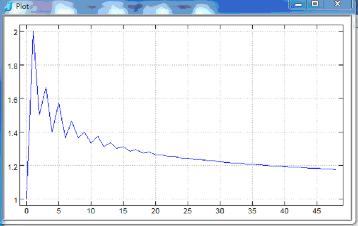
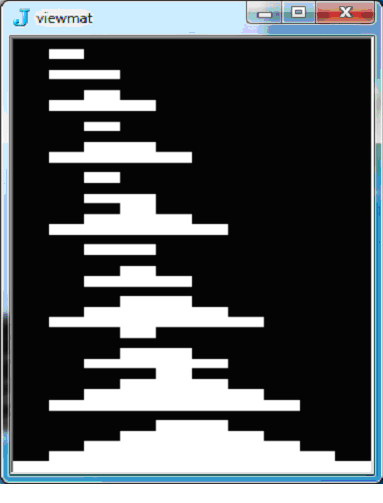
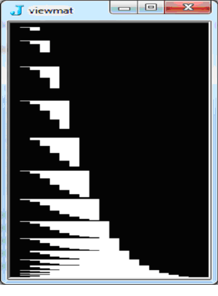
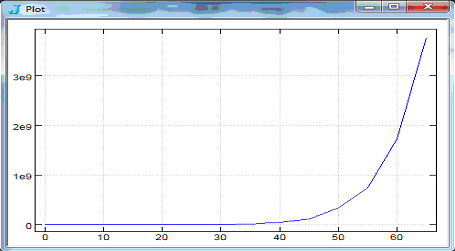

by Howard A. Peelle (hapeelle@educ.umass.edu)
{ .byline }

J programs to generate all partitions of an integer are presented and compared.
{ .abstract }

*Whoever wants to go about generating all partitions  
not only immerses himself in immense labor,  
but also must take pains to keep fully attentive,  
so as not to be grossly deceived.*

*-- Leonhard Euler,  
De Partitione Numerorum (1750)*

## Introduction

Historically, there has been great interest in partitions, especially computing the number of partitions of an integer. Relatively recently, algorithms and programs for generating all integer partitions have appeared but have not been expressly compared in a common language. Here, a dozen or so J programs are presented developmentally and then compared by speed, space, and spread.

Note: Programs are organized generally in chronological order by author of algorithm, with alternative coding to contrast efficiency, but with minimum explanation. If you are still learning J, please consult the JSoftware website [\[1\]](#ref1) and read appropriate tutorials, notably [\[7\]](#ref7) and [\[8\]](#ref8). If you are only interested in the best programs, skip to Comparisons and see Appendix for their final definitions.

```
                                 6
                                1 5
                                2 4
                                3 3
                               1 1 4
                               1 2 3
                               2 2 2
                              1 1 1 3
                              1 1 2 2
                             1 1 1 1 2
                            1 1 1 1 1 1
```

A *partition* of an integer n is represented here as a list of *parts*: positive integers whose sum is n. All integer partitions of n are all the distinct partitions of n with parts in ascending (non-decreasing) or descending (non-increasing) order. Partitions may be listed in any order but usually are in ascending or descending base value. For example, all partitions of 6 in ascending order, with ascending parts:

Note: The following utility names will be used often throughout, but their definitions will not be repeated.

```
    ELSE =: `
    WHEN =: @.
    EACH =: &.>
```

## Skiena’s Algorithm

The first program is a simplified coding of Steven Skiena’s algorithm [\[2\]](#ref2) using double recursion to produce partitions of input integer n beginning with input largest part p. It joins two arrays vertically: The top is the result of p joined horizontally onto partitions of n - p with the new largest part being the smaller of n - p and p; the bottom is the partitions of n with largest part p - 1. In tacit J:

```
Skiena =: Parts ELSE Ones WHEN Under2        NB. (n) Skiena (p)
    Ones =: ,:@#
    Under2 =: 2 > ]
    Parts =: Top , Bottom
        Top =: ] ,. - Skiena - <. ]
        Bottom =: Skiena <:
```

For example, partitions of 5 beginning with 3 in a table (padded with 0s):

```
   5 Skiena 3
3 2 0 0 0
3 1 1 0 0
2 2 1 0 0
2 1 1 1 0
1 1 1 1 1
```

All partitions of 6 in descending order:

```
   6 Skiena 6                    NB. Skiena~ 6
6 0 0 0 0 0
5 1 0 0 0 0
4 2 0 0 0 0
4 1 1 0 0 0
3 3 0 0 0 0
3 2 1 0 0 0
3 1 1 1 0 0
2 2 2 0 0 0
2 2 1 1 0 0
2 1 1 1 1 0
1 1 1 1 1 1
```

This is the shortest program here, but it is inefficient in speed and space.

## Knuth’s Algorithms

Donald Knuth proffered two algorithms for generating partitions in [\[3\]](#ref3).

### Knuth

Knuth’s algorithm `P` computes partitions successively, starting with n and ending with a list of 1s: “If a partition isn’t all 1s, it ends with `(x+1)` followed by zero or more 1s, for some `x≤1`; therefore, the next smallest partition in lexicographic order is obtained by replacing the suffix `(x+1)1…1` by `x…xr` for some appropriate remainder `r≤x`. The process is quite efficient if we keep track of the largest subscript q \[of partition a\] such that aq not equal 1…” [\[3](#ref3)  page 37\]. Coded explicitly in `J`, the program below performs classic scalar processing to produce a table of all partitions in descending order:

```
Knuth =: 3 : 0                  NB. Knuth (n) for n>:1
n =. y
all =. i.0,n
label_P1.                       NB. Initialize
a =. n#0
m =.0        NB. origin 0
label_P2.                       NB. Store final part
a =. n m}a
q =. m - (n=1)
label_P3.                       NB. Visit a partition
all =. all,(m+1){.a
if. (q{a)~:2 do. goto_P5. end.
label_P4.                       NB. Change 2 to 1,1
a =. 1 q}a
q =. q-1
m =. m+1
a =. 1 m}a
goto_P3.
label_P5.                       NB. Decrease q{a
if. q<0 do. all return. end.
x =. (q{a)-1
a =. x q}a
n =. (m-q)+1
m =. q+1
label_P6.                       NB. Copy x
if. n<:x do. goto_P2. end.
a =. x m}a
m =. m+1
n =. n-x
goto_P6.
)
```

For example, all partitions of 6 is the same result as `6 Skiena 6`:

```
   Knuth 6
6 0 0 0 0 0
5 1 0 0 0 0
4 2 0 0 0 0
4 1 1 0 0 0
3 3 0 0 0 0
3 2 1 0 0 0
3 1 1 1 0 0
2 2 2 0 0 0
2 2 1 1 0 0
2 1 1 1 1 0
1 1 1 1 1 1
```

The program can be shortened drastically, get the remainder neatly, and handle `n=0` as a bonus:

```
Knuthx =: 3 : 0    NB. Knuthx (n)
all =. ,:p =. ,y
while. 1 < {.p do.    i =. <: p i. 1
            x =. - <: i { p
            a =. i {. p
            s =. y - +/a
            p =. a , x +/\ s#1
            all =. all , p
end.
)
```

Look at intermediate steps during a loop of `Knuthx 10` to produce the next partition after `4 3 1 1 1`:

```
    y =. 10
    p =. 4 3 1 1 1
   ]i =. <: p i. 1
1
   ]x =. - <: i { p
_2
   ]a =. i {. p
4
   ]s =. y - +/a
6
   ]p =. a , x +/\ s#1
4 2 2 2
```

Unfortunately, `Knuthx` uses twice the space and is (increasingly) slower than `Knuth`.

A tacit translation is even slower and fatter in space:

```
Knutht =: Parts ^: While ^:_ @ N
    N =: ,:@,
    While =: 1 < {.@{:
    Parts =: , Next@Last
        Last =: {: -. 0:
        Next =: A , X +/\ S#1:
            A =: I {. ]
                 I =: <:@i. 1:
            X =: I -.@{ ]
            S =: ] -amp;(+/) A
```

Changing `Knuthx` to use `s=.x+(#p)–i` for the sum of a suffix and including a condition to change a 2 to 1 1 will improve its speed – especially for large `n` with growing percentage of 2s:

```
Knuth2 =: 3 : 0
all =.,:p=.,y
while. 1 < {.p do.    i =. <: p i. 1
            x =. i { p
            if. x=2
            do. p =. 1 i} p,1
            else.
            a =. i {. p
            x =. <:x
            s =. x + (#p) - i
            p =. a , x Next s
            end.
            all =. all , p
end.
)

    Next =: -@[ +/\ ] # 1:
```

Better yet, use a sub-program to group partitions by their leading part and append an array of all leading 2s separately, with a final row of 1s:

```
Knuth2s =: 3 : 0
all =. i.0,n=.y
while. n>1
   do.     nexts =. n Nexts y-n
    all =. all , n ,. nexts
    n =. n-1
  end.
all,1
)

Nexts =: 3 : 0
:
if. y<2 do. ,:,y return. end.
nexts =. ,:next =. x New y
while. 2 < {.next
   do.    i =. <: next i. 1
    x =. i { next
    if. x=2
    do. next =. 1 i} next,1
    else.
    a =. i {. next
    x =. <:x
    s =. x + (#next) - i
    next =. a , x New s
    end.
    nexts =. nexts , next
  end.    NB. next is 2…(1)
repeats =. >:i.#next-.1
twos =. Two ^:repeats next
nexts,twos
)

    Two =: }. , 1 1"_
```

This is faster and much slimmer, but longer.

Nevertheless, these revisions cannot compete with `Knuth` in speed or space.

### Hindenburg

Knuth’s algorithm H (attributed to Hindenburg [\[4\]](#ref4)) computes partitions of `n` with `m` parts -- that is, m-tuples that sum to `n`. “The basic idea is that colex order goes from one partition <code>a<sub>1</sub>…a<sub>m</sub></code> to the next by finding the smallest `j` such that <code>a<sub>j</sub></code> can be increased without changing <code>a<sub>j+1</sub>…a<sub>m</sub></code>.” [\[3](#ref3)  page 38\] The new partition will have `j` leading parts = <code>a<sub>j</sub>+1</code> and the same sum if <code>a<sub>j</sub>&lt;a<sub>1</sub>–1</code>. Note that this algorithm does not work for 0 or 1 parts. Later, see program `AP` that produces m-tuples robustly.

Assuming `n≥m≥2`, code `H` in `J`:

```
H =: 3 : 0                          NB. (n) H (m)
:
n =. x               NB. n>:m
m =. y               NB. m>:2
ps =. i.0,m
label_H1.                           NB. Initialize
a =. m#0
a =. (1+n-m) 0} a    NB. origin 0
a =. 1 (}.i.m)} a
a =. a , _1
label_H2.                           NB. Visit partition
ps =. ps , (i.m){a
if. (1{a)>:(0{a)-1 do. goto_H4. end.
label_H3.                           NB. Tweak 0{a and 1{a
a =. ((0{a)-1) 0}a
a =. ((1{a)+1) 1}a
goto_H2.
label_H4.                           NB. Find j
j =. 2               NB. origin 0
s =. (0{a)+(1{a)-1
while. (j{a)>:(0{a)-1 do.  s =. s + j{a
                j =. j+1
end.
label_H5.                           NB. Increase j{a
if. j=m do. ps return. end.
x =. (j{a)+1
a =. x j} a
j =. j-1
label_H6.                           NB. Tweak (i.j){a
while. j>0 do. a =. x j}a
            s =. s-x
            j =. j-1
end.
a =. s 0} a
goto_H2.
)
```

For example, partitions of 6 with 2, 3, and 4 parts:

```
   6 H 2
5 1
4 2
3 3
   6 H 3
4 1 1
3 2 1
2 2 2
   6 H 4
3 1 1 1
2 2 1 1
```

By appending such results, `H` can be used in a supra-program to generate all partitions:

```
Hindenburg =: 3 : 0            NB. Hindenburg (n)
n =. y
m =. 2
all =. ,.n
while. m<:n do. all =. all , n H m
           m =. m+1
end.
all
)
```

Notice that the order of all partitions is not the same as in `Knuth 6`.

`Hindenburg` is increasingly slower than `Knuth` and uses about twice the space, so it will be omitted from further comparisons.

## Hui’s Algorithm

### part

Roger Hui presented a concise program for all partitions [\[5\]](#ref5):

```
pu =: ] <@:+"1 [ * </\"1@=@]
pext =: [: ~. [: /:~&.> ,&.> , ;@:(pu&.>)
part =: ,&.>`(pext/)@.(1:<#) @ ($&1)
```

An example of partitions of 6 in a list of 11 boxes with ascending parts:

```
   part 6
┌───────────┬─────────┬───────┬───────┬─────┬─────┬───┬─────┬───┬───┬─┐
│1 1 1 1 1 1│1 1 1 1 2│1 1 1 3│1 1 2 2│1 1 4│1 2 3│1 5│2 2 2│2 4│3 3│6│
└───────────┴─────────┴───────┴───────┴─────┴─────┴───┴─────┴───┴───┴─┘
```

To produce a numeric table (padded with 0s), open the list:

```
   >part 6
1 1 1 1 1 1
1 1 1 1 2 0
1 1 1 3 0 0
1 1 2 2 0 0
1 1 4 0 0 0
1 2 3 0 0 0
1 5 0 0 0 0
2 2 2 0 0 0
2 4 0 0 0 0
3 3 0 0 0 0
6 0 0 0 0 0
```

With or without 0s, this program is woefully slow and obese in space. It cannot compete here.

## Boss’s Algorithm

### Boss

R. E. Boss developed an efficient algorithm [\[6\]](#ref6) that sparked interest, as well as some revisions. His program computes all partitions with descending parts:

```
init =: (<@<@i.@(1 0"_)) ,~ <"0@(] , (] (- <. >:@]) i.)@<:)
pps1 =: >:@i.@[ <@;@:(([ ,. (>: {."1) # ])&.>) {.
exit =: >@{.@>
Boss =: [: exit [: (],~ pps1)&.>/ init
```

Example:

```
   Boss 6
1 1 1 1 1 1
2 1 1 1 1 0
2 2 1 1 0 0
2 2 2 0 0 0
3 1 1 1 0 0
3 2 1 0 0 0
3 3 0 0 0 0
4 1 1 0 0 0
4 2 0 0 0 0
5 1 0 0 0 0
6 0 0 0 0 0
```

This program is very fast but fat.

### AP0

Boss’s program can be re-coded more perspicuously:

```
AP0 =: Exit@Part@Init            NB. AP0 (n)
    Exit =: >@{.@>
    Init =: <"0@Mins , <@Empty
        Empty =: <@,:@i.@0:
        Mins =: , (<. |.)@}.@i.
    Part =: Next EACH/
        Next =: <@;@Ps , ]
            Ps =: Ns@[ Join EACH {.
                Ns =: >:@i.
                Join =: [ ,. Select # ]
                    Select =: >: {."1
```

10% shorter, `AP0` runs at about the same speed as `Boss` in a little less space.

### Hui

Hui [\[7\]](#ref7) recast Boss's program using Power instead of Insert:

```
part =: 3 : 'final (, new)^:y <<i.1 0'
new =: (-i.)@# <@:(cat&.>) ]
cat =: [ ;@:(,.&.>) -@(<.#) {. ]
final =: ; @: (<@-.&0"1&.>) @ > @ {:
```

`part 6` produces a list of 11 boxes of partitions with descending parts (without 0s).  
This program is much slower than Boss and uses 80% more space. It could speed up 33% if 0s in boxes were not removed: `NB final =: ;@>@{:` But that would require more space.

Make it conform to other programs here that return a numeric table:

```
Hui =: >@part
```

```
   (Hui -: Boss) 6
1
```

This could be re-coded in smaller modules:

```
Hui0 =: Final@Parts
    Final =: ;@>@{:
        Inputs =: ] ` Start
        Start =: <@<@,:@i.@0:
    Parts =: Boxes^:Inputs
        Boxes =: , <@New
            New =: (-i.)@# ;@Cat EACH ]
                Cat =: [ ,.EACH Min {. ]
                    Min =: -@<. #
```

However, these programs need excessive memory and will not compete well at high `n`.

### AP1

Here is my revision of Boss's program, notably without using an outer level of boxing:

```
AP1 =: ;@All ELSE Ns WHEN (< 2:)            NB. AP1 (n)
    All =: Ns ,.EACH Parts/@Mins
        Ns =: >:@i.
        Mins =: Smaller@}.@i. , 0:
            Smaller =: <. |.
        Parts =: Next ELSE Start WHEN Zero
            Zero =: 0 e. ]
            Start =: 1 ; ,@0:
            Next =: ;@New ; ]
                New =: Ns@[ Join EACH {.
                    Join =: [ ,. Select # ]
                        Select =: >: {."1

    (AP1 -: Boss) 6
1
```

This program runs much faster than `Boss` in significantly less space. Indeed, it can do n = 70 whereas `Boss` runs out of memory.

Also consider an explicit translation:

```
AP1x =: 3 : 0
ns =. >:i.y
mins =. (<. |.) }:ns
all =. < i.1 0
while. #mins do. new =. all New~ {:mins
            all =. all ;~ ;new
            mins =. }:mins
end.
all =. ns ,.EACH all
;all
)
```

Notice use of `New` and its tacit sub-programs from above.

`AP1x` is slower than `AP1`, needs a lot more space, and is longer. So it will bow out of the competition.

How about a recursive definition?

```
AP1r =: ;@All
    All =: Ns ,.EACH Mins Parts Empty
        Empty =: <@,:@i.@0:
        Ns =: >:@i.
        Mins =: Smaller@}.@i.
            Smaller =: <. |.
        Parts =: Build ELSE ] WHEN Done             NB. Parts calls Build
            Done =: 1 > #@[
            Build =: ButFirst Parts First Next ]    NB. Build calls Parts
                First =: {.@[
                ButFirst =: }.@[
                Next =: ;@New ; ]
                    New =: Ns@[ Join EACH {.
                        Join =: [ ,. Select # ]
                            Select =: >: {."1
```

This has about the same speed and space as `AP1` but is longer. So, it will defer to `AP1`.

See **Peelle’s Algorithms** later for more efficient recursive programs.

### AP2

In [\[8\]](#ref8), I described a variant of Boss’s algorithm that computes the leading part at each iteration: the smaller of the number of accumulated boxed arrays and *n* minus that number. Renamed and edited slightly:

```
AP2 =: ;@All                    NB. AP2 (n)
    All =: Ns ,.EACH Parts
        Ns =: >:@i.
        Parts =: Build^:N Start
            Start =: 1 0 <@$ ]
            N =: 0 >. <:@[
            Build =: <@;@Next , ]
                Next =: Lead Ps ]
                    Lead =: Min #
                        Min =: - <. ]
                    Ps =: Ns@[ Join EACH {.
                        Join =: [ ,. Select # ]
                            Select =: >: {."1

    (AP2 -: Boss) 6
1
```

See [\[8\]](#ref8) for a tutorial. Example:

```
   AP2 6
1 1 1 1 1 1
2 1 1 1 1 0
2 2 1 1 0 0
2 2 2 0 0 0
3 1 1 1 0 0
3 2 1 0 0 0
3 3 0 0 0 0
4 1 1 0 0 0
4 2 0 0 0 0
5 1 0 0 0 0
6 0 0 0 0 0
```

This program is about 33% faster than `Boss` at n = 65 in about 25% less space. Compared to `AP1`, it has about the same speed, slightly less space, and less length.

Efficiency can be improved slightly further by separating top and bottom halves of the partitions array, by defining separate programs for odd and even input, or with other programming techniques (not shown here because those programs are much longer).

## Kelleher’s Algorithm

Jerome Kelleher and Barry O’Sullivan published two algorithms in [\[9\]](#ref9) for all partitions with ascending parts, superseding speed of existing programs for descending parts by Knuth [\[3\]](#ref3) and by Zoghbi & Stojmenovic [\[10\]](#ref10). Kelleher’s most efficient algorithm generates lexicographic successors iteratively with embedded loops, notably a second loop to handle transitions involving only the last two parts. Coded straightforwardly in J:

```
Kelleher =: 3 : 0            NB. Kelleher (n)
n =. y
a =. (n+1)#0
k =. 1
a =. (0) 0} a        NB. redundant
y =. n-1
all =. i.0,n
while. k~:0 do.
    x =. ((k-1){a)+1
    k =. k-1
    while. (2*x)<:y do.
        a =. x k} a
        y =. y-x
        k =. k+1
      end.
    l =. k+1
    while. x<:y do.
        a =. x k}a
        a =. y l}a
        all =. all , (i.k+2){a
        x =. x+1
        y =. y-1
      end.
    a =. (x+y) k}a
    y =. x + y - 1
    all =. all , (i.k+1){a
  end.
all
)
```

Example:

```
   Kelleher 6
1 1 1 1 1 1
1 1 1 1 2 0
1 1 1 3 0 0
1 1 2 2 0 0
1 1 4 0 0 0
1 2 3 0 0 0
1 5 0 0 0 0
2 2 2 0 0 0
2 4 0 0 0 0
3 3 0 0 0 0
6 0 0 0 0 0
```

`Kelleher` is 4 times slower than `AP2` at n = 65 but uses only about 40% of the space. It is faster than `Knuth` in about the same space, and much shorter. An even faster and shorter, more J-ish version `Kelleherx` is given in the **Appendix**.

## Peelle’s Algorithms

Now look at how well some new recursive algorithms perform.

### AP

Peelle presented a tidy ambivalent program in [\[8\]](#ref8) using a ‘1 Plus’ recursive approach to produce all partitions of `n` or partitions of `n` with up to `p` parts:

```
AP =: ;@All                        NB. AP (n) or (n) AP (p)
    All =: Parts EACH >:@i.
        Parts =: Ones ELSE Plus1 WHEN >
            Ones =: = # ] ,:@# 1:
            Plus1 =: 1 + - AP ]
```

The main idea is to add 1 to each sub-array of partitions of (`n-1` to `p`) for 1 to `p` parts. In other words, for a given number of parts, partition n-parts, then add 1 to each part (including 0s).

For example, assemble 1 plus each result below to get `6 AP 3`:

```
   5 AP 1                            6 AP 3
5                                 6 0 0
   4 AP 2                         5 1 0
4 0                               4 2 0
3 1                               3 3 0
2 2                               4 1 1
   3 AP 3                         3 2 1
3 0 0                             2 2 2
2 1 0
1 1 1
```

See [\[8\]](#ref8) for a tutorial. Notice that the order of all partitions is the same as `Hindenburg`:

```
   AP 6            NB. 6 AP 6
6 0 0 0 0 0
5 1 0 0 0 0
4 2 0 0 0 0
3 3 0 0 0 0
4 1 1 0 0 0
3 2 1 0 0 0
2 2 2 0 0 0
3 1 1 1 0 0
2 2 1 1 0 0
2 1 1 1 1 0
1 1 1 1 1 1
```

`AP` can speed up greatly by exiting when either input is 0 or 1:

```
AP =: ;@All ELSE N WHEN Under2
Under2 =: 2 > <.
        N =: ,:@{.~
```

This program runs three times faster than `Skiena` but needs 30% more space at `n=65`. Yet, AP can do `n=70`, whereas `Skiena` runs out of memory.

`AP` can be improved by handling 0 and 1 parts separately:

```
   AP =: N ;@, [ All <.
        N =: <@,:@{.~
        All =: Parts EACH 2 }. i. , ]
                Parts =: 1 + ] {."1 - AP ]
```

This version will be used for comparisons and is listed in the Appendix. It is much faster and much shorter than `AP1` and `AP2` in much less space at n=70 although it is much slower at n=65. Which is better? See Comparisons.

Translation into explicit definition avoids boxing:

```
APx =: 3 : 0
:
all =. ,:y{.x
for_p. 2 }. i.>:y do. all =. all , 1 + p {."1 n APx p<.n=.x-p end.
)
```

This needs 40% less space than AP but twice the time and is longer. So it will drop out.

### APr

Here is a simple recursive definition for two inputs: n and a lead part. Explicitly:

```
APrx =: 3 : 0            NB. (n) APrx (lead)
:
all =. i.0,x
while. y>1
   do. all =. all , y ,. n APrx y <. n=.x-y
       y =. y-1
  end.
all,1
)
```

Note that it skips the loop whenever `y` is 1 and just appends the last row of 1s.  
Example: `6 APrx 6` or `APrx~6` is the same as `Knuth 6`.

This program is much slower than `AP` yet much slimmer in space until `n=70` when it exceeds memory. So, forget it.

A tacit ambivalent version is shorter, 40% faster in 75% more space and can do `n=70`:

```
APr =: ;@All ELSE Ones WHEN Under2        NB. (n) APr (lead) or APr (n)
    Ones =: ,:@#
    Under2 =: 2 > ]
    All =: Ns Parts EACH Leads@]
        Parts =: ] ,. [ APr <.
        Ns =: - Leads
        Leads =: - i.
```

This can be improved further by generating 1s separately:

```
APr =: <@Ones ;@, Allbut1s        NB. (n) APr (lead) or APr (n)
        Ones =: ,:@# 1:
        Allbut1s =: Parts EACH Leads
            Parts =: ] ,. - APr - <. ]
            Leads =: 2 }. i. , ]
```

Now it is more competitive with `AP` in speed, but much fatter, albeit shorter.  
Indeed, this is the shortest program among those here that can perform high `n`.

### APm

Another simple recursive definition uses previous partitions as a *memo* to produce the next:

```
APm =: 3 : 0            NB. APm (n)
all =. i.0,n=.y
while. n>1
   do. memo =: APm y-n
    leads =. {."1 memo
    drop =. leads i. n <. y-n
      all =. all , n ,. drop }. memo
    n =. n-1
  end.
all,1
)
```

Note that global `memo` cuts down space significantly. Still, it’s way too slow.  
J’s built-in Memo adverb `M`. does better. See `APdb` later in **Other Programs**.

### APh

This approach produces all partitions in two halves, recursively, in an ambivalent program. For the bottom half, it recurses when `n` > lead part; and for the top half, it recurses with `n` as both inputs.

```
APh =: [ ;@Parts New            NB. APh (n) or (n) APh (lead)
    New =: -@<. {. i.@[
    Parts =: ] Part EACH -
        Part =: ] ,. Recurse ELSE Empty WHEN Zero ELSE Ones WHEN One
            Recurse =: [ APh [ ELSE ] WHEN >
            Empty =: ,:@i.@0:
            Zero =: = 0:
            Ones =: ,:@#
            One =: 1 = ]
```

Examples of its subprogram for two inputs:

```
   0 Part 6
6

   1 Part 5
5 1

   2 Part 4
4 2 0
4 1 1

   3 Part 3
3 3 0 0
3 2 1 0
3 1 1 1

   4 Part 2
2 2 2 0 0
2 2 1 1 0
2 1 1 1 1

   5 Part 1
1 1 1 1 1 1
```

`APh 6` assembles these results into one table of descending partitions (same as `|.APr 6`).

Include an exit for 2 and build an array with leading 2s directly:

```
Part=: ] ,. Recurse ELSE Empty WHEN Zero ELSE Twos WHEN Two ELSE Ones WHEN One
            Two =: 2 = ]
            Twos =: Build ^: Inputs
                Build =: 1 ,~ 2 ,. ] ,. 0:
Inputs =: <.@% ` Start
                    Start =: ,:@:>:@i.@|~
```

This program is now much faster in equal space but quite longer.

### APn

Another approach constructs a table of partitions horizontally by nesting columns recursively:

```
APnx =: 3 : 0                NB. APnx (n)
is =. i.y
; is Nest EACH y-is
)
```

Nest =: 3 : 0 : if. y=1 do. 1,x#1 return. end. if. x=0 do. ,:,y else. min =. – x &lt;. y is =. min \{. i.x y ,. ; is Nest EACH x-is end. )

A tacit version is shorter and much faster:

```
APn =: [ ;@Parts <.                    NB. APn (n)
    Parts =: Is Nest EACH Ns@]
    Is =: i.@] + -
    Ns =: - i.
        Nest =: Join ELSE N WHEN Zero ELSE Ones WHEN One
            Join =: ] ,. APn
            N =: ,:@,@]
            Zero =: =0:
            Ones =: 1,#
            One =: 1=]
```

### APapr

Finally, consider this: halve input `n` to become the largest second part, subtract it from `n` to get the first part, iterate through decrements of first and second parts respectively, and call `APr` (presented previously) to attach a sub-array of partitions for the remaining `new_n` with the leading part as the smaller of second and `new_n`:

```
APapr =: 3 : 0            NB. APapr (n)
all =. Ns1s y-i.y
for_second. 2 To <.-:y
    do.    for_first. |.second To y-second
            do. all =. all,first,.second,.n APr second<.n=.y-first+second
            end.
    end.
)
    To =: }. i. , ]
```

For efficiency, all partitions with a second part 0 and 1 are done at once separately in a table:

```
    Ns1s =: ,. (</ }:)             NB. Ns1s (n-i.n)
```

Example:

```
   APapr 6
6 0 0 0 0 0
5 1 0 0 0 0
4 1 1 0 0 0
3 1 1 1 0 0
2 1 1 1 1 0
1 1 1 1 1 1
4 2 0 0 0 0
3 2 1 0 0 0
2 2 1 1 0 0
2 2 2 0 0 0
3 3 0 0 0 0
```

Note the unorthodox order: by increasing second part.

This program is faster than `APr`, and much shorter than `Kelleher`, using only a little more space. (even counting `APr`). Despite relying on a sub-program that itself can compute all partitions, it competes very well at high `n`. Indeed, it is the fastest here at `n=70`.

## Comparisons

Now compare the most competitive programs here for `n=65` by ratios of time, space, and length – where 1.00 is best. Finally, sum the ratios for a simple composite of overall program efficiency:

```
            Time        Space      Length     Overall

Skiena     12.59        1.46        1.00        15.05

Knuth       5.15        1.00        7.94        14.09

Boss        1.38        3.00        3.00         7.38

Hui        24.31        5.41        2.38        32.11

AP1         1.01        2.34        2.79         6.14

AP2         1.00        2.34        2.44         5.78

Kelleher    4.49        1.00        6.35        11.85

AP          2.77        1.89        1.21         5.86

APr         3.53        2.34        1.15         7.02

APh         3.71        2.34        3.44         9.49

APn         4.85        2.34        1.85         9.04

APapr       3.40        1.03        3.88         8.31
```

So `AP2` is the winner, with `AP` and `AP1` close behind.

For `n=70`, `Skiena`, `Boss` and `Hui` cannot participate on my computer because they run out of memory. Timing results for most remaining programs have large variance since they are pushing space limits. Within this uncertain repeatability, `APapr` emerges as the fastest and `AP` becomes the new winner overall. In order, the top six are: `AP`, `APr`, `APapr`, `AP2`, `AP1`, `Kelleherx`. Considering only time and space, the top six are: `APapr`, `Kelleher`, `AP`, `Knuth`, `AP2`, `APr`.

No program above can do `n=75` on my laptop. Timing ratios on other computers differ somewhat but indicate that `AP1` and `AP2` are the fastest.

Readers may be able to run higher `n`, may want to weight the three criteria differently, and may add other criteria, such as a measure of clarity. See Appendix for benchmark details and copies of the best programs for convenient use.

## Number of Partitions

For any program above, the number of partitions can be counted perfunctorily from the resulting table of partitions. For example: `#AP 6` is 11. A list of partition numbers:

```
   #@AP"0 i.20
1 1 2 3 5 7 11 15 22 30 42 56 77 101 135 176 231 297 385 490
```

There is an issue about how to count the number of partitions for `n=0`:

```
   $Skiena~ 0
1 0

NB. Knuth 0 does not compute

   $Boss 0
0
   $Hui 0
1 0
   $AP1 0
1
   $AP2 0
0
   $Kelleher 0
1 1
   $AP 0
1 0
   $APr 0
1 0
   $APapr 0
0 1
```

Since the shape of an empty list is 0, one can argue that there are zero partitions of 0. One can also argue that there is one partition of 0: the empty partition (a 1 by 0 table) or a 1-item list (,0). In all cases, the sum is 0. So, what should it be – an empty list, or an empty table, or just 0? See oeis.org/wiki/Partition function.

Of course, the pertinent problem is how to compute number of partitions efficiently for large `n` without the effort of generating them.

### P

To begin with, here is a clean program to compute number of partitions of integer `n` with `k` parts, albeit inefficiently due to recursion:

```
P =: Recur ELSE = WHEN Done        NB. (n) P (k)

    Recur =: P&<: + - P ]
    Done =: <: +. 0 = ]
```

An alternative definition:

```
P =: Recur ELSE ] WHEN (2>]) ELSE = WHEN <:        NB. (n) P (k)
```

For example, number of partitions of 10 with 4 parts:

```
   10 P 4
9
```

The total number of partitions of `n` with `k` parts is `+/n P"0 i.>:k` .

A table of `P` for both `n` and `k` from 0 to 10:

```
      P"0/~ i.11
1 0 0 0 0 0 0 0 0 0 0
0 1 0 0 0 0 0 0 0 0 0
0 1 1 0 0 0 0 0 0 0 0
0 1 1 1 0 0 0 0 0 0 0
0 1 2 1 1 0 0 0 0 0 0
0 1 2 2 1 1 0 0 0 0 0
0 1 3 3 2 1 1 0 0 0 0
0 1 3 4 3 2 1 1 0 0 0
0 1 4 5 5 3 2 1 1 0 0
0 1 4 7 6 5 3 2 1 1 0
0 1 5 8 9 7 5 3 2 1 1
```

Notice that the nth row sum is the number of all partitions of `n`.

### Pnk

An efficient program to build this table iteratively adds the reverse diagonal to the shifted last row:

```
TP =: One , 0 ,. Row ^: (Repeat`One)        NB. TP (n)
        Repeat =: 0 >. <:
        One =: ,:@,@1:
    Row =: , Last + Diag , 0:
        Last =: 0 , {:
        Diag =: (<0 1) |: |.
```

Index the table to get number of partitions of `n` with `k` parts:

```
Pnk =: <@, { TP@[            NB. (n) Pnk (k)  or  Pnk (n)
```

Example:

```
   10 Pnk 4
9
```

### NP

Since Pnk is ambivalent, Pnk(n) is the last row, and its sum is the number of all partitions:

```
NP =: +/@Pnk            NB. NP (n)
```

Example:

```
   NP 10
42
```

First 20 numbers of all partitions:

```
   NP"0 i.20
1 1 2 3 5 7 11 15 22 30 42 56 77 101 135 176 231 297 385 490
```

Larger numbers:

```
   n ,: NP"0 n =. 5*i.15
0 5 10  15  20   25   30    35    40    45     50     55     60      65      70
1 7 42 176 627 1958 5604 14883 37338 89134 204226 451276 966467 2012558 4087968
```

Growth factors:

```
   Growth =: }. % }:

   5j2 ": Growth NP"0 i.15
1.00 2.00 1.50 1.67 1.40 1.57 1.36 1.47 1.36 1.40 1.33 1.38 1.31 1.34

   load 'plot'
   plot Growth NP"0 i.50
```



```
   Growth NP"0 n=.1000+i.10
1.04035 1.04033 1.04031 1.04029 1.04027 1.04025 1.04023 1.04021 1.04019
```

For very large `n`, use Hui’s efficient `pnv` program in [\[7\]](#ref7) based on Euler’s recurrence relation to see convergence to an asymptote approaching 1.

## Other Programs

Several other programs that generate all integer partitions have not been mentioned yet because they are not nearly competitive with those above. With respect for their role in research and development, they are summarized as follows:

### Reingold

Reingold et al. [\[11\]](#ref11) described an algorithm for generating tuples with ascending parts. Coded explicitly in J:

```
Reingold =: 3 : 0            NB. Reingold (n)
n =. y
m =. 1
ps =. i.0 0
while. n>:m
do. ps =. ps , n Parts m
        m =. m + 1
end.
ps
)
```

```
Parts =: 3 : 0               NB. (n) Parts (m)
:
n =. x
m =. y
ps =. ,: 1 + (-m) {. n-m
while. +./1<p-~{:p=.{:ps
do. ps =. ps , Next p
end.
)
```

```
Next =: 3 : 0                NB. Next (p)
p =. y
n =. +/p
m =. #p
i =. <: 0 i.~ 2 <: p-~{:p
p =. (1+i{p) (i }. i.m)} p
p =. (n-+/}:p) (m-1)} p
)
```

For example:

```
   Reingold 6
6 0 0 0 0 0
1 5 0 0 0 0
2 4 0 0 0 0
3 3 0 0 0 0
1 1 4 0 0 0
1 2 3 0 0 0
2 2 2 0 0 0
1 1 1 3 0 0
1 1 2 2 0 0
1 1 1 1 2 0
1 1 1 1 1 1
```

The program is lengthy, four times slower than `Knuth` at `n=65` in twice the space, and runs for hours at `n=70`. Tacit translations (for both ascending and descending parts) use 30% less space but are ten times slower.

## Reiter

Reiter [\[12\]](#ref12) presented a recursive program in APL that uses three inputs (in one list): integer `n`, number of parts `p` and smallest part `s`. It splits the computation depending on whether there are partitions into one, two, or more parts. The case of two parts is not necessary to the correctness of the algorithm, but it does improve the efficiency of the algorithm. When the number of parts is three or more, then a loop catenates blocks of partitions of smaller (or equal) numbers into a smaller number of parts with the smallest number allowed being the index of the loop. \[11 page 8\] In J:

```
Reiter =: ;@Blocks ELSE (,@N) WHEN (P < 2:)        NB. Reiter (n,p,s)
    Blocks =: <@(S,.Reiter)"1 @ NPSs
        NPSs =: (N-Ss) ,. <:@P ,. Ss
    N =: {.
    P =: {.@}.
    S =: {:
    Ss =: S To N Q P
        Q =: <.@%
        To =: [ + i.@>:@-~
```

Example of partitions of 10 with 4 parts, starting with 1:

```
   Reiter 10 4 1
1 1 1 7
1 1 2 6
1 1 3 5
1 1 4 4
1 2 2 5
1 2 3 4
1 3 3 3
2 2 2 4
2 2 3 3
```

All partitions of `n` are produced by inputs (`n,n,0`). For example: `Reiter 6 6 0`.  
This program runs slower than `Skiena` but needs less space. Unfortunately, it is much longer.

### Peelle

Here is my doubly recursive program based on P (above) that uses two fundamental functions to generate all partitions – appending a 1 and adding 1:

```
Peelle =: ;@All                NB. Peelle (n)
    All =: Parts EACH >:@i.
    Parts =: Recurse ELSE Empty WHEN < ELSE N WHEN One ELSE Ones WHEN =
        Recurse =: Append1 , Plus1
            Append1 =: Parts&<: ,. 1:
            Plus1 =: 1 + - Parts ]
        Empty =: 0 i.@, ]
        Ones =: # 1:
        N =: ,:@,@[
        One =: 1 = ]
```

This program is twice as fast as `Skiena`, in less space than `Reingold`, and shorter than `Reiter`. It can be improved by combining exits:

```
    Parts =: Recurse ELSE N WHEN Under2 ELSE Ones WHEN >:
        Recurse =: Append1 , 1 + - Parts ]
        N =: ,@[
        Under2 =: 2 > ]
       Ones =: = # [ ,:@# 1:
```

Now it’s quite competitive at `n=70` – notably faster, slimmer, and shorter than `AP1` and `AP2` and even faster than `Kelleherx` (but with more space).

A key insight here led to the development of `AP` (in [\[8\]](#ref8)): Appending 1 is equivalent to `1+(n-p) Parts (p-1)` with an appended column of 0s so that the result of `Recurse` can be produced by `Plus1` alone. `AP` is superior to `Peelle`, being faster in equal space and shorter.

Another improvement handles 0 and 1 parts separately and exits for `n=2`:

```
Peelle2 =:  ;@All2                                      NB. Peelle2 (n)
    All2 =: <@N01 , AllbutN01
    AllbutN01 =: Parts2 EACH 2 }. i. , ]
       Parts2 =: Recurse2 ELSE Pairs WHEN Two ELSE Ones WHEN <:
           Recurse2 =: Append2 , 1 + - Parts2 ]
                Append2 =: Parts2&<: ,. 1:
           N01 =: ,@[
           Ones =: = # ] ,:@# 1:
           Pairs =: [ By >:@i.@<.@%
               By =: - ,. ]
           Two =: 2 = ]
```

This program is very fast at high `n` in about the same space.

Using an explicit master program saves 40% space but is longer:

```
Peellex =: 3 : 0
all =. i.0,y
for_p. <i.y do. all =. all , y Parts p end.
)
```

Further, an Iterative version builds a table of boxes to index:

```
Peellei =: ;@Corner@T                           NB. Peellei (n)
        EACH =: &.>
    Corner =: Top,Right ,"1 EACH Ones
        Ones =: >:@i.@# #EACH 1:
        Right =: {:"1
           Inputs =: <:@<: ` Start
                Start =: One (<0 0)} ,~@Half $ Empty
                    One =: 1 1 <@$ 1:
                    Empty =: 0 0 <@$ 0:
                    Half =: >.@-:
        Top =: First , Append1 EACH@}:@{. ,EACH Plus1 EACH@}.@Diagonal
                First =: Plus1 EACH@{.@Diagonal
                Diagonal =: (<0 1) |: ]
                Append1 =: ,.&1
                Plus1 =: >:
    T =: Build ^: Inputs
        Build =: Top }:@, ]
                                        NB. correct except for n=0 and 1
```

This program is very fast (about same speed as `Boss`) up to `n=65` but very fat (fatter than `Boss`).

Now, here are several unusual (and inefficient) approaches that may be of interest to the curious:

### APod

An odometer approach entails selecting unique lists of partitions with sorted parts from a table of consecutive integers represented as lists in base `n+1`. The program is loopless and short, but indulgent:

```
APod =: ~.@Select (Odometer >:)
    Odometer =: # #: i.@^~            NB. (n) Odometer (n+1)
    Select =: Sort"1@Parts
        Parts =: IsSum"1 # ]
        Sort =: /:~
        IsSum =: = +/
```

Lexical order, as on an odometer:

```
   APod 6
0 0 0 0 0 6
0 0 0 0 1 5
0 0 0 0 2 4
0 0 0 0 3 3
0 0 0 1 1 4
0 0 0 1 2 3
0 0 0 2 2 2
0 0 1 1 1 3
0 0 1 1 2 2
0 1 1 1 1 2
1 1 1 1 1 1
```

Revise it to be 2.5 times faster:

```
APod =: N , (~.@Select Odometer~)
    N =: - {. ]
```

Using multiple bases is 64 times faster still:

```
APod =: ~.@Select Odometer
    Odometer =: Encode@Bases            NB. Odometer (n)
        Encode =: #: i.@(*/)
        Bases =: 1 + Diagonal@i.
            Diagonal =: {"0 1 Copies@:>:
                Copies =: |. #"0 1 ]
```

6 times faster again (with left-justified result):

```
APod =: ;@(<@Parts"0 Ns)
```

```
    Parts =: 1 + - ~.@Select Odometer            NB. (n) Parts (p)
        Odometer =: Encode@Bases            NB. (n) Odometer (p)
            Encode =: #: i.@(*/)
            Bases =: (-i.) Q |.@Ns@]
                Q =: <.@%
```

Even though this is hundreds times faster than the initial definition, it is so inefficient that it runs out of memory at about `n=30`.

### AP9s

Another approach encodes only multiples of 9 (instead of a full odometer) into base-10 digits, selects ascending lists, then selects lists that sum to n. How crude!

```
AP9s =: All ELSE i. WHEN (=0:)
    All =: Parts Ascend@Encode10
        Encode10 =: #&10 #: (+ 9 Multiples <:)
            Multiples =: * i.@(10&^)
        Ascend =: #~ (-: Sort)"1
            Sort =: /:~
        Parts =: IsSum"1 # ]
            IsSum =: = +/
```

This program is very slow and space-consuming – only able to do up to `n=8`.

### APid

This next approach iterates adding an identity matrix to generate all possible new partitions: Start with an empty 1 by 0 array. Iteratively join a left column of 0s then a top row of 1s to ascending (sorted) lists in tables created by adding each row of an appropriate size identity matrix to each row in the previous array. Finally, remove duplicate partitions from the result.

```
APid =: ~.@All^:(]`Empty)
    Empty =: ,:@i.@0:
    All =: 1 , 0 ,. Parts
        Parts =: Sort"1@(,/)@:(Plus"1)
            Sort =: /:~
            Plus =: +"1 Id
                Id =: =@i.@#
```

```
   APid 6
1 1 1 1 1 1                NB. Reverse lexical order
0 1 1 1 1 2
0 0 1 1 2 2
0 0 1 1 1 3
0 0 0 2 2 2
0 0 0 1 2 3
0 0 0 1 1 4
0 0 0 0 3 3
0 0 0 0 2 4
0 0 0 0 1 5
0 0 0 0 0 6
```

This program runs out of memory at `n=45`.

Alternative: Use boxes and trim the identity matrix to add 1s only to the last unique part, so there is no need to sort.

```
APid =: ~.@All^:(]`Empty)
    Empty =: ,:@i.@0:
    All =: 1 , 0 ,. ;@:Parts
        Parts =:  <@Plus"1
            Plus =: +"1 Id
                Id =: (i: ~. -. 0:) =/ i.@#
```

This is almost 10 times faster and uses less than 10% space, but runs out of memory at `n=60`.

### APpnk

Here is an approach that computes the number of partitions in advance for a given `n` and `k` in order to generate partitions iteratively in `k`-tuples. It uses program `Pnk` (from Number of Partitions earlier) to determine how many times to iterate.

```
APpnk =: ;@All                NB. APpnk (n)
    All =: Parts EACH Ns
        Ns =: >:@i.
        Parts =: Next^:(Pnks`Start)     NB. (n) Parts (k)
            Pnks =: i.@Pnk        NB. (n) Pnk (k)
            Start =: 1 + ] {. -
            Next =: Front To Body ]
                To =: Tos i. 1:
                    Tos =: 1 < (- ~{.)
                Body =: Copies , Back
                    Back =: >:@[ }. ]
                    Copies =: [ # >:@{
                Front =: (- +/) , ]
```

```
   (APpnk -: AP) 6
1
```

This program is shorter and faster than `Knuth` and `Kelleher` at `n=65`, but requires more space. It is even more competitive at `n=70`, although it seems like cheating.

### APdb

Another approach updates a database every time the program is used anew. A global variable contains previously executed results for smaller `n` and `k` that can be looked up directly instead of re-computed.

First, initialize a global boxed matrix:

```
parts =: 1 1 $ <i.1 0
```

Define the program to immediately extend the matrix with empty boxes if either input `n` or `k` is larger than its shape. Then look up the `n`th row and `k`th column. If it is empty, compute the result and update the global matrix; otherwise, open it as the result.

```
APdb =: 3 : 0                NB. (n) APdb (k) or APdb~ (n)
:
nk =. x,y
if. +./ nk >: $parts do. parts =: (nk+1) {. parts end.   NB. extend
                p =. (<nk) { parts                       NB. look up
                if. p=a: do. p =. < x APrdb y            NB. compute
                parts =: p (<nk)} parts                  NB. update
end.
>p
)
```

The following co-program used above is a modification of `APr` that computes all partitions of `n` in `k` parts recursively but calls `APdb` (instead of itself) to look up a sub-result if it is already known.

```
APrdb =: ;@All ELSE Ones WHEN Under2        NB. (n) APrdb (lead)
    Ones =: ,:@#
    Under2 =: 2 > ]
    All =: Leads@] <@Parts"0 Ns
        Parts =: [ ,. ] APdb <.        NB. APdb instead of APrdb
        Leads =: - i.
        Ns =: - Leads
```

Using a database is advantageous whenever partitions below `n` and `k` must be re-computed quickly. `APdb` is also quite speedy for new `n` and `k` up to about `n=60`. For instance, `APdb~60` is about 4 times faster than `APr 60`. However, by `n=65`, it becomes sluggish and demands about 50% more space even though only about `1r6` of the database is filled up.

It is easier to use J’s built-in Memo adverb `M`. to gain about the same advantage.  
For example: `NB. APr =: ;@All M. ELSE Ones WHEN Under2`  
Then `APr 60` would be 4 times faster, but still more than 4 times slower for `n=65`.

## Other Representations

So far, a natural representation has been used for a partition – that is, a list of positive integers (without interspersed + symbols). For example, a partition of 15: 5 3 3 1 1 1 1 or 1 1 1 1 3 3 5. Other possible representations include: *base* (or *standard*), *frequency* (and *multiplicity*), and *Ferrers* dot diagram.

### Base

The numerals of a partition can be compressed into digits of a single number in base 10, as in 5331111 or 1111335. This might be advantageous for certain algorithms, such as selecting multiples of 9 (see `AP9s` above). However, if any part exceeds 9, this representation becomes awkward, necessitating pairs of digits, or triples for `n>99`, etc.

To convert from natural to base representation, use J’s Decode with base 10 for partitions such as:

```
   10 #. 5 3 3 1 1 1 1                       10 #. 1 1 1 1 3 3 5
5331111                            1111335
```

To convert from *base* to *natural*, use its inverse Encode with the appropriate base for each digit:

```
   (7#10) #: 5331111
5 3 3 1 1 1 1
```

Or use J’s Power to find the inverse:

```
   10&#. ^:_1 ] 5331111
5 3 3 1 1 1 1
```

### Frequency

A partition can be represented as a list of frequencies of parts from 1 to the largest.

To convert from natural to frequency representation, use this program:

```
   Freq =: +/@(=/) >:@i.@(>./)
```

Example:

```
   Freq 5 3 3 1 1 1 1               Freq 1 1 1 1 3 3 5
4 0 2 0 1                    4 0 2 0 1
```

To convert from frequency to natural:

```
   FreqInv =: # >:@i.@#

   FreqInv 4 0 2 0 1
1 1 1 1 3 3 5
```

Or include its inverse in the definition:

```
   Freqs =: Freq :. FreqInv

   Freqs^:_1 ] 4 0 2 0 1
1 1 1 1 3 3 5
```

For any partition of `n` (in any order), `n` equals the sum of frequencies times integers 1 to the largest part, respectively:

```
   p =. >:?10#10
   n =. +/p
   fs =. Freq p                NB. fs =. Freqs p
   n = +/fs*>:i.>./p
1
```

### Multiplicity

Alternatively, a partition can be represented simply by multiples of its unique parts. For example, 4 2 1 multiples of unique parts 1 3 5 represents 1 1 1 1 3 3 5.

Convert from natural to multiplicity:

```
   +/"1 =1 1 1 1 3 3 5
4 2 1
```

Convert from multiplicity to natural representation:

```
   1 3 5 #~ 4 2 1
1 1 1 1 3 3 5
```

Define a program with its inverse:

```
   Multi =: +/"1@= :. (#~)
```

Both conversions:

```
   Multi 1 1 1 1 3 3 5
4 2 1
```

```
   1 3 5 Multi^:_1 ] 4 2 1
1 1 1 1 3 3 5
```

Any sorted partition p is identical to the inverse conversion of its conversion:

```
   p -: (~. Multi^:_1 Multi) p =. /:~ >:?10#10
1
```

### Ferrers diagram

Another representation devised by Norman M. Ferrers provides visualization of a partition via rows of dots (or any symbol) for each part. See [\[3\]](#ref3) or \[13\]. For example, 5 3 3 1 1 1 1 would be:

```
    *  *  *  *  *
    *  *  *
    *  *  *
    *
    *
    *
    *
```

A program to produce Boolean indices for such a diagram:

```
   Ferrers =: #"0 1:            NB. Ferrers =: >/ i.@(>./)
```

Example:

```
   Ferrers 5 3 3 1 1 1 1                   ‘ *’ {~ Ferrers 5 3 3 1 1 1 1
1 1 1 1 1                        *****
1 1 1 0 0                        ***
1 1 1 0 0                        ***
1 0 0 0 0                        *
1 0 0 0 0                        *
1 0 0 0 0                        *
1 0 0 0 0                        *
```

Include its inverse:

```
   Ferrers =: (# 1:)"0 :. (+/"1)
```

To produce a conjugate partition, simply sum the rows (vertically):

```
   +/ Ferrers 5 3 3 1 1 1 1
7 3 3 1 1
```

## Fractal Patterns

Due to the recursive structure of partitions, it is not surprising to find fractal-like patterns. See [\[14\]](#ref14).

```
   load 'graph'
   viewmat 1 = Knuth 10        NB. white 1s
```

{ style="max-width:15em" }

```
   viewmat 1 = AP 20
```

{ style="max-width:15em" }

Similarly, view other parts, such as `viewmat 2=AP 20` or all parts in colors: `viewmat AP 10`

## Summary

J programs for generating all integer partitions were presented and compared for the first time. Most programs and some algorithms are new. The best programs were determined (within my computing constraints) for equally weighted criteria that included program length as well as speed and space. Translations between tacit and explicit definitions were often supplied and contrasted without due explication. To follow up, see References.

### Acknowledgements

Thanks to Professor Emeritus Murray Eisenberg (UMass Mathematics & Statistics Department) for his helpful critique and for obtaining benchmarks on his iMac with J7.01. Thanks also to Boyko Bantchev for valuable feedback and generous contributions, to Devon McCormick (ACM, New York) for checking performance of programs, and to Professor Cliff Reiter (LaFayette College Mathematics Department) for continuing attention.

### References

1. <a id="ref1"></a> [http://www.Jsoftware.com](http://www.Jsoftware.com)
2. <a id="ref2"></a> S. Skiena, Implementing Discrete Mathematics … with Mathematica, Addison-Wesley,1990
3. <a id="ref3"></a> D. E. Knuth, The Art of Computer Programming Vol.4A 7.2.1.4, Addison-Wesley, 2005-2011
4. <a id="ref4"></a> C. F. Hindenburg, Infinitomii Dignitatum Exponentis Indeterminati (Göttingen) pp. 73-91, 1779
5. <a id="ref5"></a> R.K.W. Hui,  [http://www.jsoftware.com/pipermail/general/2005-June/023191.html](http://www.jsoftware.com/pipermail/general/2005-June/023191.html)
6. <a id="ref6"></a> R.E.Boss, “Partitions of numbers: An efficient algorithm in J”, Vector 23.4 pp. 121-131, 2008  [http://archive.vector.org.uk/art10012080](../art10012080/)
7. <a id="ref7"></a> R. Hui,  [http://www.jsoftware.com/Jwiki/Essays/Partitions](http://www.jsoftware.com/jwiki/Essays/Partitions) , 2008-2011
8. <a id="ref8"></a> H. A. Peelle,  [http://www.jsoftware.com/jwiki/Essays/AllPartitions](http://www.jsoftware.com/jwiki/Essays/AllPartitions)  , 2011
9. <a id="ref9"></a> J. Kelleher & B. O’Sullivan, “Generating All Partitions: A Comparison of Two Encodings”, arxiv.org > cs > arxiv: 0909.2331 \[cs.D5\], 2009
10. <a id="ref10"></a> A. Zoghbi & I. Stojmenovic, “Fast Algorithms for Generating Integer Partitions”, Int. J. Computer Math., Vol. 70 pp. 319-332, 1998
11. <a id="ref11"></a> E. Reingold, J. Nievergelt, & N. Deo, Combinatorial Algorithms, Prentice-Hall, 1977
12. <a id="ref12"></a> C. Reiter, “Random Markov Matrices and Partitions of Integers”, APL Quote-Quad, Vol. 22, No. 3, pp. 7-8, March 1992
13. <a id="ref13"></a> E. W. Weisstein,  [http://www.Mathworld.wolfram.com/PartitionFunctionP.html](http://www.Mathworld.wolfram.com/PartitionFunctionP.html)
14. <a id="ref14"></a> A. Salerno, “Partition Numbers Unveiled as Fractal”, MAA Focus, April-May 2011 maa.org/focus.html

## Appendix

Benchmarks for time and space were obtained on a Dell Latitude E6410 laptop (64-bit OS M620 at 2.67 GHz with 4GB RAM) running J6.02 under Windows 7.

Length (Spread) = total number of characters in a program definition body, ignoring spaces, and counting only 1 for each name.

For a table t of benchmarks, the table of ratios (in Comparisons) is: `(,. +/"1) t %"1 <./t`

Utility programs:

```
Time =: 6 !: 2
Space =: 7 !: 2

Test =: (-: ~.)@:Sort *. +/"1 *./ . = {:@$    NB. all unique and all rows sum = n
    Sort =: /:~"1
```

Example tests:

```
   *./Test@Knuth"0 }.i.66
1
   *./Test@Boss"0 i.66
1
   *./Test@Hui"0 i.66
1
   *./Test@AP"0 i.66
1
```

Example plots of Time and Space:



```
   load 'plot'
   plot n ; Time"1 'AP2 ' ,"1 ":,.n=.5*i.14
```


```
   plot n ; Space"1 'AP2 ' ,"1 ":,.n=.5*i.14
```

### Program Definitions:

Definitions of the best programs in Comparisons are shown below for convenient copying and pasting. Note: Use *separate* scripts:

```
AP1 =: ;@All ` Ns @. (< 2:)                 NB. AP1 (n)
    All =: Ns ,.&.> Parts/@Mins
        Ns =: >:@i.
        Mins =: Smaller@}.@i. , 0:
            Smaller =: <. |.
        Parts =: Next ` Start @. Zero
            Zero =: 0 e. ]
            Start =: 1 ; ,@0:
            Next =: ;@New ; ]
                New =: Ns@[ Join&.> {.
                    Join =: [ ,. Select # ]
                        Select =: >: {."1
```

```
AP2 =: ;@All                                NB. AP2 (n)
    All =: Ns ,.&.> Parts
        Ns =: >:@i.
        Parts =: Build^:N Start
            Start =: 1 0 <@$ ]
            N =: 0 >. <:@[
            Build =: <@;@Next , ]
                Next =: Lead Ps ]
                    Lead =: Min #
                        Min =: - <. ]
                    Ps =: Ns@[ Join&.> {.
                        Join =: [ ,. Select # ]
                            Select =: >: {."1
```

```
AP =: N ;@, [ All <.                        NB. AP (n) or (n) AP (p)
        N =: <@,:@{.~
        All =: Parts &.> 2 }. i. , ]
                Parts =: 1 + ] {."1 - AP ]
```

```
APr =: <@Ones ;@, Allbut1s                  NB. APr (n) or (n) APr (lead)
        Ones =: ,:@# 1:
        Allbut1s =: Parts &.> Leads
            Parts =: ] ,. - APr - <. ]
            Leads =: 2 }. i. , ]
```

```
Kelleherx =: 3 : 0                          NB. Kelleherx (n)
a =. 0,y#0
k =. 1
y =. y-1
all =. i.0 0
while. k do.
    k =. k-1
    x =. 1+k{a
    while. y>:2*x do.
        a =. x k}a
        y =. y-x
        k =. k+1
      end.
    l =. k+1
    while. x<:y do.
        a =. x k}a
        a =. y l}a
        all =. all,a{.~k+2
        x =. x+1
        y =. y-1
      end.
    a =. a k}~x+y
    y =. x+y-1
    all =. all,a{.~k+1
  end.
)
```

```
APapr =: 3 : 0                    NB. APapr (n)
all =. Ns1s -i.y
for_second. 2 To <.-:y
     do. for_first. |. second To y-second
             do. all =. all,first,.second,.n APr second<.n=.y-first+second
            end.
    end.
)

    Ns1s =: ,. (</ }:)
To =: }. i.@>:

NB. uses APr (above)
```
