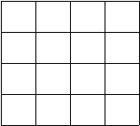

John C. McInturff
{ .byline }

The following problem is taken from the Mathcounts School Handbook for 2012-2013[\[1\]](#ref1).

<figure markdown="1">

</figure>

Two unit squares are chosen at random, without replacement, from the 4 x 4 grid shown. What is the probability that the squares do not share a side? Express your answer as a common fraction.

A student at the 6 through 8 grade level will, most likely, devise some method for counting the neighbors, and divide this number by the total number of possibilities.

The purpose here is to illustrate two methods that apply to a square of 4 sides that can be easily communicated and executed on a computer using J, then illustrate a generalisation to n sides.

## Method 1

This method, suggested by Colin A. Hedges, a high school mathematics teacher, involves classifying the square into 3 mutually exclusive categories: Execution is shown for `n=. 4` .

<table>
		<tr>
			<td>Corners , C</td>
			<td>The chance of selecting a corner is <code>C=. 4%*:n.</code></td>
		</tr>
		<tr>
			<td>Sides, S</td>
			<td>These are bordering squares but not corners.  The chance of selecting such a square is <code>S=. 4*(n-2)% *:n.</code></td>
		</tr>
		<tr>
			<td>Interior ,I</td>
			<td>These squares are landlocked squares.  The chance of selecting an interior square is <code>I=. (*:(n-2))% *:n</code></td>
		</tr>
	</table>

Let `Z=. C,S,I` .

```
    +/Z
1
```

It is seen that they sum to unity, as they should.

After selecting a cell, there are `k=. <: (*: n)` cells remaining. A corner square has 2 neighbors, a side square has 3 neighbors, and an interior square has 4 neighbors. Therefore the conditional probability of selecting one of these squares is `X=. 'c s i'=. 2 3 4 % k` . The conditional probability that the square has no neighbor is `Y=. -.X` . It is seen that `X+Y` sum to unity in each of the three cases:

```
   X+Y
1 1 1
```

The inner product, (`ip=. +/ . *`), of `Z` and `X`. gives the unconditional probability that two squares share a side. The inner product of `Z` and `Y` is the probability they do not. These two probabilities, `W`, sum to unity as they should, and are shown below expressed both as a decimal and as a common fraction.

```
   ]W=. (Z ip X),(Z ip Y)
0.2 0.8

   +/W
1


   x: W
1r5 4r5
```

The monadic verb, `Fo` , simplifies the above formulation. It produces the probability that a square shares a side for any square having n sides. The expression `( -. Fo n)` produces the complementary probability,e.g.

```
   Fo=. 4 % (* >:)
   Fo 4
0.2

   (Fo 4);(-.Fo 4)
┌───┬───┐
│0.2│0.8│
└───┴───┘

   Fo 2 3 4 5
0.666667 0.333333 0.2 0.133333
```

## Method 2

This method is simple and straightforward and may be the method a student in grades 6 through 8 may use. It compares every square with every other square and counts the neighbors it encounters in the process. The following pattern emerges and conclusions soon become evident:

Each row except the last has the same pattern wherein each square, except the last, has 2 neighbors, a row neighbor to its immediate right, and a column neighbor below. The last square in a row only has a column neighbor. For the 4 x4 matrix given this pattern, `p1` would be `p1=. 2 2 2 1` (for a total of 7 neighbors).

The last row, being at the bottom has no neighbors below it, and the last square in the last row has no neighbors, only a single, row, neighbor. Therefore, this last row has the pattern, `p2` .

```
p2=. 1 1 1 0.
```

The 4x4 matrix would then have the following neighbor pattern, `p` :

```
   ]p=. > p1;p1;p1;p2
2 2 2 1
2 2 2 1
2 2 2 1
1 1 1 0
```

The total number of neighbors, `N`, is easily seen to be `(N=. +/,p)` or 24.

The total number of possible neighbors, `T`, is n squares taken 2 at a time. Expressed in J, this is `(T=. 2!n` or 120). A student, not knowing J but knowing the formula for T could reduce T to `(15 *16)%2` or 120.

If `W1` is the probability of having a neighbor, then `(W1=. N%T)` or 0.2. The probability of not having a neighbor is `(W2=. -.W1)` , or 0.8. It is seen that this result is the same as that produced using Method 1.

### Generalization and Simplification

The above conclusions, which were applied to a matrix having n=4 sides, also apply to a matrix having n sides. The above pattern, `p` , can be re-expressed as a tally of neighboring squares.

```
   p=. (neighbors having p1 type patterns) + (neighbors having p2 type patterns)
   p=          2(n-1)(n-1) +1(n-1)         +                   1(n-1)

   p= 2(n-1)(n-1)+2(n-1)
   p= 2(n-1)(n-1+1)
   p= 2(n)(n-1)
      p=. 2*n*(n-1)
      p=. h n
```

Although the last two expressions produce the number of neighbors, and both are executable, the last expression is more simply expressed using the monadic verb, `h` , where

```
   h=. [: +: (* <:)
```

The expression `(F n)` is the probability of `p` where `(F=. h%g)` and `(g=. 2!*:)` , the total number of possible neighbors, or equivalently, n squares taken 2 at a time.

```
   F 2 3 4 5
0.666667 0.333333 0.2 0.133333
```

The expression `(-. F n)` is the probability of no neighbors.

```
   W -: (F n);(-. F n)
1
```

It is seen that Method 2 produces the same result as Method 1.

## References

1. <a id="ref1"></a> Mathcounts Foundation. “2012-2013 Mathcounts School Handbook. Contains 300 Creative Math Problems That Meet NCTM\* Standards For Grades 6-8.” Alexandria, VA, USA. Mathcounts. p. 27.  
    \*National Council of Teachers of Mathematics
