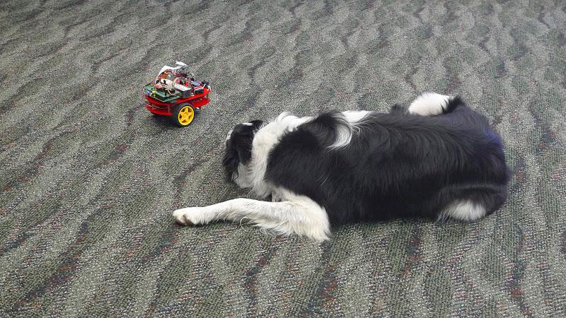
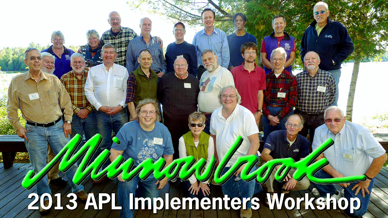

Steve Mansour
{ .byline }

I was honored to be invited to the 2013 APL Implementers Conference at Minnowbrook this year. I had been busy teaching statistics at the University of Scranton in addition to working on my doctorate in industrial engineering at Lehigh University and was unable to attend APL conferences for several years. I was privileged to have this opportunity to share my presentation, “Taming Statistics with Defined Operators” with such an esteemed group.

<figure markdown="1">

<figcaption markdown="span">Minnowbrook Moonset</figcaption>
</figure>

It was good to see everyone again. It was surprising how many APLers in the group began in 1969, including Roy Sykes, Ron Murray and Bob Smith. Jim Brown was not included in this group because he started using APL in 1967! There was a little sad news: we were told that Phil Benkard had died on July 24, 2010. I shared an office with Phil briefly during my tenure at IBM and I learned a lot from him.

The meals at the Minnowbrook Lodge were phenomenal and the bar was well-stocked for the ‘evening seminars’, which lasted well into the night. Although it rained on one day, the weather was perfect on the last two days of the conference. We were graced by the presence of Tess and Grace, two black-and-white Border Collies belonging to Roy Sykes. We had a free afternoon on Tuesday, September 17th. Many of the attendees took a two-hour boat ride on the lake while several of us hiked up to Castle Rock.

We owe Garth Foster a debt of gratitude for his connection with Syracuse University and the Minnowbrook Conference Center. He said the FORTRAN people could get rid of APL by blowing up Minnowbrook since there was almost as much programming expertise there as when Ken Iverson was in a room by himself. Why do we have meetings in such a remote place? Garth said the remoteness allows us to brainstorm and reflect without distraction. Special thanks to Roy Sykes for organizing the conference.

Jim Brown spoke about the early years of APL2 as trying to improve perfection. He used the analogy of extending a circle to a sphere. He spoke of the debates with Iverson about nested arrays and how two versions of APL emerged with boxed and enclosed arrays. It appears that APL took a ‘fork’ in the road although many feared a ‘train’ wreck. Dijkstra referred to APL as “a mistake carried through to perfection.”

David Liebtag demonstrated new enhancements to his nested array editor, which is now a part of Dyalog APL. Bob Smith spoke about “Progress on NARS2000” where he discussed factoring and number-theoretic primitive functions, the where and array lookup primitive functions and the variant primitive operator. Later he gave a separate talk entitled, “2-by-2 Syntax Analyzer.”

Bob Bernecky discussed performance problems with various sizes of arrays. Treating scalars, small arrays and large arrays differently versus a one-size-fits-all approach leads to significant performance improvements. The current optimization status shows that scalars can be improved by as much as 1300x, small arrays by 20x and large arrays by 10x.

Jacob Brickman gave us a lesson in constructing the real numbers starting from set theory, and he discussed extending the number system beyond the complex field, to quaternions and octonions. There was a heated discussion of using the notation `0J1` to represent instead of `0I1` and extending this notation to quaternions and octonions. I guess some APLers don’t like this form of ‘J’ notation. IBM saw valid reasons for using either ‘I’ or ‘J’ to denote irrational numbers; the reason that IBM chose ‘J’ was that there was less ambiguity than ‘I’ when it was written on a board in a classroom.

Bob Smith and I moderated an open discussion of expanding the domain of *iota*. The index generator function could be expanded to ‘sequence’ with an optional step. Although John Scholes was not there, some mention was made of his `a..b` notation to accomplish this. Dyadic *iota* could be extended to allow a matrix left argument; the result would be the index pairs which correspond to each element of the right argument. Another possibility would be to indicate the row which corresponds to the vector on the right. The variant operator would allow a comparison method, e.g., trailing blanks or handling special cases.

Morten Kromberg from Dyalog discussed the Version 14 language features. New operators include *rank* and *key* as well as *trains*, *forks* and *atop*. In Dyalog APL, function trains of length two are equivalent to the *atop* operator: `⍺(fg)⍵` is equivalent to `f⍺g⍵`. One significant benefit of this is that an expression like `?1E6⍴6` can be written `1e6(?⍴)6`, making it easy for the implementer to special-case the operation and avoid creating the million-element intermediate result. An extended version of dyadic *iota* is in the works as well as a new function, tally (monadic `≢`), which counts the number of items or rows in a matrix and produces a scalar result. While he was explaining the tally function, he stopped and looked at the screen for a moment, and commented that he didn’t know who would actually write a tally like that, with three lines instead of four. Someone (Bob Smith, I think) immediately replied that “that’s the way that cartoon characters write a tally.” Well done.

The new constructs *isolates* and *futures*, which let programs run on different processors, were also discussed. Morten also demonstrated the new parallel operator by executing code containing `⎕dl 3` three times in four seconds by assign each to a different isolate.

<figure class="right" markdown="1">

<figcaption markdown="span">Dog & Pi</figcaption>
</figure>

Ray Polivka and Mike Van Der Meulen held an open discussion about APL on alternative platforms, Raspberry Pi, Robots, natural language interfaces and mobile platforms. The Raspberry Pi is an inexpensive processor that can be programmed in APL as well as Python. Morten Kromberg demonstrated Raspberry Pi by giving commands to a robot using APL. This got the attention of the dogs, Tess and Grace, who were both amused and a little scared. Later we saw a demonstration on the web of helicopters flying in formation with no central authority; their motions were affected by the position and motion of the neighboring helicopters. (Kind of like the free market!)

Ray Polivka and Bob Bernecky discussed education and getting more people into array-oriented languages. This was followed by the usual lament that the average age of APLers was going up by one year every year. Ray Polivka has been teaching high school and college students for three years using a classroom in a rent-free model house. He found that the language bar was a tremendous help and that because students are generally open-minded, they had no problem with the symbols or scanning rules. Students are less concerned with how APL is used than who uses it.

This was followed by a discussion of how APL was used in industry. This included finding deadbeats in the utility industry, product reliability, mortgage finance, insurance, actuarial, medical imaging data management, petrochemical analysis, travel reservation systems, process control and ticket sales. Even Bill Gates’ investment management was done in APL.

Shannon Bailey of Native Cloud Systems brought back memories of the early 80’s with visuals of the old IBM 3279 terminal and the original IBM PC when she presented “APL— A Love Story.” She was introduced to APL at Marist College where everyone had to use APL for Computer Science 101. In that class she was able to rewrite a multi-player game from scratch in STSC APL\*PLUS PC in eight weeks. Her current work includes a cloud-based system that supports an APL-like programming language and transaction-based Native Cloud Objects for distributed arrays.

Mike Van Der Meulen wowed us with a demo of his experimental APL application using voice recognition software. He asked the computer about the weather, had the computer translate “When is the next train” into Chinese, had the computer play “Hey Jude” and asked it to show a picture of Ken Iverson. There was one glitch. When he asked it the question “Who invented FORTRAN?”, the computer showed a picture of the Roman god Bacchus!

Ron Murray revealed that although dead men tell no tales, dead processes talk! In distributed systems the failure of a computer you didn’t know existed may cause your system to fail. To get to the heart of the matter one must be able to change the system without stopping it.

Adrian Smith from across the pond showed how to embed a matrix into a database by inserting vectors as items into columns. His son Richard showed how just-in-time compiling in the parse table step improved performance in “Adventures in JIT computing APL.”

Paul Grosvenor demonstrated COSMOS, a data visualization tool largely written in APL. COSMOS is a top-down, drill-down system used to analyse medical data. The system talks to statistical language R and has often been referred to as a ‘thesis generator’.

Bob Armstrong got CoSy with FORTH and showed us how to go FORTH and multiply. He also challenged the global warming community with a hot topic: “How to Calculate the Temperature of the Earth for a Libertarian Society.”

On the last night of the conference, the highlight was jazz guitarist Stanley Jordan, who presented us with “Music and APL.” He used APL and the circle of fifths to measure distance between various musical scales. He demonstrated sonification by showing us how to generate music from stock charts and listen to patterns. Finally, he did a MIDI edit using APL to generate music and rhythm on several tracks. Afterwards he entertained us on the guitar with several original compositions. His final comment was: “You don’t speed-read poetry. APL is like poetry; everything has meaning. You may have to read it several times to understand it.”

<figure markdown="1">

<figcaption markdown="span">Minnowbrook 2013</figcaption>
</figure>
