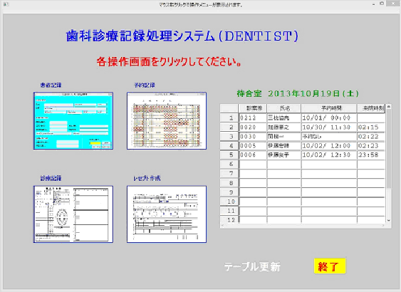
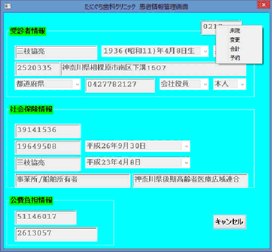
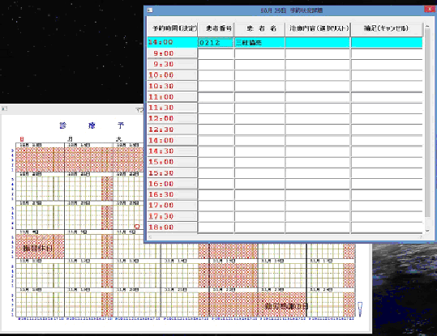
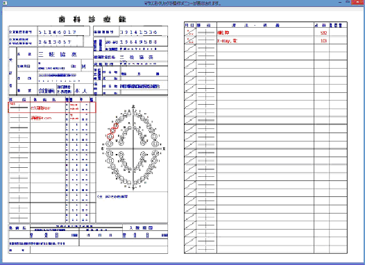
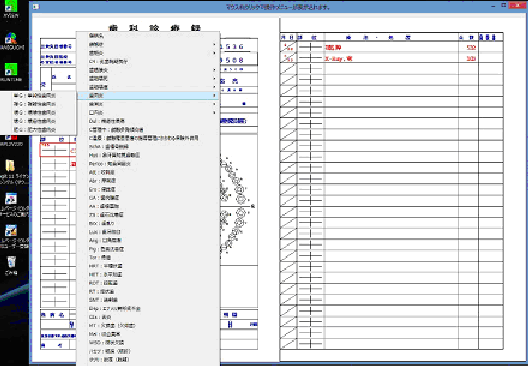
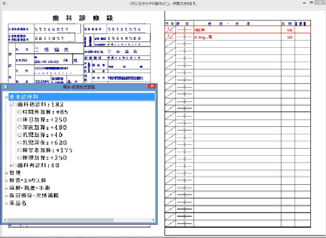
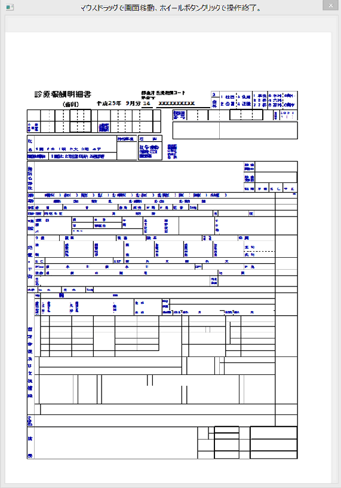

Kyosuke Saigusa, APL Consultants of Japan Ltd.
{ .byline }

## Introduction

We have written several office systems for small businesses mainly to explore the potentials of APL2. Some of them have been used daily for ten years or more. They all run under IBM workstation APL2 runtime. Users do not know what language is being used, nor need to. I would like to introduce my current work which aims to address a rather wider range of users for the first time. It is an office system for the dentists in general working under the Japanese health insurance setup. It is said that we have more dentist offices than the number of convenience stores in this country and many of them cannot afford to use expensive commercial systems.

## System Outline

It consists of the following four modules as represented in the figure shown in Fig.1.

1. Client information(Upper left box on the left)
2. Reservation information(Upper right box on the left)
3. CARTE information(Lower left box on the left)
4. RECEPT\* information(Lower right box on the left)  
    \*note: document to submit to the national insurance union for insurance claims.

<figure class="left" markdown="1">

<figcaption markdown="span">Fig. 1: Startup screen to enter the four modules</figcaption>
</figure>

In the screen, the left side four boxes represent the referenced modules and the right side table shows a list of clients in the waiting room.

Upper two boxes are mainly used by clerks at reception desk, and the lower boxes are for dentists to use. These can be concealed as required.

The system operates on Microsoft Windows XP and later versions. It is installed at respective user sites but linked via VPN to our centre for maintenance.

## Client information module

The following screen records client personal information regarding the means of contact, social insurance and government subsidies. This is used to record the time the client has arrived at the dentist office, to alter the personal information recorded, to issue bills and prescriptions after treatment and to link to the reservation module by way of a popup menu.

<figure class="left" markdown="1">

<figcaption markdown="span">Fig.2: Client information screen</figcaption>
</figure>

For a new client, a unique client number is automatically assigned. Initial information and later alterations can be entered manually or for some items by way of menus. Automatic translation of national post code is also implemented.

By way of mutually exclusive control of the AP 211 of the IBM APL2 interpreter, multiple screens can be operated concurrently by clerks for different clients. The recorded data is accessed for read and write by different modules simultaneously as well. The data takes the form of APL2 general arrays and hence it is flexible, powerful and easy to handle by APL2.

## Reservation information module

This module can be started via the link from the client information screen to enter or to alter the reservation date and time. As any desired date box is clicked, the reservation status list is shown for the date. As you click the time zone on the left of the list, the set of client name and number is automatically entered and upon confirmation, it is recorded in the database. Aside from the client number and the name, you can also specify the kind of treatment and expected time required to finish the treatment as an option (probably by dentist).

When the reservation screen is entered directly from the main screen, it only works as a reference and the contents cannot be altered.

The calendar is shown by weeks and calculated by APL2 to begin with the current week. The national and public holidays are centrally entered, based on the public web　　　information　by　the　central　maintenance　via　remote　access.　Scheduled　operating dates and off-days/time　information can　be　entered　and maintained at individual dentist offices. The calendar can be scrolled back and forth between the current week and any pre-specified future week. Each hour on the calendar is made to accommodate up to five clients, divided optionally by fifteen or thirty minutes.

<figure class="left" markdown="1">

<figcaption markdown="span">Fig 3: Reservation information screen</figcaption>
</figure>

Dentists are entitled to charge additional fees from the clients and the insurance union, if the treatment is done at an irregular time.

## CARTE information module

Each client (patient)’s ailment and treatment information is recorded in the same format as the officially designated form of the ministry of labour and welfare for compatibility with the manual systems. This is a single sheet form which records ailment information on the first (front) page and treatment information in the second (rear) page. These two pages are shown side by side on the screen, so that the related information can be viewed at a glance and new data entered with minimum errors. The records can be viewed historically by scrolling. The advantage of this approach is that it can eliminate the need to store an increasing volume of physical paper documents in the office and to search for the appropriate page of the documents in a short time. The target document page is displayed on the screen any time for reference and for hard copy printout if required. The documents are dually recorded in the center at specified intervals for back-ups and recovery of user data in case accidents occur. The dentist can enter the name of the ailment and code and the ailing teeth, if any, by mouse click on the illustration of the teeth in the first page. Treatment is entered from the multiple selection popup menu in tree structure, together with the date of treatment and the fees in points with appropriate calculations.

<figure class="left" markdown="1">

<figcaption markdown="span">Fig.4-1: CARTE information screen</figcaption>
</figure>

Patient’s personal information is entered as you click the client number from the list of clients in the waiting room, which is shown as you click the blank space

<figure class="left" markdown="1">

<figcaption markdown="span">Fig.4-2: Popup menu to enter ailment</figcaption>
</figure>

The registered ailment names and codes are shown in the popup menu by category in tree structure to select from to avoid errors in entry.

The names of the ailment are recorded in historical order in the next line without limit. The lines scroll automatically as the space runs out for new lines or manually when the past records are referenced. The treatment information on the right page relating to the selected ailment line framed in red on the left page also changes automatically.

Both pages permit alterations and deletion by the discretion of the dentists. The treatment information is entered or altered by selecting the target line on the right page. Each line records five items: date of treatment, treated teeth, treatment, the fees in points and other information. Today’s date is automatically recorded but if this column is clicked, a popup calendar allows the alteration of the date. When the treated teeth column is clicked, a popup menu appears to select the teeth to treat from the list of ailing teeth recorded on the left page for this ailment. When the treatment column is clicked, a popup menu appears, showing the possible kind of treatment, care or medicine in tree structure for multiple selections to replace the previously selected list of treatments for the same day if any. De-selection works this way. Points are automatically calculated according to the rules set by the national dentist union and insurance union.

<figure markdown="1">
{ style="max-width:27em" }
<figcaption markdown="span">Fig.4-3: Popup menu to enter treatment and care</figcaption>
</figure>

## RECEPT information module (currently being built)

<figure markdown="1">
{ style="max-width:27em" }
<figcaption markdown="span">Fig 5: RECEPT information screen</figcaption>
</figure>

RECEPT is an official document dentists are required to submit to the national insurance union for insurance claims on monthly bases for each client treated during the past month. Theoretically, RECEPT is created automatically from CARTE, if the information there is all correct. In fact this is where dentist offices spend much time to eliminate entry errors to avoid rejection and repeated re-submission and penalties. Therefore, this document can be viewed for any errors with references to the details recorded in the CARTE before submission to the insurance union by hard copy or optionally via internet.

The form of the RECEPT is printed in very small characters , therefore when it is viewed on the screen, the system can augment the displayed size of the copy and permits scrolling of the drawing by mouse drags to view the entire copy in details and also for the last-minute corrections.

## Why APL2 is suitable to write small systems

Through my observation of the development of APL2, I understood that IBM has used a tremendous amount of energy and brains to make it a practical tool to develop computer applications to the present day level. To us in the Far East, symbolic representations of the primitive functions should be the best choice to convey the precise meanings at a glance like Chinese characters, which we have been using over centuries. Aside from the philosophy of the language itself, I must say that existence of the auxiliary and associated processors have played indescribably important rolls to make interface programming very easy and simple. Hence it is easy to introduce internet access for the reservation by way of PC or smart phones and the like with the use of QR code or regular bar code. Here APL2’s AP 119 socket interface and HTML helps.

Writing programs in APL is quite private in the sense that it depends much on personal interpretations of the effects of limitless combinations of simple functions, analogous to the game of GO. This aspect of the language makes it difficult to produce extremely large application systems by groups of programmers without failure.

On the other hand, small systems require only a small team of application experts and a single well-trained and qualified APL programmer.

Small systems can grow into more comprehensive systems in time as I aim to make this dental system eventually to cover the entire segment of professional medical doctor’s office systems in town because they all run under the same public insurance system.
