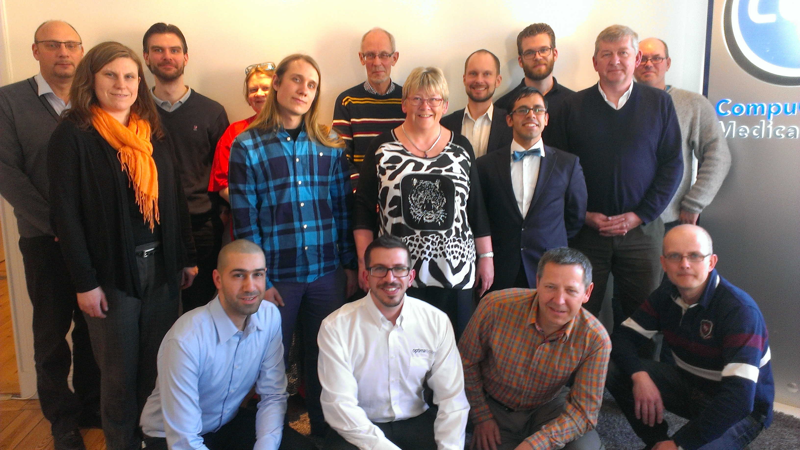

Gilgamesh Athoraya (gil@optima-systems.co.uk)
{ .byline }

The Swedish APLers are perhaps not very numerous, but after probing and prodding a little bit, we managed to find each other. A first meeting was planned and executed on the first week of April and was attended by representatives from seven companies. This is our story.
{ .abstract }

## The meeting

The meeting was held in CGM’s office in Stockholm and by 10am the meeting room was full of anticipation and every seat was occupied. All eyes turned on me as I was stalling while waiting for the last couple of attendees to find their way in. A few minutes later we got started and after welcomes and greetings, Joakim Hårsman (CGM) launched his presentation.

### Not one iota

Joakim started off by talking about how a seemingly simple and innocent fix to a bug in the APL interpreter can have unexpected, widespread knock-on effects in applications. The case in point is a fix to the result of `⍳⍬` in Dyalog APL. Where previously the following statement was true `1≡⍳⍬` it was corrected and is now `(⊂⍬)≡⍳⍬`.

This can and has caused issues in many applications that rely on the incorrect behaviour and Joakim told us of a tool they have developed to help in identifying candidates in the code that could suffer from this.

### RIDE vs Dyalog+

Joakim continued to show us an alternative to the standard Dyalog IDE. He has developed an Emacs mode that he calls Dyalog+. By using sockets to communicate between Emacs and Dyalog, he demonstrated how to use either IDE to edit and fix functions. This is particularly interesting for those who are familiar with Emacs and/or often program in many different languages as Emacs can be used as a single IDE for all/most development work.

Dyalog+ doesn’t currently offer the same features as the official RIDE (Remote IDE) from Dyalog, but Morten Kromberg (Dyalog) said the protocol for RIDE may be available once it is released and would enable users to create their own IDE to hook into sessions remotely.

### Aplensia

After a brief break, Lars Wentzel took over and presented Aplensia. The consulting firm is formed of seven APLers, most of whom have been working with APL since the early 90s. They are now managing four major systems, one for Swedbank and three for Volvo, all of which have been migrated from APL2 mainframe to Dyalog APL on Windows servers.

Aplensia was the launch customer of the Dyalog File Server (DFS) which they have used successfully to replace a DB2 file server. They were also the ones to request Integrated Windows Authentication (IWA) via Conga (Dyalog’s communication tool), which is now available to all (introduced in Conga v2.3).

Peter Simonsson talked about migrating from APL2 to Dyalog APL. He mentioned dialectal variations that required some attention, such as different interpretation of indexing:

```
A B[X] ? (A B)[X] or A (B[X])
```

A tool was developed to semi-automate the translation of code (about 890k LOC) to the Dyalog APL dialect.

They used WPF to emulate the original screens (about 400 screens) to make the transition as unobtrusive as possible for the users.

### Ways of working

After lunch break Gianfranco Alongi (Ericsson) gave a talk about how he confronted managers’ traditional views on efficiency of developers. His story of how they grudgingly gave in to pair-programming only to face the concept of mob-programming was both inspiring and hilarious at the same time. You can read more about this in his article in this same issue of *Vector*.

### News from Dyalog

Next up was Morten Kromberg with a summary of new features and tools. He talked about the upcoming RIDE which will make it much easier to debug remote sessions as well as dynamically start/stop and monitor remote sessions. They have added support for .NET data-binding which will make it easier to share data between APL and .NET components. He mentioned the Syncfusion GUI package which is going to be bundled with Dyalog APL v14.0, offering WPF and JS components. There are improvements and speed-ups to Dyalog Component Files (DCF) as well as a release of DFS v2.0.

He concluded his presentation with a demonstration of Futures and Isolates, the new features that will make it easier to harness the power of your hardware by parallelising the execution of operations in separate, external processes.

### Cosmos and big data

Finally, Paul Grosvenor (Optima Systems) talked about Cosmos: a graphical, analytical tool that doesn't give you the answers, but helps you find the questions. The system is using MiServer in the back end and a flash UI on the client side. It is a system designed to be easy to use and without requiring deep technical knowledge, but powerful enough to let the user explore data in an intuitive way. I demonstrated the system briefly and talked about the difficulties of taming data quantities that grow bigger faster than you can say analytics.

### Group photo

<figure markdown="1">

<figcaption markdown="span">Back row: Stefan Lindén, Peter Simonsson, Ylva Ljungdell, Lars Wentzel, Mikael Blomgren, Joakim Hårsman, Ronnie Sommer<br>Middle row: Tina Leijding, Alvin Mattson, Gitte Christensen, Gianfranco Alongi, Paul Grosvenor<br>Front row: Sargon Athoraya, Gilgamesh Athoraya, Morten Kromberg, Gunnar Jörtsö</figcaption>
</figure>

### Others present

In addition to the presentations we also had representatives from Sandvik. Tina Leijding presented the company briefly. Their system was built back in 1984, runs on APL2 and is hosted by IBM. They have a small team of APLers (five plus one consultant) and are looking to expand over the year.

A big group of APLers from CGM took the opportunity to pop in and out during the day, most of whom were wearing Rosetta stone t-shirts with javascript on one side and APL on the other.

My brother, Sargon Athoraya, attended the meeting to learn more about what I do for a living and claims to have been able to follow most of the presentations without nodding off.

### Next meeting

The meeting was greatly appreciated and after a conversation about content and frequency of meetings it was agreed that we will aim at half-yearly meetings with the next one planned for beginning of October (preliminary date is 9 Oct 2014). It will be hosted by Aplensia in Gothenburg and open to the general public. More information will follow closer to the date.

### LinkedIn

SwedAPL is a group on LinkedIn. Feel free to join the group to stay in touch with Swedish APLers.
