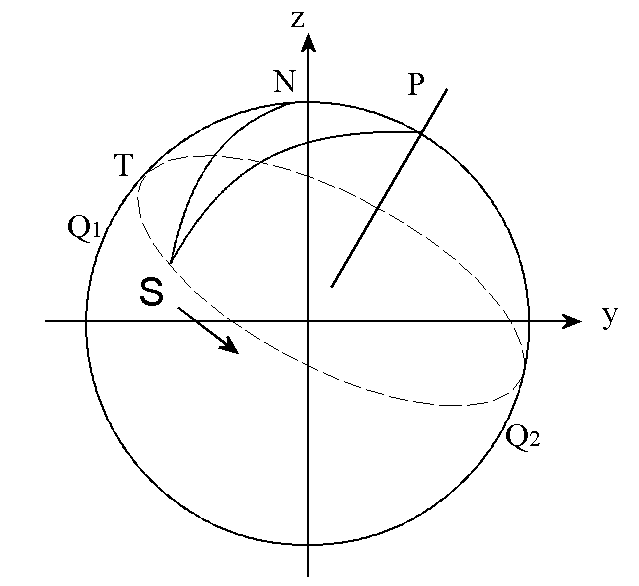
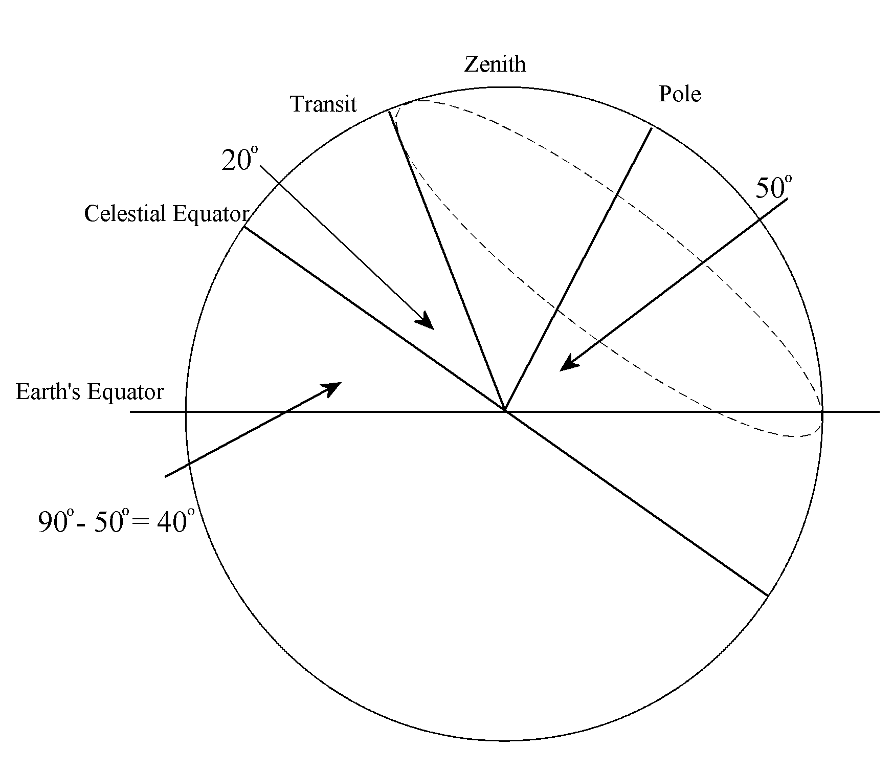

by Norman Thomson (ndt4@btinternet.com)
{ .byline }

J-ottings 56 decribed the development of a verb `rotate` which, given a left argument (axis, angle) delivers the result of performing a 3-D rotation of a point whose coordinates form the right argument. *axis* is defined by the three coordinates of any point on it other than the origin, so the left argument is a 4-item list. Here, repeated from J-ottings 56, is the verb `rotate` along with its subverbs :

```
    rotate=.] - (m1 * rmdata) + m2 * }:@[ xp ]
        rmdata=.rm@dircos@(}:@[) +/ .* ]        NB. rotn matrix*data
            rm =.(id - */~)@dircos              NB. rotation matrix
                id=.=@i.@#                      NB. identity matrix
            dircos=.% %:@(+/@:*:)               NB. direction cosines
        xp=.4 : ‘1 _1 1*det each<”(2) 1+\.(dircos x),.y’
                                            NB. normalised cross product
            det=.-/ .*                          NB. determinant
            each=.&>
        m1=.-.@(2&o.@({:@[))                    NB. (1-cos angle)
        m2=.1&o.@({:@[)                         NB. sin angle
```

David Edwards has pointed out that the verb xp the above delivers the normalised cross-product; if a conventional cross-product is required as part of another application, magnitude must be taken into account by e.g.

```
    mag=.%:@:(+/)@:*:                           NB. magnitude
    xprod =.4 : ‘(mag x)*x xp y’                NB. cross-product
    0 4 5 xprod 2 1 3
7 10 _8
```

In this article `rotate` is used to perform some basic calculations in astronomy. Trig ratios as well as conversions to and from radians and degrees are frequently required, and so it is convenient to define in advance a few utility verbs :

```
   dtor=.180%~o.                                NB. degrees to radians
   rtod=.dtor^:_1                               NB. radians to degrees

   sin=.1&o.@dtor                               NB. sine (angle in degs)
   cos=.2&o.@dtor                               NB. cosine (angle in degs)
   asin=.rtod@(_1&o.)                           NB. arcsine in degrees
   acos=.rtod@(_2&o.)                           NB. arccosine in degrees
```

## Plotting star movements

This is a special case of 3-D rotation in which all data points in the heavens are identified by two rather than than three parameters. Astronomers measure star positions as observed from Earth in angular rather than Cartesian measure. Specifically the two angles used are **altitude A** which corresponds to celestial latitude, and **azimuth Z** which correponds to longitude in terrestrial measurement. The stars themselves lie on the surface of a sphere called the **celestial sphere** which is continuously rotating about the extended Earth axis and on which every star has a latitude and a longitude which are called respectively declination D and **right ascension ra**. Analogous to the Greenwich meridian on Earth the celestial sphere requires an arbitrary zero line or **celestial meridian** from which **ra** is measured. This is conventionally taken to be the first point in Aries, which is observable as the rightmost star in the constellation Cassiopea. Azimuth is often measured in sidereal hours, minutes and seconds rather than degrees; the significance of *sidereal* is that a sideral year is one day longer than a solar year, that is the fixed stars appear to rotate at a slightly slower speed than the sun, the difference being about four minutes per day. Stars rise in the east and set in the west, and so to an Earth-bound observer looking outwards to the Pole Star, the celestial sphere appears to rotate in an anticlockwise direction.

To convert star positions defined by A and Z into (x, y, z) coordinates assume the x-axis runs west to east, the y-axis south to north, and the z-axis upward. The plane x=0 is then a meridian on a fixed celestrial sphere from which Z is measured clockwise. (x, y, z) coordinates are then given by

<math xmlns="http://www.w3.org/1998/Math/MathML" display="block">
    <mi>x</mi>
    <mo>=</mo>
    <mi>cos</mi>
    <mspace depth="0.5ex" height="0.5ex" width="0.5ex"></mspace>
    <mi>A</mi>
    <mspace depth="0.5ex" height="0.5ex" width="0.5ex"></mspace>
    <mi>sin</mi>
    <mspace depth="0.5ex" height="0.5ex" width="0.5ex"></mspace>
    <mi>Z</mi>
    <mtext>;</mtext>
    <mspace depth="0.5ex" height="0.5ex" width="3ex"></mspace>

    <mi>y</mi>
    <mo>=</mo>
    <mi>cos</mi>
    <mspace depth="0.5ex" height="0.5ex" width="0.5ex"></mspace>
    <mi>A</mi>
    <mspace depth="0.5ex" height="0.5ex" width="0.5ex"></mspace>
    <mi>cos</mi>
    <mspace depth="0.5ex" height="0.5ex" width="0.5ex"></mspace>
    <mi>Z</mi>
    <mtext>;</mtext>
    <mspace depth="0.5ex" height="0.5ex" width="3ex"></mspace>

    <mi>z</mi>
    <mo>=</mo>
    <mi>sin</mi>
    <mspace depth="0.5ex" height="0.5ex" width="0.5ex"></mspace>
    <mi>A</mi>
</math>

Inverting these formulae to convert from (x, y, z) coordinates to (A, Z) coordinates :

<math xmlns="http://www.w3.org/1998/Math/MathML" display="block">
    <mi>A</mi>
    <mo>=</mo>
    <msup>
        <mi>sin</mi>
        <mn>-1</mn>
    </msup>
    <mi>z</mi>
    <mspace depth="0.5ex" height="0.5ex" width="0.5ex"></mspace>
    <mtext>;</mtext>
    <mspace depth="0.5ex" height="0.5ex" width="3ex"></mspace>

    <mi>Z</mi>
    <mo>=</mo>
    <msup>
        <mi>cos</mi>
        <mn>-1</mn>
    </msup>
    <mfrac>
        <mrow>
            <mi>y</mi>
        </mrow>
        <mrow>
            <msqrt>
                <mn>1</mn>
                <mo>-</mo>
                <msup>
                    <mi>z</mi>
                    <mn>2</mn>
                </msup>
            </msqrt>
        </mrow>
    </mfrac>

    <mspace depth="0.5ex" height="0.5ex" width="3ex"></mspace>
    <mtext>or</mtext>
    <mspace depth="0.5ex" height="0.5ex" width="3ex"></mspace>
    <msup>
        <mi>sin</mi>
        <mn>-1</mn>
    </msup>
    <mfrac>
        <mrow>
            <mi>x</mi>
        </mrow>
        <mrow>
            <msqrt>
                <mn>1</mn>
                <mo>-</mo>
                <msup>
                    <mi>z</mi>
                    <mn>2</mn>
                </msup>
            </msqrt>
        </mrow>
    </mfrac>

</math>

## Transits

A star is said to transit or culminate when it is at its highest point in the sky when seen by an observer on Earth, at which time `x=0`. The diagram below shows a circle of celestial longitude through the transit point T of a star S as it traverses its daily circuit shown as a dotted line :

<figure class="left" markdown="1">

<figcaption markdown="span"> </figcaption>
</figure>

N is the zenith, P is the Pole Star. As S moves on from transit, the curved triangle NPS comes out of the page towards the reader.

Side SP is `90°–d` where `d` is S’s declination.  
Side NP is `90°–l` where `l` is the observer’s latitude.

The lengths of both of these remain fixed as S progresses.

Q1 and Q2 are points on the celestial equator.

Quantities which change as the star S proceeds along its course are :

<dl>
    <dd>side NS =  90° – A where A is the altitude;</dd>
    <dd>angle NPS = the angle of rotation about the polar axis, known as the <em>hour angle</em>;</dd>
    <dd>angle TNS = the terrestrial azimuth Z based on the transit plane as zero meridian.</dd>
</dl>

The diagram below shows the same cross-section of the celestial sphere through the plane x=0 for a specific star with declination 20° observed from a latitude of 50° North. 40 + 20 = 60, and so the (x,y,z) transit coordinates are (0,cos (180-60)°, sin (180-60)°), that is (0,cos 120°, sin 120°).

<figure markdown="1">

</figure>

This diagram can be generalised to show that the altitude at transit is ( 90°- l ) + d provided that d &lt; l as in the case of the star illustrated. This star transits south, that is to the left of the zenith and dips below the terrestrial horizon for at least part of its circuit. If d > l a star is circumpolar and transits north. Here the altitude at transit is ( 90° + l ) – d, or combining the two cases, the altitude of every star at transit is

```
    90° – abs(l - d) .
```

## Plotting star positions

Unlike locations on a geographical map, a star’s position has time as a parameter, which can be either local time – where was a star six hours ago? – or time by year – where was it three months ago at the current time of day? The star sphere appears to Earth observers to revolve from east to west around the pole, completing a revolution in a sidereal day which is shorter by 1/365th of a day (that is approximately four minutes) than the solar day. Thus the position of a star six hours ago (¼ of a day) is the same as its position three months ago (¼ of a year).

For example, consider the star illustrated above with declination 20°, and ask what are the (x,y,z) coordinates of its position six hours earlier, that is when the hour angle is -90° . The list ‘0, cos x, sin x’ is required sufficiently frequently in defining axes and points that it is convenient to have a verb

```
    cs=.0,cos,sin           NB. e.g. rotn. axis in y-z plane
    ((cs 50),dtor _90)rotate cs 120
0.939693 0.219846 0.262003
```

This result can be confirmed by spherical trigonometry applied to triangle NPS (see next section).

The next step is to make the hour angle a parameter (clockwise 90° = anti-clockwise -90°):

```
    v=.monad :'((cs 50),-dtor y)rotate cs 120';
```

and plot values as this moves towards transit at 10° intervals :

```
    v each 90 80 70 60 50 40 30 20 10 0
0.94    0.22    0.262
0.925   0.0948  0.367
0.883  _0.0264  0.469
0.814  _0.14    0.564
0.72   _0.243   0.65
0.604  _0.332   0.725
0.47   _0.404   0.785
0.321  _0.457   0.83
0.163  _0.489   0.857
0      _0.5     0.866
```

More generally, it is useful to convert time to angular measure with 24 hours being equivalent to a complete rotation, which suggests three more utility verbs :

```
   ttor=.o.&(%&43200@(60&#.))    NB. time (hms) to radians
   ttor 12 0 0                   NB. check 12 hrs = pi rads
3.14159
```

```
   dtot=.60 60 60&#:@(*&240)     NB. deg to time (hms)
   dtot 180                      NB. check 180 deg.= 12 hours
12 0 0
```

```
   atod=.%&3600@(60&#.@(3&{.))   NB. angle(deg,min,sec) to degrees
   atod 49 15                    NB. check 49o 15’ 0” = 49.25
49.25
```

The cooordinates of the above star 15 and a half minutes after transit, are given by

```
    ((cs 50),ttor 0 15 30)rotate cs 120
_0.0635044 _0.498354 0. 864645
```

that is a little bit to the west, a shade less south and a bit lower, all as expected.

## Spherical Trigonometry

The cos formula for a spherical triangle ABC states that if a, b and c are sides measured in angles, and A, B and C are the angles between the sides with A opposite a, etc. then

```
    cos a = cos b cos c - sin b sin c cos A
```

Although the sides are nominally measured as angles they are nevertheless *lengths* – length being defined by the angle subtended at the centre of the sphere.

There are two forms of ‘Pythagoras’ theorem’ in spherical trigonometry, viz.

```
    if cosA = 90° (n.b. do not confuse this A with A = altitude)
    if cosc = 90°
```

Applying this to the first diagram above, triangle NPS has sides SP=(90° – d), NS=(90° – A) and NP=(90° – l), and angle NPS is 180° – Z, so in general .

In the worked example angle P was chosen to be -90° and so the first ‘Pythagorean’ form applies, that is, for the star with declination 20° observed at 50° latitude, the altitude six hours earlier is given by :

```
    sin A = sin 50° sin 20°
```

The values of sin A and cos A are thus given by,

```
    ]sinA=.*/sin 50 20          NB. sin Altitude = z coordinate
0.262003
    ]cosA=.cos asin sinA        NB. cos Altitude
0.965067
```

The sine formula in spherical trigonometry states that

<math xmlns="http://www.w3.org/1998/Math/MathML" display="block">
    <mtext>
    </mtext>
    <mspace depth="0.5ex" height="0.5ex" width="1ex"></mspace>
    <mfrac>
        <mrow> <mi>sin</mi><mspace depth="0.5ex" height="0.5ex" width="1ex"></mspace><mi>a</mi> </mrow>
        <mrow> <mi>sin</mi><mspace depth="0.5ex" height="0.5ex" width="1ex"></mspace><mi>A</mi> </mrow>
    </mfrac>
    <mo>=</mo>
    <mfrac>
        <mrow> <mi>sin</mi><mspace depth="0.5ex" height="0.5ex" width="1ex"></mspace><mi>b</mi> </mrow>
        <mrow> <mi>sin</mi><mspace depth="0.5ex" height="0.5ex" width="1ex"></mspace><mi>B</mi> </mrow>
    </mfrac>
    <mo>=</mo>
    <mfrac>
        <mrow> <mi>sin</mi><mspace depth="0.5ex" height="0.5ex" width="1ex"></mspace><mi>c</mi> </mrow>
        <mrow> <mi>sin</mi><mspace depth="0.5ex" height="0.5ex" width="1ex"></mspace><mi>C</mi> </mrow>
    </mfrac>
</math>

Apply this to triangle TNS. The dotted line is a circle of latitude and so angle NTS = 90°. If the hour angle P is 90° the side it subtends at the celestial equator is sin 90° = 1, hence the dotted line TS at declination 20° has length cos 20°.

<math xmlns="http://www.w3.org/1998/Math/MathML" display="block">
    <mtext>
        Thus
    </mtext>
    <mspace depth="0.5ex" height="0.5ex" width="1ex"></mspace>
    <mfrac>
        <mrow> 
            <mi>cos</mi>
            <mspace depth="0.5ex" height="0.5ex" width="1ex"></mspace>
            <msup>
                <mn>20</mn>
                <mtext>0</mtext>
            </msup>
        </mrow>
        <mrow> 
            <mi>sin</mi>
            <mspace depth="0.5ex" height="0.5ex" width="1ex"></mspace>
            <mi>Z</mi>
        </mrow>
    </mfrac>
    <mo>=</mo>
    <mfrac>
        <mrow> 
            <mi>cos</mi>
            <mspace depth="0.5ex" height="0.5ex" width="1ex"></mspace>
            <mi>A</mi> 
        </mrow>
        <mrow> 
            <mn>1</mn>
        </mrow>
    </mfrac>
</math>

```
   ]Z=.asin(cos 20)%cosA        NB. azimuth
76.8322
```

which enables the x and y coordinates to be found using formulae given earlier :

```
   cosA*(sin,cos)Z              NB. x,y coords
0.939693 0.219846
```

## The case of the sun

Unlike other stars whose declination is constant, the sun’s declination varies in the course of a year from -23.5° to +23.5° and back again. At sunrise and sunset the sun’s altitude is zero, so side NS of triangle NPS is 90° and now the second ‘Pythagorean’ form applies to give <math xmlns="http://www.w3.org/1998/Math/MathML" display="inline">
    <mi>sin</mi> 
    <mspace depth="0.5ex" height="0.5ex" width="0.5ex"></mspace>
    <mi>d</mi> 
    <mo>=</mo> 
    <mi>cos</mi> 
    <mspace depth="0.5ex" height="0.5ex" width="0.5ex"></mspace>
    <mi>l</mi> 
    <mspace depth="0.5ex" height="0.5ex" width="0.5ex"></mspace>
    <mi>cos</mi> 
    <mspace depth="0.5ex" height="0.5ex" width="0.5ex"></mspace>
    <mi>Z</mi> 
</math> at these times.

From this

<math xmlns="http://www.w3.org/1998/Math/MathML" display="block">
    <mi>cos</mi>
    <mspace depth="0.5ex" height="0.5ex" width="0.5ex"></mspace>
    <mi>Z</mi>
    <mo>=</mo>
    <mfrac>
        <mrow>
            <mi>sin</mi>
            <mspace depth="0.5ex" height="0.5ex" width="0.5ex"></mspace>
            <mi>d</mi>
        </mrow>
        <mrow>
            <mi>cos</mi>
            <mspace depth="0.5ex" height="0.5ex" width="0.5ex"></mspace>
            <mi>l</mi>
        </mrow>
    </mfrac>
</math>

Then using the sin formula,

<math xmlns="http://www.w3.org/1998/Math/MathML" display="block">
    <mi>sin</mi>
    <mspace depth="0.5ex" height="0.5ex" width="0.5ex"></mspace>
    <mi>P</mi>
    <mo>=</mo>
    <mfrac>
        <mrow>
            <mi>sin</mi>
            <mspace depth="0.5ex" height="0.5ex" width="0.5ex"></mspace>
            <mi>Z</mi>
        </mrow>
        <mrow>
            <mi>cos</mi>
            <mspace depth="0.5ex" height="0.5ex" width="0.5ex"></mspace>
            <mi>d</mi>
        </mrow>
    </mfrac>
</math>

where P is the hour angle.

Consider London (latitude of 51° 30′) on the 21st December when the sun’s declination is -23° 30′, and its altitude at noon, that is at transit, is (90° - 51° 30′) - 23° 30′ = 15°00.

```
    ]Z=.acos(sin 23.5)% cos atod 51 30    NB. azimuth
50.17
    ]P=.dtot asin(sin Z)%cos 23.5         NB. time to noon
3 47 27.2637
```

that is, in midwinter the sun is above the horizon for about 100÷360 of the day or 7½ hours.

Now use `rotate` to spin the sun from noon for 3 hrs 47 minutes and 27.26 seconds:

```
   lat=.atod 51 30
   dec=.atod -23 30
   tim=.3 47 27.26
   alt=.90-|lat-dec

   ((cs lat),ttor tim)rotate cs 180-alt
_0.7679 _0.6405 1.278e_7
```

As expected the sun is south and west at altitude zero.

Both of the examples used above have involved special ‘Pythagorean’ cases which help to clarify principles from which more extended spherical trigonometry calculations can be made.
