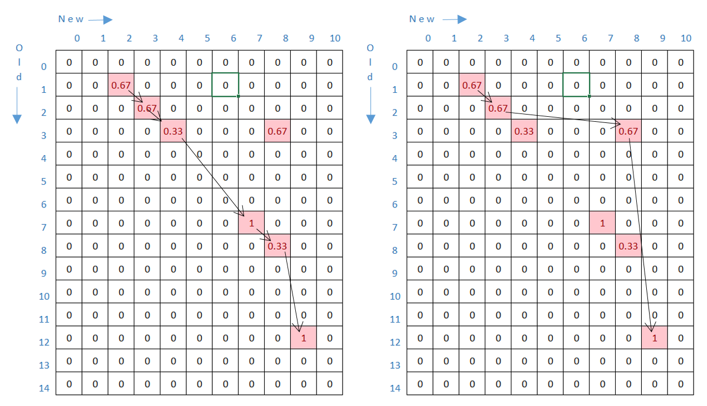

Dhrusham Patel (dhrusham.patel@equiniti.com)
{ .byline }

The objective of `tablediff` is to compare two tables: an old table and a new table, where the new table is assumed to have been derived from the old table by way of row-edits, insertions and deletions. The result should therefore identify and distinguish between these types of modification. To achieve this, the function compares two tables and returns a pair of aligned tables. In addition to aligning the matched rows, the aligned tables contain empty rows corresponding to insertions and deletions. The process of matching rows is based on solving the Longest Common Subsequence (LCS) problem[\[1\]](#ref1) for rows of the tables.
{ .abstract }

Here is an example of the function in operation:

```
old new2  (old tablediff new)
  A  A  A    v  v  v     A  A  A
  B  B  B    w  w  w                v  v  v
  C  C  C    -  B  B                w  w  w
  D  D  D    C  -  C     B  B  B    -  B  B
  E  E  E    -  D  -     C  C  C    C  -  C
  F  F  F    x  x  x     D  D  D    -  D  -
  G  G  G    y  y  y     E  E  E
  H  H  H    H  H  H     F  F  F
  I  I  I    D  I  D     G  G  G
  J  J  J    M  M  M                x  x  x
  K  K  K    z  z  z                y  y  y
  L  L  L                H  H  H    H  H  H
  M  M  M                I  I  I    D  I  D
  N  N  N                J  J  J
  O  O  O                K  K  K
                         L  L  L
                         M  M  M    M  M  M
                         N  N  N
                         O  O  O
                                    z  z  z
```

As can be seen above: rows align according to where there is a match, exact or partial. Empty rows in the `old` and `new` tables represent row insertions and row deletions respectively. Note that partial matches have also been aligned; representing where rows have been edited. In particular, notice the instances where partial matches have been aligned despite better matches being available, as doing so would yields a better alignment for the tables as a whole.

The cells contain strings, i.e. character vectors. In this example all the strings have length 1, merely for convenience in presentation.

The key variation in this function from the standard LCS problem is that it tolerates partial matches, thereby allowing the function to trace minor row edits. By calculating *degree of match* in the range 0 – 1, we find the highest-scoring common subsequence.

The strategy is to match rows in `new` to their originals in `old`; then expand the two tables to align them.

The function has four steps:

1. Find row matches: both partial and exact.
2. Generate and select candidate solutions to evaluate.
3. Find the best match: i.e. the highest-scoring common subsequence.
4. Align matching rows by creating a pair of boolean expansion vectors.

## Step 1: Tabulate all row matches

```
      matches←(↓old)∘.≡↓new
```

Split the tables and use an outer-product match to find which rows in `new` match which rows in `old`. But we want to honour partial matches, where a row has been edited.

```
      matches←(↓old)∘.(≡¨)↓new
```

Now each cell of the result is a 3-element boolean. Sum each cell and divide by the number of columns to get a score for each match in the range 0 – 1.

```
      rnew cnew←⍴new
      ms←(+/¨(↓old)∘.(≡¨)↓new)÷cnew ⍝ match scores
```

But this can be written more simply\[2\]:

```
      ms←(old+.≡⍉new)÷cnew ⍝ match scores
```

The resulting table of row match scores `ms` represents the likeness of each row from the `old` table compared with each row of the `new` table.

## Step 2: Generate and select candidate solutions to evaluate

<figure markdown="1">

<figcaption markdown="span">Figure 1: Two solution paths through the match scores table.</figcaption>
</figure>

The above two figures show two possible match paths. Origin 0, the first matches rows 2 3 4 7 8 9 of `new` to rows 1 2 3 7 8 12 of `old`. The second matches rows 2 3 7 8 of `new` to 1 2 3 12 of `old`.

Because rows are not moved (only inserted, deleted or edited) a match path must specify progressively rising indexes of old and new.

The challenge is to identify all possible match paths and find the highest-scoring.

We start by tabulating all possible selections of rows of `new`. In the figures above, the selections from `new` correspond to columns with matches: in both cases the selection is 0 0 1 1 1 0 0 1 1 1 0.

The expression `(rnew/2)⊤⍳2*rnew` gives all possible selections from new:

```
      disp←{'.⎕'[⍵]}
      disp 60↑[1] (rnew/2)⊤⍳2*rnew ⍝ first 60 of 2048 cols
............................................................
............................................................
............................................................
............................................................
............................................................
...............................⎕⎕⎕⎕⎕⎕⎕⎕⎕⎕⎕⎕⎕⎕⎕⎕⎕⎕⎕⎕⎕⎕⎕⎕⎕⎕⎕⎕⎕
...............⎕⎕⎕⎕⎕⎕⎕⎕⎕⎕⎕⎕⎕⎕⎕⎕................⎕⎕⎕⎕⎕⎕⎕⎕⎕⎕⎕⎕⎕
.......⎕⎕⎕⎕⎕⎕⎕⎕........⎕⎕⎕⎕⎕⎕⎕⎕........⎕⎕⎕⎕⎕⎕⎕⎕........⎕⎕⎕⎕⎕
...⎕⎕⎕⎕....⎕⎕⎕⎕....⎕⎕⎕⎕....⎕⎕⎕⎕....⎕⎕⎕⎕....⎕⎕⎕⎕....⎕⎕⎕⎕....⎕
.⎕⎕..⎕⎕..⎕⎕..⎕⎕..⎕⎕..⎕⎕..⎕⎕..⎕⎕..⎕⎕..⎕⎕..⎕⎕..⎕⎕..⎕⎕..⎕⎕..⎕⎕.
⎕.⎕.⎕.⎕.⎕.⎕.⎕.⎕.⎕.⎕.⎕.⎕.⎕.⎕.⎕.⎕.⎕.⎕.⎕.⎕.⎕.⎕.⎕.⎕.⎕.⎕.⎕.⎕.⎕.⎕.
```

We can eliminate selections that select rows of `new` that have no matches at all.

```
      disp {⍵/⍨∧⌿~(~∨⌿×ms)⌿⍵} (rnew/2)⊤⍳2*rnew
................................................................
................................................................
................................⎕⎕⎕⎕⎕⎕⎕⎕⎕⎕⎕⎕⎕⎕⎕⎕⎕⎕⎕⎕⎕⎕⎕⎕⎕⎕⎕⎕⎕⎕⎕⎕
................⎕⎕⎕⎕⎕⎕⎕⎕⎕⎕⎕⎕⎕⎕⎕⎕................⎕⎕⎕⎕⎕⎕⎕⎕⎕⎕⎕⎕⎕⎕⎕⎕
........⎕⎕⎕⎕⎕⎕⎕⎕........⎕⎕⎕⎕⎕⎕⎕⎕........⎕⎕⎕⎕⎕⎕⎕⎕........⎕⎕⎕⎕⎕⎕⎕⎕
................................................................
................................................................
....⎕⎕⎕⎕....⎕⎕⎕⎕....⎕⎕⎕⎕....⎕⎕⎕⎕....⎕⎕⎕⎕....⎕⎕⎕⎕....⎕⎕⎕⎕....⎕⎕⎕⎕
..⎕⎕..⎕⎕..⎕⎕..⎕⎕..⎕⎕..⎕⎕..⎕⎕..⎕⎕..⎕⎕..⎕⎕..⎕⎕..⎕⎕..⎕⎕..⎕⎕..⎕⎕..⎕⎕
.⎕.⎕.⎕.⎕.⎕.⎕.⎕.⎕.⎕.⎕.⎕.⎕.⎕.⎕.⎕.⎕.⎕.⎕.⎕.⎕.⎕.⎕.⎕.⎕.⎕.⎕.⎕.⎕.⎕.⎕.⎕.⎕
................................................................
```

That reduces the number of selections to test from 2048 to 64.

The more matches the better. So we’ll try the most promising selections first.

```
      disp sstt←{⍵[;⍒+⌿⍵]} {⍵/⍨∧⌿~(~∨⌿×ms)⌿⍵} (rnew/2)⊤⍳2*rnew
................................................................
................................................................
⎕.⎕⎕⎕⎕⎕.....⎕⎕⎕⎕⎕⎕⎕⎕⎕⎕..........⎕⎕⎕⎕⎕⎕⎕⎕⎕⎕..........⎕⎕⎕⎕⎕.....⎕.
⎕⎕.⎕⎕⎕⎕.⎕⎕⎕⎕....⎕⎕⎕⎕⎕⎕....⎕⎕⎕⎕⎕⎕......⎕⎕⎕⎕......⎕⎕⎕⎕....⎕....⎕..
⎕⎕⎕.⎕⎕⎕⎕.⎕⎕⎕.⎕⎕⎕...⎕⎕⎕.⎕⎕⎕...⎕⎕⎕...⎕⎕⎕...⎕...⎕⎕⎕...⎕...⎕....⎕...
................................................................
................................................................
⎕⎕⎕⎕.⎕⎕⎕⎕.⎕⎕⎕.⎕⎕.⎕⎕..⎕⎕.⎕⎕.⎕⎕..⎕.⎕⎕..⎕..⎕..⎕⎕..⎕..⎕...⎕....⎕....
⎕⎕⎕⎕⎕.⎕⎕⎕⎕.⎕⎕⎕.⎕⎕.⎕.⎕.⎕⎕.⎕⎕.⎕.⎕.⎕.⎕.⎕..⎕..⎕.⎕.⎕..⎕...⎕....⎕.....
⎕⎕⎕⎕⎕⎕.⎕⎕⎕⎕.⎕⎕⎕.⎕⎕.⎕..⎕⎕⎕.⎕⎕.⎕..⎕⎕.⎕..⎕...⎕⎕.⎕..⎕...⎕....⎕......
................................................................
```

From 2048 possible selections of rows of `new`, we’ve found 64 to evaluate, and sorted the most promising to the left.

## Step 3: Find best solution

A candidate solution is a selection of rows from `new`, all of which match rows from `old`. Because table rows have not been reordered, the solution must pick out successive rows of old.

Each selection of `new` will produce zero or more match paths. The criterion that row matches are monotonically rising (i.e. terms of solution must be consecutive, but not necessarily contiguous, terms of the original sequences) means that it is possible for there to be zero match paths. The longest match path corresponds to the longest common subsequence.

Scoring the matches introduces an additional variable for consideration: we now want the highest-scoring common subsequence. Note that if there are partial row matches the longest common subsequence is not necessarily the highest-scoring common subsequence.

Each selection of rows of new gives a corresponding selection of the match-scores table, in which to look for match paths. The `soln` function returns the highest-scoring match path, and its score.

```
soln←{
    ⍝ best solution (origin-0) and score for match scores ⍵ (matrix)
     ⎕IO←0
     where←{⍵/⍳⍴⍵}
     cmbn←{↑,⊃∘.,/⍵,⊂⊂⍬}                   ⍝ combine lists
     rr←{∧/↑>/1 ¯1↓[1]¨⊂⍵}                 ⍝ rising rows
     mrr←{⍵⌿⍨(rr ⍵)∧∧/⍵=⌈\⍵}               ⍝ monotonically rising rows
     rows←mrr cmbn where¨↓[0]×⍵            ⍝ solns are sequences of rows
     0∊⍴rows:⍬ 0                           ⍝ no solution, zero score
     nc←⊃⌽⍴⍵                               ⍝ count cols in ⍵
     scores←+/(,⍵)[(rows×nc)+[1]⍳nc]       ⍝ score by soln
     (scores⍳⌈/scores)∘⊃¨(↓rows)(scores)
 }
```

To find the highest-scoring match path we apply `soln` to the selections in turn, starting with the most promising. But we don’t need to evaluate every selection. We can stop when the next selection could not produce a higher-scoring match path. We don’t need to apply soln to see that. If the next selection has only four flags and the highest score so far is 4.66, then we need look no further, because the maximum score for a selection with four flags is 4.

```
i←0 ⋄ end←↑⌽⍴sstt ⋄ (sc mo mn)←0 ⍬ ⍬      ⍝ score maskold masknew
:while sc<+/sstt[;i]                      ⍝ scope to improve?
    ∆←(soln ∆/ms),⊂∆←sstt[;i]             ⍝ evaluate next
    (sc mo mn)←(sc<↑∆) ⌽ (sc mo mn) ∆
:until end=i←i+1
```

After the loop, `mo` and `mn` contain a pair of boolean vectors which represent the positions of matching row numbers for each of the old and new tables.

```
      mo mn    ⍝  match booleans
┌→────────────────────────────────────────────────────────┐
│ ┌→────────────────────────────┐ ┌→────────────────────┐ │
│ │0 1 1 1 0 0 0 1 1 0 0 0 1 0 0│ │0 0 1 1 1 0 0 1 1 1 0│ │
│ └~────────────────────────────┘ └~────────────────────┘ │
└∊────────────────────────────────────────────────────────┘
```

## Step 4: Align matching rows

Once the best solution is found, our final step is to create two boolean expansion vectors that will align the two tables.

Three ways to do this:

Looping function
:   This function recognises patterns in the two booleans `mo` and `mn` and assembles (column-wise) a 2-row table representing a pair of expansion vectors.

    ```
    Z←2 0⍴⍬
    :Repeat
      :Select ⊃¨mo mn
         :Case 0 0 ⋄ x←1 0   ⍝ Row deleted
         :Case 0 1 ⋄ x←1 0   ⍝ Row deleted
         :Case 1 0 ⋄ x←0 1   ⍝ Row inserted
         :Case 1 1 ⋄ x←1 1   ⍝ match
      :EndSelect
     Z,←x
     (mo mn)↓⍨¨←x
    :Until ∨/⊃¨0=⍴¨ mo mn
    Z,←↑~ mo mn
    expansion←↓Z
    ```

    The select structure above represents a mapping that can be expressed as a short D function:

    ```
    x←{0 0≡⍵:1 0 ⋄ ⌽⍵}⊃¨ mo mn
    ```

Recursive function
:   The loop can be rewritten concisely as a D function with tail recursion.

    ```
    stephen←{
             0∊≢¨⍵:↑~⍵
             x←(0 1)(1 1)(1 0)⊃⍨(1 0)(1 1)⍳⊂⊃¨⍵  ⍝ inserted, preserved, deleted
             (⍪x),∇ x↓¨⍵
         }
    expansion←↓stephen mo mn
    ```

Morten’s non-looping function
:   
    ```
    morten←{
         rn← ≢ ¨⍵
         ord←⍋(2×∊+\¨⍵)-(∊⍵)
         O m←(⊂⊂ord)⌷¨(rn/0 1)(∊⍵)
         {((~m∧O≠⍵)/O=⍵)}¨0 1
     }
    expansion←morten mo mn
    ```

    This function takes the booleans as its right argument. It “orders the enlisted booleans so matching rows are adjacent.” Morten has discussed his function in more detail over on a blog post [\[3\]](#ref3).

    Finally, the resulting expansion vectors are used to align the tables.

    ```
          ,¨/expansion (expansion⍀¨old new)
      1  A  A  A   0
      0            1  v  v  v
      0            1  w  w  w
      1  B  B  B   1  -  B  B
      1  C  C  C   1  C  -  C
      1  D  D  D   1  -  D  -
      1  E  E  E   0
      1  F  F  F   0
      1  G  G  G   0
      0            1  x  x  x
      0            1  y  y  y
      1  H  H  H   1  H  H  H
      1  I  I  I   1  D  I  D
      1  J  J  J   0
      1  K  K  K   0
      1  L  L  L   0
      1  M  M  M   1  M  M  M
      1  N  N  N   0
      1  O  O  O   0
      0            1  z  z  z
    ```

## Listing

Putting the four steps together:

```
∇ Z←old tablediff new;⎕IO;rnew;cnew;ms;aps;wps;sstt;i;end;sc;mo;mn;∆
 ⎕IO←0
 rnew cnew←⍴new

 ⍝ 1. Tabulate match scores
 ms←cnew÷⍨old+.≡⍉new

 ⍝ 2. Generate subsequences to test
 aps←{(⍵/2)⊤⍳2*⍵}                                ⍝ all possible selections
 wps←{⍵/⍨∧⌿~(~∨⌿×ms)⌿⍵}                          ⍝ with possible solutions
 sstt←{⍵[;⍒+⌿⍵]} wps aps rnew                    ⍝ subsequences to test

 ⍝ 3. Select subsequence with highest score
 i←0 ⋄ end←↑⌽⍴sstt ⋄ (sc mo mn)←0 ⍬ ⍬            ⍝ score, maskold, masknew
 :while sc<+/sstt[;i]                            ⍝ scope to improve?
    ∆←(soln ∆/ms),⊂∆←sstt[;i]                    ⍝ evaluate next
    (sc mo mn)←(sc<↑∆) ⌽ (sc mo mn) ∆
 :until end=i←i+1

 ⍝ 4. Align the tables vertically
 Z←old new⍀⍨¨morten mo mn
∇
```

## Scope for improvement

1. The problem is symmetrical. That is:

    ```
    old tablediff new ←→ ⌽ new tablediff old
    ```

    The longest common subsequence cannot be longer than `⌊/⊃¨⍴¨old new`. So only the shorter table should be searched for subsequences. In this example `new` is the shorter table. `tablediff` can be improved by switching `old` and `new` if the latter is longer then correspondingly reversing the 2-element result.

2. `cmbn←{↑,⊃∘.,/⍵,⊂⊂⍬}` is space hungry and inefficient for large tables. Instead, Morten recommends a depth-first search.[\[4\]](#ref4).

3. The match scores might be calculated faster if the strings were first hashed to integers. Or, if there are many repeated elements, to indexes to a list of the unique elements.

## Acknowledgements

I am indebted to Morten Kromberg of Dyalog, my colleague Stephen Taylor, Mike Thomas of Bedarra and Arthur Whitney of Kx for help with this work. Any errors are of course mine.

## References

1. <a id="ref1"></a> Longest Common Subsequence  
    [en.wikipedia.org/wiki/Longest\_common\_subsequence\_problem](http://en.wikipedia.org/wiki/Longest_common_subsequence_problem)
2. <a id="ref2"></a> I have Morten Kromberg to thank for spotting this equivalence. Watch out: this inner product returns wrong results in both APL+Win 12.0 and APLX 4.1.6. In these interpreters use the longer outer-product expression, which returns a correct result.
3. <a id="ref3"></a> Morten’s blog post:  
    [dyalog.com/blog/2014/07/aligning-diff-output-2/](http://www.dyalog.com/blog/2014/07/aligning-diff-output-2/)
4. <a id="ref4"></a> John Scholes on Depth-first searching in D  
    [youtube.com/watch?v=DsZdfnlh\_d0](https://www.youtube.com/watch?v=DsZdfnlh_d0)
