Kai Jaeger (kai@aplteam.com)
{ .byline }

This article explains why Fire for Dyalog APL came into existence at all, and why I spent about 5 – unpaid – month of work on this project over the last three years. The name “Fire” points to the two main features: FInd and REplace. Fire is specifically designed to support programmers who have to deal with legacy code: code that is typically quite old, with little or outdated documentation if any, without test cases, no clear structure and/or design and more often than not without any kind of reasonable modularisation, often with none of the original authors being around anymore.
{ .abstract }

Maintaining and enhancing a legacy system is a big challenge in any case, in particular because rewriting it seems to be the only reasonable thing to do but that’s not an option because either the client (or management) is not prepared to accept this or it’s too complex or has too many interfaces to other systems to allow this.

Rewriting an application can also pose a threat to APL because it might be used as an excuse to get rid of APL altogether, although clearly the problems causing the headache are not an intrinsic feature of APL at all, they are caused by bad decisions made by ordinary humans. In most if not all cases the client is part of the problem, not the solution. When asked to pay for improving the situation you are very likely to get an answer along the lines of “How many new features are you are going to add? None?! Forget it!”

The only way to survive in a situation like that in the long run is to add test cases and to improve design, modularisation and documentation step by step whenever you touch the code. In the beginning this will look like a simple waste of resources without gaining anything, but it will improve the situation, leading to better and more stable code.

In particular adding test cases will make it easier to carry out changes because you will become more and more confident that those changes will not break the application in many different ways, a typical problem with legacy code.

For that reason spending time on improving the code base is also in the interest of the client/management, although they would probably be incapable of realising this if told, so you better keep your mouth shut and hide behind feature enhancements and bug fixes.

Improving a code base often requires changes on a large scale like renaming plenty of objects etc., something that one would prefer to carry out automatically, at least to some extent. Fire is designed to support a programmer in this respect. Let’s discuss some typical problems and how they can be solved with Fire.

## Case study I.

Imagine a workspace where you started developing quite a number of classes dedicated to solve a certain problem (GUI utilities in this case), with all these classes situated in the root together with a couple of general classes addressing common problems and used by the GUI-related classes, and a namespace called “Demo” which holds quite a number of functions designed to demonstrate certain aspects of the GUI-related classes.

This is how the namespaces in the root might look:

<figure markdown="1">
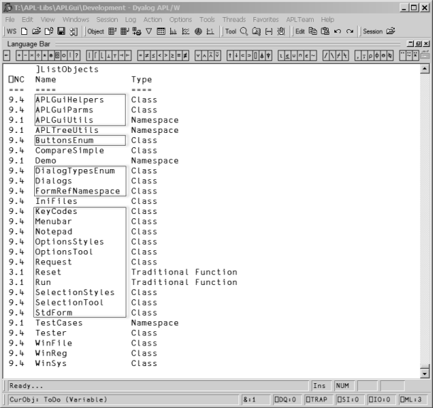
</figure>

In the future I want to use Phil Last’s excellent code management system acre\[[1](#ref1)\]. In order to do so I decided to restructure the code so that all the GUI-related classes and namespace scripts go into an ordinary namespace `#.GUI` . That is all those shown in boxes.

That’s relatively easy to achieve because I wrote my own tool that allows me to move scripts around; unfortunately the Workspace Explorer is still not capable of doing this. After that the root looks like this:

```
      ]ListObjects -n=9
 ⎕NC  Name           Type
 ===  ====           ====
 9.1  APLTreeUtils   Namespace
 9.4  CompareSimple  Class
 9.1  GUI            Namespace
 9.1  Demo           Namespace
 9.4  IniFiles       Class
 9.1  TestCases      Namespace
 9.4  Tester         Class
 9.4  WinFile        Class
 9.4  WinReg         Class
 9.4  WinSys         Class
```

But that is not enough: the functions in the `#.Demo` namespace as well as all the test cases still try to address the GUI utilities in the root. Those references need to be changed, and that is a perfect task for Fire.

The first goal is to find out how many functions and how many lines of code need to be changed. For this we enter `#.` in the “Search for” box and `#.Demo` into the “Start looking here” box as shown here:

<figure markdown="1">
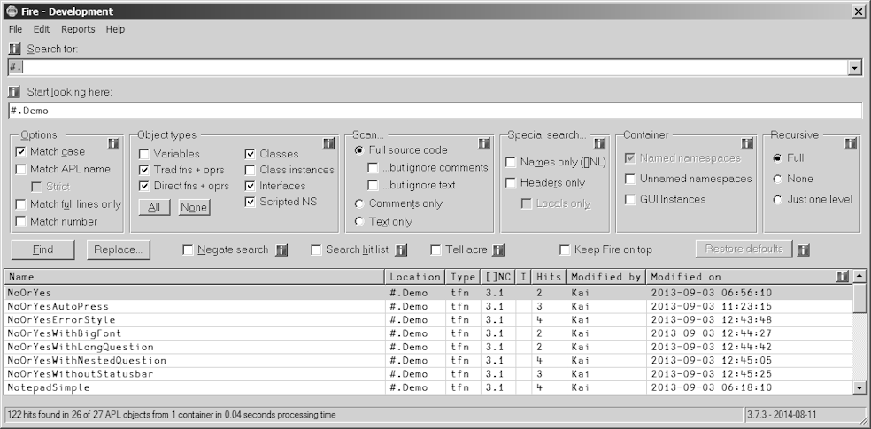
</figure>

There are 26 functions with 122 hits (see the status bar of Fire) which potentially need to be changed.

With the next step we check whether the hits we got are really what we are after. The report can be created via the “Report hits” command from the “Reports” menu. It gives an excellent overview:

<figure markdown="1">
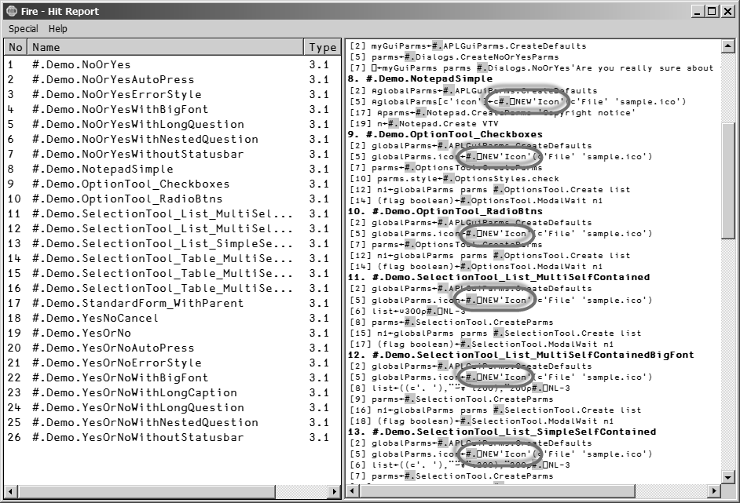
</figure>

As you can see there are quite a number of functions that carry `#.⎕NEW` in them – these statements must remain unchanged. However, those functions also carry hits we are interested in. What’s the best way to deal with this situation?

First we create a hit list with objects that do not contain the string `#.⎕”` . We can achieve this with these settings:

<figure markdown="1">
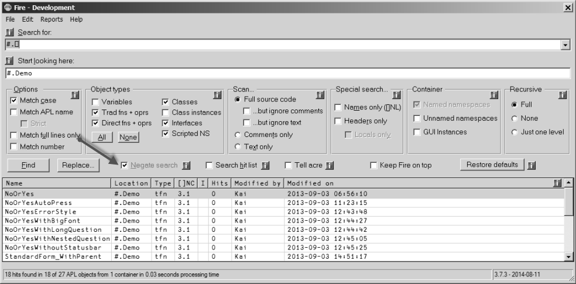
</figure>

Note that the “Negate search” option was ticked, therefore Fire just lists functions that do not contain the string `#.⎕`.

Now we untick “Negate search” and tick “Search hit list”. Then we search for `#.` as shown here:

<figure markdown="1">
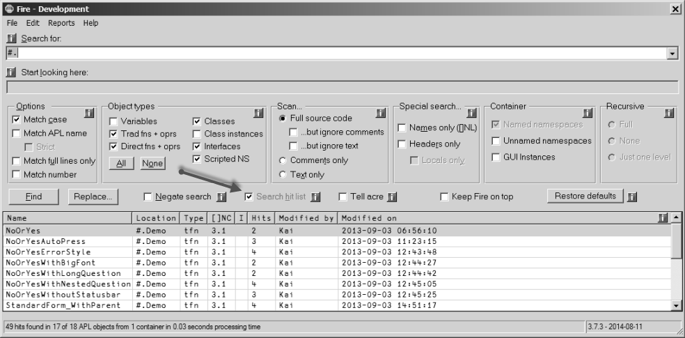
</figure>

That results in 17 functions. This is again the “Report hits” report:

<figure markdown="1">
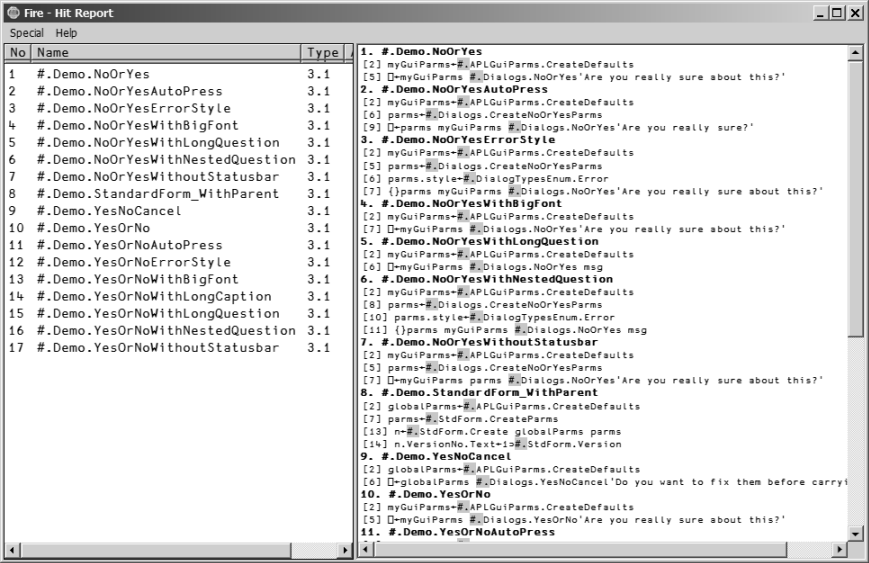
</figure>

This is indeed a big step forward: apparently only stuff that needs to be changed is reported.

<figure class="right" markdown="1">
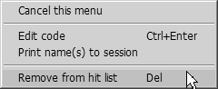
</figure>

However, if there were still some items in the hit list we don’t want to change we could easily remove them from the hit list via the Hit Report’s context menu:

After pressing the “Replace” button we get the “Replace” dialog box were we can enter this:

<figure markdown="1">
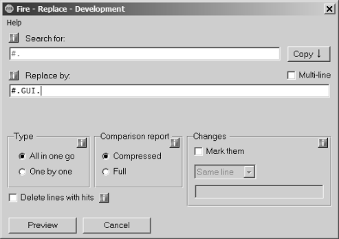
</figure>

After clicking on “Preview” we get this:

<figure markdown="1">
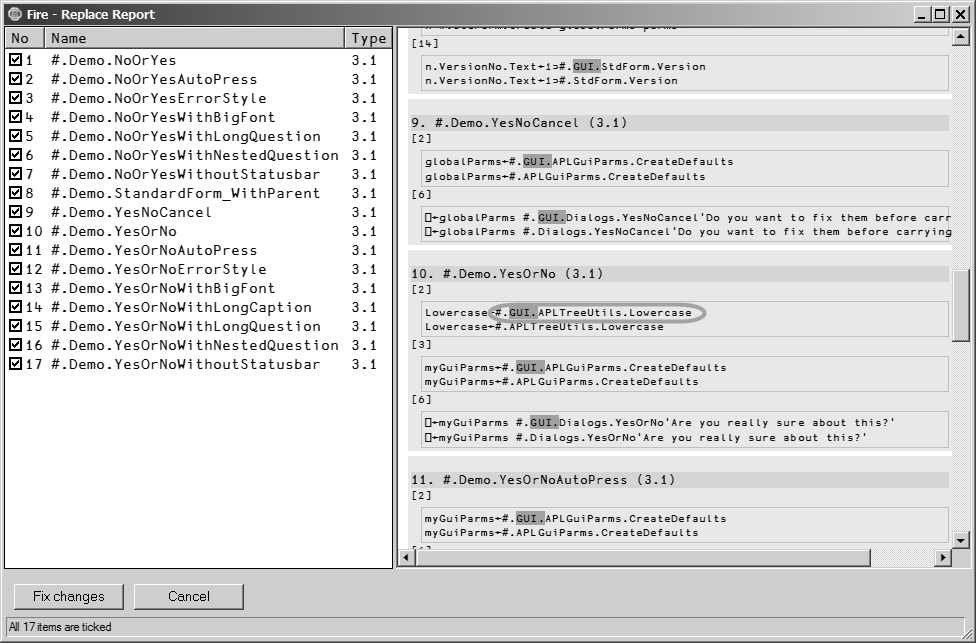
</figure>

Everything is fine except number 19 which is the function `#.Demo.YesOrNo` : apart from two lines that we want to change indeed (3 and 6) there is also a line we don’t want to change: line number 2.

One way to deal with this is to change the function anyway and then to fix line 2 in the editor afterwards. Here however we use a different approach which is much more appropriate in case we want to exclude not just one but quite a number of changes: we simply untick the checkbox number 10 in the tree view. That leads to this:

<figure markdown="1">
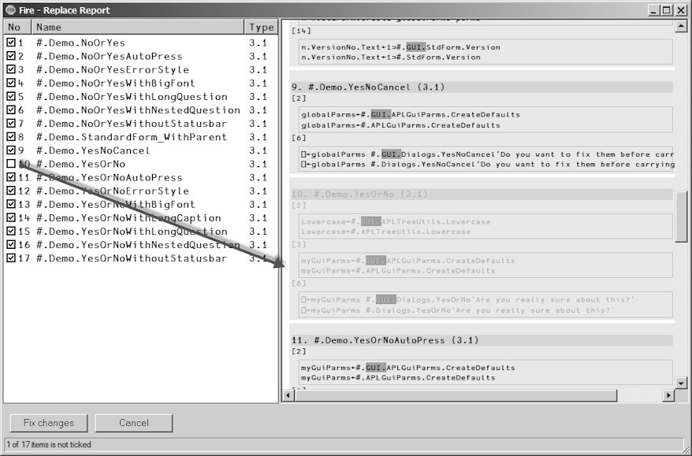
</figure>

`#.Demo.YesOrNo` is now greyed, indicating that the function will not be processed any more.

Finally we press the “Fix changes” button. First part of the task is done – the majority of the necessary changes have been carried out already.

In order to address the remaining problems we first want to get a list of objects that do *not* contain any reference to `#.GUI.` because those that do are the ones we have just changed, so we are not interested in them. In order to achieve that we tick the "Negate search" check box and repeat the search:

<figure markdown="1">
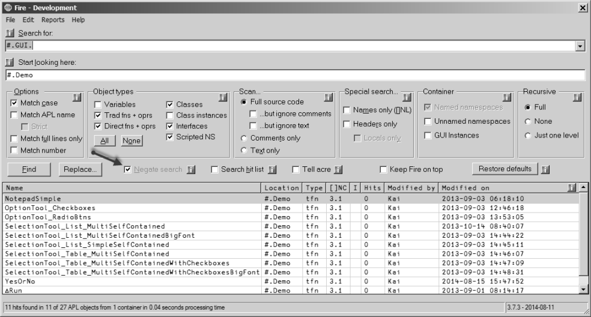
</figure>

Eleven objects do not contain any reference to `#.GUI` as of yet. These still need to change. Now let’s search this hit list for any references to `#.`

Note that the "Search hit list" check box is ticked now; that restricts the search the the objects in the hit list:

<figure markdown="1">
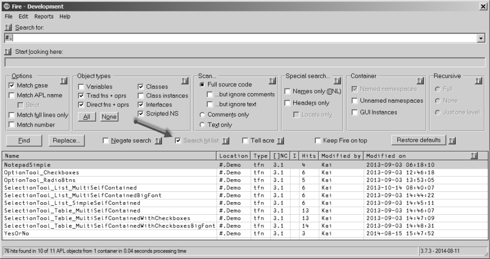
</figure>

That has reduced the number of objects down to 10.

We already know that all remaining objects do need to be changed but we also know that some of them have references to `#.` which must remain unchanged. There is no escape route; this problem cannot be solved automatically. However, Fire can still be of great help in this situation.

After a click on the “Replace” button we modify the default setting of the “Replace” dialog box:

<figure markdown="1">
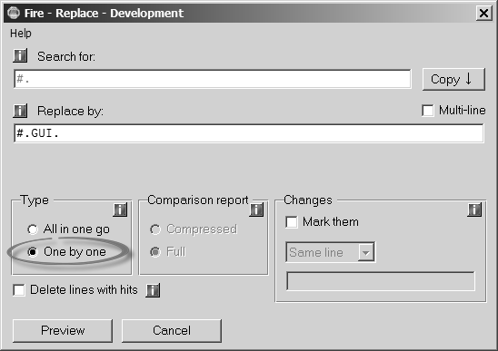
</figure>

Note that here we assume that you have installed the excellent 3rd-party tool “CompareIt!” on your machine. If that is not the case than a very basic built-in comparison tool will be used.

This allows the user to accept – or deny – changes on a hit-by-hit bases for one object after the other:

<figure markdown="1">
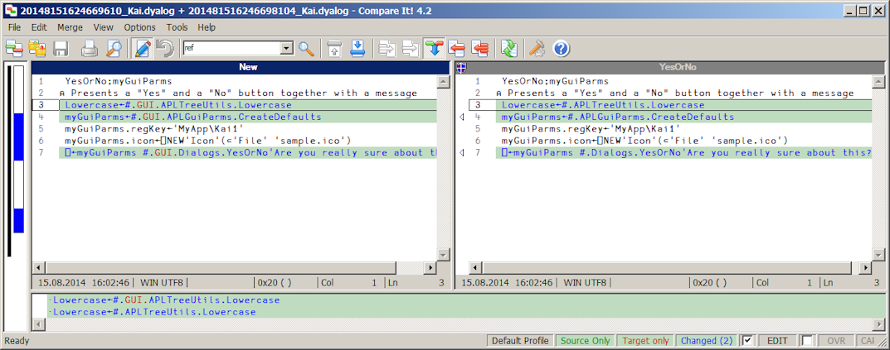
</figure>

The highlighted areas can be moved from the right pane to the left by clicking at the arrow(s) but not the other way around: the icon shown in the caption of the right pane indicates that the right pane is read-only. You can also simply edit the code in the left pane.

Either way, we should end up with the following and the problem is solved.

<figure markdown="1">
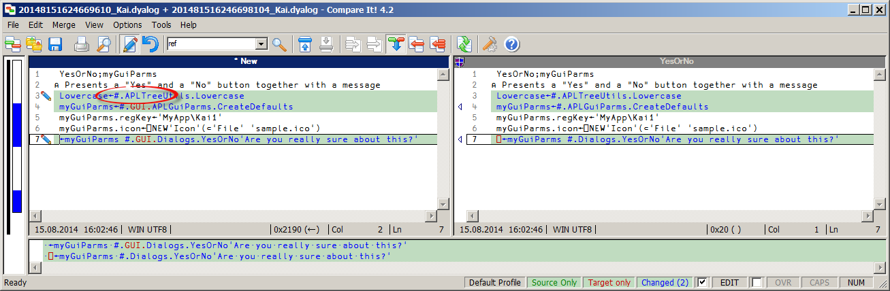
</figure>

## Case study II.

With version 3.3.0 Fire itself changed its user interface: a new check box “Strict” became available:

<figure markdown="1">
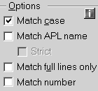{ style="width:10em" }
</figure>

The option is active only when the “Match APL name” check box is ticked. With both check boxes ticked an entry like `Foo.` in “Search for” is rejected by Fire. With just “Match APL name” ticked but not “Strict” you can search for `Foo.`, `.Foo` or `.Foo.` and it will find such strings while a reference to `Foo` without a dot won’t be found. In April 2014 I realized that this is a very useful feature and added it immediately to Fire.

That posed a problem: Fire comes with a large set of test cases: at the time of writing 121. The vast majority fires up the GUI and then sets properties. This is how a typical test case looks:

```
R←Test_Search_001(stopFlag batchFlag);n;⎕TRAP
⍝ Search for "a" everywhere with "Names only"
 ⎕TRAP←(999 'C' '. ⍝ Deliberate error')(0 'N')
 R←1

⍝ Preconditions
 1 #.Fire.Run 0
 n←#.Fire.GUI.n

 n.SearchFor.Text←'a'
 n.LookIn.Text←'#'

 n.Case.State←0
 n.APL_Name.State←0
 n.FullLineOnly.State←0
 n.AsNumber.State←0

 n.Vars.State←1
 n.FnsOprsTrad.State←1
 n.FnsOprsDirect.State←1
 n.Classes.State←1
 n.Interfaces.State←1

 n.ScriptedNamespaces.State←1

 n.Code.State←1
 n.NoComments.State←1
 n.NoText.State←0
 n.CommentsOnly.State←0
 n.TextOnly.State←0

 n.NamesOnly.State←1
 n.HeaderOnly.State←0
 n.LocalsOnly.State←0

 n.NamedNamespaces.State←1
 n.UnnamedNamespaces.State←0
 n.GuiInstances.State←1

 n.Recursive.State←1
 n.RecursiveOneLevel.State←0
 n.RecursiveNone.State←0

 n.Negate.State←0
 n.ReuseSearch.State←0
 n.acre.State←0
 n.acre.State←0

 {}∆Select n.StartBtn
 ∆Process n.Form
 →PassesIf(0<0⊃⍴n.HitList.ReportInfo)

⍝ Tidy up
  CloseFire
 R←0                ⍝ Okay
```

These lines pose the problem:

```
 n.Case.State←0
 n.APL_Name.State←0
 n.FullLineOnly.State←0
```

After

```
n.APL_Name.State←0
```

there should be a line:

```
n.StrictOnNames.(Active State)←0
```

That can be achieved with Fire quite easily. First we search for `n.APL_Name.State` just in `#.TestCases` :

<figure markdown="1">
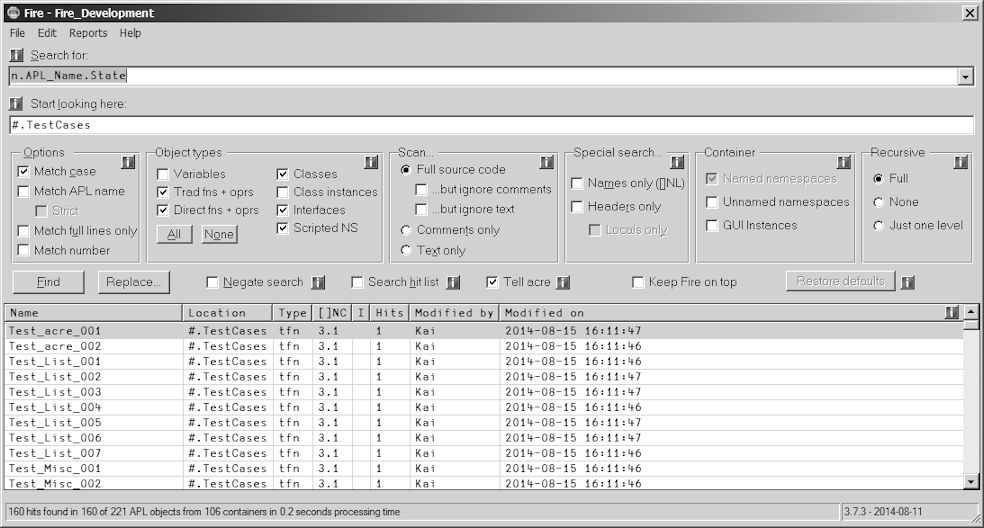
</figure>

“Report hits” confirms that we are on the right path, although it also shows that sometimes the “APL Name” check box is ticked and sometimes it isn’t, so we need to carry out the work in two steps:

<figure markdown="1">
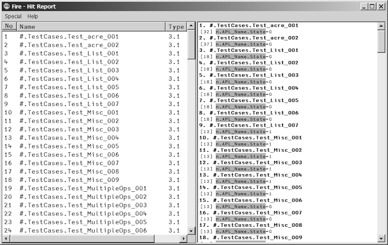
</figure>

Next we repeat the search for

```
n.APL_Name.State←1
```

simply because that will result in lesser hits. Indeed we get just 43 hits:

<figure markdown="1">
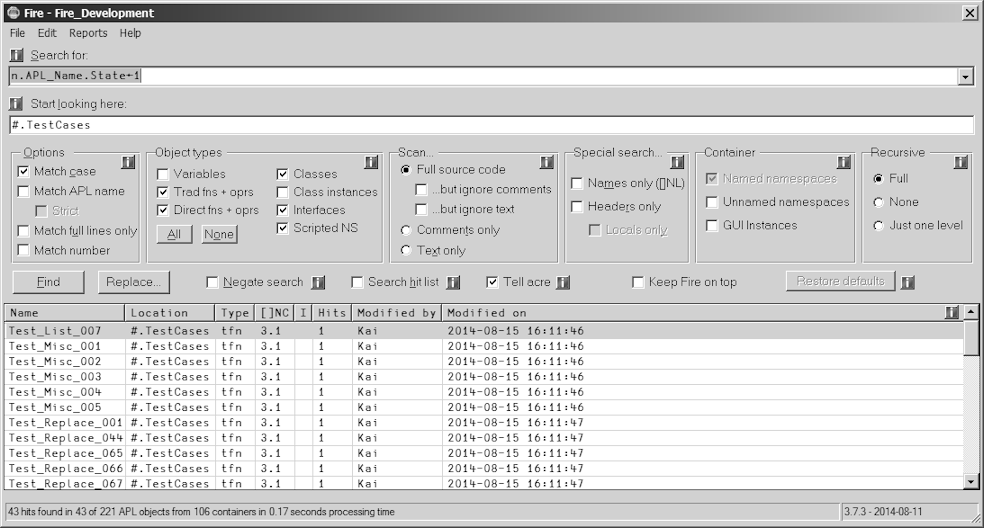
</figure>

<figure markdown="1">
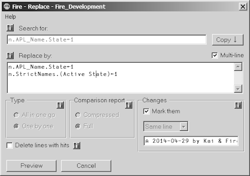
</figure>

In “Replace” we first tick the “Multi-line” check box and then repeat the search string followed by a second line with the statement (line) we want to add:

Note that the “Mark them” check box is ticked and the combo box underneath carries “Same line”. That means that the added line will be marked, by default by the string:

```
⍝ 2014-04-29 by {⎕AN} & Fire
```

After a click on “Preview” we can check the results for one function after the other:

<figure markdown="1">
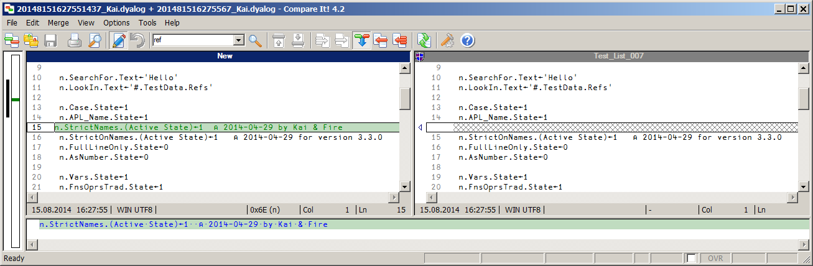
</figure>

<figure markdown="1">
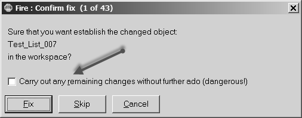
</figure>

For a large number of changes this can turn out to be annoying. However, if you feel confident that everything will just be fine you can tick the "Carry out any remaining changes without further ado" check box and you are done:

Of course that is dangerous, so keep a backup! In a separate step we can repeat this for

```
    n.APL_Name.State←0
```

and add

```
n.StrictOnNames.(Active State)←0
```

We have changed more than 100 functions within a matter of minutes.

Note that the “Strict” option has a different meaning when you search for `#` or `##`. Let’s look at an example: in a WS we have just 4 objects, two class scripts (`APLTreeUtils` and `WinFile`, both members of the APLTree project[\[2\]](#ref1)) and two functions located in an ordinary namespace `#.MyApp`:

```
∇ Run;A
[1]    A←#.APLTreeUtils
[2]    ∆WSID←A.Uppercase ⎕WSID
[3]    #.WinFile.PolishCurrentDir
[4]    WorkHorse ⍬
     ∇
∇ {r}←WorkHorse.WorkHorse dummy
[1]    r←⍬
[2]    ⎕←##.WinFile.PWD
     ∇
```

The coding of the functions does not make too much sense but they are good enough to highlight the topic. Note that `Run` carries references to `#` and `##` while `Workhorse` carries only a reference to `##` .

Now let’s assume that we want to use these two functions in a user command by copying the code over to a user command script. Although with `Workhorse` that would work without further ado, `Run` might or might not run because it relies in `WinFile` and `APLTreeUtils` to live in `#`. If they are not to be found in `#` the user command generates a VALUE ERROR.

Of course a user command should not make such assumptions: instead it should refer to the parent for utilities and stuff. In practice however this scenario might well occur because the application might have been written without considering it to run as a user command one day. It is also quite easy to try to address an object with `##.` but occasionally to address it as `#.` anyway. Worse, running the application in normal mode would not reveal such problems because both ways would work just fine.

In short, to convert an application into a user command we need to find all references to `#.` and convert them to `##.` while all references to `##` can be left alone. The problem is that searching for `#` or `#.` would not help because it would also find `##` or `##.` .

“Name” and “Strict” to the rescue: with both options ticked Fire will perform some sort of special search that deals with the problem. In our case Fire would ignore Workhorse because it does not contain any reference to `#` . The function `Run` would change; here the change preview:

<figure markdown="1">
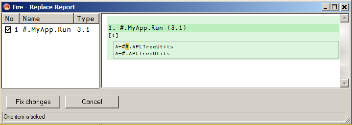
</figure>

<figure markdown="1">
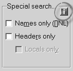{ style="width:10em" }
</figure>

Finally I want to draw your attention to the boxes displaying an “i” for information: these are links to Fire’s help file. For example, clicking at this box:

brings up the help page that is associated with that very topic:

<figure markdown="1">
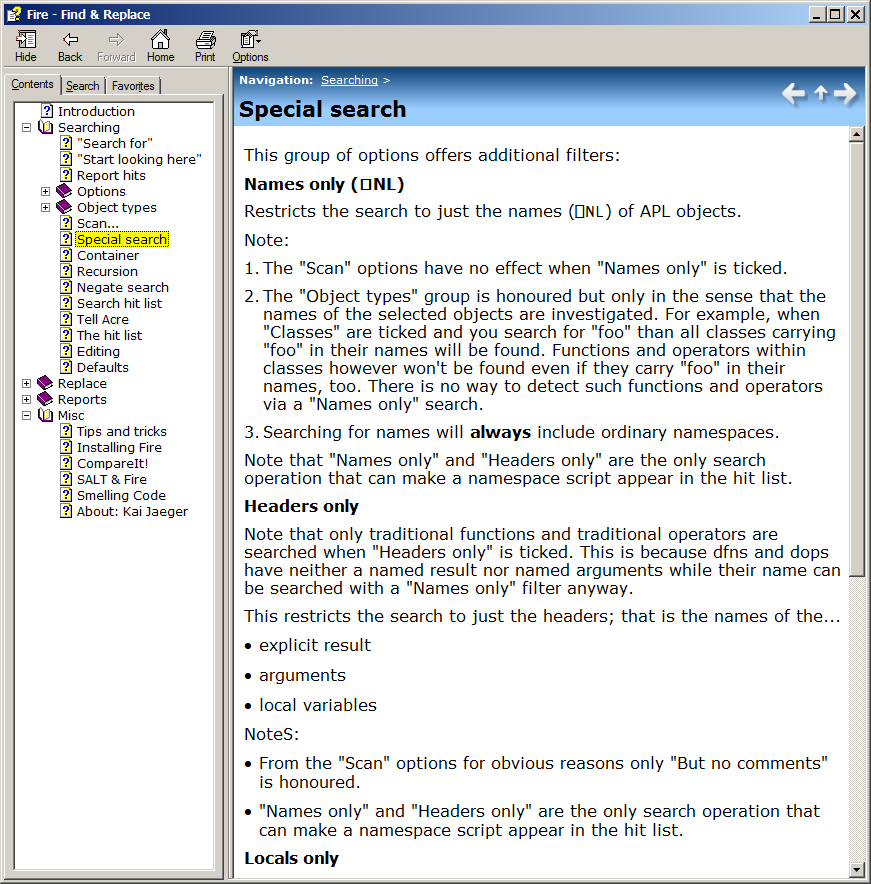
</figure>

Over time you might find all these information boxes distracting. No problem, unticking the menu command Help > Show info buttons make them disappear:

Converted into a Word document Fire’s help file comprises 33 pages. Scanning a workspace and trying to change selected objects can be a surprisingly complex business.

Although this article describes just a few of the features of Fire I hope you agree that these already proved how valuable Fire can be when dealing with legacy code. However, Fire offers many features which make it also a useful tool when dealing with non-legacy code as well.

Fire is part of the APLTree project\[[2](#ref1),[3](#ref1)\] and as such sort of Open Source\[[4](#ref1)\]: you can use it freely, you can contribute to the code basis or even take a copy and modify it for your own purposes and do whatever you like with that code.

Fire has its own page on the APL wiki\[[5](#ref1)\] and can be downloaded from there\[[6](#ref1)\].

## References

1. <a id="ref1"></a> acre's home page on the APL wiki: [http://aplwiki.com/acre](http://aplwiki.com/acre)
2. <a id="ref2"></a> “Sharing code: the APLTree project” by Kai Jaeger, Vector 25-3, [http://archive.vector.org.uk/art10500730](../art10500730/)
3. <a id="ref3"></a> The APLTree project on the wiki: <a href="http://aplwiki.com/CategoryAplTree%20">http://aplwiki.com/CategoryAplTree </a>
4. <a id="ref4"></a> The APLTree project license: [http://aplwiki.com/AplTreeLicensing](http://aplwiki.com/AplTreeLicensing)
5. <a id="ref5"></a> Fire's home page on the APL wiki: [http://aplwiki.com/Fire](http://aplwiki.com/Fire)
6. <a id="ref6"></a> The APLTree download page: [http://download.aplwiki.com/apltree/](http://download.aplwiki.com/apltree/)
