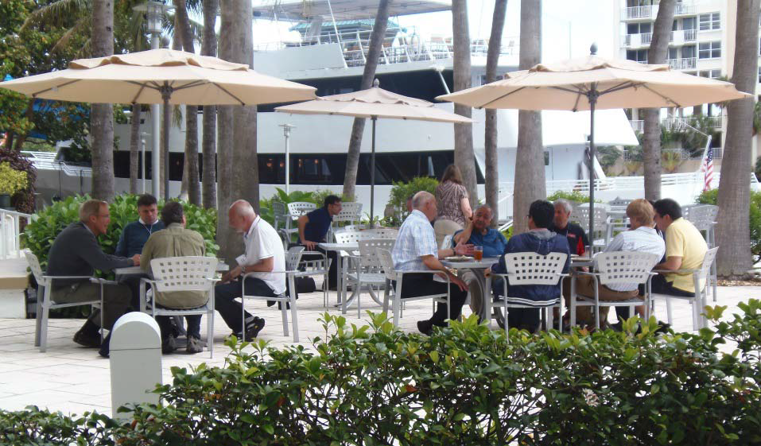
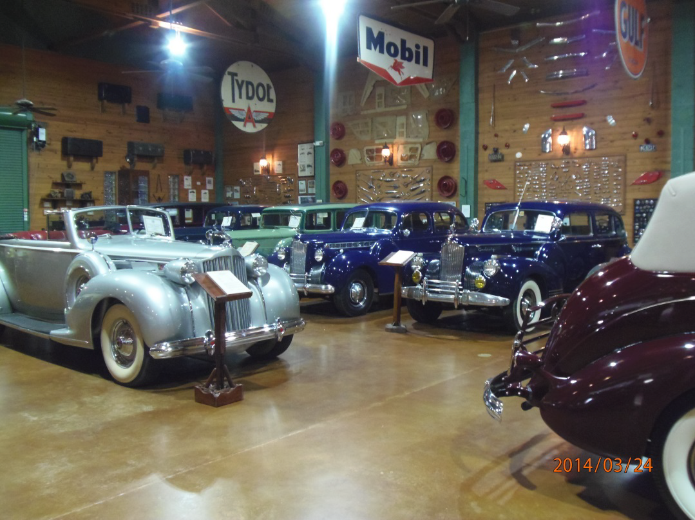
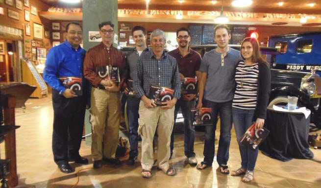

## APL2000 Welcomed Attendees in Fort Lauderdale, Florida

On March 23‐25, 2014, APL enthusiasts gathered at the Gallery One Fort Lauderdale– A Doubletree Suites by Hilton, for the APL2000 User Conference 2014. The hotel was beautifully situated along the scenic Intracostal Waterway, 8 miles from the Fort Lauderdale/Hollywood International Airport (FLL) and 3 blocks from the beach.

<figure class="right" markdown="1">

</figure>

Conference attendees reflected the diversity among users of APL2000 software. They are diverse both in the broad span of industries in which they work as well as the size of their businesses. APL2000 customers are industry leaders in the fields of finance, insurance, healthcare, aerospace engineering, employee benefits, airline and travel and many others both in the US and abroad.

The conference had a full agenda focusing on new developments in APL2000 products and various topics of interest to APL programmers including multi‐threading options to increase processing performance, using the C# Script Engine to access the .NET framework directly from APL+Win and techniques to incorporate APL+Win applications in cross‐platform solutions.

A comprehensive, 3‐day “Introduction to APL” class, taught by Kevin Weaver, was held simultaneously with the APL2000 User Conference.

At the APL2000 Conference two years ago Professor Spyros Magliveras, a noted cryptology expert from the Center for Cryptology and Information Security at Florida Atlantic University gave a very interesting presentation on his use of APL in cryptology. For the past several years, under APL2000’s Education Program, APL2000 has provided Florida Atlantic University with APL+Win licenses at no‐cost to Professor Magliveras’ students. APL2000 was pleased to welcome two of his students, Olga Shukina and Jessie Adamski, who gave presentations about how they used APL+Win to complete their Master’s theses.

## Conference Session Descriptions

### Catching Up on APL+Win (John Walker)

This presentation highlighted the new enhancements in APL+Win version 12, 13 and 14 since the APL2000 User Conference 2012.

Performance improvement for repetitive catenation; Improved support for Windows visual styles in APL+Win; APL+Win ActiveX engine Unicode execution methods; Improved APL Session Logging; `⎕CSE` – Interface to the APLNext C# Script Engine; `:FOREACH` control structure.

### Multi‐threading in APL+Win (Jairo Lopez, Joe Blaze, Pik Ng)

An overview of multi‐threading topics (including operation grouping and independence, data marshalling, asynchronous execution and performance monitoring) were presented.

- APLNext Application Server for multi‐machine processing
- APLNext Supervisor for multi‐cpu processing
- APLNext C# Script Engine for multi‐core processing

### Windows Event Log and APL+Win (Brian Chizever)

What is the Windows Event Log? Why would you want to use it? Techniques and sample APL+Win code to use the Windows Event Log were provided.

### Using APL to Manage Google Earth (John Magill)

Google Earth is a readily available tool with many useful features and potential. However, the syntax is rather cumbersome and not particularly dynamic. APL+Win provides an easy way to produce Google Earth maps and use them dynamically for strategic decision making. John Magill demonstrated the PATMIR III program he developed in APL+Win with funding from the World Bank and the Government of Mexico.

### APL+Win `⎕CSE` System Function Interface to the APLNext C# Script Engine ‐ Part 1 (Jairo Lopez, Frank Yang, Joe Blaze)

The `⎕`CSE system function empowers the APL+Win developer with direct access to 100% of the .Net Framework 4.5 without the need for Visual Studio. The CSE implementation rationale, features, object model and documentation were presented.

### APL+Win `⎕CSE` System Function Interface to the APLNext C# Script Engine ‐ Part 2 (Jairo Lopez, Frank Yang, Joe Blaze)

Advanced CSE features (e.g. defining .Net classes, GUI tools in .Net, consuming .Net events) were presented including detailed CSE examples for symmetric encryption, variable precision arithmetic, Linq queries, XML serialization, Windows event log and Windows Active Directory.

### APL+Win as a Web Server (Jairo Lopez, Joe Blaze, Pik Ng)

APL+Win is a terrific tool to implement complex algorithms. Deploying an algorithm to browser‐ or mobile‐based users is easy when APL+Win is exposed as a web service. Depending on the expected deployment scope, APL+Win functions in workspaces on a server can be exposed as a web service using Windows Communication Foundation (WCF) or APLNext Application Server technologies. The APLNext Application Server is now available in the traditional APL+Win web‐server‐based version and the new APL+Win module integrated with Microsoft IIS.

### Thor ‐ An APL Expert System to Assess Corporate Health (Eric Baelen)

Originally written in the 1980's for Touche Ross Audits to help assess non‐financial risk, Eric was recently asked to update it. Eric answered questions like “What's it like to take an APL system written for the Intel 8086 processor and move it to APL+Win, the Internet and a javascript GUI?”. While making this presentation, Eric took attendees down memory lane as he shared with us his 40 year relationship with APL.

### Workspace Recovery (Brain Chizever)

Once you release your application to a user, what do you do when they say "it won't even start"! Learn how to use the Crash Recovery Mechanism to handle these problems.

### Using .Net with `⎕CSE` Made Easy ‐ Part 1 (Eric Lescasse)

How about if you could use the new `⎕CSE` feature (almost) without having to learn .Net, Visual Studio and C#?

The presentation showed you how to create Objects in APL+Win which support multi‐level inheritance, visual inheritance and multi‐cast events, etc. It showed how you can easily document these objects and use them with `⎕`wi. It showed how you can programmatically convert .Net Framework C# objects with all their properties, methods, events and documentation into such APL+Win Objects and start using them with the good old `⎕`wi that we all know how to use! This new APL+Win Object technology is called APL+Win zObjects.

### Using .Net with `⎕CSE` Made Easy ‐ Part 2 (Eric Lescasse)

After the theory, the practice: This presentation showed practical applications using APL+Win zObjects. Various APL+Win examples were shown as well as applications that would not be possible to write with just APL+Win. Among other things, attendees saw a number of very impressive .Net controls embedded in simple APL+Win forms and how easy it is to use them. The benefits and limitations of this new APL+Win zObjects approach were discussed. Eric Lescasse provided a copy of this workspace to conference attendees.

### APL+Win Interfaces: R statistical package (Ajay Askoolum, Joe Blaze)

Using work originally developed by Ajay Askoolum, Joe Blaze has extended the interface between APL+Win and the R statistical and graphics package to use the R.Net SDK and the new APL+Win C# Script Engine. Adding R functionality to APL+Win, such as R‐based calculations and charts, were illustrated and a sample workspace was provided.

### APL+Win Development Roadmap (APL2000 Team)

This session included a discussion of APL2000 priorities and development possibilities. An overview of current trends in the IT world was presented. The session provided an open forum for an audience Q&A session with APL2000 developers.

### Accessing a Remote APL+Win COM Server from Excel (Joe Blaze, Pik Ng, Tesa Carlson)

Using ‘service moniker’ support in Excel 2003+, an Excel workbook can transmit requests to and receive responses from a remote APL+Win COM server via a simple WCF web service which exposes a ‘metadata exchange’ endpoint.

### APL+Win Implementation and Comparison of Error Correcting Algorithm Performance (Olga Shukina)

This APL+Win‐based project performed data transmission across noisy channels with recovery of the message first by using the Golay code, and then by using the first‐order Reed‐Muller code. The main objective of this thesis is to determine which code among the above two is more efficient for text message transmission by applying the two codes to exactly the same data with the same channel error bit probabilities. Comparison of the error‐correcting capability and the practical speed of the Golay code and the first‐order Reed‐Muller code was documented.

### Tags: APL and .NET Access to Your Personal Metadata Cloud (Jeremy Main)

Use the APL+Win `⎕CSE` system function and other utilities to access ALL the metadata in ALL your files including documents, pictures, music and video. Using Microsoft Powershell via the APL C# Script Engine and other .NET assemblies were discussed as they pertain to metadata.

### APL2000 – A Full‐Service Software Development Company (Sonia Beekman)

Although you are most familiar with APL+Win, APL2000’s flagship product, APL2000 is a full‐service software company providing comprehensive consulting and training. An overview of APL2000 Products and Services was presented.

### Driving MS Office (Eric Baelen)

APL+Win does a great job driving Microsoft Office (Word, Powerpoint and Excel). This presentation was an overview of several MS Office toolkit workspaces distributed to APL2000 customers.

### APL+Win Interfaces (Joe Blaze, Frank Yang, Melissa Farmer)

APL+Win `⎕NFE` System Function: Accessing Encoded Text Files A character encoding is a ‘1 to 1’ mapping of abstract glyphs (characters) to values that represent those glyphs. The values resulting from the encoding of glyphs can be persisted and transmitted without ambiguity. The new `⎕NFE` system function supports reading and writing of native files encoded as ASCII, UTF‐8, UTF‐16 and UTF‐32. APL+Win server used by RDBMS Stored Procedures Relational databases can support pre‐compiled methods called stored procedures. The technology for calling APL+Win functions from such a stored procedure using the Microsoft SQL server was presented and a sample project and workspace was provided to attendees. This technology can be used to embed APL+Win functions in database structures such as an XMLA server, column‐oriented configurations or distributed big data deployments (e.g. Hadoop). APL+Win `⎕EDITEX` System Function: Editor for Heterogeneous Data A prototype of a new APL+Win editor for heterogeneous and nested data was illustrated which uses the latest WPF GUI technology and directly interfaces with APL+Win to perform all array operations. Attendees received a working copy of the new editor.

### Computing Automorphism Groups of Projective Planes (Jessie Adamski)

APL+Win was utilized to generate the full automorphism group of finite Desarguesian projective planes. This was done using homologies and the Frobenius automorphism, which was found by using the planar ternary ring derived from a coordinatization of the plane.

### Sunday Seminar (Jairo Lopez, Frank Yang, Tesa Carlson, Joe Blaze)

The Sunday Seminar portion of the conference has traditionally explored a few topics in greater detail. Frank and Jairo discussed the power and simplicity of the new APL+Win C# Script Engine providing several sample workspaces. Tesa and Joe presented a prototype application system which uses HTML5 and javascript for the GUI, Microsoft ASP.Net for the middleware and APL+Win as a web service to support the server‐side algorithms and data persistence.

### Group Social Events at the Conference

<figure class="left" markdown="1">

</figure>

In addition to all the interesting sessions, the APL2000 User Conference provided an opportunity to enjoy the camaraderie of other APLers. Attendees were treated to a special evening at the Ft. Lauderdale Antique Car Museum. The museum owns 39 Packard motor cars from the 1900's to the 1940's. A delicious dinner was served in the middle of the 18,000 square foot building surrounded by the beautiful cars and the thousands of pieces of automotive memorabilia.

This unique venue was the perfect place for a scavenger hunt. Everyone had fun searching for the answers.

<figure class="right" markdown="1">

<figcaption markdown="span">The Scavenger Hunt Winning Team</figcaption>
</figure>

Doug Masto, APL2000’s Business Manager and car buff gave an interesting PowerPoint presentation with historical photos showing the early attempts to traverse the United States by Packard automobiles.

This quote from a conference attendee summed it up best:

> “I thoroughly enjoyed the conference. Everything about it was excellent. Kevin was a wonderful instructor, the sessions I attended were very informative, the materials and flash drive are great resources, the venue and location provided an exciting but relaxing atmosphere, and everyone in the APL community was very pleasant and a joy to be around.”
