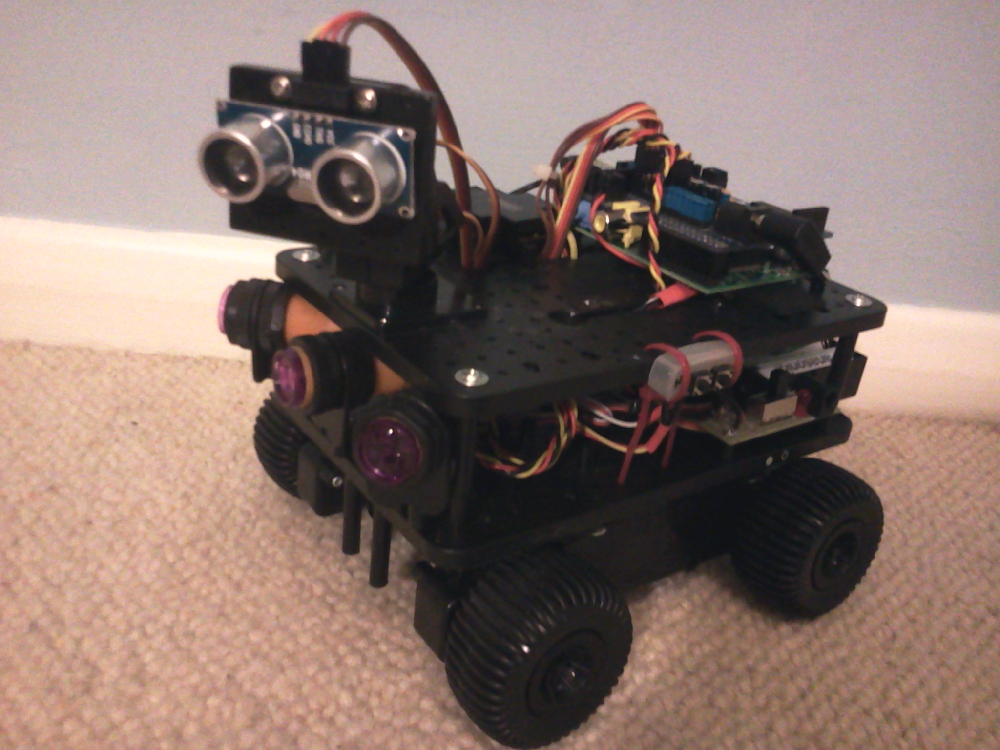
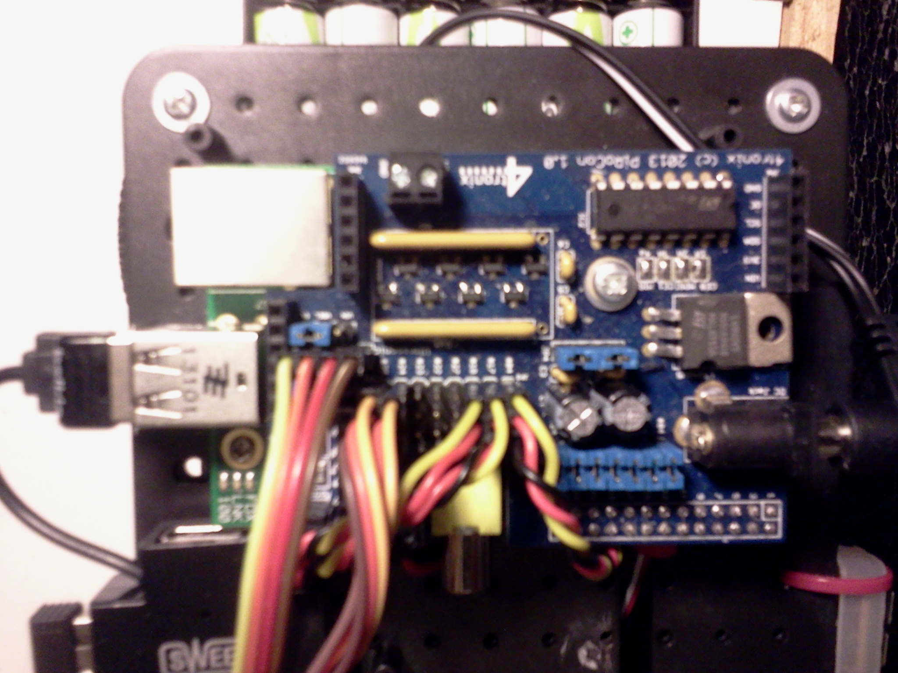
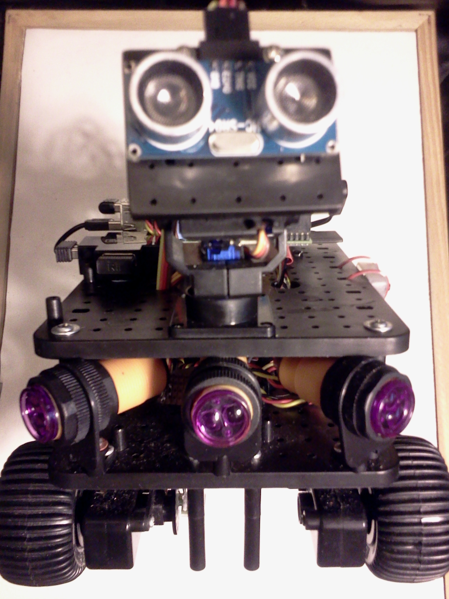

Ray Cannon
{ .byline }

(Or How to control a Raspberry Pi robot from Dyalog APL)
{ .ednote }

## Part One – The Hardware

As you properly know by now, Dyalog APL is available on the Raspberry Pi computer (running Linux), and several APLers have built *robots* controlled from Dyalog (including James and Shaquil, two of Optima’s “Three blind mice”, not to mention Morten). As I often work in the Optima office, I have watched James and Shaquil building their robots that they demonstrated at the Deerfield Dyalog Conference last year, and felt very jealous!

<figure class="right" markdown="1">

<figcaption markdown="span">Assembled Initio Robot Kit</figcaption>
</figure>

For my last birthday (after some not so subtle hints), I was given a 4tronics Initio[\[1\]](#ref1) robot kit with all the trimmings.

So here are my thoughts and experiences with it.

### Background.

I started out with no LINUX experience, and have only ever really used Dyalog under Windows. So every command needed to even copy, rename or move a file, has been a hard learning curve. As to using a computer for real time control, other than programming an Analogue Computer on my Chemical Engineering course back in the early 1970’s, again, I have no experience.

To interact with the ‘outside world’ the Model B Raspberry Pi has many hardware connection points:

- One HDMI port;
- One Composite Video port;
- Two USB ports;
- A network port;
- An audio output (earphone) socket.
- A SD card reader
- A connector for the Raspberry Pi camera.
- And a micro-usb port for its 5V power supply.

In addition it has several *interfaces* for low level peripherals such as the General Purpose Input Outputs (GPIO).

The BCM2835 chip (the ARM chip at the heart of the Pi) has 52 GPIO ports and the Raspberry Pi has exposes 26 of them via its *GPIO header pins* (marked P1 on the Pi’s circuit board). The Pi circuit board exposes other GPIOs, (via P5 and P6) but these do not have *pins* attached and require some soldering if you wish to make use of them.

These General Purpose Input Output pins connect directly onto the BCM2835 ARM chip at the heart of the Pi. These *pins* can be at *ground* 0 Volts (LOW binary 0) or at +3.3 Volts (3V3 HIGH binary 1), and can either be set to *read* (input) or *write* (output) by software.

There are a large number of very cheap +5 Volts *logic* devices such as sensors, LEDs and relays on the market. The GPIO pins allow one to connect these devices to the Raspberry Pi, allowing the Pi to control them or gather information from them.

### Who ordered the Pi and fried chips?

Directly connecting these 5V0 devices to the 3V3 pins will kill the Raspberry Pi dead.

So, one must provide an interface of some sort between the pins and the devices. At its simplest, two resistors of the right value, acting as a voltage divider, will do the trick. There are also many interface boards designed to safely connect the 5V0 devices to the 3V3 GPIO pins.

As an alternative to using the pins, many people have used an Arduino, (which is a micro-controller with number of 5v0 logic pins of its own, controlled via programmes written in C). This is the route that Morten took, and the “mice” followed when building their Robots.

### Old kit bag

In addition to the mechanical Robot parts (wheels, electric motors, gears, chassis, ‘pan and tilt’ mount with servos, battery compartment, an on-off switch), a Raspberry Pi, a 4GB SD card pre-loaded with software, 4 different types of sensors, and a WiFi dongle, my kit contained a PiRoCon (Pi Robot Controller) board that plugged directly into the Raspberry Pi’s P1 GPIO pins.

The PiRoCon board, supplies the Pi with all the power it needs, as well as *exposing* the P1 GPIO pins safely to 5V0 logic. (A bank of eight of Pi’s twenty six GPIO pins are directly available, each with its own Ground and 5V0 supply.)

It also contains a dual h-bridge *L239D* integrated circuit. This can control two electric motors (powered by the PiRoCon board or via a separate supply). It uses four pins:

<figure class="right" markdown="1">

<figcaption markdown="span">PiRoCon board (blue) in-situ</figcaption>
</figure>

- pin 7 controls forward motion on the port side
- pin 8 controls forward motion on the starboard side
- pin 9 controls backwards motion on the port side
- pin 10 controls backward motion on the starboard side

The sensors included in the kit were:

- Two Infrared Obstacle sensors:
- Two light detecting sensors (for following whit lines on the floor):
- Two sensors built into the axils to provide accurate feed back of wheel movements
- One Ultrasonic Distance sensor.

### Is there anybody out there?

The two InfraRed IR Detector 5V DC Switches return a logic *High* signal when an obstacle is detected within range. (The range between 3cm to 80cm is adjustable.) They have a angular beam of about 15 degrees. I later added a third putting one in the centre front pointing forward and the other two on either side, angled to give a 45 degree forward coverage. Each of these each required a GPIO logic pin (plus 5V0 power and ground) so are connected to three of the “bank of eight” mentioned above.

The Ultrasonic Distance sensor consisted of an ultrasonic transmitter and receiver. When activated, it sends out a short set of eight *pings* at 40Kz. The distance can be calculated knowing the speed of sound and measuring the time taken for any echo to be received. Currently this is mounted on a *turret* controlled by servos which allows it to be moved in two dimensions (*Pan* and *Tilt*).

In the early days of radio controlled model aeroplanes (1960’s) lightweight servos were developed for use over radio channels. To keep costs down, multiple servos were controlled on a single channel by using Pulse Width Modulation (PWM).

PMW is a *square* wave (or should that be *rectangular* wave) where the ratio of the duration of HIGH and LOW values vary. A value of On for 100% of the pulse or 0% or any value in between can be set. Thus a *digital* signal, (on or off) can be used to send an analogue *value*. On receiving a 75% PWM signal, the servo would move to its 75% position. My understanding of this, is that this can all be achieved through simple *electronic circuits* requiring no software or micro-computers.

The descendants of these servos are now smaller, lighter and much cheaper than their forbearers, but are still PWM based. My kit contained two PWM controlled servos that are used in the Pan and Tilt mechanism of the turret.

At the current time I am not using either the line following sensors nor the wheel motion sensors.

### Putting it all together.

Mechanical construction of the kit was straight forward, if a little fiddly. The only tools required were cross-headed screwdriver (and a pair of scissors to open some of the plastic packs).

The Raspberry Pi was screwed onto the top deck, and the PiRoCon board simply plugged into the top of the Pi.

The (colour coded-red and black) motor wires were screwed into terminal blocks on the PiRoCon board.

The Servo control wires (brown orange yellow) were plugged on to the 5V0 GPIO pins on the PiRoCon board, as were the IR sensors wires (red black yellow).

I plugged the WiFi USB dongle (supplied) into the Raspberry Pi, and wireless keyboard and mouse USB dongle (not supplied).

Finally I went out and bought two sets of six AA rechargeable batteries.

Once the six batteries were charged, I installed them in the battery compartment, plugged the power lead into the PiRoCon, and connected a monitor up to the PI, I was ready to turn it on.

I almost forgot to place the robot on blocks, as I had been instructed to.

### First Power On

As I powered it up for the first time, all four wheels span for a second or so and stopped. (So that’s why I needed the blocks.) One red LED on the PI, and a red and green LED on the PiRoCon board, and a blank screen.

I quickly discovered that I had forgotten to install the supplied SD card (with the Raspberry Pi’s operating system on it) into the PI!

Power off, install the SD card, and power on again.

Again all four wheels span for a second or so and stopped, the LEDs lit up, then the green LED on the Pi lit up, then the monitor came to life, and the Raspberry Pi booted up.

### The Wheels on the bus go round and round.

As supplied, the software on the SD card logged me on and straight into X. (X the GUI supplied with Linux). I started SCRATCH 4GPIO, selected the MOTOR TEST project from the menu, and ran the test. It worked, the wheels reacted to key strokes, forward back, left and right.

Next I tested the Pan and Tilt. That worked too, but juddered a lot. I saw that it was programmed to move in 5% jumps.

The ultrasonic distance sensor and IR obstacle sensors also worked.

I then reloaded the motor test, disconnected the monitor, put the robot on the floor and tried controlling it via the wireless keyboard. It all worked.

### Scratch to Dyalog

Ok, Scratch (like Turtle graphics in its time) is a great introduction to programming, but you can’t teach an old dog new tricks or an old APL programmer like me Scratch (not because I can’t learn to use it, but because I do not want to).

What I do want to do is to write my robot brain in APL.

My first point: How was I to pass instructions from APL to the Pi’s GPIO pins?

My first idea was to use the Python *Shared Objects* (Window users read Dynamic Link Libraries) that accessed the GPIO pins from APL via `⎕NA` calls. The principle was sound, but the practice failed, due to un-resolved dependency in the Python Shared Objects. (I spent a day following a Google trail that ended up in a flame war between one side saying it was a *bug*, and the other a *feature*.)

I then searched for a C Shared Object and found the `BCM3825` library[\[2\]](#ref2). It is an excellent piece of work written (in C) by Mike McCauley.

This is a C library for Raspberry Pi (RPi). It provides access to GPIO and other IO functions on the Broadcom BCM 2835 chip, allowing access to the GPIO pins on the 26 pin IDE plug on the RPi board so you can control and interface with various external devices.

I had some early success calling this software from Dyalog (running as *root*) via `⎕NA` calls, but in the end ran into too many problems with 64bit integers. (Dyalog APL dose not support 64bit integers as a native type.)

(Do I hear Windows users asking what *root* is? It is the user account with full administrator access. Under LINUX anyone can run a command with root privileges by pre-positioning `sudo` in front on the command on the command line. So entering the command `sudo dyalog control.dws` would run the workspace `control.dws` under Dyalog APL with administrator access rights.)

On Linux (as Unix) hardware devices appear to the operating system as files. The BCM2835 GPIO pins are in the `/sys/class/gpio/` *folder* which require *root* access to read and write to it.

### Blinking Lights

I next discovered that I could from the command line, access the pins directly!

With a LED attached to pin 17 the following will make the LED light up and go out twice:

```
sudo echo 17 > /sys/class/gpio/expand
sudo echo out > /sys/class/gpio/gpio17/direction
sudo echo 1 > /sys/class/gpio/gpio17/value
sudo echo 0 > /sys/class/gpio/gpio17/value
sudo echo 1 > /sys/class/gpio/gpio17/value
sudo echo 0 > /sys/class/gpio/gpio17/value
sudo echo 17 > /sys/class/gpio/unexpand
```

So from Dyalog APL, I should be able type:

```
⎕SH 'sudo echo 17 > /sys/class/gpio/expand'
⎕SH 'sudo echo out > /sys/class/gpio/gpio17/direction'
⎕SH 'sudo echo 1 > /sys/class/gpio/gpio17/value'
⎕SH 'sudo echo 0 > /sys/class/gpio/gpio17/value'
⎕SH 'sudo echo 1 > /sys/class/gpio/gpio17/value'
⎕SH 'sudo echo 0 > /sys/class/gpio/gpio17/value'
⎕SH 'sudo echo 17 > /sys/class/gpio/unexpand'
```

And if Dyalog was started with `sudo` then all I would have to type would be

```
⎕SH 'echo 17 > /sys/class/gpio/expand'
…
⎕SH 'sudo echo 17 > /sys/class/gpio/unexpand'
```

And it works, but it was not very fast

My next thought was to try `⎕ARBOUT`, and with a little help from the guys at Dyalog (via the forum) I worked out by trial and error that what I needed was:

```
'/sys/class/gpio/expand' ⎕ARBOUT  ⎕UCS '17',⎕TC[2]
'/sys/class/gpio/gpio17/direction' ⎕ARBOUT  ⎕UCS 'out',⎕TC[2]
'/sys/class/gpio/gpio17/value' ⎕ARBOUT  ⎕UCS '1',⎕TC[2]
'/sys/class/gpio/gpio17/value' ⎕ARBOUT  ⎕UCS '0',⎕TC[2]
Etc
```

Finally, I ended up with

```
'/sys/class/gpio/expand' ⎕ARBOUT  49 45 10
'/sys/class/gpio/gpio17/direction' ⎕ARBOUT  111 117 116 10
'/sys/class/gpio/gpio17/value' ⎕ARBOUT  49 10
'/sys/class/gpio/gpio17/value' ⎕ARBOUT  48 10
'/sys/class/gpio/gpio17/value' ⎕ARBOUT  49 10
'/sys/class/gpio/gpio17/value' ⎕ARBOUT  48 10
'/sys/class/gpio/unexpand' ⎕ARBOUT  49 45 10
```

And this is FAST!

### Look left, right and left again

Now I can control the motors directly from Dyalog.

Question, how do I produce a PWM signal required for the pan and tilt servos?

Searching the internet, I discovered `ServoBlaster`. This is a well known (in Raspberry Pi circles) piece of software that allows simple command to activate the servos.

Following instructions on the internet, I installed `ServoBlaster` on my machine.

At Pi boot-up time I automatically start `ServoBlaster`. I archived that by placing in `/etc/rc.local` file the following line of code:

```
sudo /home/pi/PiBits/ServoBlaster/user/servod –idle-time=50 –p1pins=18,22 &
```

This command (running as root) tells `ServoBlaster` to run using, pins number 18 and 22 on the Raspberry Pi GPIO header. ServoBlaster *exposes* these as pins 0 and 1. The `idle-time=50` turns the power to the servos off 50 milliseconds after use to save power. The `&` at the end of the line, tells the programme running the `rc.local` script NOT to wait for this command to finish. THIS IS IMPORTANT as the code runs as an endless loop, or it is told to turn itself off.

Since I boot up with an auto-login, but no monitor, I also added into `rc.local` the commands

```
echo 0=50% > /dev/servoblaster
echo 1=50% > /dev/servoblaster
```

These commands move the 'Pan-and-Tilt' servos into their central position.

When there is no monitor attached, this gives me audio/visual warning that the Raspberry Pi has loaded its OS and is now ready to run.

Within APL, I use the code:

```
'/dev/servoblaster'⎕ARBOUT <pin>,61,(⎕UCS <pcent>),37 10
```

Where `<pin>` is 48 for servo 0 and 49 for servo 1, and `<pcent>` is the percentage (as characters – eg '50') to move.

I have a test function that moves the *pan* servo from 50% down to about 10% back to about 90% and back to 50% in intervals of 0.5%. Then it repeats the process using the *tilt* servo. The 0.5% steps creates a very smooth motion.

### There’s magic in my eyes, I can see for miles and miles

My kit came with the HC-SR04 a very cheap (but quite good) ultrasonic distance sensor. The blurb says: “Ultrasonic ranging module HC - SR04 provides 2cm - 400cm non-contact measurement function, the ranging accuracy can reach to 3mm”

Unfortunately, the accuracy is only as good as your *stop-watch*. The 3mm accuracy relates to a time difference of a few microseconds. In a multi-tasking environment such as Linux running multiple threads under Dyalog, starting and stopping a clock cannot hope to achieve anything better that a centimetre or two. And this assumes you have a clock that measures in micro-seconds. `⎕TS` only goes down to milliseconds.

After hunting around, I found I could use the `gettimeofday` and `usleep` function in the `libc.so.6` library that Dyalog uses on my Raspberry Pi.

The `⎕NA` calls that I use are:

```
  ⎕NA'libc.so.6|gettimeofday ={U U} =P'
  ⎕NA'U libc.so.6|usleep U'
```

To get a better reading, I make several calls, throw away the *outsiders* and then take the smallest. Taking the average might at first seem better, but the *clock* should never show a shorter time than it took, but will often show a longer time.

### Departing from the script.

The instructions I got with my first Raspberry Pi, did not tell me how to stop it, so I simply ‘pulled the plug’. However this frequently causes file corruption and is not recommended. It is far better to issue a `sudo poweroff` command. With no monitor or keyboard attached to the robot, this can often be quite tricky. Then I came across a web page that described how to first add a *RESET* button to the Pi, and then a safe *POWERDOWN* button.

The reset switch was the easy one. The unpopulated *Header P6* (on Model B Raspberry Pis only) exposes two points that connected forces the BCM2835 chip to RESET. So adding a *push to make* micro switch across them give one a hardware RESET button. Included in the Initio kit were 40 *header pins strip*. Following instructions on a U-Tube video, I very carefully, soldered two of the header pins into P6 on the Raspberry Pi. I then attached a reset switched recovered from an old PC. This hardware reset required no programming.

Pressing the reset button, will reboot the Raspberry Pi. But unless done after a power down, it is lightly to create file damage.

The web page I had found described exactly how to force a power-down via button to a GPIO pin.

The python script at `flipdot.org/blog/uploads/shutdown.py.txt` does this trick. This bit of code waits until GPIO 31 (exposed as pin 6 on header P5) to be grounded (eg connected to pin 8 on header P5). So installing this script as `/home/pi/shutdown.py`, and adding the line to `crontab -e`

```
@reboot sudo python /home/pi/shutdown.py
```

So out with the soldering iron again, this time adding two pin on to header P5, pins 6 and 8, attaching another *press to make* switch between them, and we are away.

Pressing the power-down button, issues ‘sudo powerdown’ request, and the Raspberry Pi closes down without file damage. Actually this can be controlled by software without a switch being installed. Once set up, to power down, one can simply issuing the command in APL:

```
'/sys/class/gpio/gpio31/value'  ⎕ARBOUT  49 10
```

Pressing the reset button, then boots it up again. See *Part Two* for a description of the software.

### Note for would be Roboteers.

The choice between Pivoted wheels vs Tank tracks.

One of the most fundamental choices one must make is (having decided on a wheeled vehicle, as against say a quad-copter, boat, or articulated legged spider) is the wheel and steering arrangement.

The simplest is a three wheel (or more usually, two wheels on one axle and a *ball*) arrangement. There are two independent motors, one for each of the two drive wheels, and these provide both propulsion and steering. The third wheel or *ball* is free running and able to rotate about a vertical axis. The robot is able to turn (spin) on the spot.

The next simplest is the tracked arrangement (as in a tank) where the left and right hand tracks (each with its own motor) provide both propulsion and by varying the relative speed of the two tracks, steering. It too is able to turn on the spot. A two axle four wheel drive, with the front and back wheels on each side synchronised (where the two axles are parallel and fixed) can be regarded as a tracked vehicle. My Initio has this arrangement.

More complex is two axle four wheel arrangements where one of the axles can rotate about a vertical axis. With steering being provide by a servo via the vertical axis, and propulsion via a single motor but distributed thought a differential gear. This is how most cars work. It is unable to turn (spin) on the spot, and may require significant space to turn though 180 degrees.

The big advantage of the tracked robot is more stable and rugged and better able to transverse uneven ground.

The disadvantage of a tracked robot over a ‘two wheels and a ball’ robot is the motors driving the tracked robot have to be a LOT stronger when turning in a carpet. Turning a tracked vehicle involves some sliding, so the motors must be able to overcome the friction between track and ground. Tracked vehicles tend to tear up the ground. If the motors are not strong enough, the vehicle simply does not turn.

## Part Two – The APL Software

From a control point of view the three wheels and tracked robots can use the same soft ware controlling the two independent motors. The four wheeled *car* requires completely different controls, one program for the steering servos, the other for the propulsion sped and direction.

My Initio can be considered as a tracked vehicle, and requires separate orders to be sent to the left and right hand sides. By varying the relative speed and direction of the two motors, the position of the robot can be fully controlled.

My current code for the robot has evolved over two month, and I am sure will continue to evolve. Initially I was concerned on how would simply control the motors and servos, but later it was about multi-tasking, using the feedback from the sensors. Finally it was about strategy and tactics, and giving it the name ‘PiRat Bot’.

Along the way I become aware of the problems of controlling a Raspberry Pi without a monitor attached in an alien environment without recourse of a known wireless network.

At *Home*, I can simply attach a monitor, keyboard and mouse to PiRat Bot, set it on *jacks* so it does not run away as I power it up, and then test the software in the comfort of my office. At this point I am able to connect PiRat Bot to my local network via WiFi, and take note of the IP address, which the Pi displays on screen each time it boots up.

<figure class="right" markdown="1">

<figcaption markdown="span">Face to face with PiRat Bot</figcaption>
</figure>

Then to test PiRat Bot while running free, I can use PuTTY. Running PuTTY on my desktop PC (or laptop) I can connect via WiFi to the Raspberry Pi and logon using my desktop’s keyboard Mouse and monitor. All PuTTY running on my desktop needs to know is the IP address that the WiFi adaptor is using to connect to my local network.

However, running PiRat Bot away from my home network, I cannot use the local WiFi network, without first connecting to it which would normally require running software and providing network passwords etc. This in turn requires a screen, keyboard and mouse attached to the Pi.

To get round the alien WiFi , I now bring along a WiFi hotspot (supplied by my phone) that the Pi has already been *introduced* to. However, that did not always supply the PI with the same IP address.

My solution to that was to install the free software package `eSpeak`. `eSpeak` converts text to sound which can then be played via a speaker, or headphone, and get it to *say* my IP address.

The final implementation was to add a Bluethooth USB dongle, set up as a A2DP sink and send the spoken IP address to a Bluethooth headset. (“A2DP - The Advanced Audio Distribution Profile is a Bluetooth profile that allows for the wireless transmission of stereo audio from an A2DP source.”)

So now I can, using PuTTY connect to my Raspberry Pi, from my laptop using my phone as a WiFi hotspot. This was done in *anger* for the BAA London meeting on 28th Feb 2014, where Dan Baronet demonstrated how to install Dyalog APL and MiServer on the Raspberry Pi.

Once `eSpeak` was installed, I integrated it with the Dyalog’s `⎕SM` (the character based *screen map* interface), to provide a *spoken menu system*. This allows me to start up PiRat Bot without a screen, but with the audio feedback of the spoken menus, navigate my way around, running applications, and powering down Linux safely.

So now, if I just want to take the robot for a run, I can travel *light*, with just BlueTooth speaker and keyboard needed to accompany the PiRatBot with its BlueTooth adopter. (I no longer need the laptop, phone, WiFi hotspot, or WiFi adaptor, unless I want to debug the APL.)

### PiRat Bot the Amazing Rodent

Initially I tried running an APL thread for each process (eg one for each motor, servo and sensor) with the main thread co-ordinating whole. Named tokens were used (via `TGET` and `TPUT`) to pass information between the threads. I used the analogy of a steam ship, and the Engine Order Telegraph (*chadburn* – Full Ahead, Dead Slow Astern, Stop all Engines) , and quickly replace Left with Port and Right with Starboard (and not forgetting Leslie Phillips “left hand down a bit” in the Navy Lark).

The main thread was the Captain, the sensors threads were port and starboard lookouts, and the motors threads the engine room.

However, this was found to be too erratic, often leading to conflicting orders being sent as obstacles (Icebergs and Sheet Ice) were reported by the lookout while trying to navigate an *inside* right angle bend in a maze.

Eventually after many tests, I went with the much simpler ‘polling in a loop’ method. Once the Tactics on how the input was collected and how to respond to emergency conditions (not bumping into any thing) was decided, I went on to the Strategy.

The problem with a strategy is one needs an objective. ‘Not bumping into anything’ is boring, simply ‘Stop all engines’ achieves that. ‘Not bumping into anything, while moving’ is a lot better, but leads to a *semi-drunken* walk (A random walk avoiding obstacles). I eventually ended up with ‘traversing a maze’ as my objective.

And the strategy I adopted was:

1. Find the nearest wall and move to it.
2. Turn so the wall is on one side (left or right, depending which is nearer).
3. Follow that wall, always keeping it to the same side.
4. Stopping when the task was completed.

To find the nearest wall, PiRate Bot sets the servos to their mid positions, pointing straight ahead, takes some ultra-sound distance readings, notes them down, rotates thought a small angle and repeats the process until a full circle has been completed.

Then turning back to face the direction where the shortest distance was measured, and finally driving forward till the obstacle sensor could sense the wall.

If during the *turning* the (short range) obstacle sensors registered an obstruction, PiRat Bot assumes it is already next to the wall, so abandons (1) and proceeds to (2)

The main difficulty I have with (1) is knowing how far the *small angle* actually is.

What I ended up doing was turning for a ‘fixed short time’ for a ‘fixed number of turns’. The actual length of time spent turning, and the number of turns determined by trail and error. However, depending on the floor surface, and the strength of the batteries, turning for identical periods of time rotated PiRat through different angles. So this is ‘work in progress’.

### Wall of death

The process of following a wall, while always keeping it to one side, is much easier to describe if a adopt one of the sides (say left) and describe following the left hand wall with my left hand always touching it. So while my code follows the ‘selected side wall’ I will describe following the left hand side wall.

While following (running alongside) a wall with an *on/off* obstacle sensor (rather than a distance sensor) one end up turning towards the wall until it is sensed, then turning away from it (till not sensed), then moving a little forward and either ‘reacquiring the wall in the forward movement’, or having to turn back towards the wall to find it again, before repeating the process.

I use the term *over-run* for the act of moving forward for a short distance without left hand *contact* .

In a maze, while following the left hand wall, a right angle turn in the wall is on the *inside* curve when the turn is to the RIGHT, and the *outside* curve when it is to the LEFT.

So when turning to the right, (inside) the turn must start BEFORE the apex is reached.

When turning to the left, (outside) the turn must not start until the apex has been passed.

### The Bot’s not for turning

For PiRat Bot with three forward facing obstacle sensors (one facing dead ahead, and the others pointing to the left and right), an inside curve is simple to detect, as the forward sensors are able to warn of the obstacle ahead.

In the real world with uneven walls, moment to moment feedback from the 3 forward sensors initially resulted in PiRat Bot ‘changing its mind’ repeatedly. Extra code had to be inserted so that it ‘would remember’ which way it was turning. This was especially true when negotiating a *U-Turn* at the bottom of a cul-de-sac.

However, for the outside curve, contact with the left hand has to be lost while the corner is being negotiated, and then has to be re-established before continuing. (Actually this is the same *over-run* process as already described in following the wall.)

In my code, the number of times round the main loop while in the *over-run* phase (derived by trail and error) is currently set at 800. However, this has recently been revised down from 1000, when I moved my *testing grounds* from my study’s carpet onto my bath-room’s quarry tiles.

PiRat Bot’s will need feed-back from the real world if turning ability the *local* surface is to be automatically controlled, rather than using a pre-defined profile as at present. However, I am unsure how best to get this feedback. A three axis accelerometer is looking like the most useful way forward, but that decision is for another day.

## References

1. <a id="ref1"></a> 4tronics Initio  
    [www.amazon.co.uk/Ultimate-4tronix-initio-Complete-Raspberry/dp/B00GEXGW4K](http://www.amazon.co.uk/Ultimate-4tronix-initio-Complete-Raspberry/dp/B00GEXGW4K)
2. <a id="ref2"></a> BCM3825 library  
    [http://www.airspayce.com/mikem/bcm2835/](http://www.airspayce.com/mikem/bcm2835/)
