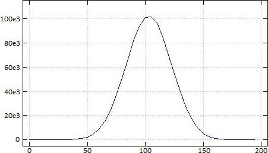

by Roger K.W. Hui
{ .byline }

{ .lead-image }

> The amuse-bouche is the best way … to express big ideas in small bites.
>
> – Jean-Georges Vongerichten, 2002

> Such were the vagaries of what may have been the most powerful computer language ever hatched by a Canadian. Yes, I know that James Gosling, an alumnus of the University of Calgary, was the “father of Java.” He and I have talked about it. And yes, there is now a game called “Perl Golf” in which you try to do the most work in that scripting language with the fewest number of (key-) strokes. Java and Perl are good and useful and popular, but APL was … beautiful.
>
> – Tom Keenan, Business Edge, 2004

**0.   `(x>0)-(x<0)`**

Signum of `x` for real `x` , assuming the values 1 , 0 , or ¯1 according as `x` is strictly positive, 0, or strictly negative. The phrase dates from the earliest days of APL, being found in section 1.4 of *A Programming Language* \[[1](#ref1)\]. Three decades later, the idea was adopted by Knuth \[[2](#ref2)\], who wrote that “Iverson’s convention” led to improvements in exposition and technique. Some writers call these “data-driven conditionals” \[[3](#ref3)\]; during a discussion between Phil Last, John Scholes, and myself it was suggested that they be called “array logic” \[[4](#ref4)\].

The usefulness of array logic in APL is due to the following:

- Boolean functions have value 0 and 1 rather than true and false \[[5, #implementers2](#ref5)\].
- Functions apply to entire arrays, as in, for example, `+/x>100` to compute the number of elements of vector `x` greater than 100 \[[5, #Maple](#ref5)\].
- A simple function precedence (“right to left”).

Amuse-bouches 0, 2, 4, D, and E use array logic.

**1.   `(+⌿÷≢) x`**

The average of `x` . The construct `+⌿÷≢` is a fork, a 3-train. Using `+⌿` and `≢` instead of the more familiar `+/` and `⍴` is superior for reasons described in \[[6](#ref6)\].

**2.   `x⌹x=x`**

A shortest phrase for the average of vector `x` . Note that `+ / ⌿ ÷ ⍴ ≢` are not used. The idea originated with Timo Seppälä at APL82 \[[7](#ref7)\]. To see why it works, start with the definition

`y⌹x ←→ (⌹(+⍉x)+.×x)+.×(+⍉x)+.×y`

which defines the rectangular case in terms of the square case.

<table>
<tr><td><code>x⌹x=x                     </code></td><td>                                </td></tr>
<tr><td><code>x⌹w                       </code></td><td><code>w←x=x</code>               </td></tr>
<tr><td><code>(⌹(+⍉w)+.×w)+.×(+⍉w)+.×x  </code></td><td>definition of <code>⌹</code>     </td></tr>
<tr><td><code>(⌹(⍉w)+.×w)+.×(⍉w)+.×x    </code></td><td><code>w</code> is non-complex                </td></tr>
<tr><td><code>(÷≢x)+.×w+.×x             </code></td><td><code>w</code> is <code>(≢x)⍴1</code>; <code>w+.×w</code> is <code>≢x</code>        </td></tr>
<tr><td><code>(÷≢x)+.×+⌿x               </code></td><td><code>((≢x)⍴1)+.×x ←→ +⌿x</code>             </td></tr>
<tr><td><code>(÷≢x)×+⌿x                 </code></td><td>LHS and RHS of <code>+.×</code> are scalars  </td></tr>
<tr><td><code>(+⌿x)÷≢x                  </code></td><td>                                </td></tr>
</table>

Alternatively, `y⌹x` computes a linear regression for `y` wherein the constant term is the mean of `y` ; that is, the best least square “fit” of a vector by a single number, is its mean.

**3.   `x⍳x`**

Index-of with both arguments being the same, an instance of a “selfie” \[[8](#ref8)\]. `x⍳x` are like ID numbers; questions of identity on x can often be answered more efficiently on `x⍳x` than on `x` itself.

The `x⍳x` selfie occurs in several important and useful computations:

<table>
<tr><td><code>((⍳≢x)=x⍳x)⌿x	    </code></td><td>nub (unique)                                                                    </td></tr>
<tr><td><code>(x⍳x)∘.=(x⍳y)	    </code></td><td>efficient computation for <code>x∧.=⍉y</code> for matrices <code>x</code> and <code>y</code> [<a href="#ref9">9</a>]    </td></tr> 
<tr><td><code>(x⍳x)∘.=(x⍳y)	    </code></td><td>efficient computation for <code>x∘.≡y</code> for non-simple vector <code>x</code> [<a href="#ref10">10</a>]  </td></tr>  
<tr><td><code>(⍉↑x⍳¨x)⍳(⍉↑x⍳¨y)   </code></td><td>inverted table index-of [<a href="#ref11">11</a>]                                </td></tr>
<tr><td><code>(x⍳x) f⌸ y          </code></td><td>equivalent to <code>x f⌸ y</code>                                             </td></tr> 
</table>

**4.   `'.⎕'[x∘.>⍳⌈/x]`**

A bar chart of non-negative integer vector `x`.

```
   x← 3 1 4 1 5 9
   '.⎕'[x∘.>⍳⌈/x]
⎕⎕⎕......
⎕........
⎕⎕⎕⎕.....
⎕........
⎕⎕⎕⎕⎕....
⎕⎕⎕⎕⎕⎕⎕⎕⎕
```

I encountered this phrase when I first learned APL in the mid 1970s. By then, it was part of the APL milieu, found in STATPACK \[[12](#ref12)\] and APL in Exposition \[[13, p.13](#ref13)\]. (I believe I saw it in the former.) The phrase brought home to me that indices can be entire arrays.

**5.   `+\1 ¯1 0['()'⍳x]`**

Depth of parentheses nesting.

```
   x←'⍵((∇<S),=S,(∇>S))⍵⌷⍨?≢⍵'
   x ,[¯0.5] +\1 ¯1 0['()'⍳x]
⍵ ( ( ∇ < S ) , = S , ( ∇ > S ) ) ⍵ ⌷ ⍨ ? ≢ ⍵
0 1 2 2 2 2 1 1 1 1 1 2 2 2 2 1 0 0 0 0 0 0 0
```

The phrase has an ancient and storied history. As recounted by Alan Perlis \[[14](#ref14)\]:

> I was at a meeting in Newcastle, England, where I’d been invited to give a talk, as had Don Knuth of Stanford, Ken Iverson from IBM, and a few others as well. I was sitting in the audience sandwiched between two very esteemed people in computer science and computing — Fritz Bauer, who runs computing in Bavaria from his headquarters in Munich, and Edsger Dijkstra, who runs computing all over the world from his headquarters in Holland.
>
> Ken was showing some slides — and one of his slides had something on it that I was later to learn was an APL one-liner. And he tossed this off as an example of the expressiveness of the APL notation. I believe the one-liner was one of the standard ones for indicating the nesting level of the parentheses in an algebraic expression. But the one-liner was very short — ten characters, something like that — and having been involved with programming things like that for a long time and realizing that it took a reasonable amount of code to do, I looked at it and said, “My God, there must be something in this language.” Bauer, on my left, didn’t see that. What he saw or heard was Ken’s remark that APL is an extremely appropriate language for teaching algebra, and he muttered under his breath to me, in words I will never forget, “As long as I am alive, APL will never be used in Munich.” And Dijkstra, who was sitting on my other side, leaned toward Bauer and said, “Nor in Holland.” The three of us were listening to the same lecture, but we obviously heard different things.

**6.   `x[⍋⍒(⍴x)⍴0 1]`**

Perfect shuffle, a special case of a solution to the more general mesh problem described by Ken Iverson \[[1, §1.9](#ref1)\] and solved by Luthor Woodrum \[[15](#ref14)\]. The phrase was found on the back of I.P. Sharp T-shirts in the 1970s and 1980s.

```
   x←'ABCDEFGHIJKLMNOPQ'
   x[⍋⍒(⍴x)⍴0 1]
IAJBKCLDMENFOGPHQ
```

The phrase `⍋⍒n⍴0 1` is a permutation of length `n` . Its order is the minimum number of times a perfect shuffle has to be applied to yield the original argument \[[16](#ref16), [17](#ref17)\]. The sequence of these orders is A024222 in the indispensible On-line Encyclopedia of Integer Sequences \[[18](#ref18)\].

**7.   `Q←{1≥≢⍵:⍵ ⋄ S←{⍺⌿⍨⍺ ⍺⍺ ⍵} ⋄ ⍵((∇<S),=S,(∇>S))⍵⌷⍨?≢⍵}`**

Quicksort \[[19](#ref19)\].

The “pivot” `⍵⌷⍨?≢⍵` is randomly chosen. `((∇<S),=S,(∇>S))` is a fork, selecting the parts of `⍵` which are less than the pivot, equal to the pivot, and greater than the pivot. The function is recursively applied to the first and the last of these three parts.

```
        ⎕←x←?13⍴20
2 2 7 10 10 11 3 10 14 5 9 1 16
   Q x
1 2 2 3 5 7 9 10 10 10 11 14 16
```

The variant `Q1` obtains by enclosing each of the three parts. Its result exhibits an interesting structure. The middle item of each triplet is the value of the pivot at each recursion. Since the pivot is randomly chosen the result of `Q1` can be different on the same argument.

```
   Q1←{1≥≢⍵:⍵ ⋄ S←{⍺⌿⍨⍺ ⍺⍺ ⍵} ⋄ ⍵((⊂∘∇<S),(⊂=S),(⊂∘∇>S))⍵⌷⍨?≢⍵}
   Q1 x
┌─────────┬─┬────────────────────────────────┐
│┌─┬───┬─┐│5│┌┬─┬───────────────────────────┐│
││1│2 2│3││ │││7│┌─┬────────┬──────────────┐││
│└─┴───┴─┘│ │││ ││9│10 10 10│┌┬──┬────────┐│││
│         │ │││ ││ │        │││11│┌┬──┬──┐││││
│         │ │││ ││ │        │││  │││14│16│││││
│         │ │││ ││ │        │││  │└┴──┴──┘││││
│         │ │││ ││ │        │└┴──┴────────┘│││
│         │ │││ │└─┴────────┴──────────────┘││
│         │ │└┴─┴───────────────────────────┘│
└─────────┴─┴────────────────────────────────┘
   Q1 x
┌────────────────────────────────┬──┬────────┐
│┌────────────────────┬────────┬┐│11│┌┬──┬──┐│
││┌──────────────┬─┬─┐│10 10 10│││  │││14│16││
│││┌─┬───┬──────┐│7│9││        │││  │└┴──┴──┘│
││││1│2 2│┌─┬─┬┐││ │ ││        │││  │        │
││││ │   ││3│5││││ │ ││        │││  │        │
││││ │   │└─┴─┴┘││ │ ││        │││  │        │
│││└─┴───┴──────┘│ │ ││        │││  │        │
││└──────────────┴─┴─┘│        │││  │        │
│└────────────────────┴────────┴┘│  │        │
└────────────────────────────────┴──┴────────┘
```

**8.   `P ← ↑ {(0∘,+,∘0)⍣⍵,1}¨∘⍳`**

Pascal’s triangle \[[20](#ref20)\].

```
   P 10
1 0  0  0   0   0  0  0 0 0
1 1  0  0   0   0  0  0 0 0
1 2  1  0   0   0  0  0 0 0
1 3  3  1   0   0  0  0 0 0
1 4  6  4   1   0  0  0 0 0
1 5 10 10   5   1  0  0 0 0
1 6 15 20  15   6  1  0 0 0
1 7 21 35  35  21  7  1 0 0
1 8 28 56  70  56 28  8 1 0
1 9 36 84 126 126 84 36 9 1

   10 ↑ (,∘.+⍨⍳10) {+/⍵}⌸ ,P 10
1 1 2 3 5 8 13 21 34 55
```

The expression `(0,x)+(x,0)` or its commute, which generates the next set of binomial coefficients, is present in the document that introduced *APL\\360* in 1967 \[[21, Fig.1](#ref21)\] and the one that introduced J in 1990 \[[22, Gc&Gd](#ref22)\]; in *Elementary Functions: An Algorithmic Treatment* in 1966 \[[23, p.69](#ref23)\], in *APL\\360 User’s Manual* in 1968 \[[24, A.5](#ref24)\], in *Algebra: An Algorithmic Treatment* in 1972 \[[25, p.141](#ref25)\], in *Introducing APL to Teachers* in 1972 \[[26, p.22](#ref26)\], in *An Introduction to APL for Scientists and Engineers* in 1973 \[[27, p.19](#ref27)\], in *Elementary Analysis* in 1976 \[[28, ex.1.68](#ref28)\], in *Programming Style in APL* in 1978 \[[29, §6](#ref29)\], in *Notation as a Tool of Thought* in 1980 \[[30, A.3](#ref30)\], in *A Dictionary of APL* in 1987 \[[31, m∇n](#ref31)\], and probably others.

`∘.!⍨⍳n` also computes Pascal’s triangle of order `n` . It is shorter, but is less interesting algorithmically and historically.

**9.   `+∘÷\n⍴1`**

Convergents to the golden mean by continued fractions \[[32](#ref32)\].

```
   +∘÷\16⍴1
1 2 1.5 1.66667 1.6 1.625 1.61538 1.61905 1.61765 1.61818
      1.61798 1.61806 1.61803 1.61804 1.61803 1.61803
   1 ∧ +∘÷\16⍴1
1 2 3 5 8 13 21 34 55 89 144 233 377 610 987 1597
```

**A.   `(2 ÷⍨ ⊢ + ÷)\ n⍴x`**

Convergents to the square root of x by Newton’s method \[[33](#ref33)\].

The operand of `\` is a fork, itself a composition of two forks `(2÷⍨(⊢+÷))` and equivalent to `{0.5×⍵+⍺÷⍵}` .

```
   ⎕←t← (2 ÷⍨ ⊢ + ÷)\ 7⍴2
2 1.5 1.41667 1.41422 1.41421 1.41421 1.41421
   (2*0.5) - t
¯0.585786 ¯0.0857864 ¯0.0024531 ¯0.0000021239 ¯1.59472e¯12
      2.22045e¯16 2.22045e¯16
```

Since the phrase uses only rational operations, it yields rational convergents when applied to rational arguments. The following result is computed in J:

```
2 3r2 17r12 577r408 665857r470832 886731088897r627013566048
      1572584048032918633353217r1111984844349868137938112
```

**B.   `x (+⌿ ×⍤¯1)⍤1 2 ⊢y`**

Inner product using row-at-a-time operation. For example:

```
   x←?3 4⍴100
   y←?4 5⍴100
   (x+.×y) ≡ x (+⌿ ×⍤¯1)⍤1 2 ⊢y
1
```

The main advantages of row-at-a-time over the conventional row-by-column are better cache utilization and ability to exploit sparsity \[[34](#ref34)\] and \[[35, #IC2013](#ref2)\]. Note: The Dyalog implementation of `+.×` is already row-at-a-time, so there is no need to resort to the circumlocution.

**C.   `r←,⍳⊢ ⋄ (r G) ≡ r ∘.{⍺[⍵]}⍨ ↓r G`**

The finite case of Cayley’s theorem \[[36, §4.4](#ref36)\]: every group G is isomorphic to a subgroup of the group of permutations. For example:

```
   ⎕←T←2 2∘⍴¨(4⍴2)∘⊤¨9 6 7 11 13 14
┌───┬───┬───┬───┬───┬───┐
│1 0│0 1│0 1│1 0│1 1│1 1│
│0 1│1 0│1 1│1 1│0 1│1 0│
└───┴───┴───┴───┴───┴───┘
   ⎕←G←∘.(≠.∧)⍨T
┌───┬───┬───┬───┬───┬───┐
│1 0│0 1│0 1│1 0│1 1│1 1│
│0 1│1 0│1 1│1 1│0 1│1 0│
├───┼───┼───┼───┼───┼───┤
│0 1│1 0│1 1│1 1│0 1│1 0│
│1 0│0 1│0 1│1 0│1 1│1 1│
├───┼───┼───┼───┼───┼───┤
│0 1│1 0│1 1│1 1│0 1│1 0│
│1 1│1 1│1 0│0 1│1 0│0 1│
├───┼───┼───┼───┼───┼───┤
│1 0│0 1│0 1│1 0│1 1│1 1│
│1 1│1 1│1 0│0 1│1 0│0 1│
├───┼───┼───┼───┼───┼───┤
│1 1│1 1│1 0│0 1│1 0│0 1│
│0 1│1 0│1 1│1 1│0 1│1 0│
├───┼───┼───┼───┼───┼───┤
│1 1│1 1│1 0│0 1│1 0│0 1│
│1 0│0 1│0 1│1 0│1 1│1 1│
└───┴───┴───┴───┴───┴───┘
```

`T` are the non-singular 2-by-2 boolean matrices, and `G` is its group table under boolean matrix multiplication. The function `r←,⍳⊢` relabels a group table according to its index in its ravel (*cf.* `x⍳x`); such relabelling, like displaying in a different font, does not affect group-theoretic properties.

```
   r ← , ⍳ ⊢
   r G
0 1 2 3 4 5
1 0 4 5 2 3
2 3 5 4 1 0
3 2 1 0 5 4
4 5 3 2 0 1
5 4 0 1 3 2
```

The rows of `r G` are permutations, and the relabeled version of its group table as permutations is the same as the relabelling of the original group:

```
   (r G) ≡ r ∘.{⍺[⍵]}⍨ ↓r G
1
```

**D.   Symmetries of the square \[[36, §4.4](#ref36)\] and \[[37](#ref37)\].**

```
   D8
┌──┬──┬──┬──┬──┬──┬──┬──┐
│⊢ │⍒ │⍒⍒│⍋⌽│⌽ │⍋ │⍋⍒│⍒⌽│
├──┼──┼──┼──┼──┼──┼──┼──┤
│⍒ │⍒⍒│⍋⌽│⊢ │⍒⌽│⌽ │⍋ │⍋⍒│
├──┼──┼──┼──┼──┼──┼──┼──┤
│⍒⍒│⍋⌽│⊢ │⍒ │⍋⍒│⍒⌽│⌽ │⍋ │
├──┼──┼──┼──┼──┼──┼──┼──┤
│⍋⌽│⊢ │⍒ │⍒⍒│⍋ │⍋⍒│⍒⌽│⌽ │
├──┼──┼──┼──┼──┼──┼──┼──┤
│⌽ │⍋ │⍋⍒│⍒⌽│⊢ │⍒ │⍒⍒│⍋⌽│
├──┼──┼──┼──┼──┼──┼──┼──┤
│⍋ │⍋⍒│⍒⌽│⌽ │⍋⌽│⊢ │⍒ │⍒⍒│
├──┼──┼──┼──┼──┼──┼──┼──┤
│⍋⍒│⍒⌽│⌽ │⍋ │⍒⍒│⍋⌽│⊢ │⍒ │
├──┼──┼──┼──┼──┼──┼──┼──┤
│⍒⌽│⌽ │⍋ │⍋⍒│⍒ │⍒⍒│⍋⌽│⊢ │
└──┴──┴──┴──┴──┴──┴──┴──┘
```

A permutation can be represented as an integer vector or as a square boolean matrix with exactly one 1 in each row and each column. Functions `pm←⊢∘.=⍳∘≢` and `mp←⍳∘1⍤1` transform from one to the other.

```
   p                     x
6 3 2 1 5 4 0         96 84 59 5 19 47 36
   pm p
0 0 0 0 0 0 1            x[p]
0 0 0 1 0 0 0         36 5 59 84 47 19 96
0 0 1 0 0 0 0
0 1 0 0 0 0 0            (pm p)+.×x
0 0 0 0 0 1 0         36 5 59 84 47 19 96
0 0 0 0 1 0 0
1 0 0 0 0 0 0
   mp pm p
6 3 2 1 5 4 0
```

`⊢ ⍋ ⍒ ⌽` on permutations produce permutation results. They can be identified with `⊢ ⍉ ⊖⍉ ⊖` on square matrices.

```
   (⊢ pm p) ≡ pm ⊢p
1
   (⍉ pm p) ≡ pm ⍋p
1
   (⊖⍉pm p) ≡ pm ⍒p
1
   (⊖ pm p) ≡ pm ⌽p
1
```

Since `⊢ ⍉ ⊖⍉ ⊖` on matrices are transpositions of the square, then so are `⊢ ⍋ ⍒ ⌽` on permutations. The group table `D8` is a compact presentation of numerous identities involving `⊢ ⍋ ⍒ ⌽` on permutations — `D8[i;0]` composed with `D8[0;j]` is `D8[i;j]` . For example:

| i | j | D8\[i;0\] | D8\[0;j\] | D8\[i;j\] |
| --- | --- | --- | --- | --- |
| 5 | 5 | `⍋` | `⍋` | `⊢` |
| 2 | 2 | `⍒⍒` | `⍒⍒` | `⊢` |
| 1 | 2 | `⍒` | `⍒⍒` | `⍋⌽` |
| 1 | 5 | `⍒` | `⍋` | `⌽` |
| 1 | 6 | `⍒` | `⍋⍒` | `⍋` |

That is, the 2 2 entry asserts that `⍒⍒⍒⍒p ←→ ⊢p` ; the 1 5 entry asserts that `⍒⍋p ←→ ⌽p` ; and so on. The veracity of these assertions can be checked by `(⍎¨D8,¨'p') ≡ ⍎¨(∘.,⍨0⌷D8),¨'p' ⊣ p←?⍨n` .

Finally, per the previous section, `(r D8) ≡ r ∘.{⍺[⍵]}⍨ ↓r D8` .

**E.   `I←{(⍴⍵)⍴(≢⍺)↓i⊣i[i]←+\(≢⍺)>i←⍋⍺,,⍵}`**

Interval index: `⍺` is a sorted (strictly ascending) vector; `⍺ I ⍵[i]` is the least `j` such that `⍺[j]` follows `⍵[i]` in the ordering, or `≢⍺` if `⍵[i]` follows `¯1↑⍺` in the ordering or if `⍺` is empty. The function is named `classify` in \[[36, §1.2](#ref36)\] and is a limited version of the `I.` primitive in J \[[38](#ref38)\].

```
   t ,[¯0.5] ¯1.5 1 4 I t←¯2+⍳8
¯2 ¯1 0 1 2 3 4 5
 0  1 1 2 2 2 3 3
   ¯1.5 1 4 I 2 2⍴5 3.1 4 ¯20
3 2
3 0
   'aeiou' I 'deipnosophist'
1 2 3 4 3 4 4 4 4 2 3 4 4
```

The function can be expressed more concisely and more clearly by use of the `merge` operator, discussed in \[[36](#ref36), [38](#ref38), [39](#ref39)\] and whimsically denoted by `→` :

```
   {(⍴⍵)⍴(≢⍺)↓(+\i<≢⍺)(i→)i←⍋⍺,,⍵}
```

**F.   `¯1+{≢⍵}⌸(⍳41),(5×⍳40)I+⌿?10 1e6⍴21`**

An illustration of the central limit theorem, that the sum of independent random variables converges to the normal distribution \[[38, I.](#ref38)\].

```
   t←¯1+{≢⍵}⌸(⍳41),(5×⍳40)I+⌿?10 1e6⍴21
   ⍴t
41
   5 8⍴t
    0     0     0     0      0     13    28    90
  317   894  2095  4574   8671  15001 24338 36728
51254 66804 82787 93943 101045 101752 96510 85281
70418 54506 39802 27267  16964   9764  5031  2467
 1059   422   136    32      6      1     0     0
```

`t` counts the number of occurrences in the intervals with endpoints `5×⍳40` , of `1e6` samples from the sum of ten repetitions of `?21` . A plot of `t` :



The derived function `{≢⍵}⌸x` counts the number of occurrences of each unique cell of `x` . On 1-byte integers the computation takes only 1.4 times as long as required for the apparently simpler problem `⌈/x` . Thinking about an obvious C implementation for `{≢⍵}⌸x` leads to a non-obvious implementation for `⌈/x` \[[8, §16](#ref8)\] faster than

```
   max=*x++; for(i=1;i<n;++i){if(max<*x)max=*x; ++x;}
```

**The fine print.** The exposition requires: Dyalog APL Version 14.0 or later; `⎕io←0` ; `⎕ml←1` ; `]box on` .

## References

<ol>

		<li>
			<a id="ref1"></a>
		  Iverson, K.E., “A Programming Language”, Wiley, 1962-05:<br>
		  <a href="http://www.jsoftware.com/papers/APL.htm">www.jsoftware.com/papers/APL.htm</a>
		</li>
		
		<li>
		<a id="ref2"></a>
		Knuth, Donald E., “Two Notes on Notation”, American Mathematical Monthly, Volume 99, Number 5, 1992-05-01:<br>
		<a href="http://arxiv.org/PS_cache/math/pdf/9205/9205211v1.pdf">arxiv.org/PS_cache/math/pdf/9205/9205211v1.pdf</a>
		</li>
		
		<li>
		<a id="ref3"></a>
		Scholes, John, “Data-driven Conditionals”, Dyalog Blog, 2014-10-13: <br>
		<a href="http://www.dyalog.com/blog/2014/10/data-driven-conditionals-2/">www.dyalog.com/blog/2014/10/data-driven-conditionals-2/</a>
		</li>
		
		<li>
		<a id="ref4"></a>
		Hui, Roger K.W., Phil Last, and John Scholes, e-mail discussion, 2014-10-18 to -20.
		</li>
		
		<li>
		<a id="ref5"></a>
		Hui, Roger K.W., editor, "Ken Iverson Quotations and Anecdotes”, 2014-10-10:<br>
		<a href="http://keiapl.org/anec">http://keiapl.org/anec</a>
		</li>
		
		<li>
		<a id="ref6"></a>
		Hui, Roger K.W., “On Average”, Vector, Volume 24, Number 2&amp;3, 2010-08:<br>
		<a href="https://britishaplassociation.co.uk/art10500270">britishaplassociation.co.uk/art10500270</a>
		</li>
		
		<li>
		<a id="ref7"></a>
		Azzarello, Arlene, editor, “APL QUOTE-QUAD: The Early Years”, APL Press, Palo Alto, 1982-11:<br>
		<a href="http://www.jsoftware.com/papers/QQ_Early_Years.htm">www.jsoftware.com/papers/QQ_Early_Years.htm</a>
		</li>
		
		<li>
		<a id="ref8"></a>
		Hui, Roger K.W., “Index-Of, A 30-Year Quest”, J Conference 2014, 2014-07-25:<br>
		<a href="http://www.jsoftware.com/papers/indexof/indexofscript.htm">www.jsoftware.com/papers/indexof/indexofscript.htm</a>
		</li>
	
		<li>
		<a id="ref9"></a>
		Hui, Roger K.W., “Dyalog Potential v14.0 Language Features”, Dyalog User Conference, 2012-10-15:<br>
		<a href="http://www.dyalog.com/uploads/conference/dyalog12/presentations/D04_14.0/v14.0_Roger.zip">
        www.dyalog.com/uploads/conference/dyalog12/presentations/D04_14.0/<br>v14.0_Roger.zip
       </a>
		</li>
		
 		<li>
		<a id="ref10"></a>
		Hui, Roger K.W., “A Speed-Up Story”, Dyalog Blog, 2014-11-05:
		<a href="http://www.dyalog.com/blog/2014/11/a-speed-up-story-2/">
       www.dyalog.com/blog/2014/11/a-speed-up-story-2/
       </a>
		</li>
		
		<li>
		<a id="ref11"></a>
		Hui, Roger K.W., “Rank &amp; Friends”, Dyalog User Conference, 2013-10-22:<br>
		<a href="http://www.dyalog.com/uploads/conference/dyalog13/presentations/D08_Rank_and_Friends/">
		www.dyalog.com/uploads/conference/dyalog13/presentations/<br>D08_Rank_and_Friends/
       </a>
		</li>
		
		<li>
		<a id="ref12"></a>
		Smillie, Keith W., “STATPACK: An APL Statistical Package”, University of Alberta, 1968.
		</li>
		
        <li>
        <a id="ref13"></a>
		Iverson, K.E., “APL in Exposition”, IBM Corporation, 1972-01.
		</li>
				
		<li>
		<a id="ref14"></a>
		Perlis, Alan J., “Almost Perfect Artifacts Improve only in Small Ways: APL is more French than English”, APL78, 1978-03-29:<br>
		<a href="http://www.jsoftware.com/papers/perlis78.htm">www.jsoftware.com/papers/perlis78.htm</a>
		</li>
		
		<li>
		<a id="ref15"></a>
		Hui, Roger K.W., “An Amuse-Bouche from APL History”, 2014-10-25:<br>
		<a href="http://www.jsoftware.com/papers/mesh.htm">www.jsoftware.com/papers/mesh.htm</a>
		</li>
		
<p class="pagebreak"><br></p>
		<li>
		<a id="ref16"></a>
		Thomson, Norman, “Jottings 43: A Rippling Good Yarn!”, Vector, Volume 21, Number 3, 2005-05:<br>
		<a href="https://britishaplassociation.co.uk/art10010570">britishaplassociation.co.uk/art10010570</a>
		</li>
		
		<li>
		<a id="ref17"></a>
		Scholes, John, “Ripple”, D-Function Workspaces, 2007-03-05:<br>
		<a href="http://dfns.dyalog.com/n_ripple.htm">dfns.dyalog.com/n_ripple.htm</a>
		</li>
		
		<li>
		<a id="ref18"></a>
		OEIS, “Sequence A024222”, On-line Encyclopedia of Integer Sequences, 2014:<br>
		<a href="https://oeis.org/A024222">https://oeis.org/A024222</a>
		</li>
		
		<li>
		<a id="ref19"></a>
		Hui, Roger K.W., “Quicksort”, J Wiki Essay, 2005-09-28:<br>
		<a href="http://www.jsoftware.com/jwiki/Essays/Quicksort">www.jsoftware.com/jwiki/Essays/Quicksort
		</a>
		</li>
		
		<li>
		<a id="ref20"></a>
		Hui, Roger K.W., “Pascal’s Triangle”, J Wiki Essay, 2005-09-28:<br>
		<a href="http://www.jsoftware.com/jwiki/Essays/Pascal's_Triangle">www.jsoftware.com/jwiki/Essays/Pascal's_Triangle</a>
		</li>
		
		<li>
		<a id="ref21"></a>
		Falkoff, A.D., and K.E. Iverson, “The APL\360 Terminal System”, Research Report RC-1922, IBM 1967-10-16:<br>
		<a href="http://www.jsoftware.com/papers/APL360TerminalSystem.htm">www.jsoftware.com/papers/APL360TerminalSystem.htm</a>
		</li>
		
		<li>
		<a id="ref22"></a>
		Hui, R.K.W., K.E. Iverson, E.E. McDonnell, and A.T. Whitney, “APL\?”, APL90, APL Quote Quad, Volume 20, Number 4, 1990-07:<br>
		<a href="http://www.jsoftware.com/papers/J1990.htm">www.jsoftware.com/papers/J1990.htm</a>
		</li>
		
		<li>
		<a id="ref23"></a>
		Iverson, K.E., “Elementary Functions: An Algorithmic Treatment”, Science Research Associates, Inc., 1966.
		</li>
		
		<li>
		<a id="ref24"></a>
		Falkoff, A.D. and K.E. Iverson, “APL\360 User’s Manual”, IBM Corporation, 1968-08.
		</li>
		
		<li>
		<a id="ref25"></a>
		Iverson, K.E., Algebra: “An Algorithmic Treatment”, Addison-Wesley, 1972.
		</li>
		
		<li>
		<a id="ref26"></a>
		Iverson, K.E., “Introducing APL to Teachers”, IBM Corporation, 1972-07.
		</li>
		
		<li>
		<a id="ref27"></a>
		Iverson, K.E., “An Introduction to APL for Scientists and Engineers”, IBM Corporation, 1973-03.
		</li>
		
		<li>
		<a id="ref28"></a>
		Iverson, K.E., “Elementary Analysis”, APL Press, 1976.
		</li>
		
		<li>
		<a id="ref29"></a>
		Iverson, K.E., “Programming Style in APL”, 1978 APL Users Meeting Proceedings, 1978-09-18:<br>
		<a href="http://www.jsoftware.com/papers/APLStyle.htm">www.jsoftware.com/papers/APLStyle.htm</a>
		</li>
		
		<li>
		<a id="ref30"></a>
		Iverson, K.E., “Notation as a Tool of Thought”, Communications of the ACM, Volume 23, Number 8, 1980-08:<br>
		<a href="http://www.jsoftware.com/papers/tot.htm">www.jsoftware.com/papers/tot.htm</a>
		</li>
		
		<li>
		<a id="ref31"></a>
		Iverson, K.E., “A Dictionary of APL”, APL Quote Quad, Volume 18, Number 1, 1987-09:<br>
		<a href="http://www.jsoftware.com/papers/APLDictionary.htm">www.jsoftware.com/papers/APLDictionary.htm</a>
		</li>
		
		<li>
		<a id="ref32"></a>
		Hui, Roger K.W., “Fibonacci Sequence”, J Wiki Essay, 2005-09-26.
		<a href="http://www.jsoftware.com/jwiki/Essays/Fibonacci_Sequence">
		www.jsoftware.com/jwiki/Essays/Fibonacci_Sequence</a>
		</li>
		
		<li>
		<a id="ref33"></a>
		Hui, Roger K.W., “Newton’s Method”, J Wiki Essay, 2005-10-15:<br>
		<a href="http://www.jsoftware.com/jwiki/Essays/Newton's_Method">
		www.jsoftware.com/jwiki/Essays/Newton's_Method</a>
		</li>
		
		<li>
		<a id="ref34"></a>
		Hui, Roger K.W., “Inner Product — An Old/New Problem”, 2009-06-07:<br>
		<a href="http://www.jsoftware.com/papers/innerproduct/ip.htm">
		www.jsoftware.com/papers/innerproduct/ip.htm</a>
		</li>
		
		<li>
		<a id="ref35"></a>
		Hui, Roger K.W., editor, “APL Quotations and Anecdotes”, 2014:<br>
		<a href="http://www.jsoftware.com/papers/APLQA.htm">
		www.jsoftware.com/papers/APLQA.htm</a>
		</li>
		
		<li>
		<a id="ref36"></a>
		Hui, Roger K.W., “Some Uses of { and }”, APL87, APL Quote Quad, Volume 17, Number 4, 1987-05:<br>
		<a href="http://www.jsoftware.com/papers/from.htm">
		www.jsoftware.com/papers/from.htm</a>
		</li>
		
		<li>
		<a id="ref37"></a>
		Hui, Roger K.W., “Symmetries of the Square”, J Wiki Essay, 2005-11-07:<br>
		<a href="http://www.jsoftware.com/jwiki/Essays/Symmetries%20of%20the%20Square">
		www.jsoftware.com/jwiki/Essays/Symmetries%20of%20the%20Square</a>
		</li>
		
		<li>
		<a id="ref38"></a>
		Hui, Roger K.W., and K.E. Iverson, “J Introduction and Dictionary”, 2011-05-03:<br>
		<a href="http://www.jsoftware.com/help/dictionary/vocabul.htm">
		www.jsoftware.com/help/dictionary/vocabul.htm</a>
		</li>
		
		<li>
		<a id="ref39"></a>
		Scholes, John, “Merge, D-Function Workspaces”, 2014:<br>
		<a href="http://dfns.dyalog.com/n_merge.htm">
		dfns.dyalog.com/n_merge.htm</a>
		</li>
		
	</ol>
