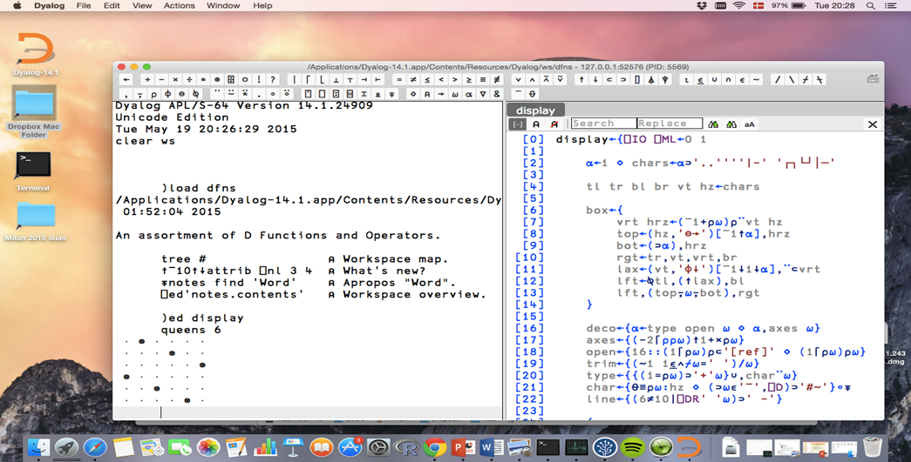
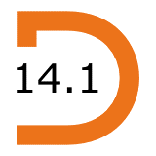
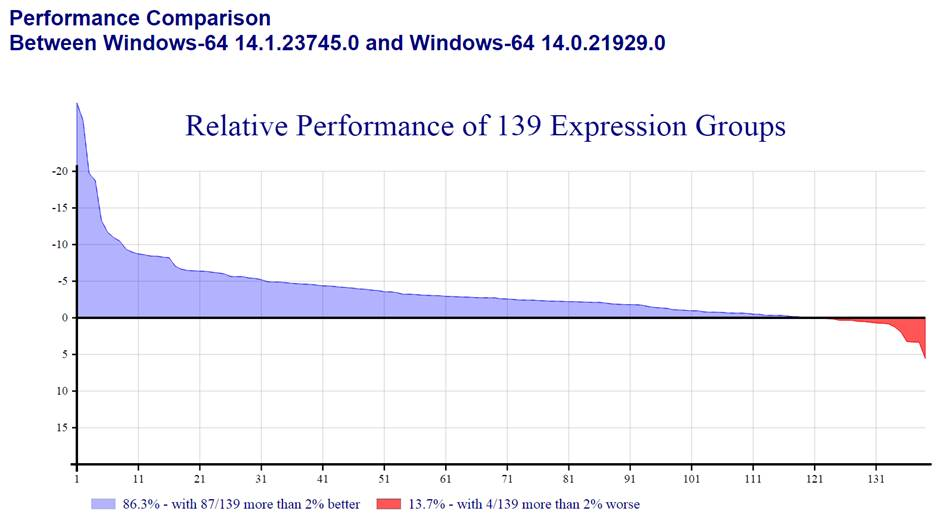

Morten Kromberg
{ .byline }

2015 was another extremely busy year! Version 14.1 was released in May with support for Apple OS X and a host of other features. For an introduction to v14.1, see the last part of this news article.

<figure markdown="1">

<figcaption markdown="span">Dyalog version 14.1 under Apple OSX</figcaption>
</figure>

We were very happy to see that the inaugural two-day Dyalog North America User Meeting [\[1\]](#ref1) in Princeton New Jersey in April managed to gather almost 50 people, and we still had a full house at the global event in Sicily in September[\[2\]](#ref2). We also got some decent exposure outside our own events: A few days after Dyalog’15 Jay Foad and Morten Kromberg presenting and running a full day workshop on Dyalog APL at FuConf’15[\[3\]](#ref3) in Bangalore, India. In June, Morten presented APL in a Google Talk[\[6\]](#ref6).

It is also very encouraging to see that APL users are slowly learning to consume and contribute to various forms of social media, like our #onelinerwednesday[\[4\]](#ref4) tweets and our developer blog[\[5\]](#ref5), which has a contribution by a member of the development team every week or two. If you want to read about proposals for new APL language extensions or other potential features, follow us, *like* us, sign up for our online newsletter. Contribute to the discussions on line via Facebook, LinkedIn and Twitter – keep an eye on global APL meetings at <em>dates for your diary</em>[\[7\]](#ref5). DYNA’16 will be in Princeton again this year on April 18th & 19th, and Dyalog’16 in Glasgow, October 9th-13th.

<figure class="right" markdown="1">

</figure>

## Version 14.1

Version 14.1 was packed with features aimed at increasing developer productivity, hardware utilisation, scalability and the security of your applications. Version 14.1 is also available on a new computing platform, Apple OS X.

### Dyalog for Apple OS X

From version 14.1, Dyalog is proud to include Apple OS X in the family of fully supported platforms - with a new cross-platform graphical development environment to go with it. The new development front-end, dubbed RIDE 2.0, is available under Windows, Linux and OS X – with a browser-based version in the pipeline. From any of these platforms, RIDE can connect to Dyalog APL running on any one of the growing list of supported execution platforms: Mac OS X, Microsoft Windows, IBM AIX, Intel Linux's - and ARM-based Linux's for the Raspberry Pi and other low power computers.

The Mac OS X version includes many of the same libraries and interfaces as Windows and Linux versions, including User Commands and SALT, TCP support (Conga), the MiServer web server/service framework, and the R interface. ODBC support (SQAPL) will follow; please contact Dyalog if you have ODBC installed on your Mac and would like to help with testing.

The new cross-platform RIDE 2.0 is the desktop development environment of choice under Apple OS X and Intel Linux. Under Windows, the *classical* IDE will probably remain the tool of choice for the next several years. The Windows version of RIDE allows debugging of Windows Services and other processes that are unable to interact with a desktop – and also makes it possible to use Windows as a front end for AIX or Linux servers.

### Windows administrator privileges no longer required

Access to administrative privileges are rapidly disappearing in large organisations. In response to this, we have removed the final hurdles that required special privileges, and it will be possible to install version 14.1 (and future versions) of the full Windows development environment without administrative privileges.

### Performance

In recent years, performance has been a major focus of every release. Version 14.1 is no exception, with speed-ups to several primitive functions and operators. A number of idioms have been added or speeded up, including `≢⍴`, `⊣/` and `⊢/`, and special code has been added for the (`?⍴`) train, `∧.=`, `∨.≠`, `∘.=`, n`⍴`scalar, partitioned enclose, and grade on Booleans.

The following chart is produced by our internal performance test suite, which executes about 14,000 expressions to test all primitive functions and operators with arguments of various types and shapes. The results are grouped into 139 categories, and sorted by performance. Blue means the new version performs better than the old:

<figure markdown="1">

</figure>

In addition to the core algorithm improvements, our compiler, which in version 14.0 was only capable of handling a very small portion of a typical application, now supports the most frequently used control structures, and references to global variables and functions. As a result, the v14.1 compiler should be able to compile a significant fraction of functions in many applications. Speed-ups of a factor-of-two for functions with small arguments are likely, but the performance gain will vary depending on language usage. Over the next several releases, the compiler technology should allow further speed-ups as we start applying further optimizations, at the moment it really only removes runtime parsing overheads.

### Futures and Isolates

Futures and Isolates are new language features introduced in v14.0, providing a mechanism to parallelise algorithms and take advantage of multi-core CPUs. In version 14.1, isolates make use of the new Conga security features described below to control access to compute servers. Usability is also enhanced through a new feature which allows service threads such as those used by the Isolate mechanism to be designated as un-interruptible; user interrupts will be passed to application threads instead.

### Shared code files

Isolates are designed to be able to launch computations in separate processes. An experimental feature known as *Shared Code Files* can be used to significantly reduce the startup time of isolates in applications with large code bases. An SCF is a workspace that has been saved in a format suitable for memory-mapping. Attaching even a large SCF to the active process takes a split second, after which references to code or data will cause the operating system to page sections of the memory–mapped file in on demand. Once an SCF is memory–mapped, all processes on the same machine, whether they are isolates or processes running on a Citrix farm or other server architectures, share the mapped memory containing code and application constants. This makes it possible to more or less instantaneously start isolate application processes. It can also be used to significantly reduce the start–up time of large legacy applications. For applications with large bodies of code, memory sharing means that SCF files can significantly reduce overall memory consumption.

### Touch-sensitive and high DPI screens

Touch sensitive screens, and screens that have a high number of *dots per inch* are now widespread. User interfaces that use Windows Presentation Foundation, or HTML5/JavaScript via MiServer or other frameworks, have built-in support for touch-driven input events and usually scale automatically to high resolution devices.

However, many existing applications are still based on the Win32-based user interface tools which are built-in to Dyalog (also known as `⎕WC` GUI), so we have decided to extend these by adding support for modern devices. New events report touch input, and a third co-ordinate system known as *scaled pixels* allows older applications to look crisp and modern on new devices with little or no rewriting of UI definitions. The classical Dyalog IDE itself is implemented on top of the `⎕WC` layer, and also has a much more modern look and feel based on the new features.

### Improved support for WPF and Microsoft.NET

For the benefit of users of Microsoft’s Windows Presentation Foundation, data binding has been extended to provide the ability to bind to a matrix in the APL workspace. This can give significant performance improvements over the existing vector of namespaces approach. A number of other pieces of data binding functionality have also been speeded up.

The new `:Disposable` control structure makes it possible to declare that Dyalog should dispose of Microsoft.NET objects when they are no longer needed: if the referenced objects have a .Dispose method, then it will be called in order to release any unmanaged resources that the object was holding, such as file handles.

### Security

The TCP tool layer known as Conga has been enhanced with several security-related features. Conga can now make use of certificates saved in the Windows Certificate Store when validating secure connections, making it significantly easier to deploy certificate-based solutions on the Microsoft Windows platform.

It is also possible to configure a Conga-based server to filter incoming connections based on the IP (v4 or v6) address of the peer, or by requiring the client to present a certificate with selected attributes. This means that a server applications written in APL can leave the first level of user validation to the communications framework, leading to higher performance and simpler code.

Clear sensitive memory: Version 14.1 adds a feature which ensures that all free memory in the workspace is overwritten. This allows you to ensure that no trace remains in memory, after your application finishes manipulating sensitive data.

### Event Viewer

A number of enhancements have been made to the Event Viewer (many thanks to Kai Jaeger for inspiration):

- User-defined events are now supported
- Selected events can be filtered out from the list of displayed events
- Event information can be copied to the clipboard
- The editor can be opened directly on the call-back function for an event

### JSON Parser & Generator

An experimental built-in function is provided to translate JSON to and from several different APL-friendly formats, including namespaces and nested arrays.

### Editor and Tracer

- The version 14.1 development environment includes a number of minor enhancements designed to improve productivity. Examples include:
- View dfn arguments in debugger: When suspended in a dfn, `⍺`, `⍵`, `⍺⍺` and `⍵⍵` will appear in hints, and can be viewed in a read-only window.
- Align Comments: The 'Align Comments' feature has been extended to work when editing class and namespace scripts.

## References

1. Dyalog North America User Meeting  
    [http://www.dyalog.com/north-american-user-meetings/2015.htm](http://www.dyalog.com/north-american-user-meetings/2015.htm)
2. Sicily, September 6th to 10th  
    [http://www.dyalog.com/user-meetings/dyalog15.htm](http://www.dyalog.com/user-meetings/dyalog15.htm)
3. FuConf’15  
    [http://functionalconf.com/](http://functionalconf.com/)
4. #onelinerwednesday  
    [https://twitter.com/hashtag/onelinerwednesday](https://twitter.com/hashtag/onelinerwednesday)
5. developer blog  
    [http://www.dyalog.com/blog/](http://www.dyalog.com/blog/)
6. Morten presented APL in a Google Talk  
    [https://www.youtube.com/watch?v=PlM9BXfu7UY](https://www.youtube.com/watch?v=PlM9BXfu7UY)
7. Dates for your diary  
    [http://dyalog.com/dates-for-your-diary.htm](http://dyalog.com/dates-for-your-diary.htm)
