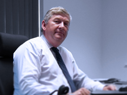

Paul Grosvenor
{ .byline }

<figure class="left" markdown="1">

<figcaption markdown="span">Paul Grosvenor</figcaption>
</figure>

Welcome back to Vector I hope you all enjoy the news, views and muse.

So what has been going on? Well in April and November last year we saw two more Swedish APL group meetings held in Malmo and Gothenburg. About 20 participants attended and discussed a wide range of subjects. A good time was had by all. The next meeting will be held on 1st April in Copenhagen and is being hosted by SimCorp.

BAA London continues to meet every month but now at the Hoop and Grapes, Farringdon Street, London and these are now beginning to be transmitted live via a web link when possible. If anyone is interested to listen in or even attend (which is free) then please join the BAA London Google Group where all the relevant information can be found.

On the 29th May we held our AGM in a combined event with BAA London, held in the Albion, London. The minutes of this meeting are published later in this edition of Vector. Our meeting was a little longer than usual (nearly an hour!) but we did get to discuss a couple of important matters and pass some resolutions.

We are now looking to plan our 2016 AGM and maybe make a whole day of it with presentations from a variety of sources. We will keep you informed.

Please keep your articles coming as without them we will have no Vector. For those of you that do provide articles to us, thank you all for your commitment and support. As always your help in the production of this publication is needed. We know that your time is precious but if you can spare us just a little of it please contact one of the committee members (at the back of this edition) and let us know.

As always your comments are always welcome. Please forward anything you have to editor@vector.org.uk

Thank you for reading and all the very best

**Paul Grosvenor**
