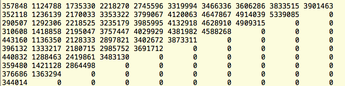
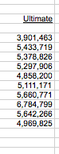
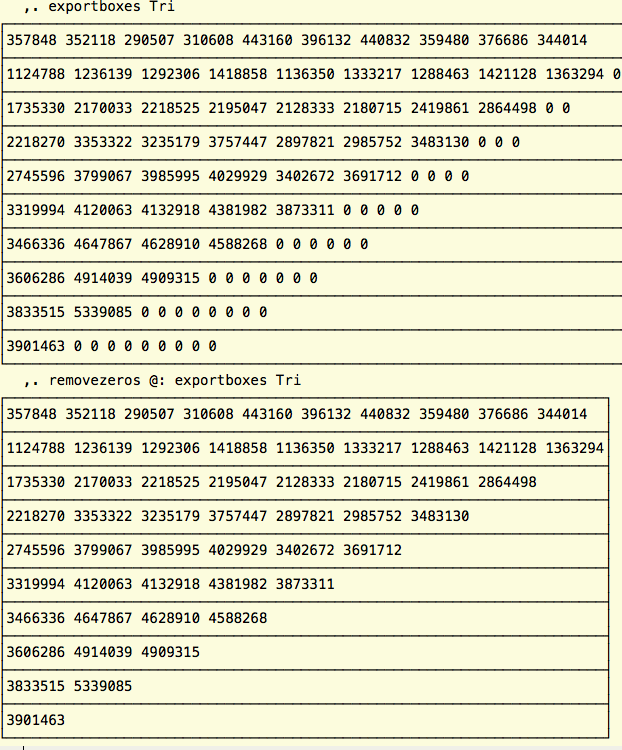
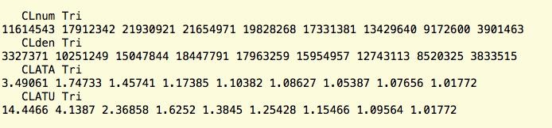
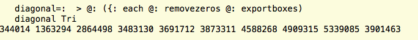
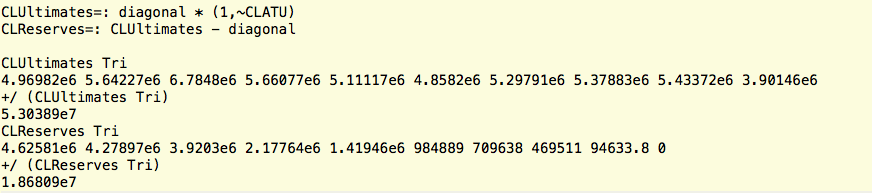

{ .lead-image }

Jeremy Smith  
(actuaryjeremysmith@gmail.com)
{ .byline }

## 1. Introduction

This article is the first in a planned series. My goal is to illustrate how J can be used in an actuarial setting. Although I am a J enthusiast, I do not consider myself to be a highly skilled J programmer. I hope that by introducing these actuarial methods to the J community, my programs can be refined and simplified. All feedback is welcome!

All of the methods in this series will be related to property / casualty insurance (e.g. auto, home, workers compensation). I will attempt to explain the methods in an intuitive, informal manner. Readers wishing to follow a rigorous formal treatment are encouraged to consult “Stochastic Claims Reserving Methods in Insurance”[\[1\]](#ref1). For those readers interested in a “middle ground” textbook (comprehensive, detailed, yet not a formal mathematical treatment with proofs and theorems), “Estimating Unpaid Claims Using Basic Techniques” [\[2\]](#ref2) should be valuable. Not only is [\[2\]](#ref2) freely available online in PDF form, it is also a standard textbook used by the Casualty Actuarial Society for examination purposes.

## 2. General Description of the Chain Ladder Method

Suppose we have the 10 x 10 array displayed in Figure 1.

<figure markdown="1">

<figcaption markdown="span">Figure 1</figcaption>
</figure>

Actuaries call this type of array a *triangle*, for obvious reasons.

This triangle can also be found in Table 1 of “Distribution-free Calculation of the Standard Error of Chain-Ladder Reserve Estimates”[\[3\]](#ref3) (p. 221). Each row can be thought of as an *accident year*, e.g. the numbers in the top row all relate to auto accidents occurring in the first year. Let’s say the first year is 2004 (10 years ago, as of this writing).

For accidents occurring in 2004, the insurance company paid out $357,848 during 2004. The company paid $1,124,788 in total during 2004-2005, and so on. By the end of 2014, the company paid $3,901,463. Assume, for the sake of argument, that nothing ever gets paid after year ten. In that case, we know that $3,901,463 is the final value for 2004. In actuarial parlance, $3,901,463 is called the *ultimate loss* for 2004.

What’s the ultimate loss for 2005? We don’t know. The latest information we have is that the company paid $5,339,085 between 2005-2014 for accidents which occurred in 2005. There’s one more year to go before the payments “reach ultimate”, as actuaries say. The ultimate loss must be estimated; we must guess a value for the blank cell to the right of $5,339,085 in the second row. What to do?

You can do all kinds of things. But one simple thing you can do is consider the previous year, 2004. How much was paid out in the tenth year, as a percentage growth? Answer: $3,901,463/$3,833,515=1.018. Using this information, we can estimate that the ultimate loss for 2005 is $5,339,085 x (1.018)= $5,433,719. (Note that I am using the exact value $3,901,463/$3,833,515 in the previous computation; rounding differences will result if you use the rounded value 1.018).

So now we have an ultimate value for 2005: $5,433,719. Ultimately, this is the amount that the company will pay. Since the company has already paid $5,339,085, the amount remaining unpaid is $5,433,719-$5,339,085=$94,634. This amount is called the “reserve”. It’s how much the insurance company should set aside to pay future claims for year 2005, assuming it believes the method result.

This is what a *reserving actuary* does all day: estimates how much the company needs to set aside as a provision for individual accident years, and in aggregate across all years. It’s a big challenge; many companies have failed after underestimating the required reserves. Many insurance companies have experienced stock price plunges after announcing reserve increases. It’s a challenging task, and even the best possible reserve estimate may prove to be way off the mark as circumstances unfold. The actuary’s responsibility is to calculate a reasonable estimate based on the information known at the time.

Let’s continue our example to build our intuition of this method. What about 2006? $4,909,315 has been paid between 2006-2014 on claims occurring in 2006. We have two years to go! But we know that cumulative payments grow by 1.018 in the final, tenth, year. So we just need to worry about the ninth year. What data do we have?

- For 2004 accidents, payments grew from $3,606,286 to $3,833,515 during the ninth year.
- For 2005 accidents, payments grew from $4,914,039 to $5,339,085 during the ninth year.

We can estimate the ninth year growth factor by calculating a weighted average: ($3,833,515+$5,339,085)/($3,606,286+$4,914,039)=1.077 (rounded; actual value 1.07655…). Since payments will grow an additional 1.018 in year ten, in years nine and ten they’ll cumulatively grow 1.077x1.018=1.096. Thus, the ultimate loss for year 2006 is $4,909,315x1.096=$5,378,826. (See the previous warning about rounding.)

<figure class="right" markdown="1">

<figcaption markdown="span">Figure 2</figcaption>
</figure>

By now you’re probably getting the idea. This process can be carried out iteratively to calculate an ultimate loss for each year. It’s pretty easy to set this up in Excel, which is what most actuaries do. If you use Excel regularly, you might want to try setting up the calculation as an exercise. (The data above can be found in an Excel spreadsheet at the link given in “Mack-Method-handout.xls”  [\[4\]](#ref4)). If you do it right, you should get the values displayed in Figure 2.

Two more vocabulary terms. Factors like 1.018 and 1.0177 (i.e. incremental, year-to-year factors) are called *Age-to-age* or *ATA* factors. Cumulative factors like 1.096 are called *Age to ultimate* or *ATU* factors. Other names are used as well, e.g. link ratios, cumulative development factors (*CDF*), loss development factors (*LDF*). They’re all acceptable but some are ambiguous (e.g. *link ratio* might refer to ATA or ATU factors).

## 3. Why J?

The Excel approach is easy enough and gets the job done, so who needs J? First, an Excel implementation of the Chain Ladder method can be a hassle to modify if the triangle changes size (say, if you suddenly get twenty years of history instead of ten). What if you have a lot of triangles, of various sizes, and need to quickly calculate the Chain-Ladder ultimate losses for all of them? This is where J shines and Excel falters.

## The J code

In general I find it convenient to export triangles into boxes and remove the zero values, because they cause all sorts of headaches. I use the following two functions extensively:

```
exportboxes=:<"1@({~ i.@#)@|:

removezeros=:(#~(~:&0)) (&.>)
```

See Figure 3 for an illustration. I call our triangle `Tri` in this example.

<figure markdown="1">

<figcaption markdown="span">Figure 3</figcaption>
</figure>

Now we’re going to use J’s power to calculate all the ATA factors are once.

```
NB. numerator of the ATA factor calculation
CLnum=: >@:(+/ each @:}.@:removezeros@:exportboxes)

NB. denominator of the ATA factor calculation
CLden=: >@:(+/ each @:(}:@:(}: each @:(removezeros @: exportboxes))))

CLATA=:  CLnum % CLden

CLATU=: |.@:(*/\@:(|.@:CLATA))
```

Figure 4 displays the results of these functions. The ATU factors can be checked against the spreadsheet example given in “Mack-Method-handout.xls” [\[4\]](#ref4), column N (where they are labeled LDF; see section 2 above regarding varied nomenclature).

<figure markdown="1">

<figcaption markdown="span">Figure 4</figcaption>
</figure>

Now we’ll calculate the ultimate losses. First we define a simple utility function which pulls the diagonal off the triangle, except for the top value (which we’re not going to develop, because it has already reached year ten).

```
diagonal=:  > @: ({: each @: removezeros @: exportboxes)
```

<figure markdown="1">

<figcaption markdown="span">Figure 5</figcaption>
</figure>

To calculate the ultimates, we multiply the diagonal by the ATU factors, and append the fully-developed 2004 value.

```
CLUltimates=: diagonal * (1,~CLATU)
```

The reserves are the ultimates minus the diagonal.

```
CLReserves=: CLUltimates - diagonal
```

<figure markdown="1">

<figcaption markdown="span">Figure 6</figcaption>
</figure>

The values for the ultimates and reserves can be crosschecked against the spreadsheet example in “Mack-Method-handout.xls”[\[4\]](#ref4) (columns P and O, respectively). The reserves can also be found in the first column of Table 2 of [\[3\]](#ref3), page 221.

## 4. Conclusion

We have coded J functions, `CLUltimates` and `CLReserves`, that allow us to compute the ultimate losses and reserves, according to the Chain Ladder Method, for each year of a loss development triangle. J’s versatility allows us to compute these values for a large number of triangles at once, of various dimensions. A straightforward way to do this would be to organize the triangles into a master array of boxes, one triangle per box, and run the command `CLUltimates each triangles` (where *triangles* is the array of boxes).

The Chain Ladder method is one of the most basic methods available to Property / Casualty actuaries. Over the years, many more sophisticated methods have been developed. In future articles I hope to illustrate more of these methods in J.

I welcome all comments regarding this article, and am especially eager to receive suggestions on how the code could be improved.

## 5. References

1. <a id="ref1"></a> Wüthrich, Mario V., and Michael Merz, “Stochastic Claims Reserving Methods in Insurance,” Wiley Finance, 2008
2. <a id="ref2"></a> Friedland, Jacqueline, “Estimating Unpaid Claims Using Basic Techniques”, Casualty Actuarial Society, 2010
3. <a id="ref3"></a> Mack, Thomas, “Distribution-free Calculation of the Standard Error of Chain-Ladder Reserve Estimates”, ASTIN Bulletin 23/2, 213-225
4. <a id="ref4"></a>  [https://www.casact.org/education/spring/2006/handouts/Mack-Method-handout.xls](https://www.casact.org/education/spring/2006/handouts/Mack-Method-handout.xls)
