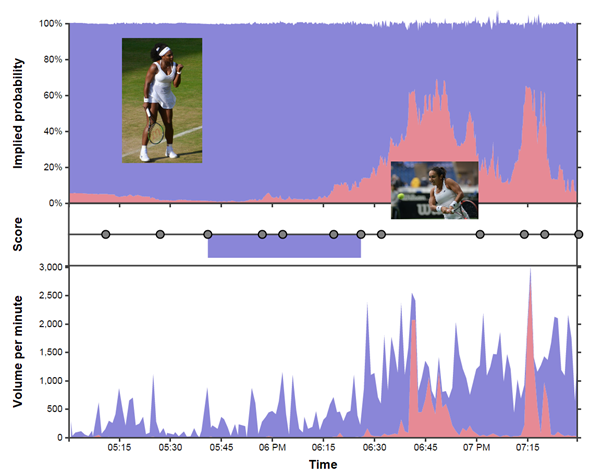
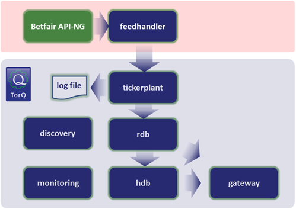
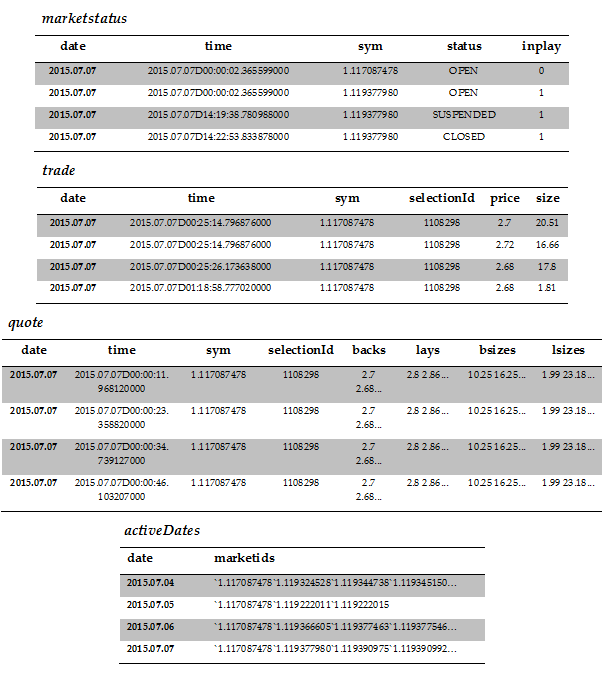
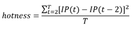
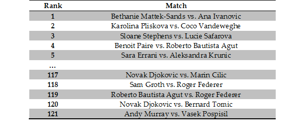
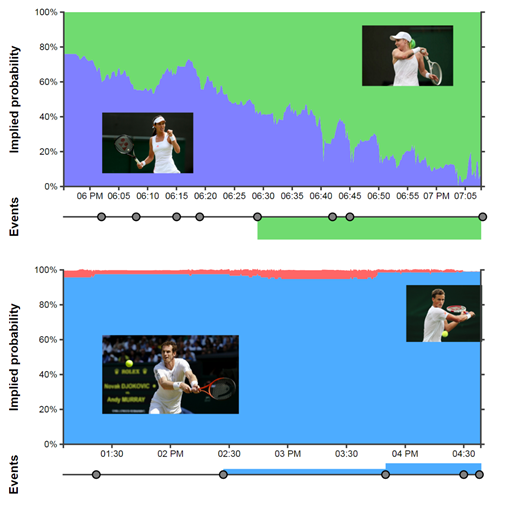

Matthew Doherty & Paul Loughran
{ .byline }

{ .lead-image }

<figure markdown="1">

<figcaption markdown="span">Figure 1 – Using data to tell the story of a good game of tennis.</figcaption>
</figure>

## Introduction

In tennis the addict moves about a hard rectangle and seeks to ambush a fuzzy ball with a modified snow shoe. In q the addict moves algorithms from their mind to the central processing unit in as few ASCII characters as possible and seeks to puzzle both fellow programmers and their future selves.

kdb+ and q sometimes have a reputation as a difficult language to learn, in part due to the terse and sometimes intimidating syntax. So why do so many trading rooms across the world rely on this technology to handle huge real-time flows of financial data? There are two main reasons:

- Speed: its column oriented nature makes it very fast at the kind of calculations necessary in trading applications.
- Scope: kdb+ is both a programming language and a database, so the majority of an application – from data capture and storage through to real-time and historical analysis – can all be done in the same technology.

Like many APL heritage languages, q makes the barrier between thinking of a solution to a problem and then implementing it very narrow. The terse syntax represents a trade-off: in exchange for a slightly steeper learning curve we get an incredibly expressive high-level tool for solving problems.

So, what was all that stuff about tennis then? kdb+ is a full database system built on top of the q language, and its main application is as a system for the capture, storage and analysis of timeseries data. In this article we’re going to describe an interesting and slightly out of the ordinary application of kdb+: the collection and analysis of sports exchange data. Specifically, we’re going to look at in-play betting data captured from [betfair.com](http://www.betfair.com)[\[2\]](#ref2) during the oldest tennis tournament in the world, the 2015 lawn tennis championships at Wimbledon.

For the uninitiated, sports exchanges are similar to traditional bookmakers in that they offer odds for the outcomes of events, but with one fundamental difference: they act like a marketplace – matching one user with another – rather than taking any positions themselves. They essentially operate in the same way as financial exchanges such as the LSE and NASDAQ, but trading bets instead of securities. Data from sports exchanges are a deeply fascinating treasure trove, rich with information, so here we’re going to demonstrate a way to capture this data and use the analytical power of kdb+ to glean some insights (and hopefully have a little fun).

## Data capture & TorQ

The kdb+ language is very small: the download from kx.com of the most recent version comes in at less than 300KB. In addition to the core language, since we want to run a complete data capture and analysis system without reinventing the wheel, we have used a framework. We chose to use the open-source TorQ from AquaQ Analytics which gives us the basis of a production kdb+ system by adding some core functionality and utilities on top of kdb+, allowing us to focus on application specific data capture and analysis logic. The basic TorQ architecture is shown in Figure 2, with the additional data connector (or feedhandler) for [betfair.com](http://www.betfair.com)[\[2\]](#ref2) which we’ve added. The feedhandler we’ve written for this application retrieves live trade and quote data from betfair.com via the JSON API-NG. It handles authentication, parses the returned JSON data, joins the appropriate metadata and pushes data to the tickerplant. We can gather data for multiple “markets” – in this case tennis matches – at set intervals of our choosing.

<figure markdown="1">

<figcaption markdown="span">Figure 2 – TorQ architecture for capturing data from betfair.com. Our custom feedhandler gathered data from the API-NG, which was then stored and queried in the TorQ architecture.</figcaption>
</figure>

The data we capture is stored in four main tables, with the schema and some sample data shown in Figure 3. So let’s explain what we have here a little. The columns sym and selectionId are identifiers for the market and outcome i.e. the tennis match and the winning player. In the marketstatus table we have updates on the status of particular matches; when betting starts, when the market is in-play and when the match finishes and the market closes. The trade table contains information on matched trades and their size, while the quotes table contains market depth. In betting parlance back means you’re betting on a particular outcome happening, while lay means that you’re betting against that outcome. On a sports exchange backs are matched to lays in the same way bids are matched to offers in a traditional financial exchange. In the case of tennis where there are only two outcomes backing one is the same as laying the other. Finally the activeDates table contains information on which markets were traded on which dates. This is important as kdb+ stores data to disk on a daily basis, so by knowing which date partitions to look at for a particular match we can improve performance significantly.

<figure markdown="1">

<figcaption markdown="span">Figure 3 – schema of our tables with a few rows of sample data</figcaption>
</figure>

So using our system we are able to capture the complete state of the betting market for multiple matches at set intervals, and have the live data available for querying along with the complete history which is persisted to disk at the end of each day. This data is particularly interesting as the state of the market at any given point tells us what the market thinks the chance of all given outcomes are at that time. We can look into the collective mind of all sports bettors! We pointed this system at each game in the Wimbledon championships where match odds were available and collected market snapshots every fifteen seconds. This is a tremendously rich dataset, so the question is what are we going to do with all this data?

## What makes a good game of tennis?

One thing we thought could be interesting to figure out – purely from this live betting data – is which games were the best. So what makes a good game of tennis (or any sport)? What makes a game exciting to watch? The question is almost philosophical in nature, and of course we can’t fully answer it, but we can make an attempt! Obviously if you have a personal stake in the match – if it’s your country/team/favourite player – you’re going to enjoying watching more. Betting data can’t tell us anything about this. What it can do however, is give some insight into which games are the most interesting for neutral watchers. Fellow blogger Todd Schneider[\[1\]](#ref1) asked the same question, and proposed the following formula to answer it:



In q, once we have a timeseries of implied probability for a given event, this calculation can be written concisely as:

```
select hotness:(avg xexp[;2] IP - xprev[8] IP)%`time$max[time]-min[time]
    from odds
```

We have a timeseries with a frequency of fifteen seconds so we can use `xprev[8]` to easily compare with odds two minutes in the past. So what does all this mean? This equation assumes that if the odds move a lot during the match then the match is more exciting. So a closely fought back-and-forth game where the outcome is uncertain gets a higher “hotness” score than a match where a favourite walks to an easy straight sets victory. From our quotes table we can calculate the mid-price at any given point i.e. the market agreed fair odds for an outcome. From these odds we can calculate the implied probability (IP) of this outcome i.e. according to the odds what is the chance of this player winning? Now, to calculate “hotness” we take the IP of a given outcome at some point during the match and the IP of the same outcome two minutes later, square it, and sum this number for every point throughout the match. His gives us a good measure of how much the odds where moving during the game. We add constant T to adjust for the length of the match and we have our hotness rating! Obviously hotness is only an estimate of good a match was and doesn’t include many important factors, but it will at least give us some idea of how interesting a game is, and it provides a nice demo of using kdb+ to ask a question of a dataset!

```
getHotness:{[id]
  dates: exec date from activeDates where any each marketids in\: id;

  / find the volume traded for each market (outcome) of each game
  sizesbyselectionandmkt:sum {[x;y]
      select sum size by sym, selectionId from
      aj[`sym`time;
         select time, sym, selectionId, size
             from trade
             where date = x, sym in y;
         select from marketstatus where date = x]
      where inplay, not status = `CLOSED
   }[;id] peach dates;

  / which market had the biggest volume in each game?
  highestvolselection:select sym,selectionId
      from sizesbyselectionandmkt
      where size = (max;size) fby ([] sym);

  / find the live odds for that market
  odds:raze {[x;y]
    select from
    aj[`sym`time;
       select time,sym,back:backs[;0],lay:lays[;0]
           from quote
           where date = x, ([] sym;selectionId) in y;
       select from marketstatus where date =x]
    where inplay, not status = `CLOSED
   }[;highestvolselection] peach dates;

  / find the mid and implied probability from the quotes data
  odds:select time, sym, IP: 100 * 1 % mid
      from select time, sym, mid: avg each flip (back;lay) from odds;

  / and calculate the hotness!
  hotness:select hotness:(avg xexp[;2]IP-xprev[8]IP)%`time$max[time]-min[time]
      by sym from odds;
  :hotness;
  };

/ sample function execution
getHotness[`1.117087478`1.119324528`1.119344738 …]
```

Figure 4 – kdb+ code to query our tables and return the hotness for each event. The id arguments represent individual events and have the form R.ID, where R is a region identifier and ID is an event identifier.
{ .caption }

Before we can apply the formula above we must first process our raw odds data. The code in Figure 4 demonstrates the full procedure to derive the hotness score of a given list of distinct markets from our data tables. It might look somewhat dense at first glance, but it’s doing quite a bit of analysis for us. For each match:

- first we determine which market was the most active
- retrieve the odds from this market while this game was being played
- calculate the implied probability from these odds
- calculate the hotness for this match

We take advantage of some of the unique features of kdb+, one of which is the asof join (or `aj`). This is a special type of timeseries join which is used to join on event data as of a given point in time. A typical example of this in financial data is joining on quote data to trade data, an `aj` can be used to join the prevailing quotes as of the time a trade has been executed. In our case we have used an `aj` to quickly filter out only trades and quotes that were published whilst the market was *in-play* i.e. we joined on the market status as of the time of our odds data. Another useful function utilised in the code is `fby`, which is short for *function by*. This has been used to identify the outcome on each market which had the largest volume of trades executed, the most traded outcome should makes for the best quality (least noisy) data set from which to derive the hotness score. The fby makes it possible to identify this within a single select statement as opposed to using one select statement to find the total traded for each market and outcome and then a further select statement to determine the highest traded outcome within each market. The calculation of the traded volumes and implied probability makes use of the multithreaded capabilities of kdb+. Queries which run over a number of partitions in a historical database (HDB) are ideal candidates to be executed in parallel (even more so if the database has been segmented over multiple disks with separate I/O controllers). This is done by writing a lambda which is executed for a list of dates using the peach adverb. Once we have extracted our timeseries of quotes data for the most highly traded outcome for each market, we calculate the mid-price and from this the implied probabilities. Finally hotness is calculated in a single line (as shown previously) by taking the implied probabilities for each market and then applying Schneider’s formula.

So we collected live odds data for 427 matches played a Wimbledon; a total of well over ten million data points. The algorithm shown above can calculate the hotness for all these games in just over one second. For many of these games the markets were not very active – not many people were betting – so the live odds may be noisy due to the low volumes. If we filter out matches where less than £1 million was matched, we’re left with 121 matches. For reference the most popular game of this year’s championships – the final between Novak Djokovic and Roger Federer – saw over £30 million matched on in-game betting. So you could say betting on tennis is fairly popular! Ranking these high-volume games by “hotness”, we can see what the best and worst matches of this year’s Wimbledon were! The top and bottom games are shown in Figure 5.

<figure markdown="1">

<figcaption markdown="span">Figure 5 – the best and worst games according to their ‘hotness’ at the 2015 Wimbledon lawn tennis championships</figcaption>
</figure>

According to our algorithm the best tennis match at Wimbledon this year was between Ana Ivanovic and Bethanie Mattek-Sands in the second round, where the world number 175 knocked out the ex-world number one and Wimbledon semi-finalist. The worst game was the quarter final matchup between Vasek Pospisil and our very own Andy Murray, where the Scot won 6-4 7-5 6-4, breaking his opponents serve exactly three times: enough to win the match and no more. So the good news is it seems to work! These games seem like reasonable candidates for the best and worst games played this year. Another notable observation from this result is that most of the best games are women’s while the worst are men’s; this could be because men’s games are longer at five sets and therefore less susceptible to upsets and sudden shifts in the odds, or simply a reflection of the fact that men’s tennis is generally more predictable than women’s. It is worth noting that while these calculations were run on data after collection, our architecture allows us to run it just as easily on live data as it is collected.

## Telling a story with the data

So we’ve got some idea now of which games were the best and worst, but what actually happened in those games? What do they look like? We were able to use the data we’ve collected to distil the game down to a single number – the hotness – but we can also use this data to tell the story of those games, which is nice because I’m sure all bar the most avid tennis fanatics can’t remember them!

<figure markdown="1">

<figcaption markdown="span">Figure 6 – The story of the best and worst games, told using betting data.</figcaption>
</figure>

So in Figure 6 we can see a time-series of the implied probability of each player winning throughout the game. We can see these odds move in response to various events in each game such as break points. Our boring game looks somewhat like a piece of modern art: just one big block of colour! On the other hand the game between Mattek-Sands and Ivanovic was clearly a closely fought, back and forth affair. Each shift in odds corresponds closely to an in game event: for example at around 06:15 Ivanovic breaks serve, but around four minutes later Mattek-Sands breaks straight back. Similarly we can see the three occasions Andy Murray broke serve as very small blips in the odds (if we squint and look very close).

The stack graphs plot the chance of each player winning at each time during the match. In the top plot Mattek-Sands is in green, while Ivanovic’s win chance is in purple. On the bottom Murray is in blue while Posposil is in red. The events plot underneath each graph shows the set score and some key events that happened during the game (see interactive graphics [\[5\]](#ref5))

If we look back to Figure 1 we can also see the story the data tells for one of the most interesting games in the championship. The nail-biter between perhaps the best ladies player of all time – Serena Williams – and the British hope Heather Watson. This game ranked 16th in hotness, but the added interest due to a home player doing so well is not really captured in the data. We can see the game start of looking a lot like Murray vs. Pospisil, but Heather starts to make herself heard in the second and third sets, setting up a nail biting finish.

This use case of capturing betting data is a nice example of the main two steps typically involved when using kdb+ in any business application:

- develop a data connector specific to the data source, in this case a connector for the betfair API-NG
- add business logic to our gateway to ask question of our data, in this case our hotness calculation

This standard `kdb+` framework allows us to easily take advantage of the disaster recovery, system monitoring, unified on-disk and in-memory data access via the gateway, and a range of other functionality. in our business application. If any readers are interested in reading more on the TorQ, or this framework for collecting sports exchange, both are open-source and available on github[\[3\]](#ref3)[\[4\]](#ref4).

## References

1. <a id="ref1"></a> Schneider, Todd W., “What Real-Time Gambling Data Reveals About Sports: Introducing Gambletron 2000”  
    [http://toddwschneider.com/posts/what-real-time-gambling-data-reveals-about-sports-introducing-gambletron-2000/](http://toddwschneider.com/posts/what-real-time-gambling-data-reveals-about-sports-introducing-gambletron-2000/)
2. <a id="ref2"></a> [http://www.betfair.com](http://www.betfair.com)
3. <a id="ref3"></a> [https://github.com/AquaQAnalytics/TorQ](https://github.com/AquaQAnalytics/TorQ)
4. <a id="ref4"></a> [https://github.com/picoDoc/betfair-data-capture](https://github.com/picoDoc/betfair-data-capture)
5. <a id="ref5"></a>Interactive graphics  
    [http://www.picodoc.org/wimbledon-2015-the-best-and-worst-games/](http://www.picodoc.org/wimbledon-2015-the-best-and-worst-games/)
