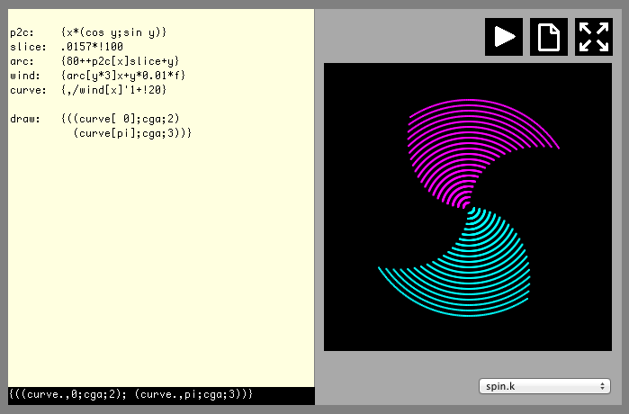
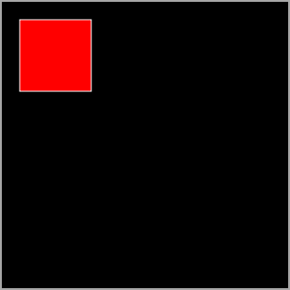
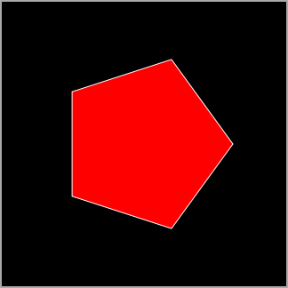
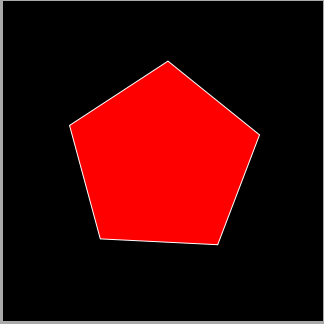
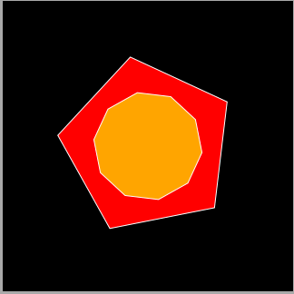
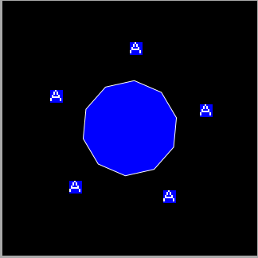
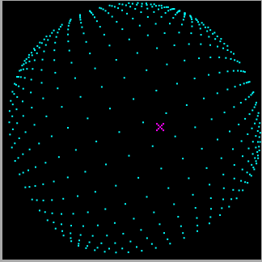
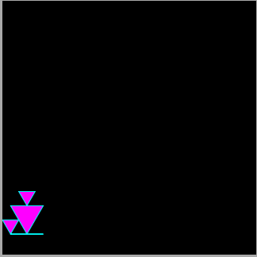

John Earnest (johnearnest@gmail.com)
{ .byline }

{ .lead-image }

This article describes <cite>iKe</cite>[\[1\]](#ref1), a browser-based environment built on the K programming language for creating interactive, animated applications. It discusses the motivations and design considerations behind the project, and walks through the process of developing a simple program using the tool.
{ .abstract }

## Background

K has a well-earned reputation for high performance data analysis among the financial community. While K 2.0 was packaged with a facility for creating graphical user interfaces (GUIs), newer releases of the language have moved away from directly supporting user-facing or interactive applications.

In December of 2014, I began work on an open-source implementation of a K interpreter[\[2\]](#ref2) intended to be compatible with the as-of-yet unreleased <cite>K5</cite>[\[3\]](#ref3). My principal goal in this project was to attempt to make K accessible to a broader audience, lowering the barriers to entry. With this in mind, I chose to write my interpreter in JavaScript, allowing anyone with a web browser to follow a hyperlink and immediately begin experimenting with the language. I carefully separated all IO capabilities from the core interpreter, permitting the creation of multiple "frontends" to suit different applications, starting with a command-line REPL and followed quickly by an HTML-based user interface for the web.

K's ability to concisely express interesting programs struck me as uniquely well-suited to *Live Coding*, in which programmers interactively and improvisationally develop audiovisual programs, sometimes before an audience. I was also inspired by <cite>Forth Haiku</cite>[\[4\]](#ref4), a site which allows users to write and share tiny programs written in a dialect of Forth augmented with the ability to render graphics and animations.

Array languages are at their best when operating on large chunks of contiguous data, and many livecoding related tasks (transforming screen coordinates, physics simulations, audio synthesis, etc.) fit well into this mold. By augmenting K with appropriate IO functions it is possible to create a fun and engaging tool for exploring topics that are far outside its usual niche.

## The Tool

The iKe user interface consists of a text editor pane on the left and a preview region on the right. As programs are modified, pressing shift and the return key simultaneously will re-evaluate the contents of the text editor. If a smaller region of the program is selected, this will instead only evaluate that portion of the program. The result of any evaluated expression will be displayed in a status bar below the text editor. A programmer can flexibly use these facilities to peer into the data of a running program or redefine procedures without restarting execution.

<figure markdown="1">

<figcaption markdown="span">The iKe user interface</figcaption>
</figure>

On the upper right are a series of buttons to toggle execution, share the current program or toggle fullscreen mode, respectively. Sharing a program makes use of the <cite>Github Gist</cite>[\[5\]](#ref5) system to create a URL that can be distributed to other users which will automatically run the current program and permit modification of a copy. The ease of sharing and building on programs created in this way helps iKe serve as an ambassador for array languages.

In addition to the standard collection of K operators, iKe includes predefined procedures and constants which are useful for experimentation, including a Perlin Noise generator, a full set of trigonometric functions and their hyperbolic counterparts, a set of predefined color palettes and a built-in bitmapped font. iKe exposes a variety of callbacks for responding to keyboard and mouse input, as well as a generic animation timer. Output can come in the form of drawing filled polygons or paletted bitmaps, or playing audio samples.

## Developing a program

Drawing in iKe always comes down to producing tuples. The structure of these tuples determines their interpretation. If a tuple contains two elements- a list of drawing coordinates and a list of colors- it will be drawn as a closed, filled polygon. To begin with, let's draw a red square near the top left corner of the display:

```
,((10 10;50 10;50 50;10 50);("white";"red"))
```

<figure class="right" markdown="1">

<figcaption markdown="span">Drawing a fixed polygon.</figcaption>
</figure>

As you can see, the first color is used as an outline color, and the second as a fill color. iKe permits any color format which browsers recognize, giving us a great deal of flexibility and a wide range of built-in colors to choose from. The drawing coordinate system counts left to right and top to bottom along the X and Y axes, respectively. The dimensions of the display are 160x160 pixels by default, and the constants `w` and `h` can be used to query these dimensions.

Let's make a general procedure for building regular polygons with a given number of sides. The simplest approach is to generate a range of fractions of 2π. `pi` is another handy predefined constant:

```
  {(2*pi%x)*!x}4
0 1.5708 3.1416 4.7124
```

We can then convert these angles from normalized polar coordinates to cartesian coordinates. Pick your favorite factoring:

```
  {(cos;sin).'\:(2*pi%x)*!x}4
(1 0 -1 0
 0 1 0 -1)

  {{(cos x;sin x)}(2*pi%x)*!x}4
(1 0 -1 0
 0 1 0 -1)
```

Finally, scale these points to an appropriate radius and translate them to the center of the display. We'll also need to take the transpose of our result to get coordinate pairs in the order iKe expects:

```
  {+80+50*{(cos x;sin x)}(2*pi%x)*!x}4
(130 80
 80 130
 30 80
 80 30)
```

Bringing everything together, a complete iKe program using this definition:

```
ngon: {+80+y*{(cos x;sin x)}(2*pi%x)*!x}
,(ngon[5;50];("white";"red"))
```

<figure class="right" markdown="1">

<figcaption markdown="span">Drawing a procedurally generated pentagon.</figcaption>
</figure>

Up to this point, we've been drawing a single static image by creating a program whose last expression returns an appropriate tuple. To create an animation, we must define a niladic procedure named `draw`. If present, this definition will be called 30 times per second and the result will be drawn. Throughout our code, we can also use the variable `f`, a frame counter which increments automatically every time the display is updated. By adding an appropriately scaled value to the radii we compute in `ngon` we can make the shape smoothly rotate:

```
ngon: {+80+y*{(cos x;sin x)}(f*.07)+(2*pi%x)*!x}
draw: {,(ngon[5;50];("white";"red"))}
```

<figure markdown="1">

<figcaption markdown="span">A rotating pentagon.</figcaption>
</figure>

To draw more shapes, it's simply a matter of modifying `draw` to return more tuples. Note how they're drawn back-to-front in the order they appear:

```
ngon: {+80+y*{(cos x;sin x)}(f*.07)+(2*pi%x)*!x}
draw: {((ngon[ 5;50];("white";"red"   ))
        (ngon[10;30];("white";"orange")))}
```

<figure markdown="1">

<figcaption markdown="span">Stacked polygons.</figcaption>
</figure>

If a tuple is given a third element, it represents drawing a bitmap. The third element should be a matrix of indices to the color list. The first element gives a list of the positions where the top left corner of of the bitmap will be drawn. The built-in variable `text` contains a list of 8x8 boolean matrices comprising a font:

```
text@0+"A"
(1 1 1 0 1 1 1 1
 1 1 0 1 0 1 1 1
 1 1 0 1 0 1 1 1
 1 0 1 1 1 0 1 1
 1 0 0 0 0 0 1 1
 0 1 1 1 1 1 0 1
 0 1 1 1 1 1 0 1
 1 1 1 1 1 1 1 1)
```

With a small tweak to our existing program, we can draw bitmaps instead of the vertices of a polygon. It will be necessary to offset the coordinates to center each bitmap and floor the coordinates so that the bitmaps are drawn at integral positions to avoid blurring.

```
ngon: {+80+y*{(cos x;sin x)}(f*.07)+(2*pi%x)*!x}
draw: {((_-4+ngon[ 5;50];("white";"red");text@0+"A")
        (    ngon[10;30];("white";"orange")))}
```

As the scene grows in complexity, we can also factor `draw` apart to keep the code easier to follow:

```
ngon:    {+80+y*{(cos x;sin x)}(f*.07)+(2*pi%x)*!x}
palette: ("white";"blue")
letter:  text@0+"A"
letters: {,(_-4+ngon[5;50];palette;letter)}
decagon: {,(ngon[10;30];palette)}
draw:    {letters[],decagon[]}
```

<figure markdown="1">

<figcaption markdown="span">Polygons and bitmaps.</figcaption>
</figure>

Hopefully this has been enough to provide a taste of what working with iKe is like. The Github repository includes many more elaborate examples.

<p class="caption center">
	<!--
    
    --> 
    <br><br>
	Panning around a hyperbolic projection (top) and a Lindenmayer System visualizer (bottom).
</p>

## Conclusions and future work

We have seen how iKe enables the creation of graphical programs with K. Leveraging the web browser as a distribution platform lowers barriers to experimentation with the language and allows users to easily share their work and spread awareness. The ideas embodied in iKe could easily be translated to other array languages, and may help APL and J appeal to an entirely new audience.

There are still interesting IO facilities available in web browsers which could be exposed to iKe- for example, network communication via AJAX and the WebSockets protocol. The *oK* interpreter leaves substantial room for improving execution performance, and iKe may benefit from experimentation with selectively recompiling K code directly into JavaScript or exposing more pre-built library functions which can take care of "heavy lifting" such as image compositing operations. Alternatively, I could explore building a system similar to iKe which ran natively on desktop operating systems. While this would require more user effort to install and set up, it could leverage the much faster official K implementations sold by Kx Systems. Finally, there is always room for improved documentation. iKe includes a manual and a collection of example programs, but guided tutorials and screencasts can improve accessibility and provide a gentler learning curve for beginners.

1. <a id="ref1"></a>iKe [http://github.com/JohnEarnest/ok/tree/gh-pages/ike](http://github.com/JohnEarnest/ok/tree/gh-pages/ike)
2. <a id="ref2"></a>oK [http://github.com/JohnEarnest/ok](http://github.com/JohnEarnest/ok)
3. <a id="ref3"></a>K5 [http://kparc.com](http://kparc.com)
4. <a id="ref4"></a>Forth Haiku [http://forthsalon.appspot.com](http://forthsalon.appspot.com)
5. <a id="ref5"></a>Gist [http://gist.github.com](http://gist.github.com)
