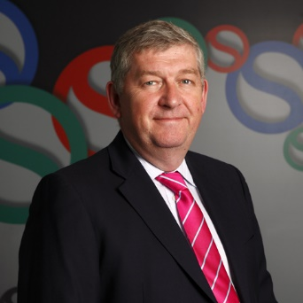

Paul Grosvenor – Managing Director
{ .byline }

<figure class="right" markdown="1">

<figcaption markdown="span">Paul Grosvenor</figcaption>
</figure>

The last few months have been very busy for us. We have seen a considerable interest shown in our COSMOS product with our support and maintenance customers also being very active. All good news particularly in these times. It seems to me that the long promised ‘green shoots’ have well and truly started to appear, businesses feel livelier and more willing to do business and the atmosphere somewhat fresher.

Our newest apprentice, Callum, has successfully completed his training and has been taken on by us as a full–time member of staff now as an APL programmer. Callum brings considerable knowledge with him of things other than just APL and is already proving to be a very valuable member of staff. Within the next few days our next APL programming apprentice, James, will be starting with us and we look forward to introducing him to the rest of the APL community. James will bring our apprentice tally up to five.

Our first apprentice intake (they started with us four years ago now) continue to go from strength to strength. Sam concentrating on APL programming and James on IT Support. Both are doing great work and becoming stronger day by day.

The whole apprenticeship exercise has proven to us that bringing in new blood and training to the required standard can be done and is cost effective. We hope to continue this process and will keep you all informed with progress; watch this space …

We started to design and build our own data analysis and visualisation tool some time ago now and finally things are starting to move. The American markets seem to be moving again and whilst slow there are visible signs …. If this continues then our operations in America and Sweden are likely to get larger.

Optima works closely with APL companies all around the world and we continue to look for ways in which we might collaborate or just simply share ideas. We would like very much to hear from anyone in the APL community who might like to work with us or simply discuss issues.

If you are from a larger company have you ever considered sharing staff or getting involved in non-confidential strategy meetings to consider potential ways forward? Our view is that the more ways we can help each other the easier it could be to overcome some of the barriers we all face each day. If you have any views or ideas on this then please contact me – paul@optima-systems.co.uk .

Overall we are looking forward to a number of APL events being held this year and being actively involved with projects for the APL community.

All of us here at Optima hope you are experiencing a similar upturn in fortunes and we look forward to hearing your news in the forthcoming conferences.

Best regards to all

**Paul Grosvenor**
