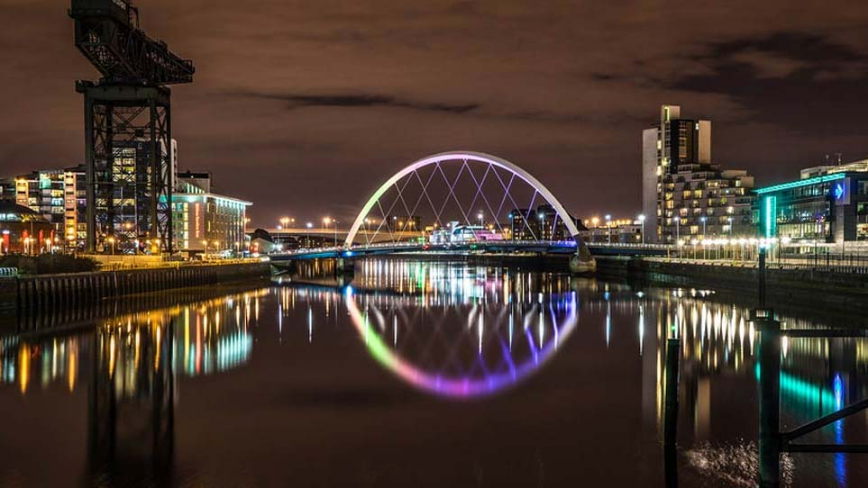
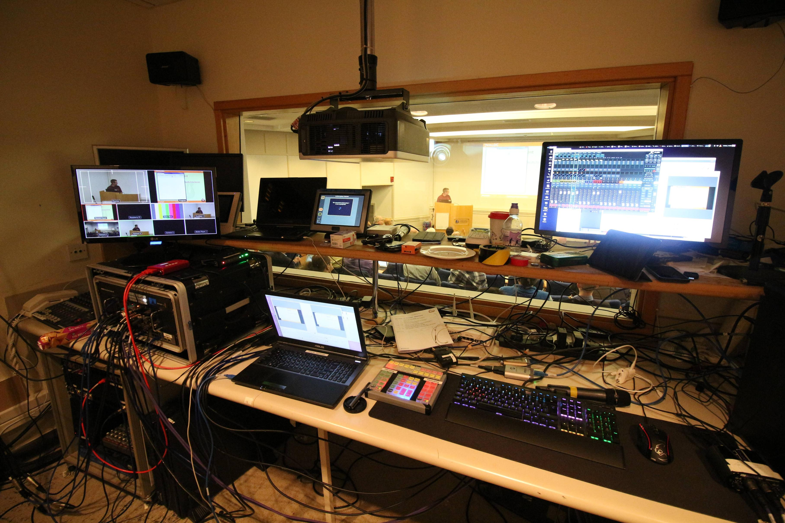
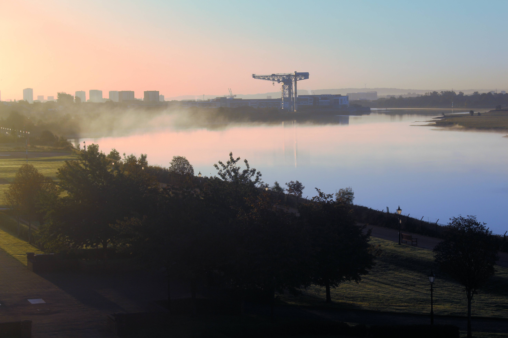
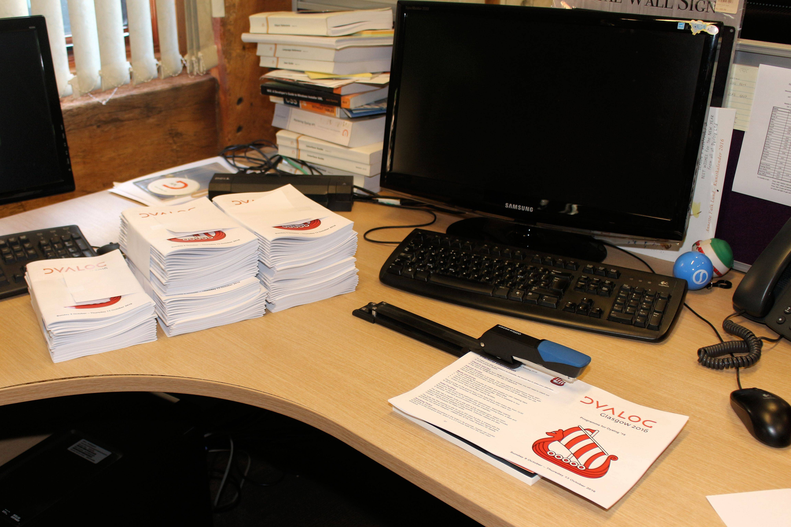
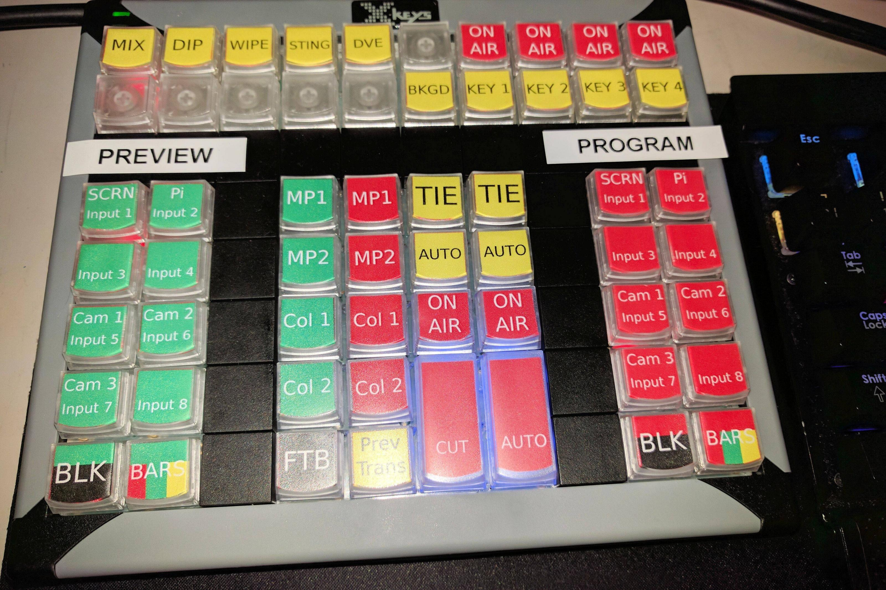
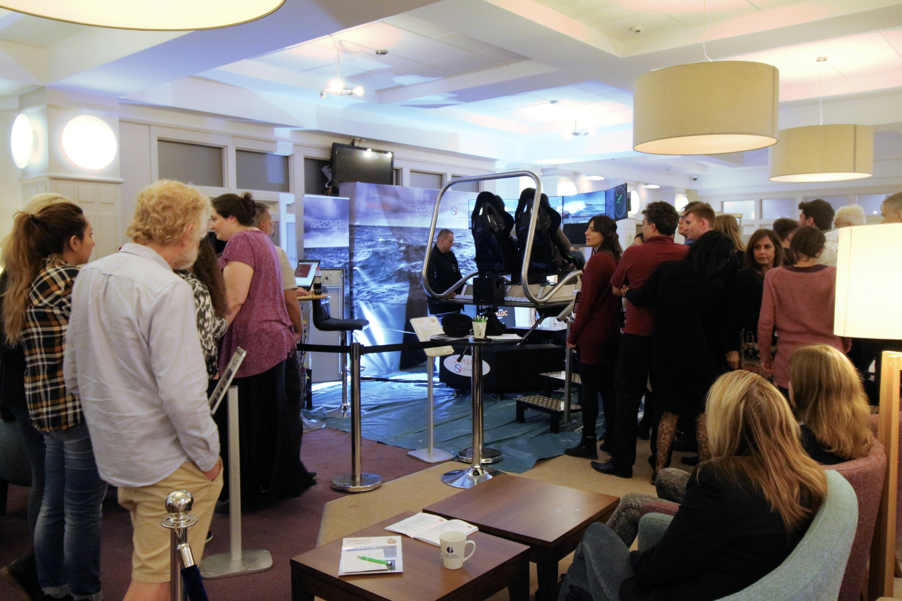
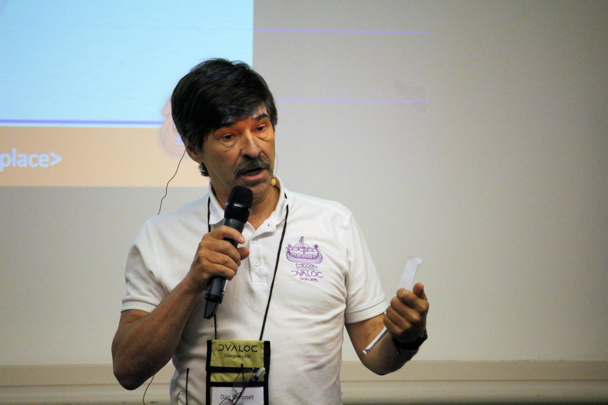

{ .lead-image }

The 2016 Dyalog user meeting took place at the Golden Jubilee Conference Hotel in Glasgow in early October and, in collaboration with the BAA, included a celebration of the 50 year anniversary of APL. The anniversary content was streamed live over the internet and all of the presentations were recorded for posterity; the videos and other materials are available on the [Dyalog website](http://dyalog.com/user-meetings/dyalog16.htm). This article attempts to add a new perspective - an insight into the event from an insider's view.

<figure class="left" markdown="1">
{ style="width:100%" }
<figcaption markdown="span">View of the auditorium from the AV control room.</figcaption>
</figure>

For everyone here at Dyalog, the annual user meeting is a lot of work but also hugely rewarding. Over the last few years the attendance has exceeded 100 people (at Dyalog '16 it was 106 plus a further 15 partners and guests) and above all else, the APL community is such that as well as being customers, these are also old friends we enjoy meeting up with in both a professional and social environment.

As hosts we get to talk about the new things we've been working on and, importantly, we get crucial feedback from the people who will be using them. The meetings may sometimes feel a bit chaotic or a presentation may not be as slick as it might be - but that's mostly because professional presentation is not a day-to-day job for any of us. But with practice we hope that we're getting a little bit better at it every year!

So, here follows a few of the things that made Dyalog '16 memorable to us.

## Preparing for the unexpected

The user meetings are meticulously planned but each year we brace ourselves for one or two unexpected surprises - and not without reason:

- At Dyalog '14 in Eastbourne, the banquet dinner was arranged to be at the restaurant at the end of the pier but just a few weeks before the user meeting began that pier burned down. The event was very hurriedly rearranged and held instead - very successfully - at the Grand Hotel, and hopefully no-one noticed the change of plan (the burned-out pier itself was difficult to miss, though).
- Flash floods struck mid-way through Dyalog '15 in Sicily and many bedrooms were flooded; the banquet room was flooded; the main auditorium was flooded. This was more difficult to disguise but things were moved and everything proceeded as planned - indeed, “blitz spirit” may even have made the event more successful.

Dyalog '16 was, technically, the most demanding we had attempted - so there were plenty of things to go wrong. Much effort went into ensuring we were as prepared as possible, but some of the more worrying things were:

- Most of the AV equipment was new and could only be tested in rehearsals at the Dyalog offices. We had never edited and streamed live before.
- JD's presentation required a Mac, an additional webcam and several Android devices to connect - not just to each other but also to the projection system so they could be seen and recorded, as well as a reliable internet connection. An entirely independent network was needed to achieve all this.
- Tomas Gustafsson's Stormwind simulator had been run on motion platforms before, but not the specific one we had at the meeting.

In the end, most things went as planned and those that did not were managed. Read on for those issues that did occur!

## Timeline

The user meeting involves just about everyone at Dyalog. Preparations for the event started as soon as Dyalog '15 finished - the venue was confirmed and booked first, well before Christmas. The International APL Problem Solving Competition, which culminated with awards to the winners at the user meeting, was devised in November and ran throughout the year. Planning for the celebration of 50 years of APL was under way with the BAA for much of the year. Throughout the year there were also tasks such as getting the registration website running, designing the year's logo and getting it on the various handouts and publicity. Serious planning of the programme of events started with the workshops around June and the presentations shortly after. Finally, in the last week before the meeting, everyone at Dyalog was in the UK putting the finishing touches to presentations and workshops, frantically preparing all the materials, and getting everything working.

## Choosing the venue

This was the first Dyalog user meeting to take place in Scotland.

Finding a venue is always a difficult process. As it turns out, we were very happy with this one: Glasgow, the fourth largest city in the United Kingdom, has good transport connections, is within the Scottish lowlands and has the highlands and Edinburgh within easy reach for those who wished to extend their visit. The Golden Jubilee Hotel (or, The Beardmore Hotel as it was named when booked) is a dedicated conference hotel with the facilities needed to host a user meeting of 120 people - including, rarely, an auditorium with tiered seating. The staff were very attentive and we had all the technical expertise we needed on-hand when we needed to integrate our AV equipment with theirs.

It overlooks the River Clyde and it's always good when we can illustrate the event with a view such as this one:

<figure class="right" markdown="1">
{ style="width:100%" }
<figcaption markdown="span">Morning mist on the Clyde as seen from the hotel.</figcaption>
</figure>

A couple of planning visits were needed - to understand the facilities available, the logistics of getting everyone there, and to arrange the menus and entertainment, etc.

Holding the event in the UK doesn't appeal to everyone - it's nice to have it somewhere warmer, especially when it comes to evening socialising - but having the venue close enough to visit regularly and somewhere where all the equipment can be transported by car, has significant advantages.

## Producing the programme

This year it was quite difficult to fit the programme of events into the usual Sunday to Thursday format - nearly half of the non-workshop time was dedicated to the anniversary celebrations but Dyalog still wanted to include the usual mix of its own and user presentations. The Viking Challenge (traditionally on Wednesday afternoon) was the Stormwind competition and an ideal evening activity, so it moved to Tuesday evening. The rest of the content was squeezed in by keeping the presentations short (most were 30 minutes long; only one was more than 45 minutes) and by pushing the days' start and end times as far as possible.

In the end, the 30 and 45 minute presentations worked well - long enough for meaningful content but short enough to keep things moving and interesting. We'll likely retain the format in future years.

<figure class="left" markdown="1">
{ style="width:100%" }
<figcaption markdown="span">Stapling programmes.</figcaption>
</figure>

The printed programme, like all the paper printed materials, was produced in-house - if for no other reason than because the content includes synopses and so on which are never finalised in time for the two or three day turnaround a print shop would require. So instead, the day before the equipment gets sent to the venue, the office copier runs flat-out to print them all and they're assembled by hand. Very low-tech, but effective!

## New AV equipment

Jason had a new box of toys this year with which to record the presentations. It included a 4K camera and everything needed to edit the video and projector streams in real time during the presentations - the upshot of which is that we were able to stream the APL at 50 celebration content live as it happened and spend significantly less time in post-production when getting the presentations ready for publication. Indeed, the limiting factor in getting those videos published is no longer the time needed to prepare them but the review and approval process.

<figure class="right" markdown="1">
{ style="width:100%" }
<figcaption markdown="span">AV controller keyboard.</figcaption>
</figure>

The finished videos are in HD quality and an advantage of the higher resolution 4K camera is that it allows panning and zooming from fixed camera footage - thereby largely removing the need for someone to stand with the camera and physically do that. The finished recording of the interview of John and Geoff switches between multiple camera angles but the “separate” cameras are in fact just different parts of the one 4K feed.

## Morten and Gitte's Iverson award

This was the event at which Morten and Gitte were presented with their Iverson Awards - bestowed upon them by the Special Interest Group on APL of the Association for Computing Machinery (ACM SIGAPL) and presented at the banquet dinner by Paul Grosvenor as chairman of the BAA, with an introduction by Brian Becker.

Those who had been in the know beforehand had kept it secret so that the award came as a surprise to as many people as possible - especially Morten and Gitte themselves, of course. That was no small feat as quite a lot of people had been involved - the petition to SIGAPL recommending Morten and Gitte was signed by 17 members of the APL community including seven past winners, and 11 of these were present at the user meeting. In addition, two or three Dyalog people were told shortly before the user meeting started so that the appropriate arrangements could be made for the presentation. One of those was Jason, who was asked to set up cameras in the room, which he did on the pretence of filming the address to the haggis at the start of the meal. One other person in Dyalog found out on being asked to proof-read the artwork for the presentation plaques - a worthwhile exercise given that at least one other Iverson Award plaque out there apparently has the recipient's name on it spelled incorrectly!

The secrecy seems to have worked - Morten and Gitte, and most of the attendees, appeared to be taken by surprise. And Dyalog is very proud of the fact that five of its 22 staff are now Iverson Award winners.

## Stormwind

We were very pleased to have Tomas Gustaffson's Stormwind simulator at the user meeting - and, thanks to sponsorship by Optima Systems, it was on a full motion platform which was brought over from Ireland by Simotion, a specialist Virtual Reality company.

<figure class="left" markdown="1">
{ style="width:100%" }
<figcaption markdown="span">The Viking Challenge.</figcaption>
</figure>

The success of this met and exceeded all expectations - it was a real focal point in the hotel auditorium, and made for a great social event outside of the presentations.

We were, of course, lucky that Tomas was still able to attend following his motorcycle accident - he did so suffering ten fractures to his ribs. As this was the first time he had had first-hand access to the platform he spent the first day working with Simotion making adjustments so that it responded exactly as he wanted it to. In the course of the testing one person managed to throw their boat around more heavily than expected and break the platform in the process, but fortunately it was repairable.

## Fifty years of APL

The fifty years of APL celebrations were jointly organised with the BAA, and both the BAA and Optima systems were instrumental in helping make this a success. It was especially pleasing to welcome members of the wider Array Programming community to the event.

## Bloopers

It was a relief that after the fire and flood of previous years, nothing so dramatic occurred this year. It was, however, unfortunate that the week of the user meeting coincided with Yom Kippur, the holiest day in the Jewish calendar, as this may have prevented some people from attending, and a few minor mishaps did occur along the way:

- The wrong rubber ducks were ordered for part of the Viking challenge prizes. The right ones were hastily obtained but in the meantime we have some unexpected additions in the Dyalog collection.
- The conference pack hand-outs included shower jackets with the user meeting logo on them. Anyone who uses them in the rain may be disappointed to discover the logo has a tendency to come off.
- Morten left his banquet attire behind; fortunately this was discovered in time to have it couriered to him.
- Similarly a few extra pieces of AV equipment were unexpectedly needed but these were quickly obtained from a certain well-known online retailer, and successfully delivered despite them having the wrong address on them.
- There was some hasty replanning at the start of Wednesday morning because one contributor was unable to attend in time, and another had a problem with his PC containing his presentation materials.
- An unplanned addition to the schedule - a rendition of [Blossom Time](http://smartarrays.com/downloads/aplblossomtime/aplblossomtime.html) - was supposed to be accompanied by a video, but the video didn't work.
- JD had a bit of a scare when he had to reboot a Nexus tablet during his complicated Android presentation.

However, for an event celebrating the 50th anniversary of APL, there were a couple of coincidental bits of good fortune. Glasgow Airport was also celebrating its 50th anniversary of opening and was adorned with “Golden Jubilee” banners, and the hotel itself renamed itself from the Beardmore to the Golden Jubilee shortly before we arrived - *almost* as if in honour of our visit. The reality is, unfortunately, less impressive.

## Dyalog '17

Preparations for next year are now starting (in fact, arrangements to confirm the venue for Dyalog '18 are already under way). Dyalog '17 is at a very early stage of planning but the hope is to return to [LO Skolen](http://www.konventum.dk/) in Helsingor, Denmark *provisionally* from 10-14 September. More details will follow in due course - but we hope to be able to see you there!

## Dan Baronet - in memorium

<figure class="right" markdown="1">
{ style="width:100%" }
<figcaption markdown="span">Dan Baronet at Dyalog '16.</figcaption>
</figure>

Just after this article was written we received the dreadful news of the passing of our colleague and friend, Dan Baronet. During the user meeting, when he was not running his own workshops, he was often to be seen stood at the back of the conference room operating the video camera, or photographing everything on his own camera. After some soul searching we decided to go ahead and submit this article for publication as planned. A web page containing tributes and photographs has been started by the APL community in his memory at [http://danielbaronet.rip/](http://danielbaronet.rip/) and additional personal recollections and pictures would be most gratefully accepted there.

## References and links

1. Dyalog website [http://dyalog.com/user-meetings/dyalog16.htm](http://dyalog.com/user-meetings/dyalog16.htm)
2. Blossom Time [http://smartarrays.com/downloads/aplblossomtime/aplblossomtime.html](http://smartarrays.com/downloads/aplblossomtime/aplblossomtime.html)
3. LO Skolen, Helsingor, Denmark [http://www.konventum.dk/](http://www.konventum.dk/)
