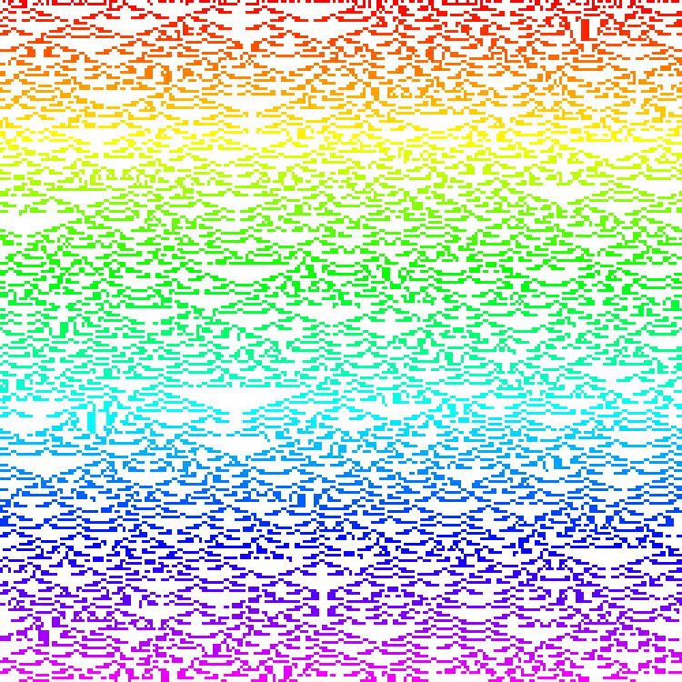
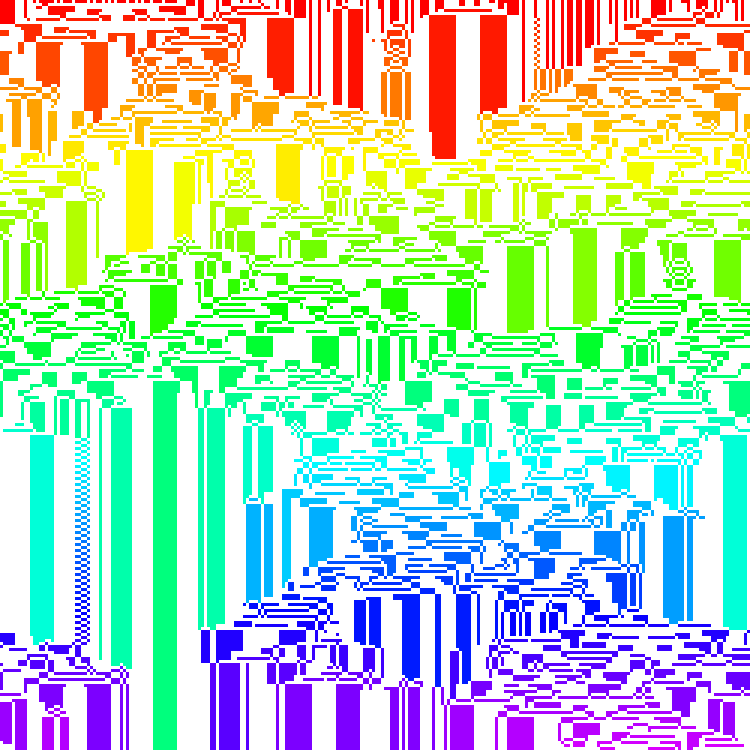
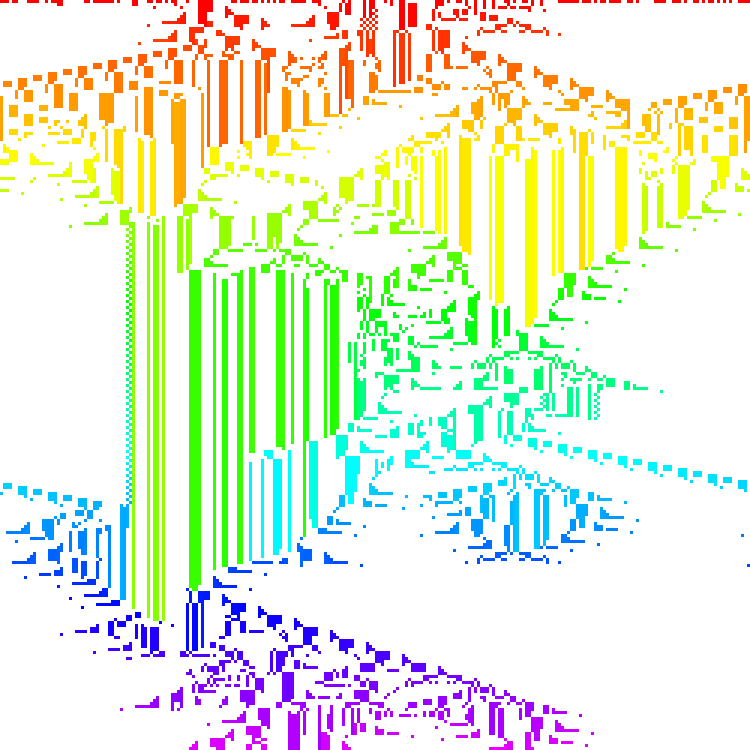
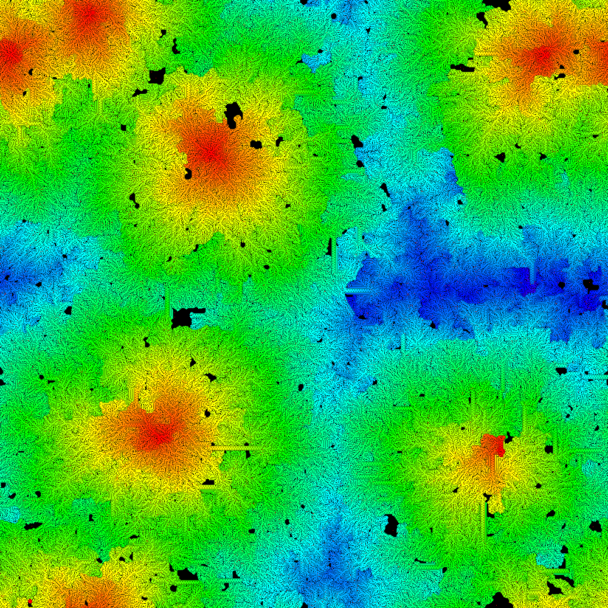
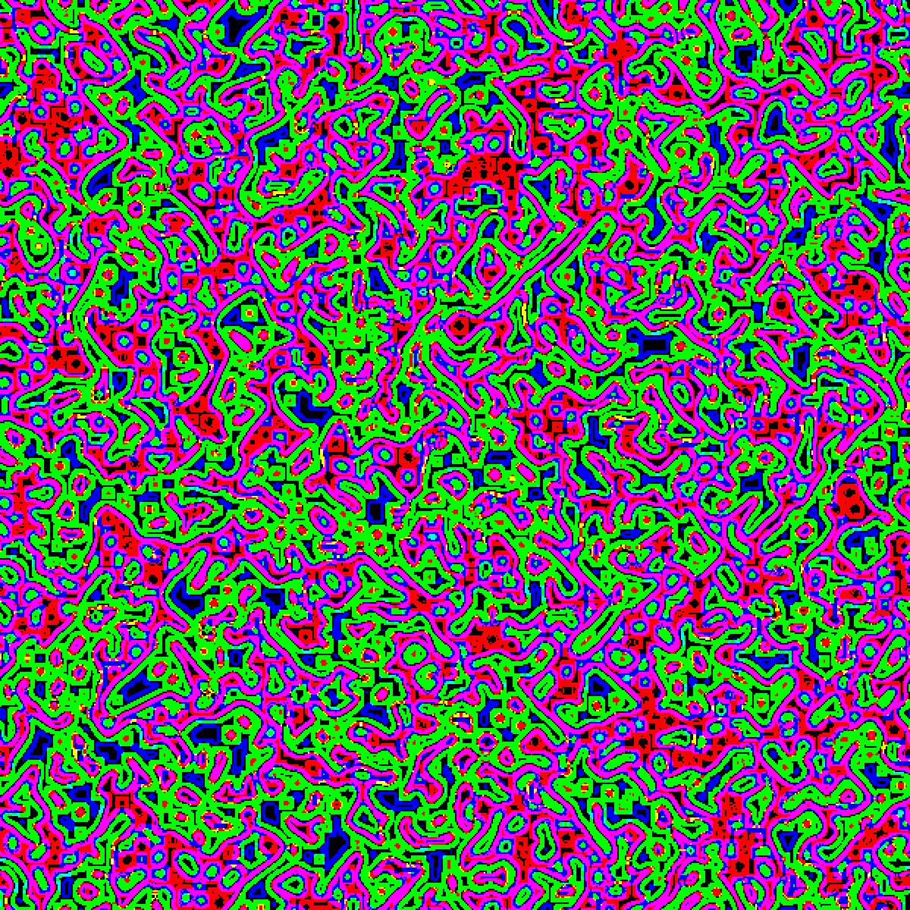
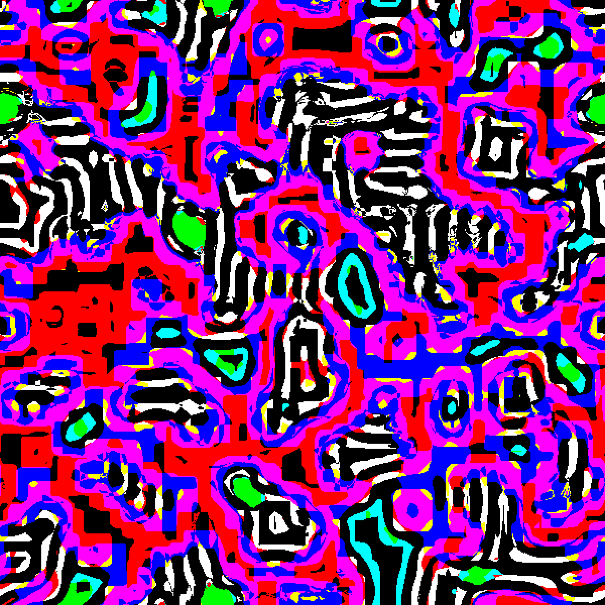
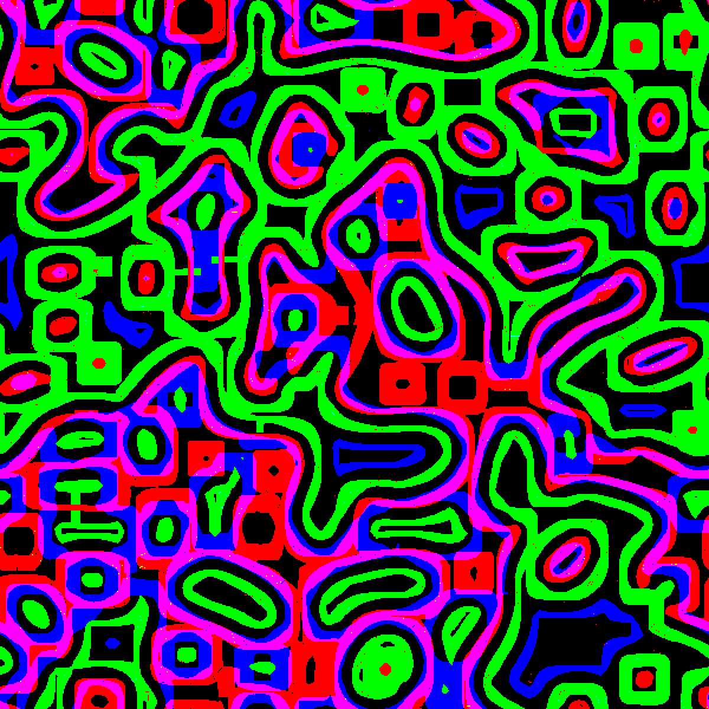
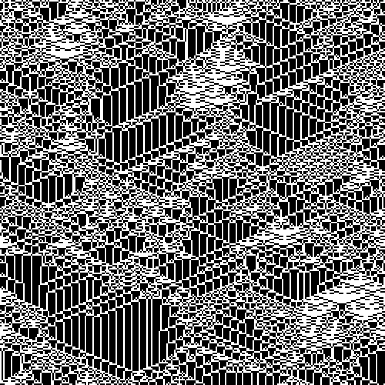
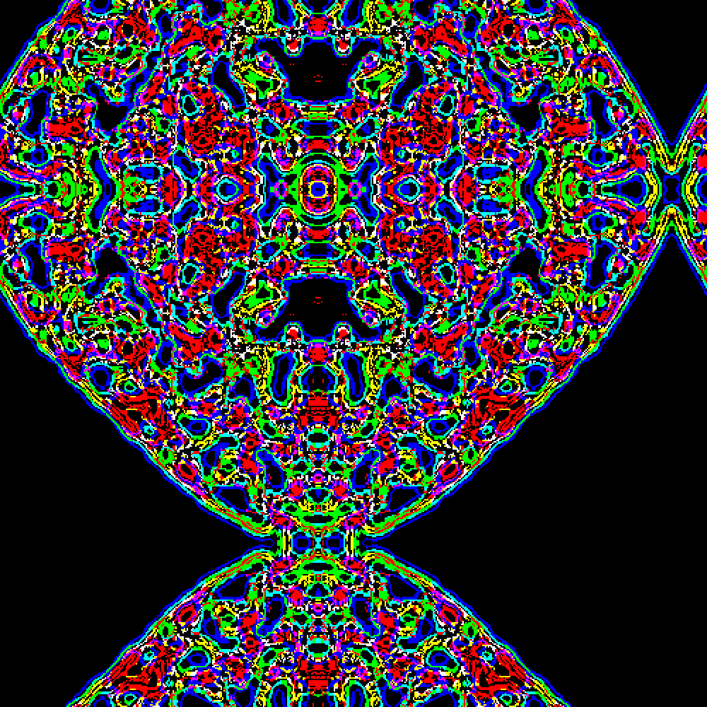

Cliff Reiter (reiterc@lafayette.edu)
{ .byline }

{ .lead-image }

Larger than life automata have been known for some decades. Recent examples in \[1\] triggered the author's interest into investigating them with J. These automata use rules that are a straightforward generalization of the rules for the Conway's Game of Life that was popularized by Gardner and others \[2-7\] and is likely the most widely known automaton.
{ .abstract }

## Section 1. Introduction

In general, an automaton is a process for updating an array of cells where each cell is in one of a finite number of states and updating is according to a rule based on local neighborhoods and that rule is applied to every neighborhood. General introductions include \[5-7\]. The Game of Life is a 2-dimensional automaton that evolves from generation to generation using the following rule on each 3 by 3 neighborhood: if the center cell is dead (0) then it becomes alive at the next generation if exactly 3 of its eight neighbors are alive; if the center cell is alive (1), then it remains alive if 2 or 3 of its eight neighbors are alive. A Larger than Life (LtL) automaton has five parameters: *r, a, b, c, d*. The radius *r* defines the size of the neighborhoods which are *2r+1* by *2r+1*. Let *s* denote the number of alive cells in an *2r+1* by *2r+1* neighborhood, including the center. Then a dead cell becomes alive when *a ≤ s ≤ b* and an alive cell remains alive if *c ≤ s ≤ d*. In this notation, the Game of Life is the LtL rule 1 3 3 3 4 automaton. Notice that LtL automata easily generalize to <em>n</em>-dimensional automata. In Section 2 we will consider the 1-dimensional case before turning to the more traditional 2-dimensional LtL automata.

In the 1990's and later David Griffeath and Kellie Evans investigated many LtL automata. Indeed, it was the topic of Evan's PhD thesis \[8\]. We will mention the particular LtL automata from \[1\] in Section 3 but the interested reader can find a wealth of material on their web pages \[9-10\] and in their publications \[11-15\].

## Section 2. One-dimensional Larger than Life Automata

We begin our implementation and examples with the one-dimensional version. We define `nl` to decide whether new life will appear and `rl` to decide if a cell should remain alive, then we use the center cell to decide which of those to apply to a local neighborhood. Thus, `lltl` applies this automata to a single neighborhood.

```
   'r a b c d'=.4 2 3 3 4

   nl=.(a&<: *. <:&b)@:(+/)

   rl=.(c&<: *. <:&d)@:(+/)

   cen=.r&{

   lltl=.nl`rl@.cen

   lltl 0 1 1 1 1 0 0 0 0
1
```

We load the *ltl.ijs* script from the *graphics/fvj4* addon. It in turn loads the *automata.ijs* which is designed for use with the author's text \[16\] and also loads the adverbs used in this note. We will use of some of the automata utilities. In particular, below we use `nperext` for periodic extension. We use `lltl;._3` to apply the local rule `lltl` to the *2r+1* sized tesselations. The periodic extension assures that the input and output are the same length. We iterate that `i.4` steps as an illustration.

```
   load '~addons/graphics/fvj4/ltl.ijs'

   (1+2*r)&(lltl;._3)@:(r nperext)^:(i.4) ?.20#2
0 1 0 1 1 0 0 1 1 1 0 0 0 0 1 0 0 0 1 0
0 1 0 1 0 0 0 0 1 1 0 0 1 1 0 1 1 1 1 1
0 0 0 1 1 0 1 1 1 1 0 0 0 0 0 0 0 0 0 0
1 1 1 1 0 0 0 0 0 1 0 1 1 0 0 0 0 0 0 0
```

We can see the adverb to build this tacit automaton and use it to build a larger image as follows.

```
   LtL1d
1 : 0
'r a b c d'=.m
nl=.(a&<: *. <:&b)@:(+/)
rl=.(c&<: *. <:&d)@:(+/)
cen=.r&{
lltl=.(nl`rl@.cen)
(1+2*r)&(lltl;._3 f.)@:(r nperext)
)

   b=:4 2 3 3 4 LtL1d^:(i.250) ?.250#2

   WB=:255,:0 0 0

   view_image WB;3 spix b
```

A common colouring scheme for two-dimensional LtL automata uses the time when a cell became alive. In order to accomplish that, our arrays will use 0 to denote a dead cell, but a positive entry specifies when the cell most recently became alive. We define a LtL automata adverb `LtL1dt` (note the "`t`") that temporarily marks new life with `_1` and reassembles the new and old with the appropriate step required. Note that the left tine of the hook in the final line will be called with arguments of the form:

`oldarray (((1+>./)@[*_1&=@])+(*1&=@])) temparray`

where `oldarray` is the input array and `temparray` has \_1 where there is new life, a 0 for a dead site, and a 1 if the cell remains alive. Note that since the original array had 1s in it, if a cell most recently became alive at iteration 3, the cell would be marked with a 4.

```
   LtL1dt
1 : 0
'r a b c d'=.m
nl=.(_1 * a&<: *. <:&b)@:(+/)
rl=.(c&<: *. <:&d)@:(+/)
cen=.r&{
lltl=.(nl`rl@.cen)
(((1+>./)@[*_1&=@])+(*1&=@])) (1+2*r)&(lltl;._3 f.)@:(r nperext)@:*
)

   4 2 3 3 4 LtL1dt^:(i.4) ?.20#2
0 1 0 1 1 0 0 1 1 1 0 0 0 0 1 0 0 0 1 0
0 1 0 1 0 0 0 0 1 1 0 0 2 2 0 2 2 2 1 2
0 0 0 1 3 0 3 3 1 1 0 0 0 0 0 0 0 0 0 0
4 4 4 1 0 0 0 0 0 1 0 4 4 0 0 0 0 0 0 0
```

Again we iterate this 250 steps on an initial random configuration of 250 cells with periodic boundaries we get the result seen in Figure 1. The colours in Figure 1 run from red to magenta according to the most recent time the cell became alive while dead cells are white (the palette `P254` gives those properties). Notice the triangular structures of dead cells seem to be ubiquitous. No cell stays alive for many steps, so there is a general, almost uniform, trend to run from red to magenta.

```
   b=:4 2 3 3 4 LtL1d^:(i.250) ?.250#2

   view_image P254;3 spix b
```

<figure markdown="1">

<figcaption markdown="span">Figure 1. The 4 2 3 3 4 LtL 1-D automaton.</figcaption>
</figure>

Next we consider 1-D LtL rule 10 2 6 8 12. The result (not using the standard random seed) is shown in Figure 2. Notice that many stable regions appear, at least for a time. There also are a few periodic regimes.

```
   b=:10 2 6 8 12 LtL1dt^:(i.250) ?250#2

   view_image P254; 3 spix b
```

<figure markdown="1">

<figcaption markdown="span">Figure 2. The 10 2 6 8 12 LtL 1-D automaton.</figcaption>
</figure>

As our last 1-D example in this section we consider LtL rule 7 3 3 4 6. The initial configuration is given by `0.5>?.250#0` (J8.05). Notice the stable and periodic configurations and the self replicating moving patterns.

```
   b=: 7 3 3 4 6 LtL1dt^:(i.250) 0.5>?.250#0

   view_image P254; 3 spix b
```

<figure markdown="1">

<figcaption markdown="span">Figure 3. The 7 3 3 4 6 LtL automaton.</figcaption>
</figure>

## Section 3. Two-dimensional Larger than Life Automata

Two-dimensional Larger than Life automata can be implemented using modest modifications to `LtL1d` and `LtL1dt`. In particular, we need square tesselations, we need to locate the center in ravel order, we need to extend periodically in two dimensions and we need sum over the square neighborhoods. The 2-D versions are `LtL` and `LtLt` depending on whether we keep track of the most recent time an alive cell became alive. The definition for `LtL` is shown, but the definition of `LtLt` is available in the script *ltl.ijs*.

```
   LtL
1 : 0
'r a b c d'=.m
nl=.(a&<: *. <:&b)@:(+/)
rl=.(c&<: *. <:&d)@:(+/)
cen=.(2*r*r+1)&{
lltl=.(nl`rl@.cen)@,
(2#1+2*r)&(lltl;._3 f.)@:(r nperext2)
)
```

As our first example we consider Griffeath's "Life without Death" \[15\]. Namely, LtL rule 1 3 3 0 9 with a very sparse initial conditions `0.005>?.1000 1000$0`. Not surprisingly, the alive region tends to expand. We can use `show_auto` to display progress or build a color final image. Expressions to accomplish those are shown below. Each of those takes several minutes. Alternately, an animation showing this time evolution is available at \[17\].

```
   VRAWH=:1000 1000

   n=:0.005>?.1000 1000$0

   1500 0 (1 3 3 0 9 LtL) show_auto n
0

   b=:1 3 3 0 9 LtLt^:1500 n

   P=:0,Hue 5r6*(i.%<:) >./,b

   view_image P; b
```

Figure 4 shows the result after 1500 time steps. Note that color denotes the last (which is here the same as first) time a cell becomes alive. Here we used a hue palette. Notice that for our 2-dimensional automata we have switched to using black for the dead cells.

<figure markdown="1">

<figcaption markdown="span">Figure 4. The 1 3 3 0 9 LtL automata.</figcaption>
</figure>

Griffeath's illustration \[15\] uses a brown palette with periodic changes in saturation that gives a beautiful botanical feel. Another striking LtL rule from Griffeath \[15\] is rule 13 10 100 100 320 where concentric rings of stable alternating alive and dead bands self-organize. Evans \[13\] shares rule 50 2834 3975 2834 5850 where the initial density of alive is between 56.4 and 58 percent gives rise to dramatic self-organized mazes. As mentioned earlier, many other examples appear in \[8-15\].

We now turn to some interesting 2-dimensional examples that we have discovered. The first we call scribble. It evolves bands of alive and dead regions with a significant portion of the cells alternating between alive and dead. However, nothing stays stable and the scribbles form and reform in new patterns.

```
   n=:?.600 600$2

   (+/%#),*b=:3 1 16 17 19 LtL^:100 n
0.3781

   P=:0,Hue 5r6*(i.%<:) >./,b

   view_image P;2 spix b
```

If you run that experiment, you will see magenta scribbles that cover about 38% of the image. If we make a frequency table we see that no cell has been alive for more than a few steps.

```
   ({.,#)/.~,b
  0 223884
101 130579
100   5115
 99    361
 98     48
 97     12
 96      1
```

Thus we turn to using a different visualization scheme. We compute three successive steps and then use the result to give an RGB value. Thus, a magenta cell would have been alive on the first and the last steps, but not the intermediate one. The result is shown in Figure 5.

```
   $N=:3 1 16 17 19 LtL^:(i. 3) * b
3 600 600

   view_image 2 spix 255*0|:N
```

<figure markdown="1">

<figcaption markdown="span">Figure 5. The 3 1 16 17 19 LtL automata: scribble.</figcaption>
</figure>

Thus we see that magenta and green almost complement each other which would mean that there is almost an oscillation. However, there are substantial regions of red and blue which break the oscillation. Note there are very few white pixels that represent life at all three steps. This kind of behavior seems to be fairly common.

Our next example is rule 15 10 160 160 420 which was inspired as a variant of Griffeath's rule 13 10 100 100 320. We initialize an array with about 45% alive cells and run one hundred iterations and combine three successive steps as in the previous illustration. The result is shown in Figure 6.

```
   n=:0.45>?.600 600$0

   N=:15 10 160 160 420 LtL^:(100+i.3) n

   view_image 2 spix 255*0|:N
```

<figure markdown="1">

<figcaption markdown="span">Figure 6. The 15 10 160 160 420 LtL automata: LtL 420.</figcaption>
</figure>

Notice the stable regions of black and white stripes. Cyan regions are the birth of stable regions. However, they are not long lived. The wandering magenta scribbles erase the stable regions and new stable regions emerge. We considered many varinats on this rule. In particular, rule 15 10 135 160 420 has much larger stable regions. An animation of the time evolution of that variant is available at \[17\]. Raising the lower bound for alive cells to remain alive slowly reduces the stable zone. Rule 15 10 160 391 420 is worth a look. Remarkably, we can take the bound all the way to 420. Figure 7 shows the result of the 15 10 160 420 420.

<figure markdown="1">

<figcaption markdown="span">Figure 7. The 15 10 160 420 420 LtL automata: LtL 420.</figcaption>
</figure>

Several variants of these 420 automata are available at \[17\].

## Section 4. Interesting Random LtL Automata

After experimenting with LTL automata in an ad hoc way, we paused to think about how one might look for interesting random examples. For both 1-dimensional and 2-dimensional LTL automata we picked a random radius between 1 and 9 or 10. Then we took 4 random numbers between 0 and around one quarter of the number of cells in a neighborhood. The partial sums of that list formed our remaining parameters. Then we ran small images and considered them interesting if they were not fixed or of a small period. In that case a larger version image was created. Several hundred were created for browsing. Some favorites are available at \[17\]. We share two here. Rule 3 1 3 5 6 in 1-dimension gives the image shown in Figure 8. This was initialized on 250 random cells with default (J8.05) random seed.

<figure markdown="1">

<figcaption markdown="span">Figure 8. The 1-dimensional 3 1 3 5 6 LtL automata.</figcaption>
</figure>

The 2-dimensional 5 20 31 33 47 LtL automaton is shown in Figure 9. It was initialized on a 500 by 500 random array with default seed. Yes, it has a perfect vertical and horizontal axis of symmetry up to the periodic boundary conditions. An animation of its time evolution is available at \[17\]. This striking result is an artifact of the fact that the thresholds are difficult for a uniform random array to satisfy. Thus, by the sixth iteration, only 20 cells are alive, the minimum for anything to be alive at the next step. The alive cells are in small patch: a 4 by 4 block with a pair of cells centered on top and bottom of the block. Thus, the symmetry arises at step 6.

<figure markdown="1">

<figcaption markdown="span">Figure 9. The 5 20 31 33 47 LtL automata on a random initial configuration.</figcaption>
</figure>

## References

1. Designing Beauty: the Art of Cellular Automata, eds, A. Adamatzky and G. J. Martinez, Springer, (2016).
2. M. Gardner, The fantastic combinations of John Conway's new solitaire game of life", Sci. Am. 223 4 (1970) 120-123.
3. M. Gardner, On cellular automata, self-replication, the Garden of Eden and the game life", Sci. Am. 224 4 (1971) 112-117.
4. E. R. Berlekamp, J. H. Conway and R. K. Guy, Winning ways for your mathematical plays, vol 2, Academic Press, 1982.
5. A. Ilachinski, Cellular Automata: a Discrete Universe, World Scientific, (2001).
6. J. L . Schiff, Cellular Automata: a Discrete View of the World, Wiley, Inc., (2008).
7. S. Wolfram, A New Kind of Science, Wolfram Media, (2002).
8. K. M. Evans, PhD thesis, Larger than Life: it's so nonlinear,  [http://www.csun.edu/~kme52026/thesis.html](http://www.csun.edu/~kme52026/thesis.html)
9. K. M. Evans, Web page  [http://www.csun.edu/~kme52026/](http://www.csun.edu/~kme52026/).
10. D. Griffeath, Primordial Soup Kitchen,  [http://psoup.math.wisc.edu/welcome.html](http://psoup.math.wisc.edu/welcome.html).
11. K. M. Evans, Larger than life: threshold-range scaling of Life's coherent structures, Physica D; Nonlinear Phenomena 183 (2003) 45-67.
12. K. M. Evans, Larger than Life's invariant measures, Electronic Notes in Theoretical Computer Science, Vol. 252 (2009) 55-75. Gallery of Images:  [http://www.csun.edu/~kme52026/invariant.html](http://www.csun.edu/~kme52026/invariant.html)
13. K. M. Evans, Larger than Life, pp 27-34, in \[1\].
14. D. Griffeath, Self-organization of Random Cellular Automata: Four snapshots. In: Probability and Phase Transitions, 49-67, Springer (1994).
15. D. Griffeath, Self-organizing two-dimensional cellular automata, pp 1-12, in \[1\].
16. C. A. Reiter, Fractals, Visualization and J, 4th edition, lulu.com, Part 1 (2016), Part 2, (2017).
17. C. Reiter, Auxilary Materials for Larger than Life Automata,  [http://webbox.lafayette.edu/~reiterc/j/vector/ltl/index.html](http://webbox.lafayette.edu/~reiterc/j/vector/ltl/index.html)
