

# The Vector Archive

The [British APL Association](https://britishaplassociation.org) published its journal *Vector* in print and online between 1984 and 2022.

The complete archive is here recovered from multiple sources and published online in a form legible to search engines and AI agents, most of it for the first time.

| volume | years | N°1 | N°2 | N°3 | N°4 |
|:------:|:-----:|:---:|:---:|:---:|:---:|
| [1](1/) | 1984–1985 | [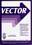](1/#n1-may-1984) |  | [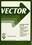](1/#n3-january-1985) |  |
| [2](2/) | 1985–1986 |  | [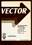](2/#n2-october-1985) |  | [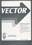](2/#n4-april-1986) |
| [3](3/) | 1986–1987 |  |  |  | [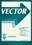](3/#n4-april-1987) |
| [4](4/) | 1987–1988 | [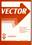](4/#n1-july-1987) |  | [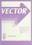](4/#n3-january-1988) |  |
| [5](5/) | 1988–1989 | [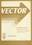](5/#n1-july-1988) |  |  | [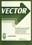](5/#n4-april-1989) |
| [6](6/) | 1989–1990 |  | [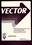](6/#n2-october-1989) |  |  |
| [7](7/) | 1990–1991 | [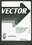](7/#n1-july-1990) | [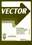](7/#n2-october-1990) | [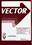](7/#n3-january-1991) | [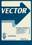](7/#n4-april-1991) |
| [8](8/) | 1991–1992 | [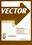](8/#n1-july-1991) | [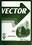](8/#n2-october-1991) | [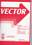](8/#n3-january-1992) | [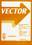](8/#n4-april-1992) |
| [9](9/) | 1992–1993 |  | [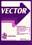](9/#n2-october-1992) | [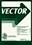](9/#n3-january-1993) | [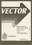](9/#n4-april-1993) |
| [10](10/) | 1993–1994 | [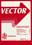](10/#n1-july-1993) | [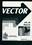](10/#n2-october-1993) | [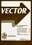](10/#n3-january-1994) | [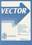](10/#n4-april-1994) |
| [11](11/) | 1994–1995 | [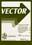](11/#n1-july-1994) |  | [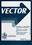](11/#n3-january-1995) | [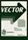](11/#n4-april-1995) |
| [12](12/) | 1995–1996 |  |  | [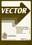](12/#n3-january-1996) | [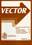](12/#n4-april-1996) |
| [13](13/) | 1996–1997 |  | [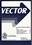](13/#n2-october-1996) | [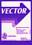](13/#n3-january-1997) | [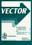](13/#n4-april-1997) |
| [14](14/) | 1997–1998 | [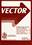](14/#n1-august-1997) | [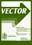](14/#n2-october-1997) | [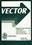](14/#n3-january-1998) |  |
| [15](15/) | 1998–1999 |  |  |  |  |
| [16](16/) | 1999–2000 |  |  | [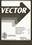](16/#n3-january-2000) | [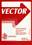](16/#n4-april-2000) |
| [17](17/) | 2000–2001 | [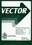](17/#n1-july-2000) |  | [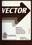](17/#n3-january-2001) | [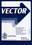](17/#n4-april-2001) |
| [18](18/) | 2001–2002 | [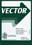](18/#n1-july-2001) | [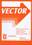](18/#n2-october-2001) | [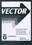](18/#n3-january-2002) | [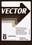](18/#n4-april-2002) |
| [19](19/) | 2002–2003 |  | [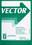](19/#n2-october-2002) |  | [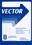](19/#n4-april-2003) |
| [20](20/) | 2003–2004 |  |  | [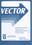](20/#n3-january-2004) |  |
| [21](21/) | 2004–2005 | [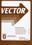](21/#n1-september-2004) |  | [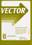](21/#n3-may-2005) |  |
| [22](22/) | 2005–2006 |  |  |  |  |
| [23](23/) | 2008 |  |  | [23:3](23/#n3-june-2008) |  [23:4.1](23/#n41-september-2008) |
| [24](24/) | 2008–2010 |  |  |  |  |
| [25](25/) | 2011–2012 |  |  |  |  |
| [26](26/) | 2013–2016 |  |  |  |  |
| [27](27/) | 2016–2022 | [27:1](27/#n1-20162022) |  |  |  |

## Published online only

- [BAA meeting, 20 May 2016: talks](art10501780/) (2016-05-20)

## In press, never printed

- [APL Germany Autumn Meeting](art10501790/), Stephen Taylor (2018-10-14)
- [Finding text in files](art10501800/), Dan Baronet (2019-04-12)
- [Reflections on Langlet’s APL Theory of Human Vision](art10501810/), Stuart Smith (2019-05-29)
- [Making images and videos of the Buddhabrot](art10501820/), Nicolas Delcros (2019-05-30)
- [APLX is out, long live APL](art10501830/), Dan Baronet (2019-05-30)
- [TAO Axioms](art10501840/), Adám Brudzewsky, Jay Foad, Roger Hui (2019-07-05)
